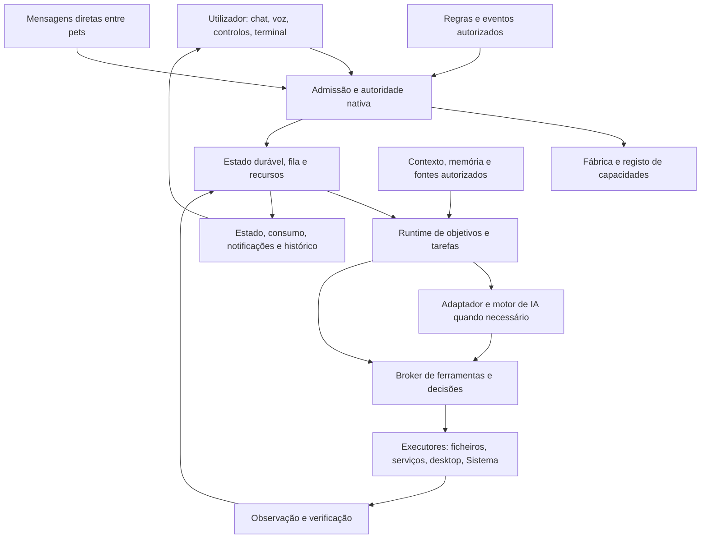

# Arquitetura desejada completa do fork Coucou

Documento de revisão do produto — **25/10/2026**. Descreve o destino do fork. As expressões «deve», «permite» e «o sistema» neste documento definem o comportamento pretendido; a implementação observada está discriminada em [ESTADO-E-PLANO.md](ESTADO-E-PLANO.md). O [objetivo literal](OBJETIVO-INTEGRAL.md) e os [43 requisitos](REQUISITOS-E-ACEITACAO.md) fazem parte deste contrato.

## 1. Objetivo do fork

Transformar os pets em assistentes digitais de IA persistentes, autónomos, cooperativos e úteis no dia a dia. Cada pet deve manter identidade, contexto, sessões, memória, capacidades e objetivos próprios. O utilizador pode falar diretamente com qualquer um, atribuir-lhe um objetivo, acompanhar a execução, responder a decisões e parar o trabalho. Os pets também podem comunicar e dividir trabalho autorizado entre si.

O produto integra conversa, execução, fontes pessoais e controlo do computador numa experiência desktop. A figura animada e a ilha são superfícies de acesso ao assistente. A responsabilidade pelo trabalho, pela autorização e pela recuperação pertence ao backend.

«Sempre disponível» depende de a infraestrutura necessária estar operacional. O runtime pode receber eventos e executar operações determinísticas sem manter um modelo carregado. Um motor offline não apaga o pet. Um computador desligado não executa tarefas; a política de ocorrências perdidas e de retoma deve tratar esse período explicitamente.

A ordem de prioridade é arquitetura e contratos, desenvolvimento dos pets, cooperação e integrações segundo as dependências. Frontend e UX recebem apenas trabalho necessário a capacidades, aprovações, preservação e entrega. Aperfeiçoamentos de aparência permanecem adiados até nova indicação.

## 2. Resultados do dia a dia

| Situação | Comportamento esperado |
| --- | --- |
| «Prepara o meu dia» | Consultar os calendários e fontes autorizados, distinguir atualidade e falha parcial, apresentar compromissos e prioridades com origem identificável. |
| «Trabalha neste objetivo» | Registar intenção e critérios, propor ou executar um plano limitado, usar ferramentas permitidas, verificar os resultados e conservar progresso. |
| Fechar a conversa | Conservar o trabalho e a sua origem; a atividade de background não troca a conversa ou o rascunho visíveis. |
| Reiniciar ou perder ligação | Recuperar estado, distinguir trabalho ainda ativo de efeito incerto e pedir a retoma necessária sem repetir ações. |
| Entregar vários ficheiros | Acrescentar à coleção da conversa, selecionar o conjunto de cada turno, conservar proveniência e permitir gestão de retenção. |
| Pedir algo por voz | Identificar pet, intenção e âmbito, partilhar os mesmos contratos e decisões do chat e permitir interrupção imediata. |
| Criar uma rotina | Definir regra, fontes, gatilho, concessões, limites e notificações; executar enquanto o backend e os recursos o permitirem. |
| Controlar o computador | Usar a operação autorizada no alvo exato, preservando autenticação nativa e verificando o efeito. |
| Dividir trabalho entre pets | Delegar subtarefas com orçamento e contexto próprios, sem transferir permissões implicitamente. |
| Consultar estado e consumo | Mostrar o que corre, espera, falhou ou concluiu; separar sessões, clientes, terminais, tokens e quota com cobertura explícita. |

Uma resposta convincente do modelo não comprova execução. O utilizador deve conseguir distinguir proposta, decisão, comando enviado, resultado observado e critério efetivamente satisfeito.

## 3. Âmbito completo e funcionalidades a preservar

O fork aproveita o Coucou existente. Preserva a ilha, o acesso aos pets, conversas, configurações, sessões, integrações e os restantes módulos úteis, evoluindo-os pelos contratos comuns. Não há autorização arquitetural para apagar funcionalidades antigas apenas porque a substituição é mais recente.

| Área | Papel no sistema completo |
| --- | --- |
| Pets e ilha desktop | Identidade visível, atividade, acesso direto, chat compacto/flutuante, gestão, notificações e ligação a janelas. |
| Assistentes de código e terminais | Observar sessões, continuar as suportadas, responder a decisões e preservar ferramentas, sandbox, projetos e MCP nativos. |
| Conversa local e API | Conversar com o modelo configurado, processar os tipos de conteúdo suportados e respeitar custo, limites e privacidade. |
| Objetivos e tarefas | Execução durável, planeamento limitado, ferramentas, provas, recuperação, histórico e controlo humano. |
| Contexto e memória | Anexos múltiplos, fontes inscritas, notas, preferências, contexto de projeto e informação derivada com proveniência. |
| Proatividade | Regras de horário/evento, preparação diária, acompanhamento e notificações deduplicadas. |
| Sistema e multimédia | Som, música, rede, Bluetooth, ecrã, energia, sessão e componentes reais, com operações partilhadas entre controlos e pets. |
| Voz, ditado e notas | STT/TTS, comando, diálogo, interrupção e decisões; preservar gravações/notas e falhas de persistência de módulos existentes. |
| Serviços | Operações de cada integração, autenticação e eventual assistência por IA, mantendo o dono próprio. |
| Telemóveis e relay | Preservar protocolos existentes de ligação/estado/decisões nas plataformas suportadas, com emparelhamento, revogação e capacidades negociadas. |
| Personalização | Preservar aparência, animações, sons, roupa, atalhos e preferências já suportados; evolução visual fica adiada. |
| Entrega | Instalação reproduzível, migração, backups, autostart, reinício, observabilidade e rollback compatível. |

As especificações upstream de macOS, iPhone, Android e relay são incluídas nas [fontes](fontes/README.md). Uma função upstream não se torna automaticamente funcional em Linux. O inventário de preservação identifica plataforma, configuração, suporte efetivo e percurso por aceitar. Qualquer extensão de controlo remoto das novas capacidades exige contrato próprio; emparelhar um telefone não concede acesso global.

Só o pet GitHub enquanto entidade está temporariamente descontinuado. Os seus dados são preservados. Gravity e Copilot CLI continuam no âmbito. Uma integração de GitHub usada como ferramenta por um agente autorizado é distinta dessa entidade retirada.

## 4. Arquitetura por camadas

O alvo é a evolução modular do backend desktop existente. O código Linux/Windows reside na aplicação Tauri com núcleo Rust e superfícies TypeScript; os módulos de outras plataformas mantêm os contratos aplicáveis. Não é necessário reconstruir o projeto AI Local multirepo nem criar microserviços para obter autonomia.

| Componente | Responsabilidade |
| --- | --- |
| Fábrica | Construir descritores e defaults comuns sem copiar autoridade ou apagar personalizações. |
| Registo de capacidades | Publicar suporte, disponibilidade, configuração, origem, frescura e motivo por operação. |
| Autoridade/admissão | Capturar dono e intenção, conferir política, dados, destino e orçamento, persistir a autorização exata. |
| Repositórios | Estado versionado, revisões concorrentes, exclusão de escritores, recuperação e publicação coerente. |
| Fila/agendador | Prioridade, justiça, dependências, prazos, recursos físicos e ocorrências. |
| Runtime | Objetivo, plano, passos, progresso, decisões, cancelamento, recuperação e conclusão. |
| Adaptadores | Traduzir o contrato comum para o protocolo e as limitações de cada motor/serviço. |
| Broker | Operações tipadas e decisões exatas, incluindo o canal nativo quando existe. |
| Executores | Interagir com alvos reais, gerir concorrência e recolher processos próprios. |
| Verificação | Comparar observações com pós-condições e emitir recibos com proveniência. |
| Contexto | Selecionar apenas dados autorizados para a tentativa/destino em causa. |
| Cooperação | Entregar mensagens e delegações duráveis com correlação e limites, reutilizando o runtime. |
| Superfícies | Mostrar estado e recolher intenções/decisões; não fabricar permissões. |

A comunicação local tem limites de tamanho, prazo e admissão. Argumentos IPC e texto do modelo são entradas a validar. A autoridade é derivada pelo backend do caller nativo e das concessões aplicáveis.

## 5. Independência de cada pet

Há três entidades distintas: **pet**, **runtime persistente** e **motor de IA**. Nome, desenho e modelo podem mudar sem alterar o dono dos dados ou do trabalho. A execução determinística e a receção de eventos não precisam de inferência contínua.

Cada pet mantém identidade estável, configuração, contexto, sessões, memória e objetivos. Um adaptador partilhado é código reutilizado. Uma conta física eventualmente partilhada é um recurso cuja concorrência se gere. Nenhuma dessas partilhas funde os diálogos ou as permissões de Gravity, Copilot, Codex ou dos pets de serviço.

A fábrica aplica melhorias comuns a todos os pets compatíveis. Resolve base, molde, extensão e override da identidade. Identidade/provider, nomes/aliases, acessos e execução local são escolhas protegidas por pet. Uma atualização comum não ativa uma permissão nova nem sobrescreve uma escolha pessoal. A matriz detalhada está em [PETS-E-CONTRATOS.md](PETS-E-CONTRATOS.md).

Um observador pode mostrar atividade sem conseguir conversar ou controlar a sessão observada. Promovê-lo a assistente exige adaptador, contrato, configuração, ferramentas, cancelamento e provas; mudar uma linha de catálogo não basta. Os pets de serviço mantêm as operações determinísticas mesmo quando a assistência por IA está indisponível.

## 6. Identidades e contratos transversais

| Identidade | Significado |
| --- | --- |
| PetId | Dono lógico persistente; não deriva do nome/modelo. |
| ConversationId | Conversa local e âmbito de dados; não é o ID da sessão do provider. |
| NativeSessionId | Sessão canónica reconhecida pelo adaptador, com origem e associação verificadas. |
| TurnId / AttemptId | Turno solicitado e tentativa concreta de inferência, respetivamente. |
| GoalId / TaskId / StepId | Objetivo, trabalho e passo com critérios, autoridade e recibos próprios. |
| RuleId / OccurrenceId | Regra configurada e ocorrência deduplicável. |
| GrantId / ApprovalId | Concessão e decisão sobre uma proposta exata. |
| ArtifactId / SourceId / MemoryId | Cópia de conteúdo, fonte inscrita e memória com revisão e proveniência. |
| MessageId / CorrelationId | Entrega entre pets e cadeia causal de comunicação. |

Antes de esperar por recursos ou respostas, o pedido captura pet, conversa, sessão, turno, modelo, configuração/política, origem, dados e prazo. Trocar a vista ou o pet visível não altera esse pedido. Um resultado atrasado volta ao dono original ou é classificado como obsoleto.

O descritor de capacidades é versionado. Cada capacidade distingue implementação, suporte observado, configuração, disponibilidade, frescura e motivo de recusa. A condição efetiva é:

`implementação ∩ suporte do destino exato ∩ configuração ∩ permissões ∩ política do trabalho ∩ orçamento e recursos`.

Não há fallback silencioso de provider, conta, modelo, workspace ou sessão. O registo é uma projeção informativa; a fronteira de execução volta a validar as condições relevantes antes do efeito e durante trabalho cancelável.

## 7. Conversas, sessões, terminais e paridade nativa

O chat do pet deve conservar as capacidades que o agente original realmente expõe: ficheiros, projetos, comandos, ferramentas/MCP, modelos, sandbox e decisões. Isto aplica-se às rotas suportadas e autorizadas pelo protocolo e perfil nativos. O produto deve mostrar uma limitação quando a sessão/protocolo não permite uma operação.

O sistema distingue processo cliente, terminal/TTY, sessão nativa e conversa local. Três processos não provam três terminais nem três trabalhos ativos. A observação usa identidade e continuidade do processo, origens conhecidas, timestamps e cobertura. Quando o estado não pode ser comprovado, mostra «desconhecido».

A descoberta de uma sessão por PID, título ou pasta não autoriza a controlá-la. A associação precisa de uma identidade nativa inequívoca. Retomar conserva sessão e workspace originais; uma preferência incompatível é recusada antes do prompt. Criar uma conversa nova é uma transição explícita que preserva o arquivo anterior.

Chat, voz e terminal acompanham o mesmo pedido de decisão quando o protocolo o permite. A decisão identifica sessão, turno, callId, operação, argumentos, alvo, política e prazo. A primeira resposta válida resolve o pedido uma vez e invalida as outras representações. Um «sim» sem contexto não escolhe outra aprovação. Um timeout ou uma reconexão não reaplica uma decisão.

Uma CLI que suporta conversa manual pode ainda não oferecer limites internos suficientes para autonomia controlada. O dispatcher de objetivos não a ativa apenas por conseguir enviar prompts: tem de conseguir limitar execução, ferramentas, custo, tempo, efeitos e recuperação. Até existir prova, essa capacidade permanece indisponível, preservando a conversa manual e as decisões nativas suportadas.

## 8. Autorização, dados e modos de autonomia

O utilizador pode manter um pet manual, assistido, autorizado para objetivos limitados ou proativo por regras. Os nomes dos modos são apresentação; a autoridade efetiva reside em concessões versionadas. Uma concessão especifica pet, operações, recursos, restrições de argumentos, dados/destino, validade, limites e revisão de política.

Há decisões diferentes para usar dados, executar uma ferramenta, autorizar um objetivo, ativar uma regra ou permitir um envio externo. Uma seleção de memória num turno não autoriza rondas autónomas. Ativar Sistema não concede todas as componentes. Uma ferramenta descoberta por MCP não fica automaticamente autorizada.

A aprovação de comando livre vincula comando, executável, pasta, tarefa e prazo. Uma receita automática tem versão, argumentos tipados, recursos e verificação definidos; não equivale a uma shell genérica. A política nativa do provider/SO continua aplicável, incluindo prompts que só o canal original consegue resolver.

Anexos, páginas, calendários, emails, memória recuperada e respostas de outros pets são dados não fiáveis. Não criam concessões, não alteram políticas e não autorizam plugins ou delegações. O sistema separa o conteúdo do modelo das decisões de controlo.

Revogar impede novos efeitos e novas utilizações de dados; invalida decisões pendentes e resultados tardios como autoridade. Efeitos já iniciados exigem classificação e reconciliação. Stop não promete desfazer o que já aconteceu. Credenciais permanecem nos mecanismos nativos/locais apropriados, fora de prompts, histórico, argumentos de processo, logs e Git.

## 9. Objetivos, tarefas e execução

Um objetivo guarda intenção original, pet responsável, critérios verificáveis, contexto autorizado, política, limites, prazo, plano revisionado, tarefas, passos, tentativas, consumo e evidências. A conversa de background é dedicada ou uma associação explicitamente escolhida. O journal resumido do chat não é a fonte completa do runtime.

O ciclo comum é: receber intenção; preparar contexto e prontidão; rever a proposta e concessões necessárias; persistir admissão; entrar na fila; obter recursos; planear dentro dos limites; executar passos; verificar; atualizar progresso; concluir ou parar com motivo. Falhas e decisões são estados duráveis, não apenas animações.

| Estado lógico | Significado |
| --- | --- |
| Na fila / à espera de recurso | Admitido, ainda sem recurso físico disponível. O prazo continua a contar. |
| A executar | Passo ativo sob um dono e uma reserva. |
| À espera de decisão/informação | Pedido exato pendente; não é conclusão nem autorização tácita. |
| Em verificação | Existe saída/efeito que precisa de observação independente. |
| Pausado | Suspensão explicitamente pedida, com política de retoma. |
| Interrompido / recuperação necessária | Processo perdido, publicação parcial ou efeito incerto por reconciliar. |
| Concluído | Critérios satisfeitos por evidência e pendências resolvidas. |
| Falhou / cancelado | Motivo terminal e alcance real da limpeza registados. |

Cada passo declara entrada, alvo, recursos, operação, pós-condição, prazo, forma de verificação e política de repetição. Repetir texto ou confiança não é progresso. Repetição do mesmo erro/plano sem evidência nova faz reduzir o plano dentro da concessão, pedir informação ou terminar com motivo. Há limites de ciclos, tentativas, saída, ferramentas, tempo e custo.

A admissão e a intenção do efeito são duráveis antes de executar. Se a gravação falha, não se inicia um novo efeito. Se a execução já produziu algo e a persistência falha depois, conserva-se o resultado conhecido e a incerteza; não se sugere reenviar automaticamente.

## 10. Fila, recursos e orçamentos

O controlo de recursos é comum a chat manual, objetivos, regras e delegações. Recursos incluem sessão/conta/provider, modelo/instância, dispositivo, aplicação, ficheiro e componente de Sistema. Reservas físicas duram até ao fim efetivo do worker e à recolha dos filhos próprios, mesmo quando a UI já recebeu cancelamento.

O agendador deve evitar que uma rotina monopolize o motor ou bloqueie decisões e Stop. Define prioridades, justiça, concorrência e prazo, preservando trabalhos independentes. Modelos descarregados ou serviços ocupados levam a espera explícita dentro do prazo, sem troca silenciosa de motor.

Os orçamentos distinguem limite admitido, reserva antes do IO, consumo observado, consumo desconhecido e saldo disponível. Tokens/custo ausentes não são zero. Não se renova orçamento ao reiniciar, perder ACK ou mudar o controlador. Uma continuação que exige orçamento adicional recebe revisão própria ligada ao objetivo original.

O corpo real do pedido, incluindo contexto autorizado, deve estar fechado antes do hash e da reserva da tentativa. O recibo associa a chamada ao modelo, destino, entrada, limites e autorização exatos. Conteúdo acrescentado depois da revisão não pode entrar na inferência como se tivesse sido aprovado.

## 11. Ferramentas, computador e verificação

O broker publica operações tipadas e versionadas. Cada operação declara efeito, argumentos, alvo, permissões, prazo, recursos, cancelamento, repetição e verificação. O executor volta a conferir a autoridade e o alvo antes da mutação. Origem nativa e nomes de ferramentas são vinculados ao pedido para impedir substituição por conteúdo do modelo.

A ordem preferida de interação é CLI, API local e acessibilidade quando permitem verificar o resultado. O controlo visual exige observar a janela exata antes de agir e observar depois. Coordenadas pertencem ao alvo capturado. Uma sessão bloqueada ou sem suporte gráfico tem limitação explícita. O sucesso de um comando de clique não prova o efeito na aplicação.

Em serviços e Sistema, alvos opacos e revisões substituem nomes ambíguos como autoridade. O executor distingue pedido aceite, comando despachado, ACK, saída e estado efetivo observado. Recibos conservam origem, momento, alvo e cobertura. Efeitos sem confirmação ficam incertos, sem repetição automática para «ver se funciona».

Receitas como play/pause/volume são unidades pequenas com limites e pós-condições próprias. Uma permissão de música não autoriza todo o áudio. Uma operação de rascunho não envia email. A eventual capacidade de envio precisa de destinatários/canal/limites e autorização próprios.

## 12. Recuperação, concorrência e continuidade

Um único dono controla cada tentativa/efeito. Leases, revisões, locks, reservas e proveniência impedem dois workers de executar o mesmo passo. Um lease expirado não prova que o processo físico terminou. A recuperação não inicia outro efeito enquanto a posse anterior ou a limpeza continuarem incertas.

Após crash, reconciliar os registos de intenção, autorização, claim, chamada, recibo e publicação. Um ACK perdido pode significar operação concluída. Não inferir ausência de efeito a partir de ausência de resposta. Uma saída já durável pode ser publicada/consultada sem repetir a inferência. Uma operação incerta permanece no histórico original.

Retoma e continuação mantêm objetivo, critérios, consumo e causalidade. Quando necessário, uma nova admissão referencia a anterior e inclui orçamento adicional e efeitos desconhecidos explicitamente revistos. Não se apagam recibos selados nem se reconstrói uma aprovação humana que se perdeu.

Abrir um catálogo, listar objetivos, migrar ficheiros ou arrancar a UI não lança trabalho. A ativação de regras e a política de retoma são decisões separadas. O backend deve tratar suspensão do computador, perda do provider, mudança de configuração, revogação de dados e processo não recolhido sem duplicar ações.

## 13. Contexto, anexos e memória

O contexto de cada tentativa contém o mínimo relevante: conversa, intenção, passos verificados, fontes, artefactos e memória autorizados. Um contentor físico comum de conversas não é contexto global de todos os pets.

Anexos formam uma coleção por conversa, com IDs estáveis, ordem, revisão, proveniência e pertença. Adicionar outro ficheiro ou pasta acrescenta à coleção em vez de substituir o anterior. Cada turno captura um conjunto imutável antes do IO; entregas posteriores não o alteram. Ficheiros com o mesmo nome não são fundidos por esse nome.

A extração tem limites de quantidade, bytes, formatos, tempo e tokens e declara cobertura parcial. Não se promete que o modelo leu todos os bytes porque há um anexo no histórico. Selecionar, retirar seleção, revogar leitura, apagar conversa e eliminar cópia são operações diferentes. Cópias referenciadas ou com recuperação pendente não são limpas como lixo.

A memória inclui preferências/notas, contexto de projeto, episódios, resumos/derivados e partilha autorizada. Cada item tem dono/âmbito, origem, revisão, sensibilidade, validade e retenção. Um derivado conserva referências às fontes e é invalidado quando estas são corrigidas, revogadas ou eliminadas, conforme a política. Um resumo não ganha autoridade nem substitui a fonte como prova.

A recuperação começa por seleção estruturada/lexical e referências exatas; pesquisa vetorial é uma opção futura com benefício medido. Os dados são apresentados para revisão com destino e âmbito de uso. A autorização para um turno, uma sessão CLI e um objetivo é distinta. Uma sessão nativa já recebeu dados e pode retê-los: revogar bloqueia nova utilização pela app, mas não promete apagar o conhecimento ou os logs do fornecedor.

O [documento de dados](DADOS-MEMORIA-E-FONTES.md) detalha armazenamento atual, seleção, revogação e migração. Memória automática e partilhada não se consideram prontas só porque existem APIs CRUD de notas.

## 14. Fontes pessoais e informação externa

Um anexo entregue pontualmente é diferente de uma fonte persistente inscrita. A inscrição define fonte, dono, operações, revisão, validade, frescura e cobertura. Autorizações por conversa não se alargam automaticamente ao pet, objetivo ou regra.

ICS é um ficheiro/exportação de calendário. Importá-lo não cria sincronização de conta nem capacidade de escrever eventos. Vários calendários requerem seleção explícita da coleção, fuso validado e proveniência por evento. A consulta distingue ausência de compromissos de falha/atraso de leitura.

RSS e IMAP são adaptadores próprios com limites antes de materializar conteúdo: destinos, TLS, redirecionamentos, bytes, tempo, número de mensagens e pastas. IMAP começa por leitura autorizada; não implica envio, eliminação ou acesso a outras pastas. Credenciais ficam fora do modelo. Informação externa pode conter instruções hostis e nunca altera a política.

Os conceitos úteis do AI Local descontinuado são reutilizados de forma seletiva: leituras limitadas, proveniência, orçamento, controlo de progresso, recursos e execução isolada. As limitações desse código ficam preservadas na avaliação; não se copia todo o stack nem as suas bases, modelos ou credenciais.

## 15. Regras, agendamento e proatividade

Uma regra guarda dono, revisão, gatilho, fontes, ações/receitas, concessões, limites, validade e política de notificação. O utilizador pode ativar, desativar e rever. Conteúdo externo ou uma conversa informal não inscrevem uma regra sem a decisão necessária.

Cada ocorrência tem identidade estável e deduplicação. O agendador trata fuso IANA, mudança da hora, suspensão, offline e ocorrências perdidas. A política escolhe ignorar, agregar ou pedir decisão, em vez de executar uma sequência atrasada sem limite. Um evento duplicado não produz dois efeitos.

A preparação diária é o primeiro cenário de ponta a ponta: calendários escolhidos, informação atual, falha parcial explícita, resumo com origem e uma notificação dentro do horário. O acompanhamento de projetos verifica progresso, pede decisões quando bloqueado e respeita orçamento e silêncio. Notificações têm validade, limites, deduplicação e conteúdo sensível reduzido; a indisponibilidade não provoca spam nem mudança de canal/conta.

## 16. Comunicação e cooperação entre pets

O utilizador chama qualquer pet diretamente. Pets podem comunicar diretamente e trabalhar em paralelo. Ollama é o coordenador global preferencial configurável, com visão autorizada de objetivos, prioridades, estados e capacidades. Coordenação é uma capacidade, não uma dependência de todas as mensagens. O sistema mantém trabalhos independentes quando o coordenador ou um motor falha.

O protocolo comum cobre descoberta, mensagem, pedido, resposta, delegação, evento, resultado e acompanhamento. O envelope inclui versão, MessageId, origem/destino autenticados, correlação/causa, objetivo/tarefa, artefactos autorizados, prazo, idempotência e limites. Receção, aceitação, execução e conclusão são fases diferentes. Reutilizam-se o estado durável, CAS, eventos, recibos e broker existentes antes de criar outra infraestrutura.

Uma delegação especifica subobjetivo, critérios, contexto mínimo, orçamento repartido, prazo e resultado esperado. O destinatário passa pela mesma admissão que uma tarefa direta. Não herda privilégios do remetente nem usa outro pet para contornar a sua própria falta de acesso. O resultado delegado é verificado antes de satisfazer um critério.

Cada efeito tem um dono. A cadeia causal limita ciclos, profundidade, número de ramos, tentativas, custo e concorrência. ACK perdido não repete o efeito. Cancelar um ramo conserva resultados e estado dos restantes. Conflitos sobre recursos são coordenados; texto de outro pet não se torna uma aprovação. Transferir coordenação ou escolher um substituto exige política explícita.

## 17. Sistema como plugin dos pets

A integração de Sistema tem finalidade funcional: os pets consultam e controlam componentes através dos mesmos executores usados pelos widgets. Um pet autorizado não precisa de abrir o painel para cada operação. A UI e o pet têm autoridades distintas; partilhar executor não significa partilhar a autorização da janela.

A matriz é **pet × subplugin × operação × recurso/âmbito**. Ativar o plugin principal habilita a configuração, sem conceder tudo. Leitura e controlo são operações diferentes. Subplugins novos não ficam autorizados por herança. Vários pets podem ter o mesmo subplugin: Spotify e Ollama podem usar Som simultaneamente, com pedidos coordenados sobre o recurso real.

As unidades são Rede/Bluetooth; Som/Multimédia; Ecrã; Energia/Sessão e componentes disponíveis. Cada uma inclui estado, alvos, ações, prompts nativos, concorrência, revogação e verificação. Rede e Bluetooth pertencem a um grupo coerente de execução. A lista detalhada, os sete widgets a preservar e as condições para substituir o centro antigo estão em [SISTEMA-E-PERMISSOES.md](SISTEMA-E-PERMISSOES.md).

Ter uma operação de desligar Wi-Fi no produto não significa desligar a rede desta estação. Testes não autorizam alterar rádios ou dispositivos reais. Retirar acesso a Som de um pet não retira o acesso de outro. Uma operação irreversível, de energia ou de autenticação conserva as decisões aplicáveis.

## 18. Voz como canal completo

Voz partilha pet, conversa, sessão, tarefa, contexto, orçamento e permissões com chat/terminal. Deve cobrir todas as operações de utilizador disponibilizadas pelo backend: selecionar pets e sessões; conversar; gerir contexto, memória e fontes; criar/consultar/pausar/retomar/parar objetivos e regras; responder a decisões; escolher configuração/modelo permitido; operar Sistema autorizado.

Ditado, comando e confirmação têm intenções distintas. Uma ambiguidade é esclarecida por voz. Uma resposta a uma aprovação identifica o pedido e a operação relevantes; um «sim» solto, TTS ou som de terceiros não autoriza uma ação. Se o provider/SO não expõe um passo por voz, conserva-se o fluxo nativo com limitação explícita.

Stop e interrupção têm prioridade sobre TTS e fila normal. O âmbito é explícito e o resultado distingue paragem confirmada de recolha ainda pendente. Reconexão de microfone/Bluetooth, timeout ou reinício não repetem comandos. Escuta contínua é preferência própria, não consequência de ativar um pet.

A aceitação inclui PT, EN e misto, nomes dos pets e termos técnicos, latência completa, pronúncia, microfone, Bluetooth, diálogo contínuo, falhas e interrupção da fala. Transcrição escrita ou áudio sintético não fecham aceitação humana de áudio real. Os modelos/vozes e preferências existentes são preservados.

## 19. Serviços, módulos existentes e ligação remota

Serviços como Spotify, Notion, n8n, Vercel, Resend, Cal.com e Stripe têm operações tipadas próprias. Uma conta/modelo de assistência pode ser partilhada fisicamente, mas o histórico, contexto, permissões e objetivos permanecem do pet do serviço. Uma integração anunciada só expõe ações implementadas e prontas. Operações financeiras, publicações e envios não são autorizados por o pet existir no catálogo.

Música e som preservam o controlo determinístico disponível. Notas/transcrição/resumos devem confirmar gravação antes de publicar sucesso, serializar escritores e conservar áudio se a persistência falhar. Atalhos, guarda-roupa, animações, posicionamento e modos de apresentação existentes entram no inventário de preservação sem prioridade visual nova.

Os protocolos locais e de relay para telemóveis conservam emparelhamento, capacidades, correlação e revogação. Um dispositivo remoto resolve apenas os pedidos que lhe estão expostos e autorizados. A segurança do protocolo existente não é substituída por um canal de texto entre pets. As fontes integrais preservam formatos e limites; qualquer extensão para objetivos, memória ou Sistema precisa de autorização e compatibilidade específicas.

## 20. Persistência e PostgreSQL

O backend usa repositórios versionados separados por responsabilidade: conversas/arquivos, contexto e cópias, fontes, memória, objetivos/autoridade, regras, efeitos, decisões e consumo. Referências entre ficheiros não constituem uma transação atómica única: são necessárias fases duráveis e recuperação de publicações parciais.

O armazenamento local inicial pode usar journals/snapshots limitados com CAS e exclusão de escritores. Limites e rotação não removem objetivos ativos, decisões pendentes, efeitos incertos ou referências necessárias. Corrupção ou versão desconhecida são preservadas e recusadas, sem normalização destrutiva. Backups e restauro incluem relações, não apenas ficheiros soltos.

PostgreSQL é **opcional e ainda não integrado**. Pode ser útil para pesquisa estruturada, concorrência e relações de memória/fontes/objetivos quando a necessidade for medida. A disponibilidade local não é razão suficiente para migrar. Uma adoção futura usa base/schema/utilizador próprios, mínimos privilégios, credenciais referenciadas, migrações e backup/restauro comprovados, preservando IDs e concessões. Não se acede a bases de outros projetos. Pesquisa vetorial continua uma decisão adicional.

## 21. Observabilidade e privacidade

O estado é consultável por pet, objetivo e tarefa: fase, atividade, espera/motivo, prazo, recursos, tentativas, decisões, resultado e evidência. Os controlos de pausa/Stop/retoma mantêm o âmbito original. O utilizador vê a origem manual, regra ou delegação e o que falta para concluir.

Tokens de tentativa, acumulado de thread, métricas de conta e quota são valores diferentes. Cada um tem origem, período, data e cobertura; snapshots cumulativos não se somam como deltas. Ausência é desconhecido. Uma reserva preparada não é inferência. Abrir estado não autentica contas nem consome quota.

Logs operacionais não contêm prompts, documentos, conversas, tokens, credenciais ou metadados privados de rede. Recibos detalhados ficam no âmbito privado necessário e com retenção limitada. Diagnóstico exportado é revisto. Esta documentação contém contratos e evidência sanitizada, não dados pessoais do utilizador.

## 22. Migração, entrega e plataformas

A evolução é incremental e compatível com o código útil existente. As versões condicionais só se aplicam quando novos dados exigem o formato. Um leitor antigo deve recusar um formato que perderia informação. Importar/selecionar um perfil, restaurar dados ou abrir a biblioteca não concede permissões nem inicia tarefas.

Antes de substituir uma build, identificar executável, assets, helpers, perfil e writers; preservar rascunhos, cópias, arquivos e estado de execução; criar backup consistente; migrar com verificação; aceitar o percurso instalado. Rollback de binário precisa de compatibilidade de dados ou de restauro coerente, conforme [MIGRACAO-E-ENTREGA.md](MIGRACAO-E-ENTREGA.md).

O runtime deve manter disponibilidade com janelas fechadas enquanto o processo/serviço adotado estiver vivo. A forma final de persistência fora do processo desktop, eventual serviço e política de login/reinício têm de ser decididas e aceites no anfitrião. Não se afirma que fechar todo o processo mantém o backend a correr. Alterações persistentes do Fedora/configuração global seguem sysworkspace e a autorização aplicável.

As plataformas e providers têm matrizes de aceitação próprias. Os sete widgets/indicadores atuais e as capacidades legadas permanecem até paridade e aceitação. Uma prova privada Linux não certifica outras plataformas, contas reais ou a instalação do utilizador.

## 23. Aceitação do sistema completo

Cada capacidade atravessa desenho, implementação, prova com fixtures, prova nativa, integração e entrega. A matriz identifica o pet/modelo/configuração, o âmbito do teste e os limites. As exceções de quota, dispositivo ou autorização ficam pendentes de forma explícita.

Os cenários obrigatórios incluem objetivo em background; vários anexos e memória; decisão partilhada entre canais; reinício com efeito incerto; rotina diária multicalendário; voz real; cooperação paralela sem coordenador; e Spotify/Ollama a partilhar apenas Som autorizado. Todos incluem Stop, revogação, erro, concorrência e preservação.

Testes verdes isolados não fecham o projeto. O objetivo só termina quando os requisitos aplicáveis estão implementados, integrados, testados e entregues, com exceções resolvidas. O [mapa dos 43 requisitos](REQUISITOS-E-ACEITACAO.md) define a rastreabilidade; o [estado](ESTADO-E-PLANO.md) identifica o trabalho atual e o que permanece por fazer.

## 24. Pontos ainda sujeitos a desenho

Estão estabelecidos a independência dos pets, a fábrica comum, a continuidade, a autoridade limitada, a comunicação direta, a coordenação opcional, a voz integral, a matriz de Sistema e a preservação. Permanecem decisões de implementação com alternativas: backend durável fora do processo desktop, necessidade real de PostgreSQL, política detalhada de memória derivada/partilhada, seleção multicalendário, formatos finais de mensagens/rules e critérios de autonomia por protocolo CLI.

Esses pontos não são omitidos nem apresentados como escolhas já concretizadas. [DECISOES-PARA-REVISAO.md](DECISOES-PARA-REVISAO.md) explica o estado e as consequências. A revisão pode corrigir a arquitetura; o desenvolvimento continua nas unidades já autorizadas e compatíveis.
