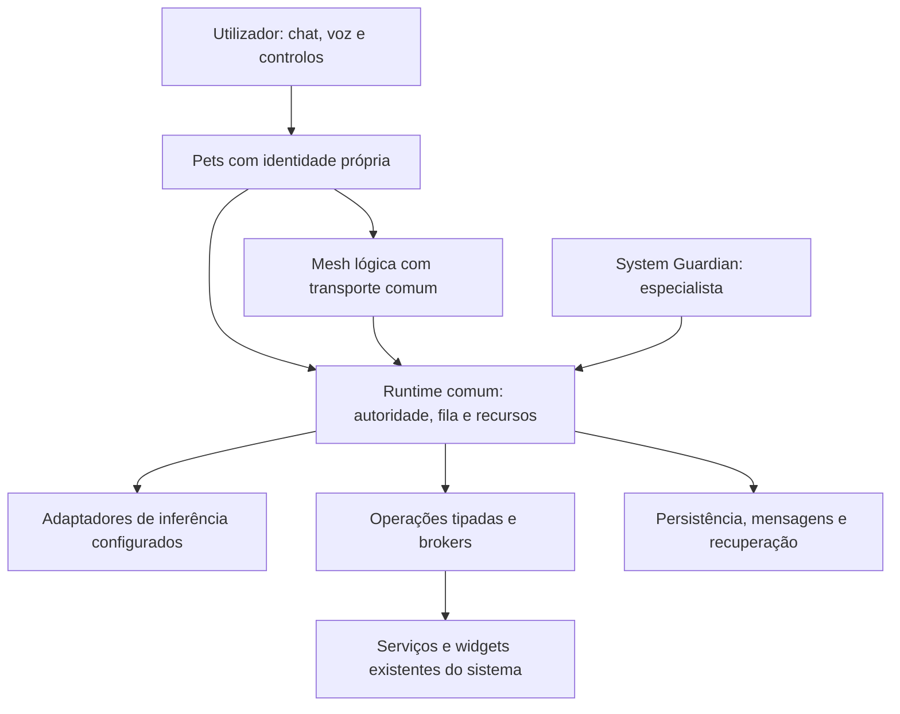

# Coucou — passagem integral para continuação e revisão independente

**Data:** 11/11/2026. **Finalidade:** permitir a outro agente compreender o objetivo completo, localizar o trabalho real, avaliar criticamente o desenho e continuar a implementação sem reiniciar o projeto ou repetir trabalho comprovado.

Este documento é uma passagem técnica, não uma certificação de produção. O objetivo integral permanece incompleto. Distingue decisões do utilizador, implementação, evidência e lacunas. O novo agente deve confirmar a árvore e as fontes atuais antes de agir; não deve aceitar as avaliações do agente anterior como prova.

**Instrução operacional mais recente:** o proprietário pediu este documento e autorizou commit/push de todas as alterações revistas do Coucou, sem assinatura Git para não pedir YubiKey/código. Pediu parar depois da publicação e aguardar novas ordens. A exceção de assinatura é desta publicação; não altera configuração global, hooks ou regras de sysworkspace. O controlo de Goal estava pausado pelo utilizador na preparação desta passagem. Não confundir produzir esta passagem com autorização para iniciar agentes auxiliares ou retomar autonomamente trabalho depois do push.

## 1. Localização, branches e composições

| Elemento | Referência e interpretação |
| --- | --- |
| Repositório remoto | https://github.com/PedroMglo/coucou |
| Árvore de desenvolvimento efetiva | `/home/pmglo/Projects/coucou-codex` |
| Branch de desenvolvimento/publicação | `feat/mochi-cli-accounts` |
| HEAD antes desta publicação | `0a1ba8173625ac255646b4650a3a688ff3e20d4e` |
| Commit que contém esta passagem | Identificar com `git log -1 --oneline -- coucou-migration/HANDOFF-CONTINUIDADE-INTEGRAL-2026-11-11.md`; o documento não pode conter o seu próprio hash de commit. Confirmar o remoto após o push. |
| Dossier anterior | `coucou-migration/`, fotografia original de 25/10 e revisões posteriores explicitamente datadas |
| Branch documental histórica | `docs/coucou-migration-20261025`, commit de revisão `eeee1b5517eab7783c53585572ae98c0c0811161` |
| Outra referência histórica | HEAD `bbe12e21010d28d36619003187d82ba175b6a0ec`, integrada834/SDK841/R43F1A e instalação30 eram fotografias antigas, não alvos de checkout. |
| Última instalação comprovada nesta cadeia | `0.5.1-mochi.43`; executável `/home/pmglo/.local/opt/coucou/0.5.1-mochi.43/usr/bin/coucou` |
| SHA-256 desse executável 43 | `878408b2d07d1f19371876355b75110e52e65395cdb3463c6b7ee1e5e0e01446` |
| Candidata privada mais recente | `.build/pet-goal-execution-next-r1/host-native-development-20261107/build58/coucou-dev` |
| SHA-256 privada 58 | `c1e364ce9f5f5031b3edb67b09f44f3a597df64a09152b67466e060becd6515b` |
| Identidade da privada | ID `fr.louisraille.coucou.dev`, nome de desenvolvimento, versão interna `0.5.1-mochi.44`; “58” é sequência de build de QA, não versão instalada. |
| Última unidade | `.build/pet-goal-execution-next-r1/rule-governed-revisions/` |
| Entrada local de coordenação | `.build/ACTIVE-BACKEND-UNIT.json`; conferir com processos/handles reais, não confiar só no marcador. |

Não fazer checkout da branch documental sobre a árvore em curso. A pasta `/home/pmglo/Projects/coucou` pode estar noutra branch e não conter o trabalho desta árvore. Uma cópia privada em `.build/.../sdk` ou `qa-source*` não é a árvore principal. A ausência de algo num HEAD remoto antigo não prova ausência na estação.

A privada 58 compilou, mas não foi instalada nem aceite na sessão gráfica. Não lançar esse executável com os XDG da conta por omissão: um ID de aplicação diferente, sozinho, não isola os dados. Os ensaios usam perfis e barramento privados.

## 2. Objetivo completo e fronteira do produto

Transformar os pets do fork em assistentes digitais de IA persistentes, autónomos, cooperativos e úteis no dia a dia, sempre disponíveis enquanto a infraestrutura permitir. O resultado não é apenas um chatbot, catálogo de mascotes, demonstração ou MVP. Deve conservar todos os 43 requisitos originais, os seis do Guardian e as decisões posteriores.

O sistema deve permitir, entre outras coisas:

- Falar diretamente com um pet, manter as suas conversas/sessões e dar-lhe objetivos com critérios verificáveis, contexto autorizado e limites.
- Trabalhar com Codex, Gravity, Copilot CLI, Ollama e adaptadores efetivamente suportados, respeitando as ferramentas, sessões, sandbox, projetos, MCP e decisões nativas de cada protocolo.
- Continuar tarefas sem a conversa aberta; recuperar de falhas sem renovar permissões ou repetir efeitos cujo resultado seja incerto.
- Usar anexos múltiplos, memória individual/de projeto e fontes selecionadas com dono, revisão, proveniência, validade e revogação.
- Executar rotinas e reagir a eventos de forma autorizada, com fuso IANA/DST, suspensão/offline, limites e notificações deduplicadas.
- Cooperar diretamente entre pets e delegar trabalho em paralelo com orçamento, critérios e contexto mínimo, sem ampliar privilégios.
- Usar os componentes existentes do computador através de brokers e grants seletivos; gerir saúde/segurança/manutenção por um System Guardian da mesma framework.
- Controlar integralmente estes percursos por voz, com decisões inequívocas e os mesmos limites de chat/terminal.
- Migrar, restaurar, preservar configurações/dados e entregar uma aplicação realmente utilizável, com aceitação no ambiente correto.

A prioridade continua a ser arquitetura coerente e desenvolvimento dos pets. Frontend/UX é trabalho funcional de gestão, aprovação, observabilidade, preservação e entrega; redesign cosmético não é prioridade.

### 2.1 Quatro elementos separados

| Elemento | Responsabilidade |
| --- | --- |
| Pet | Identidade persistente, configuração, canais, contexto, memória, sessões, objetivos e capacidades próprias. |
| Runtime comum | Admissão, fila, recursos, autoridade, persistência, ferramentas, mensagens, execução, verificação e recuperação determinísticas. |
| Motor de inferência | Ollama, Codex, Gravity, Copilot, API ou outro adaptador configurado e suportado, invocado quando necessário. |
| Papel funcional | Coordenador, especialista, serviço ou observador; não determina provider nem privilégios. |

O `ai_ollama` pode ser coordenador preferencial, preservando identidade/dados, mas coordenação é configurável e distinta do processo Ollama. Não é router obrigatório, executor universal, concedente de permissões ou fonte única de estado. Especialistas devem trabalhar diretamente entre si e continuar trabalhos independentes se o coordenador ou um motor falhar.

Não prometer funcionamento sem o backend comum nem com a máquina desligada. Fechar chat, fechar janela, sair da app, crash, suspensão, logout e reboot são eventos diferentes. Um serviço de utilizador separado só se justifica por necessidade demonstrada, com dono único, IPC autenticado, start/stop, atualização e recuperação; não ativar serviço/autostart silenciosamente.



A mesh é lógica sobre transporte comum. Não exige microserviços, ligações físicas all-to-all, um processo ou um modelo residente por pet. Não introduzir outro framework de agentes, stack AI Local/Symbiont, broker externo, PostgreSQL ou vetores por preferência abstrata.

## 3. Decisões do proprietário que não podem perder-se

### 3.1 Sistema: integrar a UI existente

A decisão de 07/11 substituiu a intenção antiga de criar definições próprias de Wi-Fi/Bluetooth/Som. Usar as definições/widgets atuais da estação, incluindo DMS/Quickshell e os serviços existentes. O Coucou fornece identidade, trabalho, grants, aprovação e integração; não substitui o centro de definições.

Preservar `controlCenterButton`, `gravacao`, `systemTray`, `udiskieMenu`, `clipboard`, `notificationButton` e `battery`, módulos úteis e protocolos móveis. O acesso manual deve continuar disponível sem o Coucou. Não retirar acessos antigos antes de paridade aceite.

O Guardian é especialista que observa, diagnostica, propõe e acompanha. Pode ser responsável funcional por tarefas de Sistema, mas não é proprietário absoluto das definições ou da política. O runtime valida e os brokers executam. Nem Guardian nem coordenador aprovam os seus próprios planos ou concedem a si próprios acesso.

Matriz obrigatória: **pet × subplugin × operação × recurso exato**. Ativar Sistema não concede tudo. Spotify e Ollama podem partilhar Som com grants independentes; retirar um não revoga o outro. Rede/Wi-Fi e Bluetooth formam uma unidade de desenvolvimento, conservando permissões separadas. Som/Multimédia e Ecrã/Energia/Sessão têm contratos próprios. Nome reutilizado não identifica dispositivo físico com segurança.

### 3.2 Providers e identidade

- Só `integration_github` está temporariamente retirado; os seus dados são preservados. Isso não retira ferramentas GitHub separadamente autorizadas.
- Gravity/Antigravity e Copilot CLI continuam no âmbito. Transporte/conta de assistência partilhados não fundem pets, conversas, sessões ou permissões.
- Não trabalhar apenas no Codex. A melhoria comum deve atravessar fábrica/runtime e as superfícies aplicáveis.
- O utilizador não tem LM Studio instalado: preservar o adaptador e os caminhos existentes, adiar novo desenvolvimento/QA desse pet; não o tornar gate desta fase.
- Testes usam gratuito/sintético primeiro. Sem quota real Copilot/GitHub; nenhuma chamada paga por autorização genérica.
- Não fazer fallback silencioso de provider, conta, endpoint ou modelo. Estado `unknown` não é `ready`; consulta passiva não autentica, carrega modelos ou consome quota.

O catálogo tem26 identidades; os testes atuais projetam23 disponíveis em Linux. Isso não significa26 pets configurados/ativos nem23 operacionais. A última fotografia conhecida do uso tinha Codex principal e Copilot, Gravity, Ollama e Spotify selecionados; revalidar o estado público atual se necessário, sem exportar perfis. O Guardian existe na fábrica, mas presença no catálogo não o ativa ou configura inferência/grants.

### 3.3 Dados, autonomia e autoridade

Um turno manual ou uma sessão CLI não autoriza rondas autónomas. Rever dados, revisões, proveniência, destino/modelo e âmbito próprio do objetivo/regra. Compor o corpo real antes do hash canónico e da reserva. Revalidar antes de novos efeitos e durante IO/esperas; a retoma não renova autoridade.

Uma decisão vincula sessão, turno, callId, operação, argumentos, alvo, política e prazo. Chat, voz e terminal representam a mesma decisão consumida uma vez. Descobrir PID, pasta ou título não concede controlo. Não usar flags permissivas para esconder limitações de protocolo.

Persistir admissão e intenção antes do efeito. Falha de gravação impede iniciar outro efeito. Efeito possivelmente ocorrido sem ACK exige incerteza/reconciliação, não retry automático. Não prometer exactly-once externo, nem que cancelar/restaurar desfaz ações passadas. Leases expirados não provam morte do worker; só libertar recurso físico após fim/recolha do worker e filhos próprios. Stop/decisões têm prioridade.

Ficheiros, páginas, emails, logs, memória e mensagens de outros pets são dados não fiáveis. Texto gerado não altera política, não autentica PetId e não é aprovação. Isolamento lógico no processo partilhado não é sandbox real de plugins não fiáveis.

## 4. Mapa do código e componentes a reutilizar

Caminhos relativos à raiz `coucou-codex`. São pontos de entrada, não uma lista exaustiva de centenas de módulos.

| Área | Fontes e responsabilidade |
| --- | --- |
| Fábrica | `windows/src-tauri/pets.factory.json`, `pet_factory.rs`, `pet_factory_runtime.rs`, `windows/src/core/pet-factory.ts` |
| Projeção de compatibilidade | `windows/src-tauri/pets.default.json`; gerar/verificar com `windows/scripts/generate-pet-defaults.mjs`; não é segunda fonte de verdade. |
| Configuração/bindings | `pet_config.rs`, `pet_model.rs`, `pet_roster_settings.rs`, `docs/PET-INFERENCE-BINDING.md` |
| Capacidades | `pet_capabilities/`, descritores com suporte/disponibilidade/frescura/motivo/caller, `native_validity.rs` |
| Conversas/providers | `chat.rs`, `assistant_memory.rs`, `local_chat.rs`, `codex_chat/`, `copilot_chat/`, `copilot_session/`, `gravity_chat/`, `session_chat/`, `pipe.rs`, `cli_decisions.rs`, `cli_goal_decisions.rs` |
| Runtime | `pet_runtime/mod.rs`, `model.rs`, `store.rs`, `admission.rs`, `admission_review.rs`, `context.rs`, `requested_dispatch.rs`, `leases.rs`, `lease_controller.rs`, `lease_maintenance.rs`, `plan_controller.rs` |
| Autoridade | `pet_runtime/authority.rs`, `authority_store.rs`, `authority_budget.rs`, writers especializados `authority_*`; catálogo/HMAC, fences e original-choice ACK existentes. |
| Posse/recursos | `pet_resources.rs`, `pet_process_group.rs`, `pet_runtime/native_owner.rs`, `native_operation.rs`, `runtime_owner.rs`, `absent_owner.rs` |
| Planos/execução | `planning*`, `steps*`, `recipes*`, `writer.rs`, `native_verification*`, resultados/fecho/continuação; usar o mesmo caminho de admissão e verificação. |
| Mesh | `pet_runtime/messages*`, `delegation*`, `funding*`, `received_*`, `peer_round_*`, `peer_feedback*`, `work_report*`; contrato em `docs/PET-MESH-CONTRACT.md`. |
| Regras | `pet_runtime/rules/`, `authority_rules.rs`, `authority_rule_readiness.rs`, `authority_rule_probe_recovery.rs`, `authority_rule_intent_retirement.rs`, `authority_rule_lineage.rs`, `authority_rule_succession.rs` |
| Controlo das regras | `windows/src/views/runtime-rules.ts`, `runtime-rule-authority.ts`, `runtime-rule-recovery.ts`, `runtime-rule-intents.ts`, `runtime-rule-succession.ts`, `runtime-rule-revision.ts`, `windows/src/core/bridge.ts` |
| Documentos/memória/fontes | `pet_documents.rs`, `pet_documents/`, `pet_memory/`, `pet_sources/`, `pet_calendar/`; seleção própria e corpo revisto devem chegar ao transporte real. |
| Sistema/Guardian | `pet_system.rs`, `pet_system_access.rs`, `pet_audio/`, brokers/executores existentes e `pet_runtime/system_*`; editor em `windows/src/desktop/pet-system-access-editor.ts`. |
| Operações comuns | `pet_operations/`, `pet_helper.rs`; catálogo de operações não é por si autorização para objetivo ou modelo. |
| Voz | `voice/`, `speech/`, reprodução/captura, interpretação e decisões; preservar os gates de captura, cancelamento e reconhecimento. |
| Dados/entrega | `pet_data/`: bootstrap, publicação, perfis, backup/restore, história/quarentena, configuração/ativação; `linux/build-fedora-rpm.sh` e procedimentos existentes. |
| Entradas IPC | `windows/src-tauri/src/lib.rs`; validar caller/janela no backend e transportar só referências/decisões permitidas no Bridge. |

**Confirmar caminhos no código atual:** alguns nomes têm módulos/submódulos e a árvore tem evoluído. Se um caminho desta tabela estiver ausente, pesquisar o símbolo com `rg` e corrigir a referência; não criar uma implementação equivalente por não o encontrar imediatamente.

A resolução da fábrica segue base → molde → extensões → configuração do pet/override autorizado. Melhorias comuns não concedem permissões novas. `systemAccess` e bindings de inferência têm writers/revisões próprios, não devem ser emitidos por herança genérica ou pelo editor legado de todo o perfil.

O Guardian usa `agent_system_guardian`, `introducedIn:1`, adaptador base não ligado e inferência Ollama explicitamente configurável. O routing marca especialista de saúde/segurança/manutenção; não lhe atribui execução geral por catálogo. Há suporte parcial de Saúde e inventário limitado. Não anunciar análise completa de CVEs, tuning, remediação ou proatividade como já entregues.

## 5. Persistência e limites dos dados

Os caminhos efetivos passam pelo bootstrap/perfil admitido. Em Linux, o layout comum tem payload de configuração sob `~/.config/coucou/pets-config-v1/` e payload de dados sob `~/.local/share/coucou/pets-data-v1/`; confirmar `settings::config_dir()` e `platform::data_dir()` antes de intervir. Não adivinhar a partir de uma pasta legacy ou copiar um perfil autenticado.

| Dados | Organização observada no código |
| --- | --- |
| Preferências por pet | `pets.json` no perfil de configuração, com revisões/bindings/grants tipados. |
| Conversas | `assistant/conversations.json` no diretório de dados admitido (`lib.rs` inicializa `Chat::persistent`). É biblioteca física comum com donos/CIDs distintos; não significa contexto global partilhado. |
| Memória própria | `assistant/memories.json`, catálogo e refs/revisões; CRUD não prova uso consentido por modelos ou objetivos. |
| Objetivos | `pet-runtime-v1/g-*.json`, registos versionados por objetivo com causalidade/admissões/planos/recibos. |
| Autoridade | `pet-runtime-consent-v1/`, chave privada local, envelopes assinados, intenção pendente e marcadores de histórico. Não exportar a chave para Git/logs/prompts. |
| Posse nativa | Diretório associado `.owners-v1`, identidade do perfil/processo e FDs/locks; não inferir fim pelo lease. |
| Contextos de objetivos | `pet-runtime-contexts-v1/`, refs imutáveis e seleção própria, não alias da conversa atual. |
| Regras e fontes | `pet-rules.json`, `sources.json` e catálogos/coleções existentes; regras são metadados até obter concessão própria. |
| Anexos | Armazenamento/manifestos por `pet_documents`; ingestão captura dono/CID/drop/sequence, acumula anexos e conserva seleção por tentativa. Examinar o resolvedor de caminhos do componente. |
| Restauro | Dados e autoridade histórica são distintos; importar bytes não reativa grants, serviços ou preferências sensíveis. |

PostgreSQL não é requisito nem backend ativo universal demonstrado. A proposta é opcional: medir benefício de volume, concorrência, pesquisa e manutenção, usar base/role próprios, migrar e testar backup/restauro. Não consultar bases de outros projetos. Embeddings e pesquisa vetorial são decisões independentes; começar por filtros e pesquisa lexical/estruturada.

O projeto AI Local antigo pode fornecer ideias/código útil após revisão, conforme `docs/AI-LOCAL-REUSE.md`; não adotar a sua stack como substituição deste runtime. A autorização de consulta não abrange dados/credenciais/bases de outros projetos.

Anexos múltiplos já têm desenvolvimento cumulativo e histórico5/6; a entrega completa, retenção e aceitação não se deduzem desse schema. Manter anexo único antigo, nomes repetidos, rascunhos, referências, cobertura e leitores incompatíveis. Não voltar ao comportamento de substituir o anexo anterior.

## 6. Estado real na passagem

### 6.1 Níveis de prova

Usar estados distintos: desenhado; implementado; validado com fixtures; validado nativamente no âmbito indicado; integrado localmente; candidato empacotado; instalado; aceite operacionalmente. Acrescentar pendente/indisponível/bloqueado com motivo. Um catálogo, teste, API privada ou build não fecha o sistema integral.

A árvore integra trabalho amplo de runtime individual, dados, inferência, cooperação e Sistema. Existem percursos nativos e entregas anteriores documentados. **Nenhum dos49 requisitos integrais está aqui declarado concluído.** Muitos campos do audit usam “parcial”; alguns textos antigos são desatualizados ou demasiado genéricos. Reavaliar por critério e evidência, sem repetir incrementos já feitos.

| Grupo | Implementação/base que deve ser preservada | Lacuna para o produto completo |
| --- | --- | --- |
| Identidade/fábrica/providers | Fábrica comum, descritores, bindings explícitos, bridges e canais próprios; melhorias nas identidades de sessão/turno e nas decisões. | Paridade por adaptador/caller, autonomia CLI realmente controlável, disponibilidade/frescura e aceitação instalada por pet; não universalizar provas Codex. |
| Runtime individual | Objetivos duráveis, admissão, fila, recursos, leases, driver, planos/receitas, critérios/recibos, recuperação/continuação e limites. | Lifecycle completo, justiça/progresso/retenção operacional e prova integrada do conjunto; execução após saída total/reboot não deve ser prometida por conversa fechada. |
| Mesh | Mensagens/delegação, financiamento, recursão, contexto/resultado recebido, rondas/feedback e cancelamento possuem implementação e provas delimitadas. | Fecho do percurso cooperativo autónomo completo, coordenação configurável/resiliente e aceitação operacional. Não recriar scheduler/ledger de mensagens ou orçamento. |
| Anexos/memória | Múltiplos anexos, seleções/revisões, fontes de contexto, memória própria e percursos de consentimento/envio foram desenvolvidos. | Projetos/episódios/derivados/resumos/partilha, retenção/invalidação e composição/entrega integral. CRUD não basta. |
| Fontes | ICS limitado, catálogos/coleções por conversa/pet e recortes de objetivos dedicados, corpo real e revogação possuem desenvolvimento. | Grants próprios de regra/ocorrência, multicalendário da rotina diária, falha parcial/frescura/notificação, RSS/IMAP nos limites e âmbitos corretos. |
| Rotinas | Regras persistentes, calendário IANA, políticas skip/coalesce/decisão, admissão de ocorrência, dispatch limitado, recuperação e autoridade1..7. | Aceitação final6/7, decisões humanas de atraso/DST, regras com dados/fontes, preparação diária, acompanhamento e notificações. Regras atuais têm dataScope:none. |
| Sistema | Brokers/executores, matriz seletiva, Som, Saúde e inventário limitado; integração com widgets atuais. | Cobertura real Rede/Bluetooth/Ecrã/Energia/Sessão, targets físicos, grants por caller, efeitos/pós-condições e aceitação autorizada, sem duplicar UI. |
| Guardian | Identidade independente; Saúde simples documentada como entregue43; inventário OS/kernel manual e TaskRuntime limitado comprovado em privada 35. | Inventário abrangente delimitado, advisories/findings, baseline/otimizações medidas, sysworkspace real, remediação e proatividade/cooperação integral. |
| Voz | Canais por pet, captura/reprodução, decisões e trabalho nativo têm implementação e provas parciais. | Cobertura integral de comandos, ligação de toda a autoridade/contexto, recuperação e áudio real PT/EN/misto/Bluetooth/eco/Stop. |
| Dados/entrega | Bootstrap/perfil, backup/restauro, quarentena histórica, ativação revista, leitores incompatíveis e retenção possuem trabalho substancial. | Composição final, migração7, leitores/rascunhos/efeitos incertos e aceitação operacional; fontes locais avançadas não estão automaticamente instaladas. |

### 6.2 R43: não regressar à fotografia antiga

O dossier antigo dizia começar por R43F2. Desde então houve muito desenvolvimento de revisão própria de dados, corpo real, hash/reserva, referências/revisões, revogação, memória/contexto recebido, continuidade e preservação. Não reiniciar F2 só porque uma cópia de 25/10 o chama “próximo”. Ver `pet_runtime/memory_review*`, `admission_review*`, `context*`, os caminhos de memória/peer e as provas da composição relevante.

Ao mesmo tempo, não declarar todo o R43 fechado porque existe uma rota funcional. Há diferenças entre manual, objetivo, regra, ocorrência, API/CLI e callers. Regras1..7 sem dados selecionados não concedem uso futuro de memória/fontes; chat manual funcional não prova autonomia ilimitada de CLI. Qualquer barreira deve ser retirada apenas no percurso comprovado.

### 6.3 Incrementos recentes de regras e a razão de cada um

Os números abaixo são **formatos da concessão de regra**, não versões da app ou percentagens de progresso.

| Formato/unidade | Comportamento e prova existente | Limite |
| --- | --- | --- |
| Regras persistentes / concessão1..2 | Definição CAS/IANA e concessão própria; reserva original e ligação a uma admissão de ocorrência. | Sem inferir autonomia de toda regra ou acesso a dados. |
|3 / scheduled-dispatch | Opt-in automático, até3 sondagens de metadados por ocorrência,6s cada e30s entre falhas; usa serviço de leases e runtime comuns. Escritor reutiliza a evidência de metadados exata, sem pedido não contabilizado. | Provedores recentes sintéticos; automático limitado a Ollama suportado. |
|4 / readiness-recovery | Dono nativo da operação, prova real de fim separada, recuperação/ACK sem replay ou saldo novo. Worker vivo/unlocked FD não é morto. | Legado sem dono comprovável e mudanças de namespace/boot/perfil mantêm recusa. |
| Temporal / privada 55 | observedAt nativo, expired e authorityTimeUncertain com dispatch falso e precedência correta. | Testes não alteraram a hora real do anfitrião. |
|5 / revoked-rule-intents, privada 56 | Junta dados assinados monotónicos de intenções preparadas antes da revogação, sem publicar Active; recibo e remove_exact(stamp)/fsync após representação durável. | Não prova fim de worker nem liberta recurso físico. Native56/CLI de preservação6 anterior têm âmbito próprio. |
|6 / rule-authority-succession, privada 57 | Nova decisão usa saldo original restante; predecessores permanecem Revoked; cadeia única, orçamento cumulativo e slots gastos recusados. | Core/CLI passaram; revisão Tauri/HTTP/reinício desse percurso não foi iniciada porque a sessão estava bloqueada. |
|7 / rule-governed-revisions, privada 58 | CarryRemaining revê política/modelo/destino suportados sem aumentar limites/validade da alocação. RenewFiniteAllocation exige novo orçamento finito explícito e retira do uso o saldo antigo não usado, sem o somar. Só slots posteriores à aprovação original são elegíveis. | Sem aceitação gráfica/HTTP7 ou CLI7 completa nesta publicação. Core/restauro histórico7 não substitui aceitação instalada. |

Há uma cadeia autenticada comum, com uma alocação vigente derivada, e histórico cumulativo preservado. Não há saldo paralelo. A continuação6 após uma renovação7 respeita a alocação atual, sem reabrir uma antiga. Mudanças de fonte antes de publicar exigem nova revisão; ACK reconhece a escolha/candidato/tempo originais e não sobrescreve progresso posterior. Uma intenção7 de novo orçamento não pode ser reconhecida com consentimento6.

Em7, o digest estável de compromissos inclui a autoridade7; os hashes/bytes dos formatos1..6 conservam a compatibilidade quando o novo campo está ausente. Os limites atuais incluem64 nós canónicos,1MiB de fonte e32 revisões com120s. São recusas limitadas, não políticas completas de retenção/compactação. Avaliar se o desenho pode simplificar-se sem perder os invariantes nem destruir dados já produzidos.

Nos percursos observados de ocorrência, encontram-se Admission29 e Goal67. Não assumir um único número global de schema para todos os tipos/caminhos: consultar valid/required_version e os leitores correspondentes.

### 6.4 Última verificação, sem ocultar falhas

- Fonte local final de código da unidade7: `.build/pet-goal-execution-next-r1/rule-governed-revisions/SOURCE2.json`, com1322 entradas de build/teste. Contagem de entradas não mede conclusão.
- Rust: a execução `rule-revision-regression1` teve33 casos passados e1 falhado por uma fixture que validava a política antes de construir o novo calendário. Corrigida só a fixture, `rule-revision-expiry2` passou o caso afetado. O Rust de produção ficou byte a byte igual entre as fontes 1/2. Não se apresenta a primeira execução como totalmente verde.
- Web final: `npm test`,1566 passados,0 falhados,0 ignorados. A primeira execução encontrou expectativas de catálogo Guardian/tradução e um checkbox da fixture; corrigidos antes da execução final.
- TypeScript, bundle Vite e binário Rust/Tauri da privada 58 passaram com entradas de fonte inalteradas.
- `node windows/scripts/generate-pet-defaults.mjs --check`: todas as projeções coincidem com a fábrica.
- A preservação CLI da unidade6 teve13 recibos nativos sobre perfil gerado: backup/restauro inativo exato, quarentena histórica/ativação sem grants e recusa do leitor56 sem alterar payload. O motivo público da recusa é genérico; essa prova não é validação específica do formato 7.
- A unidade7 testou restauro/histórico em Rust; a composição7 ainda precisa do percurso nativo/CLI de entrega. Os testes selecionados não fizeram chamadas a modelos reais/pagos nem consumiram quota Copilot/GitHub.
- Na última inspeção não havia testes/builds/apps de QA pertencentes ao projeto em execução. Confirmar novamente se esta passagem for lida muito depois.
- A instalada 43 não foi substituída nesta publicação. Nenhuma aprovação humana, áudio físico, instalação58 ou capacidade completa do Guardian é afirmada.

Provas detalhadas e perfis gerados estão em `.build/`, ignorados pelo Git. **Um clone remoto não recebe essas provas privadas.** O novo agente pode usá-las se estiver nesta estação e se inputs/pressupostos continuarem válidos; caso contrário deve reproduzir os critérios necessários, não inventar resultados a partir dos links.

### 6.5 Observações técnicas para revisão imparcial

1. Os documentos canónicos acumularam muitas notas de história e “próxima unidade” antigas. A informação útil deve ser consolidada num resumo vigente; preservar o histórico sem obrigar a relê-lo todo em cada turno.
2. O aumento de schemas e módulos de recuperação tem razões concretas de compatibilidade/autoridade, mas o próximo agente deve avaliar custos e redundâncias. Nem toda microcorreção precisa de formato, build e dossier novos.
3. `bridge.ts` tinha uma união de RuntimeAdmissionSpec que parecia terminar em28 enquanto o percurso nativo de regras usa29. É uma divergência de contrato a confirmar/alinhár; não foi aqui demonstrada como falha funcional nem corrigida por suposição.
4. A derivação da cadeia/catálogo em guardas de execução pode ter custo de IO/HMAC. Medir antes de otimizar; não trocar validade atual por cache sem fence. Não alegar um problema de desempenho só pelo número de ficheiros.
5. Limites de histórico/recibos/fontes/owners precisam de política de retenção coerente. Não apagar evidência ou assumir saldo livre para sair de um limite.
6. Há adaptações nativas/Windows/macOS e UI de upstream; provas Linux não fecham as outras plataformas. Não desativar adaptores/pets apenas por ausência de quota/máquina de teste.

## 7. O que falta e como priorizar a continuação

A próxima intervenção deve respeitar uma eventual nova instrução do proprietário, não executar esta lista automaticamente durante a pausa.

1. **Fechar a composição de regras já desenvolvida.** Adaptar o harness às fontes e ao binário atuais, provar revisão 6/7, modos distintos, Stop, resposta finita HTTP sintética, orçamento restante, história/ACK e reinício. A privada 57 não prova o código7 da58. A sessão tem de estar desbloqueada; não a desbloquear programaticamente.
2. **Aceitar e entregar um percurso utilizável.** Integrar os bloqueadores reais de preservação/compatibilidade, construir a candidata identificada, promover o mesmo pacote validado e verificar versão/executável ativo/dados/funcionalidade. Autorizações antigas de teste direto/atualização existem, mas confirmar a instrução atual e a fronteira sysworkspace. Não perguntar de novo por ações já autorizadas nem instalar por uma autorização revogada.
3. **Completar regras com fontes/dados e decisões temporais.** Grants próprios de regra/ocorrência, revisão exata de fontes/modelo, múltiplos calendários, DST, atraso/offline/suspensão, skip/coalesce/decisão e ausência de avalanche.
4. **Entregar preparação diária e acompanhamento.** Uma rotina real usa só calendários/fontes escolhidos, identifica informação antiga/falha parcial, conserva silêncio e notifica uma vez. Não criar uma rotina que só repete texto fixo para poder declarar AUTO-03 concluído.
5. **Convergir cooperação existente.** Verificar o que TEAM já faz e fechar o ciclo de trabalho/verificação/retoma autorizado, em vez de começar outro protocolo/ledger. Coordenador é projeção autorizada, não bloqueador de especialistas.
6. **Cobrir os restantes pets e providers.** Preservar sessões/decisões/ferramentas nativas e provar limites de autonomia por protocolo. Não inferir isto de chat manual ou de wrappers comuns; Copilot real permanece sem quota de testes, LM Studio adiado.
7. **Completar memória, fontes, serviços e voz.** Projetos/episódios/derivados/partilha explícita, RSS/IMAP limitados, operações externas separadas, decisões de voz únicas e áudio real nos ambientes autorizados.
8. **Completar Sistema e Guardian.** Manter widgets existentes, contratos de targets/grants, finding verificável sem LLM e percurso autorizado de remediação via sysworkspace/brokers, proatividade pelo scheduler comum.
9. **Aceitar o sistema integral.** Executar a matriz de critérios e cenários no ambiente correto, com pendências resolvidas; package/build/contagem de testes não substituem produção.

Esta ordem admite dependências independentes, mas não deve voltar a acumular várias entregas privadas da mesma funcionalidade sem convergência. Não usar uma permissão externa em falta como pretexto para parar tudo; também não a contornar ou declarar a parte bloqueada aceite.

## 8. Método recomendado ao novo agente

Ler e aplicar `docs/PETS-DEVELOPMENT-METHOD.md`. O método já foi pedido pelo proprietário e continua a ter valor; a execução anterior nem sempre convergiu suficientemente depressa. O novo agente deve corrigir o processo com evidência.

### 8.1 Uma entrega funcional por vez

Escolher uma dependência real e um percurso observável de ponta a ponta. Registar uma ficha curta com base, IDs, comportamento, limites, componentes, aceitação, provas reutilizáveis e condição de entrega. Implementar contrato/backend/controlo/persistência/prova na mesma entrega. Manter as restantes ideias na lista futura, não como frentes simultâneas.

Exemplo útil: “a rotina escolhida executa com o objetivo fechado, apresenta origem/falha parcial, Stop responde, reinício não duplica o efeito e o utilizador recebe uma notificação”. Exemplo insuficiente: “acrescentei outra versão de schema e muitos testes”. A entrega incremental não reduz os 49 requisitos a um MVP.

### 8.2 Validar proporcionalmente e reutilizar provas

Durante implementação, usar testes dirigidos a comportamento/falhas relevantes e tipos. Na integração, testar os componentes afetados e o percurso funcional. Na candidata, executar verificações gerais aplicáveis, package e compatibilidade. Após instalar, verificar o mesmo pacote, processo/versão, dados e resultado.

Não repetir suites idênticas sem alteração/risco. Cada teste novo deve distinguir um requisito ou reproduzir falha relevante, não espelhar a função. Se falhou a fixture, corrigir a fixture e repetir só o conjunto afetado, reutilizando código/binário válidos. Explicar por que uma alteração a autoridade/formatos/recuperação precisa de mais cobertura.

Fixtures e HTTP sintético permitem repetição barata. Native test com provider sintético continua sintético nesse provider. Hardware/Bluetooth/voz/contas reais exigem aceitação própria. Não gastar quota só para substituir um teste sintético já suficiente, nem promover o sintético a prova de provider real.

**Congelamento:** não editar código/recursos/testes/documentação incluídos numa fonte enquanto um teste/build/QA dessa fonte está vivo. Preparação inativa de harness/evidência em `.build` é distinta. Uma alteração documental após os testes deve ser identificada como tal. Não tratar timeout de observação como fim do processo; seguir o handle original e observar PID/estado antes de repetir.

### 8.3 Integrar cedo e reduzir burocracia

Reutilizar fábrica, runtime, Authority, perfis, scripts e estado existentes. Não criar framework nova de QA, outra taxonomia, outro ledger ou dezenas de snapshots equivalentes. Os IDs e a matriz existentes são a estrutura do produto.

Atualizar o resumo de estado e os critérios afetados; arquitetura/contrato só quando a decisão/comportamento muda. Não copiar a mesma narrativa para todos os ficheiros a cada pequena correção. Medir tempo até integração/instalação e idade dos incrementos privados, não quantidade de testes/fontes. Não inventar percentagens ou horas sem base comparável.

Uma revisão independente pode propor consolidar módulos/histórico e simplificar o método. Deve preservar os contratos efetivos, dados e autorizações, e demonstrar a compatibilidade. Reduzir complexidade de implementação é desejável; apagar critérios ou proteções para fazer uma demo passar não é.

### 8.4 Comunicação e conclusão

Relatar: estado realmente encontrado; mudança entregue; reutilização; ficheiros; prova e limite; pendência concreta; próximo passo. Separar instalada/privada, dados/autoridade, observado/ready e implementado/aceite.

Se uma confirmação for realmente necessária, explicar a origem exata da obrigação. Não pedir aprovação para cada passo já autorizado. Não esconder auto-review rejeitado, testes ignorados/falhados ou ausência de hardware. Não declarar completo até todos os critérios aplicáveis estarem implementados, integrados, verificados e entregues.

### 8.5 Avaliação de valor e complexidade

Há valor potencial na integração de assistentes com sessões, voz, contexto e ações reais governadas. Valor comercial não está demonstrado; a utilidade diária precisa de evidência instalada. O custo de autoridade/persistência é justificado pelo poder de ação dos pets. O excesso de microincrementos, formatos e documentação merece revisão crítica.

O novo agente não tem de defender o investimento passado. Deve procurar o caminho mais simples que cumpre o objetivo completo, demonstrar utilidade em percursos reais e retirar trabalho redundante com segurança. Não manter complexidade só porque já foi construída, nem reiniciar tudo para evitar compreendê-la.

## 9. Segurança, estação e autorizações

Estas regras são parte do contexto; instruções posteriores do proprietário podem alterá-las explicitamente. Uma cópia histórica não renova permissões.

- Um único agente de desenvolvimento; não criar auxiliares de programação/revisão nem usar os pets para contornar isso. Implementar a colaboração do produto continua no objetivo. O pedido desta passagem não é ordem para lançar outro agente agora.
- Preservar árvore suja, instalação, preferências, credenciais, modelos escolhidos, hooks, dados e assinaturas existentes. Nada de reset/clean/stash automático, substituição de diretórios, cópias antigas ou checkout para “alinhar”.
- A exceção atual permite commit/push do Coucou sem assinatura Git, apenas neste ato. Usar `git -c commit.gpgsign=false ...`, mantendo hooks/configuração global. Não alargar a exceção a sysworkspace ou futuras publicações. Merges não foram pedidos.
- Depois da publicação, parar e aguardar instruções. A continuidade técnica descrita aqui não sobrepõe a pausa do utilizador.
- Desenvolvimento/testes diretos na máquina foram autorizados, incluindo interferência temporária no trabalho. Isso não é autorização para desligar Wi-Fi, alterar VPN/firewall, emparelhar dispositivos, reiniciar, alterar PAM/YubiKey ou ativar serviços reais. Usar fixtures/perfis isolados nos percursos sensíveis.
- Intervenções persistentes no Fedora/configuração global/aplicações globais pertencem a `/home/pmglo/sysworkspace`: antes ler `/home/pmglo/.codex/context/sysworkspace.md` e o AGENTS.md desse repositório; atualizar fontes/manifestos/procedimento e concluir com commit focado, hooks/assinatura ativos. Não ignorar exclusões de Coucou/Mochi nem inventar comandos de integração.
- Código, dependências, lockfiles, venvs/containers/caches do projeto pertencem ao Coucou. Não os instalar/promover globalmente nem capturar em sysworkspace. Instalação versionada do anfitrião é fronteira distinta do código.
- Não consultar bases de outros projetos, exportar HOME/`.config`/`.codex`, copiar perfis autenticados, colocar segredos em prompts/logs/Git ou pedir passwords/PINs na conversa. Capturas são privadas, fora do Git.
- Os ensaios e pedidos de aprovação do Coucou em desenvolvimento não devem bloquear outros agentes/trabalhos da estação. Isolar perfis, hooks, janelas e autoridade de QA; não resolver isso desativando globalmente permissões dos agentes ou falsificando aprovação humana.
- Não retomar o assunto YubiKey/PAM: o utilizador mandou regressar ao Coucou. A dispensa de assinatura deste commit não altera a autenticação sudo da estação.
- Para extração/ingestão/transformação/indexação de dados, ler `/home/pmglo/.codex/context/pif.md`, usar PIF e inventário/conexões aprovadas. Novas conexões/conectores e falhas do core/SDK/registry vão por issue sanitizada ao proprietário de `PedroMglo/PIF`; o consumidor não altera/faz fork da plataforma para contornar limites.
- Seguir `pet-desktop --help`, começar por `pet-desktop status` e `pet-desktop windows`, escolher janela exata e observar antes/depois. Preferir CLI/API/acessibilidade verificáveis. Não desbloquear a sessão nem matar processos por nome amplo; atuar só sobre processos próprios identificados.

As primitivas de hash, HMAC, aleatoriedade segura, publicação atómica/fsync e locks protegem integridade/causalidade. Não substituem sandbox, autorização nativa, prova de fim de processo ou consentimento humano. Desativar assinatura **Git** deste commit não desativa a assinatura/HMAC dos dados do produto.

## 10. Critérios transversais de aceitação

Além dos49 IDs do anexo, preservar os 12 cenários solicitados. O novo agente deve associar cada prova à composição, inputs, comando, resultado e limite, e não apresentar nenhum deles como integralmente aceite só porque existe base parcial.

1. Pet disponível e operação determinística sem modelo carregado; falha de inferência não apaga identidade ou tarefas.
2. Chamada direta a especialista; dois pets comunicam/trabalham sem coordenador.
3. Delegação paralela com orçamento repartido, conflito de recurso, ciclo recusado e cancelamento de um ramo sem perder os restantes.
4. Objetivo continua com conversa fechada; Stop responde; crash antes/depois de possível efeito não o duplica. Distinguir conversa fechada de processo morto.
5. Vários anexos/memória selecionada conservam dono/revisões; revogação impede novo uso e sucesso tardio falso.
6. Uma decisão resolvida uma vez entre chat/voz/terminal; sessão errada e replay recusados.
7. Rotina multicalendário trata falha parcial, DST, suspensão e uma única notificação.
8. Spotify/Ollama partilham só Som autorizado; revogar um não afeta o outro.
9. Guardian produz finding verificável sem LLM; remediação permitida completa o fluxo e não autorizada é recusada.
10. Conteúdo hostil recebido por Guardian/mesh não altera políticas nem acede fora do âmbito.
11. Migração/restauro preservam dados, rascunhos, autoridade histórica e efeitos incertos; leitor antigo recusa formato incompatível sem destruir.
12. Lifecycle, áudio real e instalação verificados no ambiente e autorização corretos; fixture não substitui aceitação operacional.

Testes adversariais incluem PetId forjado, aprovação reutilizada, argumentos/alvo trocados após consentimento, pet intermediário para ampliar privilégios, memória partilhada como fuga de dados, grant revogado reusado após reativação, fallback de destino, inputs malformados/excessivos, ciclos, fan-out e consumo de recursos.

Guardian requer ainda inventário limitado/classificado, findings com origem/data/severidade/confiança, advisories da distribuição/pacote, baseline/métrica antes e depois, integração efetiva sysworkspace e remediação finding → proposta/diff → impacto/pré-condições → autorização → efeito limitado → verificação. Sem shell/root geral ou autopermissão. Rollback só se suportado; compensação/irreversibilidade devem ser declaradas. Preparar diagnósticos de Proton VPN/Tailscale/firewall, dock Thunderbolt intermitente e serviço com consumo anómalo como fixtures; não alterar esses componentes reais para “testar”.

## 11. Runbook de retoma sem contexto desta conversa

### 11.1 Primeiros minutos

1. Confirmar instrução atual do proprietário e estado do Goal. Se continuar pausado/sem autorização de retoma, limitar-se ao pedido recebido.
2. Ler as instruções da estação e AGENTS aplicáveis. Consultar sysworkspace/PIF apenas conforme a tarefa e a fronteira.
3. Na árvore indicada, obter branch, HEAD, status, worktrees e remoto. Não tocar noutra árvore por ter o nome “coucou”.
4. Ler esta passagem, o topo do estado canónico, o checkpoint atual e a unidade em curso. Confirmar processos/handles, não apenas `liveHandles:[]` num ficheiro antigo.
5. Identificar a composição final publicada pelo Git e diferenças locais; localizar provas privadas presentes e as que faltam num clone novo.
6. Escolher a próxima ação útil sem auditoria infinita: retomar aceitação 6/7 se ambiente disponível ou uma dependência independente concreta, mantendo uma entrega funcional em curso.

Comandos de orientação:

```sh
cd /home/pmglo/Projects/coucou-codex
git status --short --branch
git log -1 --oneline
git worktree list
rg --files windows/src-tauri/src/pet_runtime/rules windows/src/views
```

Confirmar PID/estado/tempo do processo próprio pelo handle ou por campos selecionados, sem despejar argumentos com segredos. Um timeout de leitura não autoriza relançar uma operação. Se já houve efeito possível, consultar recibos/estado e retomar o pedido original.

### 11.2 Verificações reutilizáveis

```sh
cd /home/pmglo/Projects/coucou-codex/windows
npm test
npx tsc --noEmit
node scripts/generate-pet-defaults.mjs --check
```

Para repetir apenas o grupo Rust da última integração numa toolchain Linux preparada, o comando de produto é:

```sh
cargo test --locked --offline --manifest-path src-tauri/Cargo.toml --lib \
  --features tauri/custom-protocol pet_runtime::authority_store::rule -- \
  --test-threads=2 --skip rule_probe_owner_child \
  --skip rule_status_expired_fixture --skip rule_intent_retirement_native_fixture \
  --skip rule_succession_native_preservation_fixture
```

Executar a partir de `windows`. As quatro exclusões são produtores/filhos de fixture explicitamente acionados por ensaios próprios, não uma dispensa dos critérios. Não há pretensão de ter executado a suite Rust inteira nesta publicação. `--offline` exige cache/dependências já disponíveis; num clone novo preparar o ambiente do projeto conforme os lockfiles, respeitando sysworkspace para qualquer instalação global.

Não são instruções para repetir tudo em cada retoma. O último `npm test` geral foi necessário para publicar uma árvore com centenas de alterações acumuladas; verificações posteriores dependem do delta.

Para Rust na estação, existe `.build/pet-goal-execution-next-r1/host-native-development-20261107/test-native.py`. Tem ambiente/dependências locais e produz comando, fontes, log e recibo terminal. Usar o script original, não uma cópia RUNNER.py com paths relativos errados. Exemplo de sintaxe, **com um nome novo e manifesto atual deliberadamente escolhido**:

```sh
python3 .build/pet-goal-execution-next-r1/host-native-development-20261107/test-native.py \
  --name nome-unico-da-verificacao --filter filtro-dirigido \
  --base-source-map caminho/manifesto-atual.json \
  --source-root /home/pmglo/Projects/coucou-codex
```

`build-native.py` no mesmo diretório aceita `--source-root` e `--source-map`. Esses helpers e dependências estão ignorados no Git; num clone novo, usar a toolchain e dependências do projeto documentadas, não assumir que os caminhos privados foram publicados. Não instalar dependências globais por atalho sem sysworkspace.

### 11.3 QA gráfica/instalação

O harness preparado de sucessão 6 está em `.build/.../rule-authority-succession/native-app-source2.py`, com snapshot `qa-source2` e binário 57. Ele terminou no guard de sessão bloqueada **antes de criar app1**. O produto evoluiu para7/build 58: adaptar fonte/composição e acrescentar o percurso7 antes de usar a prova como aceitação atual. Não lançar cegamente o script antigo.

Usar XDG_CONFIG_HOME/XDG_DATA_HOME/XDG_CACHE_HOME/XDG_RUNTIME_DIR privados, barramento D-Bus privado com ativação controlada, provider HTTP sintético e settings que não instalem hooks/autostart/serviços ou efetuem áudio/rede reais. Não copiar credenciais/perfis. Um ID dev diferente não separa por si o diretório `coucou`.

Quando houver candidata normal autorizada, promover o pacote testado, preservar o prefixo anterior e validar compatibilidade dos dados antes de prometer rollback. Recuar o binário não desfaz dados novos ou ações externas. Confirmar processo/executável/versão e o percurso entregue. Documentar a parte sysworkspace que corresponda a alterações persistentes do anfitrião.

## 12. Fontes de verdade e como as ler

| Fonte | Uso |
| --- | --- |
| Instruções atuais do proprietário | Autorizações, prioridades e pausa prevalecem sobre cópias históricas. |
| `docs/PETS-ARCHITECTURE.md` | Objetivo/desenho canónico; enorme histórico embutido, ler com datas/âmbito. |
| `docs/PETS-ROADMAP.md` | Dependências e plano; notas antigas de “próximo” não são automaticamente vigentes. |
| `docs/PET-CAPABILITIES-CONTRACT.md` | Caller, binding, capacidades reais, frescura e autoridade. |
| `docs/PET-FACTORY.md` | Fonte comum, herança/overrides e fronteiras de identidade/permissões. |
| `docs/PETS-IMPLEMENTATION-STATUS.md` | Estado vigente, instalada versus privada e lacunas. |
| `docs/PETS-VALIDATION.md` | Provas e limites; conferir inputs/saída real. |
| `docs/PETS-GOAL.md` | Objetivo e histórico; o estado do Goal é independente do ficheiro. |
| `docs/PETS-REQUIREMENTS-AUDIT-2026-10-25.json` |49 IDs e critérios preservados; estados/provas têm datas e podem carecer atualização. |
| `docs/PETS-DEVELOPMENT-METHOD.md` | Método de entrega funcional, validação proporcional e integração cedo. |
| `docs/PETS-DELIVERY-GROUPS.md/.json` | Agrupamento existente; números/percentagens antigos exigem revalidação. |
| `docs/PET-RULES.md`, `PET-SCHEDULED-EXECUTION.md` | Contratos das regras/horários, autoridade e próximas lacunas. |
| `docs/PET-MESH-CONTRACT.md`, `PET-DETERMINISTIC-RUNTIME.md` | Cooperação e operações/driver determinísticos. |
| `docs/PET-SYSTEM-INTEGRATION.md`, `PET-SYSTEM-ACCESS-CONTRACT.md` | Integração com UI/serviços existentes e grants seletivos. |
| `docs/SYSTEM-GUARDIAN-ARCHITECTURE.md` | Especialização Guardian e aceitação GUA. |
| `docs/PET-CALENDAR-SOURCES.md`, `PET-GOAL-CALENDAR-CONTEXT.md` | Fontes/coleções e uso próprio em objetivos; não ampliam para regras por herança. |
| `docs/PET-INFERENCE-BINDING.md`, `PETS-DATA-BACKUP.md` | Captura explícita de motor/destino e preservação/restauro. |
| `coucou-migration/` | Dossier completo25/10, revisão Guardian, atualização R8 e revisão Sistema07/11; esta passagem é a entrada atual. |
| `coucou-migration/fontes/` e manifesto/índice | Cópias históricas/proveniência, não código ativo ou permissões novas. |
| `.build/ACTIVE-BACKEND-UNIT.json` e checkpoints | Continuidade local privada; validar contra worktree/processos/evidência. |

O `docs/AGENTS.md` contém material de integração upstream, incluindo descrições antigas que podem não corresponder aos bridges agora implementados. Respeitar as instruções aplicáveis, mas verificar comportamento/estado pelo código e contratos atuais. Um comentário antigo sobre ausência de aprovação não apaga a implementação posterior; a presença de um handler também não prova paridade integral.

A documentação histórica é preservada, não apagada para tornar o estado “verde”. Divergências identificadas devem ser resolvidas, não interpretadas como autorização para diminuir o objetivo.

## 13. Requisitos integrais preservados

Os43 originais e GUA-01..06 seguem no anexo abaixo. O critério é copiado da matriz canónica; o estado integral de cada um permanece aberto. As secções anteriores dão o mapa observado e as lacunas. O próximo agente deve manter uma matriz rastreável de estado, ficheiros/símbolos, dependências, implementação, prova/limite, lacuna e próximo critério; não substituir estes IDs por outra lista menor.

### ARC-01 — Separar arquitetura, estado e histórico; atualizar prioridade para arquitetura e pets

**Critério original preservado:**

> Documento normativo, plano com IDs, fontes identificadas e arquivo anterior preservado; ligações coerentes

**Estado integral:** não demonstrado como concluído. Usar a linha homónima da matriz para prova, limite e lacuna; cruzar com o estado vigente desta passagem, sobretudo AUTO-01/02 e composições posteriores.

### ARC-02 — Rever contratos quando código/decisão revelar incompatibilidade

**Critério original preservado:**

> Registar decisão, motivo, migração, impacto e requisitos afetados antes de implementar um caminho incompatível

**Estado integral:** não demonstrado como concluído. Usar a linha homónima da matriz para prova, limite e lacuna; cruzar com o estado vigente desta passagem, sobretudo AUTO-01/02 e composições posteriores.

### ARC-03 — Manter definição de sistema completo e cobertura

**Critério original preservado:**

> Cada cenário do dia a dia tem capacidade, implementação, prova e pendência por provider; exceções não desaparecem dos critérios

**Estado integral:** não demonstrado como concluído. Usar a linha homónima da matriz para prova, limite e lacuna; cruzar com o estado vigente desta passagem, sobretudo AUTO-01/02 e composições posteriores.

### PET-01 — Implementar `PetDescriptor` e capacidades versionadas a partir de `pet_factory`, `pet_config`, modelos e adaptadores

**Critério original preservado:**

> Matriz por pet distingue suporte, configuração, disponibilidade, frescura e motivo. API/perfil vazio ou hook não aparecem como execução suportada. Nome/modelo não alteram identidade; GitHub entidade continua retirado

**Estado integral:** não demonstrado como concluído. Usar a linha homónima da matriz para prova, limite e lacuna; cruzar com o estado vigente desta passagem, sobretudo AUTO-01/02 e composições posteriores.

### PET-02 — Associar conversa, sessão nativa, turno, tarefa e decisões com autoridade inequívoca

**Critério original preservado:**

> Trocar de pet/vista/sessão, resultados tardios, sessão ambígua, revogação e Stop preservam dono. Terminal/chat/voz partilham a identidade do pedido nativo e a política da sessão/perfil; uma resposta invalida as outras representações. Descoberta por PID/pasta/título não autoriza controlo

**Estado integral:** não demonstrado como concluído. Usar a linha homónima da matriz para prova, limite e lacuna; cruzar com o estado vigente desta passagem, sobretudo AUTO-01/02 e composições posteriores.

### PET-03 — Completar continuidade e decisões Gravity/Copilot/Codex segundo capacidades nativas

**Critério original preservado:**

> Continuar a execução original quando suportado, decisões exatas e limpeza dos filhos próprios. Gravity sem canal de aprovação não ganha permissões. Copilot usa fixtures enquanto quota real está vedada. Preservar as capacidades do agente original — ficheiros, comandos, projetos e ferramentas/MCP — conforme a sessão/perfil autorizados; distinguir continuação nativa do dispatcher autónomo ainda sem limites internos garantidos. Verificar paridade de sandbox/política/modos de aprovação, sem flags mais permissivas nem concessões copiadas entre sessões

**Estado integral:** não demonstrado como concluído. Usar a linha homónima da matriz para prova, limite e lacuna; cruzar com o estado vigente desta passagem, sobretudo AUTO-01/02 e composições posteriores.

### PET-04 — Consolidar identidade, modelos, ferramentas e falhas locais/API

**Critério original preservado:**

> Ollama/LM Studio/API mantêm modelo e contexto escolhidos, recusam ferramentas não suportadas e não fazem fallback silencioso. Completar ligação de pets ainda sem configuração/adaptador resolvido

**Estado integral:** não demonstrado como concluído. Usar a linha homónima da matriz para prova, limite e lacuna; cruzar com o estado vigente desta passagem, sobretudo AUTO-01/02 e composições posteriores.

### PET-05 — Definir o contrato comum dos pets de serviço e observadores

**Critério original preservado:**

> Spotify permanece determinístico nas capacidades atuais; integrações com executor LLM conservam dono próprio. Só operações efetivamente implementadas ficam disponíveis

**Estado integral:** não demonstrado como concluído. Usar a linha homónima da matriz para prova, limite e lacuna; cruzar com o estado vigente desta passagem, sobretudo AUTO-01/02 e composições posteriores.

### RUN-01 — Schema e repositório de objetivos, tarefas, planos, passos e eventos; migração do estado atual

**Critério original preservado:**

> PET-01/02. Separar atividade de estado durável; guardar admissão antes de efeitos, preservar IDs e trabalhos ativos além dos dez do journal público

**Estado integral:** não demonstrado como concluído. Usar a linha homónima da matriz para prova, limite e lacuna; cruzar com o estado vigente desta passagem, sobretudo AUTO-01/02 e composições posteriores.

### RUN-02 — Admissão, fila, leases e associação da conversa de background

**Critério original preservado:**

> RUN-01. Não trocar seleção/rascunhos da UI; uma sessão não recebe dois controladores. Prazos incluem fila, slots físicos aguardam fim do worker, outros pets continuam. Prontidão fresca antes do efeito; validade durante IO não depende apenas da idade da cache e continua vinculada a política/posse/contexto/prazo

**Estado integral:** não demonstrado como concluído. Usar a linha homónima da matriz para prova, limite e lacuna; cruzar com o estado vigente desta passagem, sobretudo AUTO-01/02 e composições posteriores.

### RUN-03 — Ciclo comum de planeamento, progresso, orçamento e conclusão

**Critério original preservado:**

> RUN-01/02 + EXE-01. Critérios verificáveis, limites de ciclos/tentativas/recursos, falta de progresso detetada; texto do modelo não basta para concluir

**Estado integral:** não demonstrado como concluído. Usar a linha homónima da matriz para prova, limite e lacuna; cruzar com o estado vigente desta passagem, sobretudo AUTO-01/02 e composições posteriores.

### RUN-04 — Recuperação, pausa, Stop e retoma após falha

**Critério original preservado:**

> RUN-01/02. Reinício não reproduz efeitos; reconciliar processos/sessões/recibos, preservar incerteza e permitir retoma vinculada ao objetivo original

**Estado integral:** não demonstrado como concluído. Usar a linha homónima da matriz para prova, limite e lacuna; cruzar com o estado vigente desta passagem, sobretudo AUTO-01/02 e composições posteriores.

### RUN-05 — Prioridades e justiça entre trabalho manual e rotinas

**Critério original preservado:**

> RUN-02 + OBS-01. Stop/decisões responsivos, nenhuma rotina monopoliza provider/modelo/dispositivo; limites configurados e observáveis

**Estado integral:** não demonstrado como concluído. Usar a linha homónima da matriz para prova, limite e lacuna; cruzar com o estado vigente desta passagem, sobretudo AUTO-01/02 e composições posteriores.

### EXE-01 — Registo/broker de operações tipadas para ferramentas nativas, locais, MCP e desktop

**Critério original preservado:**

> PET-01/02. Schema, versão, efeitos, alvos, limites, cancelamento, idempotência e verificação; ferramenta descoberta não fica automaticamente autorizada

**Estado integral:** não demonstrado como concluído. Usar a linha homónima da matriz para prova, limite e lacuna; cruzar com o estado vigente desta passagem, sobretudo AUTO-01/02 e composições posteriores.

### EXE-02 — Concessões por objetivo/regra e receitas limitadas; integrar aprovações existentes

**Critério original preservado:**

> RUN-01 + EXE-01. Uma aprovação não se torna shell genérica; política revogada invalida pedidos pendentes, sem conceder privilégios de outro pet. Chat/voz acompanham a política e os pedidos do agente original, com consumo único, sem duplicar pedidos já satisfeitos nem alargar a decisão nativa

**Estado integral:** não demonstrado como concluído. Usar a linha homónima da matriz para prova, limite e lacuna; cruzar com o estado vigente desta passagem, sobretudo AUTO-01/02 e composições posteriores.

### EXE-03 — Recibos e verificação de pós-condições

**Critério original preservado:**

> EXE-01. Separar ACK/saída/efeito observado; erro após possível efeito exige reconciliação, sem repetir automaticamente

**Estado integral:** não demonstrado como concluído. Usar a linha homónima da matriz para prova, limite e lacuna; cruzar com o estado vigente desta passagem, sobretudo AUTO-01/02 e composições posteriores.

### EXE-04 — Uso do computador e capacidades de observação

**Critério original preservado:**

> EXE-01/02. CLI/API/acessibilidade primeiro; alvos exatos, observação antes/depois em controlo visual. Sessão bloqueada ou falta de imagem tem limitação explícita

**Estado integral:** não demonstrado como concluído. Usar a linha homónima da matriz para prova, limite e lacuna; cruzar com o estado vigente desta passagem, sobretudo AUTO-01/02 e composições posteriores.

### CTX-01 — Fechar anexos múltiplos, retenção e recuperação do protótipo de 633 fontes

**Critério original preservado:**

> Bloqueador REL-01. Envelope terminal e aceitação nativa de restauro parcial/nome reutilizado/limpeza interrompida/motivos de recusa verificados nos dois incrementos675 privados; completar integração e migração/backup/rollback v4/v5/leitores antigos

**Estado integral:** não demonstrado como concluído. Usar a linha homónima da matriz para prova, limite e lacuna; cruzar com o estado vigente desta passagem, sobretudo AUTO-01/02 e composições posteriores.

### CTX-02 — Apresentação por mensagem e seleção de anexos para contexto

**Critério original preservado:**

> CTX-01. IDs/proveniência/cobertura visíveis onde necessário; não reautorizar cópias nem inferir leitura integral do modelo

**Estado integral:** não demonstrado como concluído. Usar a linha homónima da matriz para prova, limite e lacuna; cruzar com o estado vigente desta passagem, sobretudo AUTO-01/02 e composições posteriores.

### MEM-01 — Schema de memória: preferências, contexto de projeto, episódios, derivados e resumos

**Critério original preservado:**

> PET-01 + RUN-01. Dono/âmbito/proveniência/validade/revisão; dados derivados não viram instrução nem autorização

**Estado integral:** não demonstrado como concluído. Usar a linha homónima da matriz para prova, limite e lacuna; cruzar com o estado vigente desta passagem, sobretudo AUTO-01/02 e composições posteriores.

### MEM-02 — Recuperação seletiva, correção, exclusão, revogação e retenção

**Critério original preservado:**

> MEM-01 + CTX-01. Pesquisa estruturada/lexical inicial, isolamento entre pets/projetos e invalidação de derivados/índices; embeddings externos só com concessão própria

**Estado integral:** não demonstrado como concluído. Usar a linha homónima da matriz para prova, limite e lacuna; cruzar com o estado vigente desta passagem, sobretudo AUTO-01/02 e composições posteriores.

### CTX-03 — Completar gestão e aceitação do catálogo ICS já implementado

**Critério original preservado:**

> Formulário/consentimento nativos e fonte selecionada; calendário exportado não aparece como sincronização ou capacidade de escrita

**Estado integral:** não demonstrado como concluído. Usar a linha homónima da matriz para prova, limite e lacuna; cruzar com o estado vigente desta passagem, sobretudo AUTO-01/02 e composições posteriores.

### CTX-04 — Evoluir fontes de pet/CID para objetivos/regras e coleções persistentes

**Critério original preservado:**

> RUN-01 + EXE-02 + CTX-03. Migração sem alargar concessões antigas; seleção explícita de vários calendários, revisão e revogação por ocorrência

**Estado integral:** não demonstrado como concluído. Usar a linha homónima da matriz para prova, limite e lacuna; cruzar com o estado vigente desta passagem, sobretudo AUTO-01/02 e composições posteriores.

### CTX-05 — Adaptadores RSS/IMAP com leitura limitada e proveniência

**Critério original preservado:**

> EXE-02 + CTX-04. TLS, redirecionamentos/destinos, bytes/prazos e mensagens limitados antes de materializar conteúdo; IMAP sem envio/eliminação implícitos

**Estado integral:** não demonstrado como concluído. Usar a linha homónima da matriz para prova, limite e lacuna; cruzar com o estado vigente desta passagem, sobretudo AUTO-01/02 e composições posteriores.

### AUTO-01 — Repositório de regras, gatilhos e concessões; ativar/desativar por utilizador

**Critério original preservado:**

> RUN-01/02 + EXE-02 + CTX-04. Regra tem dono, revisão, fontes, limites e validade; conteúdo externo não inscreve regras

**Estado integral:** não demonstrado como concluído. Usar a linha homónima da matriz para prova, limite e lacuna; cruzar com o estado vigente desta passagem, sobretudo AUTO-01/02 e composições posteriores.

### AUTO-02 — Agendador de horários/eventos e deduplicação de ocorrências

**Critério original preservado:**

> AUTO-01. Fuso IANA, mudança de hora, suspensão/offline e políticas skip/coalesce/decisão; nenhum efeito duplicado por evento repetido

**Estado integral:** não demonstrado como concluído. Usar a linha homónima da matriz para prova, limite e lacuna; cruzar com o estado vigente desta passagem, sobretudo AUTO-01/02 e composições posteriores.

### AUTO-03 — Primeira rotina: preparação diária a partir de calendários escolhidos

**Critério original preservado:**

> AUTO-01/02 + EXE-03. Dados sintéticos desconhecidos pelo modelo, várias fontes, frescura/cobertura, falha parcial e uma única notificação no horário permitido

**Estado integral:** não demonstrado como concluído. Usar a linha homónima da matriz para prova, limite e lacuna; cruzar com o estado vigente desta passagem, sobretudo AUTO-01/02 e composições posteriores.

### AUTO-04 — Rotina de acompanhamento de objetivo/projeto e pedido de decisão

**Critério original preservado:**

> RUN-03/04 + MEM-02. Progresso verificável, interrupção/retoma sem repetir efeitos, orçamento repartido e comunicação sem spam

**Estado integral:** não demonstrado como concluído. Usar a linha homónima da matriz para prova, limite e lacuna; cruzar com o estado vigente desta passagem, sobretudo AUTO-01/02 e composições posteriores.

### AUTO-05 — Notificações, silêncio e escalada de bloqueios

**Critério original preservado:**

> OBS-01 + AUTO-01. Conteúdo sensível limitado, deduplicação e validade; indisponibilidade não causa reenvio infinito ou mudança de canal/conta

**Estado integral:** não demonstrado como concluído. Usar a linha homónima da matriz para prova, limite e lacuna; cruzar com o estado vigente desta passagem, sobretudo AUTO-01/02 e composições posteriores.

### TEAM-01 — Protocolo comum de comunicação direta, descoberta e delegação

**Critério original preservado:**

> PET-01/02 + RUN-01 + EXE-02. Mensagens/pedidos/respostas/eventos/resultados com origem/destino, correlação/causa, tarefa/objetivo, idempotência, artefactos, autoridade, orçamento e prazo explícitos; reutilizar mecanismos existentes. Utilizador e pets chamam cada pet diretamente; nenhuma delegação amplia permissões

**Estado integral:** não demonstrado como concluído. Usar a linha homónima da matriz para prova, limite e lacuna; cruzar com o estado vigente desta passagem, sobretudo AUTO-01/02 e composições posteriores.

### TEAM-02 — Execução paralela/assíncrona, verificação, cancelamento e coordenação resiliente

**Critério original preservado:**

> TEAM-01 + RUN-03/04 + EXE-03. Mesmo controlo para tarefas diretas/delegadas; um dono por efeito, entrega deduplicada, limites de profundidade/concorrência/custo, ciclos/conflitos recusados e falhas isoladas. Coordenador Ollama configurável, com visão autorizada dos trabalhos, sem intermediação obrigatória; restantes pets operacionais sem coordenador/motor indisponível. Resultados com proveniência, sem copiar o histórico inteiro

**Estado integral:** não demonstrado como concluído. Usar a linha homónima da matriz para prova, limite e lacuna; cruzar com o estado vigente desta passagem, sobretudo AUTO-01/02 e composições posteriores.

### SYS-01 — Matriz pet × subplugin × operação × recurso; autoridade dos pets ligada ao executor comum

**Critério original preservado:**

> PET-01 + EXE-01/02. Plugin Sistema não concede tudo; Som pode ser partilhado por Spotify/Ollama; revogação de um pet preserva o outro

**Estado integral:** não demonstrado como concluído. Usar a linha homónima da matriz para prova, limite e lacuna; cruzar com o estado vigente desta passagem, sobretudo AUTO-01/02 e composições posteriores.

### SYS-02 — Rede e Bluetooth como uma unidade de execução

**Critério original preservado:**

> SYS-01 + EXE-03. Estado/scan/alvos/prompts/perfis e operações suportadas; distinguir implementação/ACK/efeito. Sem desligar Wi-Fi nem alterar dispositivos em QA sem autorização específica

**Estado integral:** não demonstrado como concluído. Usar a linha homónima da matriz para prova, limite e lacuna; cruzar com o estado vigente desta passagem, sobretudo AUTO-01/02 e composições posteriores.

### SYS-03 — Som/multimédia; ecrã/energia/sessão em subunidades completas

**Critério original preservado:**

> SYS-01 + EXE-03. Streams/dispositivos/perfis e restante âmbito da arquitetura; partilha/concorrência verificadas e indicadores preservados

**Estado integral:** não demonstrado como concluído. Usar a linha homónima da matriz para prova, limite e lacuna; cruzar com o estado vigente desta passagem, sobretudo AUTO-01/02 e composições posteriores.

### INT-01 — Integrações de serviço e comunicação externa com operações distintas

**Critério original preservado:**

> PET-05 + EXE-02/03. Abrir rascunho não envia; envio futuro exige concessão própria. Autenticação/tokens e identidades nativas preservados

**Estado integral:** não demonstrado como concluído. Usar a linha homónima da matriz para prova, limite e lacuna; cruzar com o estado vigente desta passagem, sobretudo AUTO-01/02 e composições posteriores.

### VOICE-01 — Controlo e interação integral do sistema de pets por voz

**Critério original preservado:**

> PET-02/03 + EXE-01/02 + CTX-04 + SYS-01. Cobertura por operação de pets/sessões/conversas/objetivos/tarefas/regras/fontes/memória/configuração/modelos e Sistema autorizado; mesmos dono, permissões e pedidos nativos que chat/terminal. Decisão única por pedido, clarificação falada de ambiguidade, Stop prioritário e sem reenvio após reconexão

**Estado integral:** não demonstrado como concluído. Usar a linha homónima da matriz para prova, limite e lacuna; cruzar com o estado vigente desta passagem, sobretudo AUTO-01/02 e composições posteriores.

### VOICE-02 — Aceitação real de microfone/Bluetooth/TTS PT/EN/misto

**Critério original preservado:**

> VOICE-01. Latência/pronúncia/alternância/falhas, conversa contínua, interrupção de TTS e reconexão com áudio real; matriz de cobertura funcional por voz. Uma transcrição escrita não fecha este requisito

**Estado integral:** não demonstrado como concluído. Usar a linha homónima da matriz para prova, limite e lacuna; cruzar com o estado vigente desta passagem, sobretudo AUTO-01/02 e composições posteriores.

### OBS-01 — Estado, decisões, prazos, recursos e consumo por tarefa/pet

**Critério original preservado:**

> Distinguir terminais/TTYs, clientes e sessões, com atividade/espera/suspensão/inatividade confirmadas ou desconhecido; lease preparado não é inferência. Fontes/cobertura explícitas, sem segredos/documentos privados em logs

**Estado integral:** não demonstrado como concluído. Usar a linha homónima da matriz para prova, limite e lacuna; cruzar com o estado vigente desta passagem, sobretudo AUTO-01/02 e composições posteriores.

### OBS-02 — Cobertura/rotação dos ledgers e captura de consumo nativo

**Critério original preservado:**

> Separar tentativas/thread/conta/quota; não perder notificação antes do ACK, não somar snapshots como deltas e não autenticar por abrir painel

**Estado integral:** não demonstrado como concluído. Usar a linha homónima da matriz para prova, limite e lacuna; cruzar com o estado vigente desta passagem, sobretudo AUTO-01/02 e composições posteriores.

### DATA-01 — Repositórios, migrações, retenção e backups

**Critério original preservado:**

> Falhas antes/depois de publicação, escritor concorrente, reinício e restauro; nenhum dado ativo desaparece por rotação

**Estado integral:** não demonstrado como concluído. Usar a linha homónima da matriz para prova, limite e lacuna; cruzar com o estado vigente desta passagem, sobretudo AUTO-01/02 e composições posteriores.

### DATA-02 — Decisão e eventual backend PostgreSQL

**Critério original preservado:**

> Benefício medido e esquema/base/utilizador próprios; IDs e concessões preservados, migração/restauro comprovados; estado atual continua sem integração

**Estado integral:** não demonstrado como concluído. Usar a linha homónima da matriz para prova, limite e lacuna; cruzar com o estado vigente desta passagem, sobretudo AUTO-01/02 e composições posteriores.

### REL-01 — Composição, adoção das fontes e migração/rollback

**Critério original preservado:**

> Fontes/hash exatos, preservação de dados/configuração/rascunhos e resolução de bloqueadores; journal v5 e marcadores pendentes tratados antes de regressar a leitores antigos

**Estado integral:** não demonstrado como concluído. Usar a linha homónima da matriz para prova, limite e lacuna; cruzar com o estado vigente desta passagem, sobretudo AUTO-01/02 e composições posteriores.

### REL-02 — Entrega e aceitação integrada por capacidades

**Critério original preservado:**

> Executável/assets/helper/autostart/login/reinício, hotplug e trabalhos interrompidos; paridade funcional dos centros legados antes de descontinuar capacidades, mantendo os indicadores. Rádio/dispositivos/contas respeitam o âmbito autorizado

**Estado integral:** não demonstrado como concluído. Usar a linha homónima da matriz para prova, limite e lacuna; cruzar com o estado vigente desta passagem, sobretudo AUTO-01/02 e composições posteriores.

### GUA-01 — Inventário limitado, evidência e classificação de gestão

**Critério original preservado:**

> PET-01/04/05, EXE-01/02, OBS-01, SYS-01. Componentes/versões/serviços/processos/exposição/recursos/logs selecionados e estado desejado, com origem/data/cobertura e distinção gerido/observado/externo/privado/dinâmico; percurso determinístico sem LLM e sem varrimento pessoal indiscriminado

**Estado integral:** não demonstrado como concluído. Usar a linha homónima da matriz para prova, limite e lacuna; cruzar com o estado vigente desta passagem, sobretudo AUTO-01/02 e composições posteriores.

### GUA-02 — Findings de segurança e vulnerabilidades

**Critério original preservado:**

> GUA-01, CTX-05, EXE-02/03, DATA-01. Componente/versão, evidência/origem/data, severidade/confiança/estado/recomendação; distinguir confirmação/candidata/suspeita, conferir advisories da distribuição e pacote; não inventar CVE, inferir vulnerabilidade só por upstream ou executar exploração/scans intrusivos

**Estado integral:** não demonstrado como concluído. Usar a linha homónima da matriz para prova, limite e lacuna; cruzar com o estado vigente desta passagem, sobretudo AUTO-01/02 e composições posteriores.

### GUA-03 — Saúde/desempenho com baseline e resultado

**Critério original preservado:**

> GUA-01, OBS-01/02, SYS-03. CPU/memória/IO/GPU suportada/arranque/falhas/conflitos, hipótese/métrica/impacto/custos e validação; fixtures de consumo, dock Thunderbolt e VPN/Tailscale/firewall sem mutações reais, tuning genérico, limpeza destrutiva ou desativação de proteções

**Estado integral:** não demonstrado como concluído. Usar a linha homónima da matriz para prova, limite e lacuna; cruzar com o estado vigente desta passagem, sobretudo AUTO-01/02 e composições posteriores.

### GUA-04 — Adaptador governado ao sysworkspace

**Critério original preservado:**

> GUA-01, EXE-01/02/03, DATA-01, REL-01. Contratos reais de plano/validação/backup/aplicação/recuperação, estado desejado efetivamente gerido e exclusões Coucou/Mochi/projetos preservados; integração de excluído é proposta separada, sem comandos ou fonte de verdade inventados

**Estado integral:** não demonstrado como concluído. Usar a linha homónima da matriz para prova, limite e lacuna; cruzar com o estado vigente desta passagem, sobretudo AUTO-01/02 e composições posteriores.

### GUA-05 — Remediação autorizada completa

**Critério original preservado:**

> GUA-01/04, RUN, EXE, SYS-01, REL-01/02. Finding→proposta/diff→impacto/pré-condições→autorização→execução limitada→verificação→resultado; receitas específicas sob grants explícitos e aprovação exata para sensíveis; sem shell/root geral, autoaprovação ou replay; rollback só suportado/provado, compensação/irreversibilidade explícitas

**Estado integral:** não demonstrado como concluído. Usar a linha homónima da matriz para prova, limite e lacuna; cruzar com o estado vigente desta passagem, sobretudo AUTO-01/02 e composições posteriores.

### GUA-06 — Proatividade e cooperação sem runtime paralelo

**Critério original preservado:**

> GUA-01/05, AUTO, TEAM, OBS. Gatilhos leves/debounce/deduplicação/limites no scheduler, orçamento e notificações comuns; LLM só quando útil; pedidos diretos/coordenador opcional, delegação autorizada sem ampliar acesso, ausência de motor/coordenador e conteúdo hostil sem alertas/efeitos repetidos

**Estado integral:** não demonstrado como concluído. Usar a linha homónima da matriz para prova, limite e lacuna; cruzar com o estado vigente desta passagem, sobretudo AUTO-01/02 e composições posteriores.

Digest dos pares `(ID, critério original)` da matriz na passagem: `648d3d30de8a25e8cd98ea97c35ada75fd6a6b60ab2e6fbbd729dbde8a9286c6`. O digest permite detetar alteração dos critérios; não comprova que estejam cumpridos.

## 14. Texto literal do objetivo persistente (histórico)

O literal seguinte preserva a intenção integral. As restrições de execução/publicação nele referidas têm de ser cruzadas com as instruções posteriores resumidas nas secções1/9: houve autorização específica desta publicação e pausa depois dela. Não usar a cópia para reativar ou retirar permissões silenciosamente.

Concluir o sistema completo de Pets do fork Coucou como assistentes digitais de IA persistentes, autónomos, cooperativos e sempre disponíveis enquanto a infraestrutura permitir, capazes de trabalhar de forma proativa e autorizada no dia a dia.

PRIORIDADE PRINCIPAL: concluir a arquitetura coerente, robusta, verificável e extensível já em desenvolvimento. Preservar os 43 requisitos originais, todos os pedidos posteriores, as decisões existentes e o trabalho realizado. Seguir docs/PETS-ARCHITECTURE.md, docs/PETS-ROADMAP.md, docs/PET-CAPABILITIES-CONTRACT.md e a restante documentação vigente. Não reiniciar, substituir ou reestruturar componentes funcionais sem necessidade demonstrada.

ARQUITETURA MULTIAGENTE: todos os Pets existentes e futuros devem ser entidades autónomas de primeira classe, incluindo Codex, Gravity, Copilot CLI, Ollama e outros adaptadores configuráveis. Cada Pet deve poder ser chamado diretamente pelo utilizador, manter identidade, capacidades, contexto, sessões, memória e objetivos, receber e executar tarefas, desenvolver iniciativas autorizadas e colaborar com outros Pets, respeitando as capacidades reais do respetivo fornecedor.

COMUNICAÇÃO E COOPERAÇÃO: preservar e evoluir a comunicação direta entre Pets, sem obrigar todas as interações a passar por um coordenador. Implementar ou consolidar um protocolo comum para descoberta de capacidades, mensagens, pedidos, respostas, delegação, eventos, resultados e acompanhamento de tarefas. Suportar colaboração paralela e assíncrona, correlação de mensagens, rastreabilidade, controlo de concorrência, prevenção de ciclos, conflitos, duplicações e delegações ilimitadas. Preferir reutilizar mecanismos existentes em vez de introduzir infraestrutura redundante.

COORDENAÇÃO: permitir que o Pet Ollama assuma preferencialmente o papel de coordenador global, com visão dos objetivos, prioridades, estados e capacidades dos restantes Pets, sem se tornar intermediário obrigatório, dependência central ou ponto único de falha. A coordenação deve ser uma capacidade funcional configurável, separada do motor de inferência e da infraestrutura de controlo. Outros Pets devem continuar operacionais quando o coordenador, Ollama ou qualquer fornecedor estiver indisponível.

RUNTIME AUTÓNOMO: separar conceptualmente a identidade/interface visual de cada Pet, a sua execução persistente e os respetivos motores de IA. Permitir que os Pets permaneçam disponíveis para receber eventos, gerir tarefas, comunicar e executar operações determinísticas sem manter modelos locais carregados ou processos de inferência permanentemente ativos. Invocar Ollama, Codex, Copilot ou outros motores apenas quando necessário e suportado. Preservar tarefas e estados através de encerramentos da interface, reinícios e falhas, dentro das limitações reais do ambiente e dos fornecedores.

AUTONOMIA CONTROLADA: completar objetivos/tarefas/filas duráveis, agendamento, eventos, proatividade configurável, execução e verificação, recuperação de falhas, memória individual e partilhada, documentos, fontes pessoais, sessões e decisões nativas, regras, utilização, voz e notificações. Garantir que tarefas iniciadas diretamente num Pet e tarefas delegadas são acompanhadas pelo mesmo sistema de controlo, sem retirar independência aos agentes.

SEGURANÇA E GOVERNANÇA: manter uma matriz de permissões de Sistema por Pet/subplugin/operação, aprovações nativas, isolamento adequado, auditoria, limites de recursos, custos, concorrência e profundidade de delegação. Nenhum Pet pode obter permissões adicionais apenas por receber uma delegação de outro. Operações destrutivas, alterações sensíveis, envios externos e ações irreversíveis devem respeitar as autorizações explícitas aplicáveis. Preservar dados, preferências, credenciais, permissões e Wi-Fi.

IMPLEMENTAÇÃO: avaliar primeiro a arquitetura real e os componentes existentes, distinguindo capacidades implementadas de funcionalidades apenas documentadas. Preferir integração incremental, modular, testável e compatível com o sistema atual. A arquitetura deve permitir acrescentar novos Pets, motores, ferramentas e integrações sem exigir alterações extensivas aos restantes. PostgreSQL permanece opcional e exige benefício demonstrado, sem acesso às bases de dados de outros projetos.

ÂMBITO E RESTRIÇÕES: descontinuar temporariamente apenas o Pet GitHub enquanto entidade, conservando os seus dados; Gravity e Copilot CLI permanecem no âmbito. Trabalhar como único agente de desenvolvimento desta intervenção, sem criar novos agentes de desenvolvimento auxiliares e sem novos commits, pushes ou merges. Esta restrição não impede implementar ou testar a colaboração entre Pets do produto. Frontend/UX limitado a bloqueadores funcionais, aprovações, preservação e entrega. Não consumir quota real de GitHub CLI/Copilot em testes; utilizar alternativas gratuitas adequadas ou, quando estritamente necessário e autorizado, a opção mais económica. Respeitar as instruções da estação e registar alterações persistentes do anfitrião no sysworkspace.

ORDEM DE EXECUÇÃO: primeiro consolidar a arquitetura e contratos; depois concluir identidade, capacidades, sessões, persistência, autonomia e execução individual dos Pets; em seguida garantir comunicação, cooperação, delegação e coordenação resilientes; depois completar as integrações e capacidades funcionais pendentes. Ajustar esta sequência às dependências reais e ao estado já implementado, sem refazer trabalho concluído.

CONTINUIDADE E CONCLUSÃO: continuar autonomamente após cada incremento, atualizar documentação, arquitetura e evidências, identificar a próxima unidade útil e executá-la dentro das permissões disponíveis. Não declarar o objetivo concluído até todos os requisitos aplicáveis estarem implementados, integrados, testados, verificados no âmbito correto e entregues, com exceções e pendências explicitamente resolvidas. Testes verdes isolados, protótipos privados ou documentação sem implementação não bastam para declarar o sistema completo.

## 15. Ponto de saída desta passagem

Preparar/publicar esta documentação com as alterações revistas, conferir o remoto e parar. Não foi solicitada nova instalação nesta publicação. O objetivo global mantém-se incompleto e pausado; o novo agente só deve continuar execução conforme a instrução atual do proprietário, usando esta passagem como contexto verificável, não como uma aprovação genérica de efeitos.
