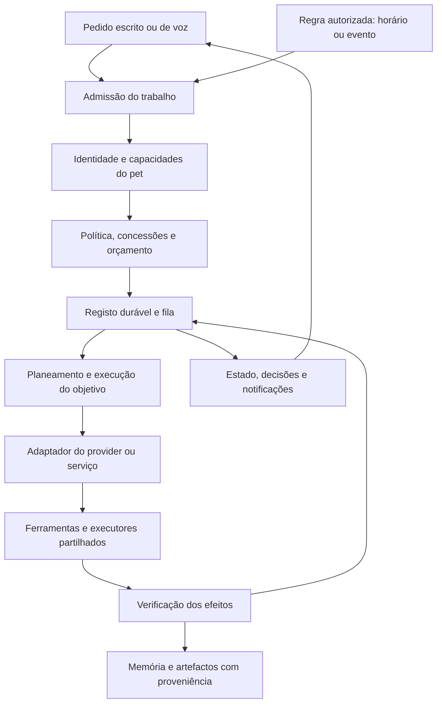
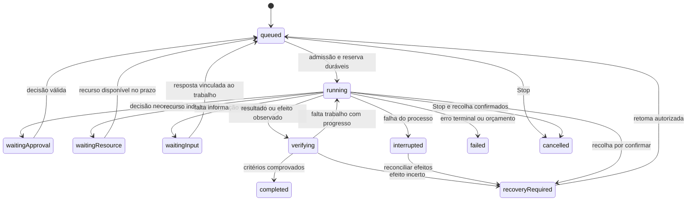

# Arquitetura dos pets autónomos de AI

Revisão normativa: **24 de outubro de 2026**. Projeto: `coucou-codex`, branch
`feat/mochi-cli-accounts`. Este documento define o sistema a construir e os
contratos que orientam o desenvolvimento. Um contrato definido aqui pode ainda
não estar implementado; a prova de implementação tem localização própria.

## 1. Prioridade, objetivo e documentos de referência

A ordem expressa pelo utilizador é:

1. **Arquitetura:** manter requisitos, contratos, dependências e critérios de
   aceitação completos e coerentes com o código e com as decisões do utilizador.
2. **Pets:** desenvolver os assistentes, a sua continuidade, execução, memória,
   contexto pessoal, autonomia e cooperação, abrangendo os vários providers.
3. **Sistema e integrações:** desenvolver as capacidades necessárias aos pets
   segundo os contratos comuns. A matriz de Sistema fica definida desde já;
   construir widgets ou completar todas as componentes físicas não precede o
   motor dos pets.
4. Frontend/UX: apenas controlos necessários a uma capacidade, aprovação,
   preservação de dados ou entrega. Melhorias visuais continuam adiadas.

O objetivo é ter **assistentes digitais disponíveis no dia a dia, capazes de
compreender objetivos, trabalhar com continuidade, usar ferramentas autorizadas,
verificar resultados, recordar contexto permitido e antecipar necessidades
através de regras escolhidas pelo utilizador**.

A disponibilidade inclui executar sem a conversa aberta, recuperar após falhas,
explicar limites e parar quando solicitado. Autonomia inclui planeamento e
execução dentro de uma autorização durável e limitada; não exige uma chamada
humana para cada leitura já autorizada. O âmbito das ações continua explícito.

| Documento | Responsabilidade |
| --- | --- |
| Este ficheiro | Arquitetura e requisitos normativos do produto |
| [PETS-GOAL.md](PETS-GOAL.md) | Texto integral revisto para o objetivo persistente da sessão |
| [PET-CAPABILITIES-CONTRACT.md](PET-CAPABILITIES-CONTRACT.md) | Contrato v1 do registo de identidade/capacidades, próximo incremento |
| [PETS-ROADMAP.md](PETS-ROADMAP.md) | Unidades de desenvolvimento, dependências, IDs e aceitação |
| [PETS-IMPLEMENTATION-STATUS.md](PETS-IMPLEMENTATION-STATUS.md) | Código existente, lacunas, versões, provas e próxima execução |
| [AI-LOCAL-REUSE.md](AI-LOCAL-REUSE.md) | Avaliação do projeto AI Local descontinuado e peças aproveitáveis |
| [Arquivo anterior](PETS-ARCHITECTURE-HISTORY-2026-10-23.md) | Requisitos detalhados e evidência histórica preservados |
| [COMPANIONS.md](COMPANIONS.md) | Contexto funcional e evolução da integração desktop |

A prioridade deste documento prevalece sobre prioridades antigas. Requisitos
históricos ainda sem substituição explícita permanecem no âmbito do produto e
estão agrupados no roadmap. Métricas de testes e números de builds não definem
sozinhos a conclusão de uma unidade ou do objetivo completo.

### 1.1 Regras de trabalho e preferências preservadas

- Um responsável de desenvolvimento, sem novos agentes. As unidades organizam
  o trabalho e a integração; a cooperação entre pets pertence ao produto.
- Desde 24/10, commits assinados e atualização do remoto estão autorizados
  assim que a composição estiver validada e coerente. Preservar hooks e assinatura
  YubiKey. Merge continua a exigir pedido explícito.
- Não consumir quota real de GitHub CLI/Copilot em ensaios. Usar fixtures e
  simulação nesses percursos; a aceitação real fica identificada como pendente.
  Ensaios necessários com modelos usam primeiro uma opção gratuita, depois a
  mais barata que satisfaça a capacidade a verificar.
- Só `integration_github` está temporariamente descontinuado. Preservar ID,
  preferências, perfis e dados. Gravity e Copilot CLI permanecem no âmbito.
- Manter Wi-Fi disponível e os sete widgets existentes. Um controlo de desligar
  Wi-Fi é uma operação explícita; não representa uma configuração pretendida
  para a estação. Ensaios não autorizam alterações de rádio/dispositivos.
- Código, dados e dependências do projeto ficam no seu âmbito. Alterações
  persistentes do anfitrião seguem as instruções da estação e sysworkspace.
- PostgreSQL é opcional; a disponibilidade local não autoriza ler bases de
  outros projetos, migrar dados ou ativar serviços.

## 2. Resultado funcional e critérios de sistema completo

O sistema tem de permitir, com autorizações e recursos disponíveis:

| Situação do dia a dia | Resultado esperado |
| --- | --- |
| Preparar o dia | Consultar calendários/fontes escolhidas, distinguir dados atuais de incompletos, apresentar compromissos e prioridades com proveniência |
| Trabalhar num objetivo | Criar trabalho persistente, planear passos verificáveis, executar ferramentas permitidas e continuar enquanto houver progresso e orçamento |
| Receber vários documentos | Conservar a coleção, associar os itens aos turnos, pesquisar o conteúdo autorizado e gerir retenção sem apagar referências ou reautorizar leitura silenciosamente |
| Fechar a conversa | O trabalho mantém o mesmo dono, tarefa e sessão; pode continuar em background, com decisões pendentes acessíveis |
| Reiniciar ou perder um provider | Recuperar estado durável, reconciliar efeitos e sessões e apresentar a retoma apropriada; operações incertas não são repetidas automaticamente |
| Usar voz | Reconhecer o pet e a intenção, partilhar a conversa/tarefa correta, respeitar idioma e capacidades e permitir parar ou responder a decisões |
| Criar uma rotina | Definir regra, fontes, horário/evento, ações, limites, notificações e política para ocorrências perdidas; executar sem manter uma janela aberta |
| Controlar o computador | Usar CLI, API, acessibilidade ou observação visual suportada; confirmar os efeitos no alvo exato |
| Usar mais de um pet | Escolher o pet adequado ou delegar trabalho autorizado, mantendo permissões, proveniência e um único responsável por cada efeito |
| Consultar o estado | Saber o que está a correr, espera, falhou, consumiu recursos e produziu resultado verificado; distinguir incógnitas |

O objetivo só está concluído quando estas situações têm percurso implementado,
integrado e aceite nas capacidades declaradas, com recuperação, cancelamento,
revogação e preservação de dados demonstrados. Uma capacidade indisponível num
provider aparece como indisponível e não é simulada por outro pet. A aceitação
por provider e por componente fica discriminada no roadmap.

## 3. Estrutura e fluxo comum

O alvo é um backend modular no processo desktop existente, com workers próprios
para IO e processos. Introduzir serviços independentes exige benefício concreto;
não é necessário reconstruir o antigo sistema multirepo para ter autonomia.

| Componente | Responsabilidade e fronteira |
| --- | --- |
| Registo de pets e capacidades | Identidade estável, papel, configuração, modelos e capacidades realmente observadas |
| Admissão e política | Validar dono, recursos, concessões, limites e intenção antes de criar ou executar trabalho |
| Motor de objetivos | Manter plano, tarefas, dependências, progresso, condições de paragem e conclusão verificável |
| Fila e agendador | Reservas, prioridades, concorrência, prazos, regras e recuperação durável |
| Adaptadores | Traduzir os contratos comuns para cada provider, conta e protocolo nativo |
| Broker de ferramentas | Validar operações tipadas, aprovações e alvos e encaminhar para executores |
| Executores partilhados | Serializar operações conflituantes em ficheiros, aplicações e componentes de Sistema |
| Verificação | Guardar observações e recibos e decidir se a pós-condição foi satisfeita |
| Contexto e memória | Selecionar fontes, anexos e recordações autorizadas com proveniência |
| Observabilidade e comunicação | Estado, consumo, decisões, falhas, notificações e controlos de pausa/Stop |

As janelas, widgets e voz são clientes destes contratos. O trabalho é propriedade
do backend; mudar de vista não altera o destinatário de uma resposta ou ação.

## 4. Identidades, capacidades e paridade entre pets

### 4.1 Entidades distintas

| Entidade | Contrato |
| --- | --- |
| `PetId` | Identidade persistente do assistente; nome/alias/modelo não a substituem |
| `ConversationId` | Conversa local do pet, independente da sessão nativa |
| `NativeSessionId` | Identidade canónica no provider, com origem e ligação verificadas |
| `GoalId` | Objetivo durável pedido pelo utilizador, com critérios de conclusão |
| `TaskId` / `StepId` | Execução concreta e passo com autoridade, orçamento e recibos próprios |
| `AttemptId` | Tentativa de inferência, com modelo, consumo e resultado observado |
| `RuleId` / `OccurrenceId` | Regra autorizada e ocorrência deduplicável |
| `GrantId` / `ApprovalId` | Concessão limitada ou decisão vinculada a uma proposta exata |
| `ArtifactId` / `SourceId` / `MemoryId` | Cópia, fonte inscrita e recordação; cada uma com revisão e proveniência |

Um pedido guarda pet, conversa, tarefa, turno, modelo, origem, revisões e prazo
antes das esperas. A autoridade efetiva é construída no backend autenticado.
Nomes, títulos de janela, diretórios ou IDs enviados por um modelo não conferem
controlo sobre uma sessão, pet, ficheiro ou dispositivo.

### 4.2 Descritor de capacidade

O contrato a implementar é um `PetDescriptor` versionado: ID, tipo
(`llm`, `service`, `observer`), adaptador, estado, configuração e revisão. Cada
capacidade publica suporte, disponibilidade, motivo, origem da observação e
frescura. Suporte desconhecido não equivale a suportado.
Os campos, estados, motivos, origens e critérios exatos estão no
[contrato v1 de capacidades](PET-CAPABILITIES-CONTRACT.md). O núcleo de leitura e as observações de histórico nativo por alvo estão
integrados nas fontes, com adoção inicial no chat comum, preparação da voz e
observabilidade da gestão. A entrega da composição atual continua pendente. A preparação separa presença do adaptador, configuração e identidade
de autenticação/modelo pronto; voz conserva o perfil e dono próprios do pet.
Cobertura e adoção completas e
aceitação nativa continuam pendentes. O contrato integral não está fechado.

O contrato abrange conversa, streaming, cancelamento, ferramentas, decisões,
imagens/documentos, voz, continuidade, execução, memória, fontes, Sistema,
consumo e cooperação. Uma capacidade só fica utilizável quando coincidirem:

`implementação ∩ suporte observado ∩ configuração ∩ permissões ∩ política do trabalho ∩ orçamento`.

Capacidades dependentes do modelo pertencem ao modelo exato selecionado. A
existência de um adaptador HTTP, perfil ou ID num JSON não prova um pet completo.
Não trocar conta, provider ou modelo silenciosamente para satisfazer um pedido.

Na configuração atual, o campo `provider` faz parte da identidade validada do
pet. O novo descritor deve resolver adaptador/endpoint/capacidades sem alterar
essa identidade por conveniência. Perfis com `provider` vazio e adaptadores de
API existentes exigem integração e migração explícitas antes de anunciar execução.

### 4.3 Evolução da fábrica e do framework comum

A fábrica atual resolve os moldes `llm`/`application`, extensões e preferências
bundled. `pet_config` e os consumidores usam esse catálogo; a fábrica não é um
executor nem um mecanismo de autorização. Melhorias no núcleo comum propagam-se
pelos pets que usam esse núcleo, sem copiar implementações por pet.

**Pedido revisto do utilizador:** tornar a promoção de pets e a propagação de
melhorias mais prática. Centralizar num manifesto tipado os metadados de papel,
provider lógico e encaminhamento para adaptadores. As tabelas hoje repetidas
entre configuração, descritor e voz devem consumir essa origem comum. O manifesto
declara a rota implementada; suporte de modelo, disponibilidade e autoridade
continuam observados/revalidados pelos mecanismos próprios.

Os contratos de adaptador devem separar comportamento comum e diferenças nativas,
com testes gerados a partir do catálogo: cada entrada possui identidade/limitações
coerentes e cada rota implementada passa a matriz aplicável. Uma nova entrada não
herda execução só por escolher um molde. Proibir herança de credenciais, grants,
política de execução e decisões nativas mantém-se requisito da fábrica.

Alterações aos defaults não sobrescrevem preferências pessoais gravadas. Uma
migração de configuração precisa de versão, distinção de defaults/overrides e
prova de preservação dos IDs, modelos/perfis e permissões. Este desenvolvimento
segue a validação em curso de contexto/reservas e correção do censo CLI; integra
PET-01/04/05 e ARC-02, sem retirar âmbito aos restantes requisitos.

**Primeiro incremento nativo validado em privado:** o catálogo bundled passa
a schema2 com `runtime.kind` e um adaptador tipado explícito por entrada. A
configuração pessoal continua em versão1, com os mesmos 25 defaults resolvidos.
IDs de providers/tarefas, lista de serviços, classificação e binding do descritor
e escolha de adaptador na preparação da voz passam a consumir essa origem.
Rotas de canais distintos não podem identificar donos diferentes com a mesma
chave; partilhar uma conta Codex conserva o provider lógico de cada serviço.
Metadados de runtime/rotas/retirada não podem ser herdados dos moldes/extensões.

O catálogo só pode escolher entre adaptadores realmente implementados. APIs e
LM Studio mantêm a sua classificação de LLM e histórico, sem receber execução
pela declaração. Observadores conservam referências históricas. Spotify mantém
a rota determinística, com provider vazio por omissão; um backend de assistência
explicitamente configurado é preservado e admitido pelo contrato opcional da
fábrica (16.8). Só a entidade GitHub
continua retirada. Um teste derivado do catálogo exige controlador nativo para
cada rota de voz declarada; acrescentar metadados não implementa esse controlador.
Promover um pet para conversa/execução exige completar o adaptador, provar o
contrato de dono/contexto/modelo, cancelamento/decisões/recuperação aplicável e
anunciar as limitações efetivas. O manifesto nunca substitui esses controlos.

A unidade654 passou 1818 testes Rust/12 ignorados, 1082 JS e check/TSC/Vite,
preservando os defaults e as fontes653. A primeira suite Rust teve uma falha
num helper de recuperação de rede anterior; esse caso passou isoladamente e
a suite completa passou com quatro testes em paralelo, sem alterar fontes.
Esta prova não é aceitação nativa nem instalação. Ver
[estado e limites](PETS-IMPLEMENTATION-STATUS.md) e
[checkpoint](PETS-VALIDATION.md#evidencia-local).

A validação dos donos de objetivos deve consumir as rotas e adaptadores da mesma
fábrica, incluindo o assistente opcional de um serviço. O provider lógico do
Spotify mantém-se `integration_spotify` quando o seu assistente é Codex; não se
transforma no pet Codex. Esta compatibilidade estática permite ler um registo e
não concede execução. Conservar os identificadores de registos antigos de APIs e
observadores; criar trabalho novo exige descritor nativo ativo, configurado e com
adaptador realmente declarado. Retirada e falta de executor impedem criação/
admissão, sem apagar histórico. Troca de adaptador/modelo/configuração exige nova
revisão e não converte um objetivo ou consentimento antigo.

**Incremento718 integrado:** este contrato passa pela fábrica e pela construção
nativa do dono a partir do descritor. Sete regressões novas, 2141 Rust/17 ignorados,
1109 JS, check/TSC/Vite e 181 ensaios privados do runtime no host, sem novos avisos.
Os schemas e os 25 defaults permanecem iguais. Não implementa executores de APIs
ou suporte autónomo adicional: compatibilidade estática não é autorização.
[Prova e limites](PETS-VALIDATION.md#evidencia-local).

### 4.4 Cobertura a desenvolver

| Grupo | Contrato e lacuna principal |
| --- | --- |
| Codex | Sessão/turno nativos inequívocos, ferramentas/aprovações, continuidade e consumo com cobertura real; alvo externo ambíguo mantém apenas leitura |
| Gravity | Conversa própria e sessões externas distintas; resolver controlo/continuidade e aprovações interativas sem ampliar permissões para contornar limitações |
| Copilot CLI | Preservar ACP/ponte e decisões nativas; fixtures para capacidades, continuidade e falhas; ensaios reais que consumam quota permanecem suspensos |
| Ollama | Conversa e execução local quando o modelo anuncia ferramentas; motor supervisionado existente como base; memória, tarefas duráveis e regras usam o mesmo dono |
| LM Studio e APIs | Verificar configuração e ligação do pet, formatos e ferramentas realmente suportados; completar os percursos declarados antes de os oferecer como equivalentes aos restantes |
| Observadores/integrações CLI | Um agente detetado ou hook não implica conversa controlável; anunciar apenas as operações efetivas |
| Spotify/serviços | Operações determinísticas e autoridade própria; a especialização de áudio não exige um LLM. Qualquer executor LLM associado tem dono e contexto explícitos |
| GitHub entidade | Identidade e dados preservados; novos pedidos continuam desativados |

Os contratos comuns são exercitados em todos os adaptadores aplicáveis. Trabalho
no Codex não fecha automaticamente lacunas do Gravity, Ollama ou outros pets.

## 5. Autonomia, autorização e controlo pelo utilizador

### 5.1 Modos por pet e por regra

| Modo | Comportamento |
| --- | --- |
| A pedido | Responder a uma intenção explícita; não inicia objetivos próprios |
| Assistida | Planear, consultar recursos já autorizados e propor ações; ações que exigem decisão aguardam aprovação |
| Delegada | Concluir um objetivo dentro de concessões explícitas de ferramentas, recursos, limites e validade |
| Programada | Iniciar ocorrências de regras autorizadas por horário ou evento, sob os mesmos limites da autonomia delegada |

A autonomia efetiva é a interseção das permissões do pet, da concessão do
objetivo/regra e da política da operação. Ativar um modo não concede documentos,
Sistema, contas, memória partilhada ou comunicação externa. A configuração
inicial mantém os comportamentos atuais; novas rotinas exigem configuração.

### 5.2 Concessões e decisões

Uma concessão define dono, capacidades/operações, recursos e alvos permitidos,
restrições de argumentos, prazo, limites e revisão de política. Pode autorizar
leituras repetidas ou uma receita tipada durante um objetivo, evitando pedidos
redundantes. A aprovação de um comando livre continua vinculada ao comando exato,
pasta, executável, tarefa e prazo; o modo Ask existente conserva essa regra.

Receitas automáticas futuras têm ID/versão, argumentos tipados e limitados,
recursos explícitos e verificação definida. Uma receita não pode transformar-se
numa aprovação genérica de shell. As aprovações e autenticação nativas do provider
ou do sistema operativo mantêm-se necessárias onde aplicáveis.

Revogar uma concessão impede novos passos e descarta resultados tardios como
autoridade para novas ações. Operações já iniciadas conservam recibo e reconciliam
o efeito real. Stop não significa que efeitos anteriores foram desfeitos.

Conteúdo de páginas, anexos, calendários, email, memória recuperada e saídas de
ferramentas é dado não fiável. Não cria permissões, não altera a política e não
pode induzir inscrição de fontes, instalação de plugins ou delegação de autoridade.

### 5.3 Comunicação e ações sensíveis

Preparar uma mensagem, abrir um rascunho e enviá-la são capacidades distintas.
O comportamento instalado de email prepara rascunhos, com acesso ativo apenas no
Ollama por defeito. Não há autorização atual de envio autónomo. Um envio futuro
exige capacidade própria e concessão explícita de destinatários, canal e limites.

Credenciais e prompts de autenticação pertencem ao mecanismo nativo e ao pedido
exato. Permanecem fora dos prompts, conversas, argumentos de processo, logs e Git.

## 6. Motor de objetivos e tarefas duráveis

Este motor comum é **desenho a implementar**. As tarefas e os loops existentes
são a base de integração; ainda não provam este contrato integral.

Um objetivo guarda intenção original, critérios de conclusão, pet responsável,
contexto autorizado, orçamento, política de autonomia e estado. O plano é
revisionado; passos independentes podem executar em concorrência, com limites.
Uma alteração que alargue recursos, custo ou efeitos exige nova autorização.

O objetivo/regra tem uma conversa própria ou uma associação explicitamente
escolhida. Executar em background não troca a conversa selecionada na UI,
arquiva o rascunho do utilizador ou publica numa conversa que entretanto passou
a estar visível. A estrutura atual de conversa corrente por provider exige uma
admissão/associação própria para estes trabalhos; não basta criar uma fila.

### 6.1 Ciclo do trabalho

`paused` é uma decisão explícita de suspensão; não substitui erro, espera por
recurso ou falta de progresso. Os estados atuais `thinking`, `working`,
`searching` e `message` continuam úteis como atividade. A migração deve separar
atividade transitória de estado durável, sem reinterpretar cegamente os journals.
O código atual reduz `SavedConversation.tasks` a dez entradas e limita
`Task.query` a 4000 caracteres. Esse histórico não é o repositório do motor de
objetivos: a migração conserva referências e recibos antigos, assinala a possível
incompletude da intenção e exige critérios/política próprios para nova admissão.
`Task::terminal()` também inclui `interrupted` e `resumed`; isso não demonstra
conclusão de um objetivo. Abrir ou migrar o novo repositório nunca lança trabalho.
Stop também cancela admissões e decisões nos estados de espera; uma recolha
incerta conserva esse motivo e não é apresentada como paragem física confirmada.

### 6.2 Progresso e conclusão

Um passo define entrada, recursos, pós-condição, prazo, possibilidade de repetição
e forma de verificação. O motor mede progresso por evidência nova ou mudança
verificada de estado, não pelo volume de texto nem pela confiança do modelo.

Repetição do mesmo plano/erro sem evidência nova faz o trabalho esperar por
informação, reduzir o plano dentro do âmbito autorizado ou terminar com motivo.
Há limites de ciclos e tentativas. A conclusão exige os critérios do objetivo,
recibos das ações e pendências explícitas; uma resposta final do modelo não basta.

Guardar a admissão e o passo precede iniciar efeitos. O checkpoint inclui plano,
origem, tentativas, consumo, decisões, artefactos e efeitos conhecidos/incertos.
Uma falha de persistência impede iniciar um novo efeito e conserva qualquer
resultado já produzido, com indicação da incerteza de gravação.

### 6.3 Reinício e repetição

No arranque, um trabalho antigo em execução passa a interrompido ou a reconciliação.
Não reproduzir comandos, envios ou decisões antigas automaticamente. A retoma
verifica sessão, processo, recursos, permissões e efeitos já observados.

Uma ferramenta idempotente pode repetir dentro da política. Para efeitos externos
sem idempotência garantida, um ACK perdido exige consulta do estado ou decisão
humana. O sistema não promete execução exatamente uma vez num serviço externo.

### 6.4 Primeiro repositório do runtime — decisão de implementação

RUN-01 começa com um registo privado por objetivo, independente do journal das
conversas. O envelope versionado reúne intenção original, critérios, dono e
associação de contexto, planos, tarefas, passos e eventos. Recusar entradas acima
dos limites; não truncar a intenção ou eliminar tarefas ativas. A primeira versão
admite rascunhos e planos propostos; não concede execução a partir dos dados gravados.

O primeiro kernel expõe os estados de preparação `draft`, `paused`, `cancelled`
e `recoveryRequired`. Tarefas/passos guardados são propostas; `resumeDraft`
retoma a preparação. A importação conservadora de tarefas antigas conserva
referências/recibos e exige reconciliação mesmo quando a fase antiga era `done`.
Cancelar essa referência não afirma que o processo antigo parou. A fila, leases,
orçamentos, autorização e execução do ciclo completo continuam em RUN-02/03/04.
O caminho local é `config_dir()/pet-runtime-v1/<goalId>.json`; abrir/listar este
caminho não cria conversas, altera seleção da UI ou inicia providers.

Os IDs de pedido são estáveis para repetir uma criação incerta com o mesmo
conteúdo; reutilizá-los com conteúdo/dono diferentes dá conflito. Cada mutação
exige a revisão original, publica uma revisão nova e um evento. O backend define
pet/provider/adaptador a partir da configuração; o frontend não escolhe executor,
origem de autoridade ou concessões. Uma conversa existente pode ser associada
explicitamente sem alterar a seleção/rascunho da UI. Contexto ainda por resolver
permanece por resolver até à admissão RUN-02.

Limites iniciais: 256 objetivos, 128 tarefas e 512 passos por objetivo, 32 planos,
32 critérios, intenção até 64 KiB e envelope até 4 MiB. Não fazer GC implícito.
Reservar capacidade de controlo para cancelar quando o histórico de eventos
atinge o limite; uma nova atividade não pode impedir a paragem posterior.
Estes limites são do repositório, separados do orçamento de inferência/execução.

O backend local Linux usa diretório privado identificado por protocolo, exclusão
de escritores, acessos relativos ao descritor do diretório, substituição atómica
e sincronização do ficheiro, diretório do objetivo e diretório pai. Recusar links
e ficheiros/locks de identidade ou permissões
inesperadas. Uma falha anterior à publicação conserva a revisão original;
depois da publicação pode exigir reconciliação e devolve recibo incerto, sem
incentivar repetir efeitos. Artefactos incompletos ficam identificados para
recuperação, sem execução ou limpeza automática de dados desconhecidos.

Abrir/listar não cria o repositório nem executa trabalho. Uma recuperação explícita
marca execução/decisões antigas para reconciliação, sem replay. A migração de
`assistant_tasks` importa referências/recibos com indicação de intenção incompleta;
não inventa critérios, autorização ou conclusão a partir de `phase`/`terminal()`.
PostgreSQL permanece opcional atrás do contrato do repositório; esta unidade não
requer novos serviços, credenciais ou dependências globais. A aceitação de RUN-01
ainda exige a integração/migração; RUN-02/03/04 completam admissão, fila, execução,
verificação e recuperação no percurso real dos pets.

Este primeiro kernel está implementado e verificado em 650 fontes privadas:
1792 Rust/12 ignorados, 1074 JS, cargo check, TypeScript e Vite. O contrato
`Repository`, os comandos nativos e a bridge tipada já existem; as provas atuais
são sintéticas/offline, com diretórios de teste. O módulo não foi ativado na
aplicação instalada. `goals.draft`/`goals.inspect` são operações de preparação
para `nativeUser`; `goals.run` continua por implementar. Este estado não fecha
RUN-01 nem demonstra o motor autónomo completo.

### 6.5 Propostas de operações e vinculação exata da revisão

Um passo pode propor uma operação por ID/versão do catálogo comum e argumentos
tipados, além da descrição e pós-condição humana. Validar o schema e os limites
na proposta; a proposta é dados e não um permit de execução. IDs desconhecidos,
versões não suportadas e argumentos inválidos são recusados antes de persistir.
O journal de objetivos usa versão6 quando contém propostas tipadas ou a nova
vinculação de revisão; este schema é distinto do histórico de conversas.

A revisão nativa apresenta intenção, critérios, tarefas e planos exatos e sela
o seu conteúdo estático na admissão. IDs, ligações, descrições, pós-condições e
argumentos ficam vinculados; estados transitórios de progresso não mudam essa
identidade. Revalidar o selo ao confirmar, certificar, admitir e usar uma
admissão ativa, mesmo que um ficheiro alterado conserve a revisão aparente.
Admissões antigas fechadas conservam o seu selo histórico quando o utilizador
retoma um draft e propõe trabalho novo.

O writer textual recebe a intenção e os critérios integrais e as propostas
revistas como dados, com limite agregado explícito e recusa sem truncagem. A
pergunta legível apresentada na atividade e no histórico visível conserva a
intenção original; o envelope de contexto fica no pedido privado ao modelo. Uma
admissão legada sem selo não adota propostas como contexto revisto. A leitura de
recibos antigos mantém-se independente e não revive workers.

A admissão atual continua a autorizar só `conversationRespond`: os campos de
revisão devem dizer que a execução de ferramentas está indisponível. Um limite
`maxToolCalls` não é concessão. Executar os passos exigirá autoridade própria,
alvos/recursos vinculados, ledger/recibos e verificação independente; não inferir
essa autoridade a partir das propostas ou da aprovação de uma resposta textual.

O incremento710 integra esta vinculação: 2106 Rust/16 ignorados, 1107 JS,
check/TSC/Vite sem novos avisos e 155 casos privados do runtime no anfitrião.
O input revisto do modelo tem limite agregado de 256 KiB, com recusa antes da
inferência se não couber. As fixtures não executaram modelos ou dispositivos
reais. A app instalada continua na .30; o dispatcher de planos/ferramentas e a
verificação dos critérios permanecem pendentes.
[Prova e limites](PETS-VALIDATION.md#evidencia-local).

### 6.6 Entrada operacional e supervisão dos objetivos

A área de Tarefas usa os mesmos IDs e APIs nativos dos objetivos. Criar guarda o
intento/critérios, tarefa/plano propostos e um contexto dedicado; cada publicação
precisa de ACK durável ou idempotente antes da seguinte. Uma confirmação incerta
interrompe o encadeamento e exige leitura/reconciliação. Abrir, atualizar ou fechar
a vista não aprova, repete efeitos ou inicia modelos. Os rascunhos e revisões
permanecem estáveis durante leituras periódicas; uma fonte indisponível conserva
o último estado como tal, sem o confundir com uma observação atual.

A disponibilidade passiva não inicia IO de modelo. A inspeção explícita antes de
rever/confirmar admissão e claim consulta apenas metadados do modelo Ollama
configurado em loopback, com alvo lógico original, prazo, reserva e cancelamento.
Uma alteração de pet/provider/adaptador é recusada. Um `modelHint` que se resolve
após criar o rascunho conserva a identidade do dono; o modelo concreto, política
e limites são selados na admissão e revalidados antes de uso. A observação de
metadados não concede execução nem renova orçamento.

A revisão de trabalho e a revisão de receita são decisões distintas. A primeira
sela o trabalho/limites; a segunda autoriza os efeitos exatos apresentados. A
execução continua numa chamada nativa própria com o controlador retido. Uma
reserva lida do disco não o recria. Texto produzido pelo modelo conserva critérios
não verificados; conclusão exige a cadeia de prova nativa. A gestão tem APIs de
consulta/resposta apenas de objetivos, reutilizando o broker sem ganhar a
faculdade de responder às permissões originais de sessões CLI.

**Incremento759 integrado — entrada funcional de objetivos RUN-01/02/EXE-02:**
a área existente de Tarefas passa a chamar criação/contexto/admissão/claim/resposta/
receita/consulta/Stop nativos. O formulário usa identidades da fábrica, prepara
contexto dedicado e conserva a revisão e os limites originais. A gravação incerta
interrompe a sequência de chamadas; abrir/atualizar a vista não inicia inferência,
ações ou aprovação. Os controlos permitem propor uma sequência de música e os
critérios finais explícitos, sem converter a proposta em permissão. A gestão tem
transporte de decisões apenas de objetivos; não ganha acesso às respostas de
permissões nativas de terminais. A inspeção explícita de metadados Ollama resolve
a preparação sem inferência, com alvo/configuração locais e cancelamento; o
modelo resolvido é selado na admissão, sem trocar a identidade do dono. Uma
reserva guardada sem controlador vivo não dá origem a outra execução.

Foram aplicados 20 ficheiros com 15 pré-imagens e cinco fontes novas. Passaram
2370 Rust/20 ignorados, 1153 JS, check/TSC/Vite e 274 ensaios privados no anfitrião;
cinco helpers do runtime são invocados pelos pais, sem novos avisos/modelos/quota.
O controlador e os controlos funcionais têm fixtures; os metadados e o broker
exercitam IO nativo privado. Não se comprovou o ciclo gráfico completo da app,
microfone/TTS, inferência real ou entrega. A app instalada continua na .30.
[Aceitação e limites](PETS-VALIDATION.md#evidencia-local).
[Checkpoint](PETS-VALIDATION.md#evidencia-local).

A mesma unidade continua: planeamento/replaneamento limitado, despacho nativo,
restantes operações/verificadores/adaptadores e aceitação operacional/entrega.
As revisões v2 selam os planos originais; replanear exige uma transação nativa
explícita que preserve o orçamento comum, e não remover a guarda dos planos ou
das chamadas internas das CLI. Os 43 requisitos permanecem no âmbito.
[Contrato seguinte](PETS-VALIDATION.md#evidencia-local).

### 6.7 Planeamento limitado com publicação autenticada — desenho escolhido

A evolução do planeador usa uma concessão própria, com o mesmo orçamento e prazo
do objetivo, catálogo nativo permitido e limites de rondas, passos, saída e falta
de progresso. A proposta do modelo é dado tipado e limitado; não aprova nem
concede efeitos. As aprovações de receita e as permissões originais das CLI
mantêm a sua autoridade. A guarda de adaptadores sem limites internos comprovados
permanece. Este desenho está escolhido e ainda não corresponde a implementação
completa do ciclo autónomo.

A revisão atual v2 continua a selar o plano imutável. A evolução v3 deve selar a
semente e a política de planeamento, mantendo um journal nativo autenticado de
rondas junto ao ledger de tentativas. Reservar ronda e orçamento é uma transação
única anterior ao IO. O resultado e a proposta têm provas imutáveis com hashes
da origem, modelo/tentativa, política e conteúdo. Um ACK incerto não renova a
chamada nem inicia execução.

Adicionar um plano durante uma reserva exige CAS do registo de origem e uma
confirmação nativa da publicação, sob o controlador original e sem workers em
curso. Leitores e executores verificam assinatura, conteúdo e pertença ao journal;
JSON não pode acrescentar/remover uma ronda ou recriar o controlador. Novos
âmbitos de passo/receita referenciam o plano confirmado e a proposta exata. Os
formatos anteriores conservam o seu comportamento; alterações de schema seguem
a aceitação de migração, preservação e rollback antes de instalar.

O dispatcher nativo continua independentemente da vista, limita os ciclos,
executa apenas receitas autorizadas, verifica resultados e replaneia com provas
nativas e saldo restante. Efeitos desconhecidos param para reconciliação. Uma
medida posterior não substitui a observação final original; texto do modelo não
conclui critérios. O mesmo contrato da fábrica deve propagar estes comportamentos
aos adaptadores, respeitando o suporte efetivamente implementado.

## 7. Fila, regras, limites e recursos

### 7.1 Preparação de contexto e reserva física — núcleo privado verificado

A fila só pode despachar depois de resolver a independência do contexto e do
controlo. Na aplicação instalada, a reserva de `Chat` fixa a conversa corrente
de uma instância. A unidade privada653 introduz um coordenador de recursos
partilhado pelas conversas manuais e pelos contextos privados dos objetivos.
O âmbito inicial é o provider lógico do pet; serviços com executor Codex mantêm
o seu dono próprio. Não transformar o coordenador num bloqueio de todos os pets.

O handle do worker/reserva conserva a posse física até terminar. Cancelamento ou
expiração invalida novas operações mas não liberta um slot ainda detido pelo
worker. Metadados de turno e revisão não constituem prova de posse. A validação
de admissão conserva o prazo original, incluindo preparação/espera; o dispatcher
terá de cancelar e recolher workers no prazo, sem roubar a sua reserva.

Cada objetivo prepara uma biblioteca privada com CID próprio, identificada pelo
objetivo/pet/provider, sem modificar a conversa ou rascunho visível. Quando o
objetivo referencia uma conversa Mochi existente, uma cópia do histórico exige
modo explícito de snapshot e conserva a origem/hash do conjunto copiado. Não
copiar tarefas ativas, sessões nativas, aprovações, anexos ou concessões da
conversa original como autoridade do novo contexto. O contexto de execução e
a associação original são campos distintos. Preparar não inicia inferência.

A biblioteca e o seu marcador ficam privados e com exclusão de escritores. Uma
preparação interrompida ou uma divergência de dono/CID/origem exige recuperação,
sem adotar outra conversa. Callbacks, respostas e decisões usam o chat/alvo do
pedido original; não consultam a conversa visível no momento da callback.
O incremento prepara este percurso; a admissão autorizada, fila durável,
leases persistidas, orçamento e dispatch continuam requisitos RUN-02/03/04.

O agendador pertence ao backend e continua com as janelas fechadas enquanto a
aplicação permanece ativa. Uma janela não possui processos ou filas de trabalho.
A necessidade de um serviço separado será avaliada apenas se este ciclo de vida
não satisfizer os requisitos; não instalar um daemon por antecipação.

### 7.2 Admissão durável — contrato e núcleo privado

A admissão vincula a revisão original do objetivo/tarefa, pet/provider lógico,
contexto preparado, adaptador/modelo/endpoint efetivamente resolvidos, referências
às concessões e revisões de política/capacidades, prazo e orçamento. O backend
constrói este registo após verificar esses elementos; uma proposta do modelo,
um campo recebido da UI ou um envelope recuperado do disco não é um permit.
Não confundir `routing.execute` do catálogo com autorização do trabalho.

Antes de iniciar efeitos, persistir a admissão e a reserva de orçamento/lease
sob revisão e idempotência. A fila deve derivar de estado durável reconciliável;
um índice separado não pode iniciar trabalho que o registo do objetivo não
reconhece. A posse durável e o handle físico têm funções distintas: expirar a
primeira impede novos efeitos, mas só o fim do worker liberta a segunda.

No dispatch, revalidar dono/contexto, concessões, política, capacidades, modelo e
prazo originais. Mudança ou revogação devolve motivo tipado e pausa/recusa; não
trocar conta, modelo, conversa ou ampliar validade para conseguir executar.
Reabrir registos não repete efeitos. Trabalho com lease interrompido ou efeito
incerto exige reconciliação pelos recibos e controlador nativo original antes
de retoma. A perda do processo não prova cancelamento remoto ou custo zero.

**Primeiro núcleo RUN-02 verificado em privado, unidade657:** revisão exata
mantida no backend, tokens de uso único por janela/pet/objetivo/revisão,
revalidação de prontidão/modelo/política/contexto e histórico de admissões no
mesmo envelope do objetivo. O schema3 acrescenta o estado `queued`; pausa e
cancelamento encerram apenas entradas que ainda não possuem worker. Retomar
o draft exige nova revisão e preserva as decisões anteriores. Gravação incerta
e repetição devolvem recibos de dados, sem renovar prazo ou iniciar trabalho.

Os limites fixados incluem prazo, chamadas, ferramentas e bytes de saída; limites
finitos de tokens/custo são recusados quando não existe medição adequada. A
revisão usa observações frescas e pode devolver indisponibilidade: não inventa
prontidão a partir de um modelo/default ou de uma conta presumida. Os comandos
nativos e a bridge existem; controlos de revisão, produtores efetivos de
prontidão e aceitação dos providers ainda requerem integração. Passou 1833 Rust/
12 ignorados, 1084 JS e check/TSC/Vite, com fontes654 preservadas.

A unidade não faz dispatch, não reserva consumo no writer e não produz um permit
de execução recuperável. Leases, autorização verificável após reinício, execução,
orçamento aplicado, verificação e recuperação continuam RUN-02/03/04. `goals.run`
permanece indisponível. Os schemas3 e anteriores precisam de backup/migração e
rollback aceites antes de ativação.

### 7.3 Proveniência de consentimento — núcleo privado verificado

Para admitir execução após reabertura, não basta validar a forma de uma entrada
`queued`. Acrescentar prova autenticada do consentimento nativo, vinculada ao
objetivo/revisão de origem, contexto, operação/modelo, política e limites exatos.
A chave pertence ao estado privado da aplicação, com protocolo/versão e leitura
segura; nunca ao catálogo, à UI, ao modelo ou ao próprio ficheiro do objetivo.
Verificar proveniência e condições atuais precede construir um permit efémero
tipado. Ausência, alteração ou chave indisponível exige nova revisão/reconciliação,
preservando dados; não adotar silenciosamente decisões antigas sem prova.

O claim durável fixa controlador/lease e revisão antes de iniciar efeitos; um
recibo incerto impede esse início até reconciliação. O handle físico conserva o
recurso até terminar o worker real. Stop/expiração revoga novas operações, mantém
o lease em reconciliação e não declara cancelamento remoto ou libertação física.
Uma instância nova nunca toma posse de uma sessão nativa ambígua ou mata terminais
externos para recuperar um objetivo. A posse/execução permanece requisito da
integração seguinte, separado da prova de consentimento.

**Unidade660 validada em privado:** schema4 acrescenta uma prova HMAC-SHA256 por
admissão, com versão e operação explícitas, usando `ring` já existente. A chave
aleatória de 32 bytes e o ledger de concessões têm namespace privado
`pet-runtime-consent-v1`, distinto dos objetivos. A criação publica a diretoria
completa; protocolos, dono/modo, symlinks/hardlinks, limites, identidade da chave/
diretoria/lock e sincronização são verificados. Chave perdida/corrompida ou
namespace estrangeiro não são regenerados/adotados automaticamente.

A certificação só segue a confirmação da revisão original no backend. O ledger
autentica estados `issued`/`revoked` com domínio separado da prova de consentimento;
pausa/cancelamento revoga primeiro, antes da publicação do estado do objetivo.
Uma cópia antiga do JSON do objetivo não repõe uma concessão revogada. Repetir
um recibo de pausa antigo não revoga uma admissão posterior. Publicação incerta
conserva artefactos e exige reconciliação; capacidade esgotada recusa novas
entradas sem apagar metadados desconhecidos.

O endpoint de proveniência é só leitura, sem criar chave, e devolve sempre
`executionAvailable: false`. Autenticidade não prova política/prontidão atuais.
Os registos unsigned do schema3 conservam leitura e exigem nova revisão explícita;
não há upgrade automático para autoridade. Passou 1854 Rust/12 ignorados,
1085 JS e check/TSC/Vite, incluindo os cinco donos nativos/serviço exercitados
pelas fixtures. Não houve chamadas a modelos ou instalação.

O âmbito de proteção pressupõe acesso reservado do backend à chave e ao ledger.
A exclusão deste estado de fontes/contexto/ferramentas dos pets e o isolamento de
processos com acesso irrestrito à mesma conta exigem aceitação própria. Rollback
de todo o perfil, backup/recuperação/rotação da chave, órfãos e falhas durante a
criação da chave continuam na aceitação de dados/release. HMAC autentica estes
registos; as conversas mantêm o seu formato de persistência documentado.

### 7.4 Posse durável dos workers — núcleo privado verificado

O claim deve verificar a proveniência, revisão atual e condições frescas do
contexto/pet/modelo/política/recursos/prazo. Conservar a ordem de locks
objetivo → autoridade nos passos que precisem de ambos; revogação não mantém
o lock da autoridade enquanto escreve no objetivo. Persistir controlador,
identidade do lease e orçamento reservado antes de entregar um permit efémero
ao writer. A mesma decisão não admite dois controladores, mesmo com outra
instância ou uma cópia antiga do JSON.

Falhas entre publicar o claim no ledger e no objetivo exigem reconciliação antes
de efeitos. Expiração/Stop não libertam a posse física de um worker vivo. Uma
instância nova exige prova do estado/controlo nativo original para reconciliar
um lease interrompido; não o toma como livre por decurso do prazo. O dispatcher,
o orçamento aplicado em cada chamada e a aceitação dos adaptadores continuam
pendentes. `goals.run` permanece indisponível.

**Unidade664 verificada em privado:** schema5 fixa lease/controlador/contexto/
modelo/política/prazo no objetivo e schema2 autentica o claim no ledger privado.
Uma admissão tem um controlador durável por provider lógico, mesmo entre
instâncias e após expiração. Publicação incerta não devolve owner de worker;
o pending original conserva contexto/reserva e reconcilia com o mesmo lease,
sem renovar prazo ou criar outro owner. Uma instância nova não fabrica essa
posse a partir dos dados guardados.

Pausa/cancelamento com lease passam por `stopping`; o recurso físico mantém-se
até os guards de IO registados terminarem e a drenagem ser reconciliada.
`leaseDrained` conserva estado de recuperação quando falta confirmação do efeito;
não conclui critérios do objetivo. O controlador original pode abandonar uma
preparação interrompida antes de produzir owner, preservando intenção e trilho.
Contenção transitória do ledger ou observação desconhecida bloqueiam nova
operação sem cancelar permanentemente outro trabalho válido. Alteração/revogação
confirmada, contexto inválido ou prazo expirado continuam a invalidar o lease.

Os endpoints nativos preparam/consultam/libertam metadados de posse e devolvem
`executionAvailable:false`. Reserva local, claim confirmado, número conhecido
de guards e lease só guardado em disco têm campos/origens distintos; este último
conserva workers desconhecidos. O holder físico pode omitir apenas o seu próprio
busy numa projeção reconstruída; prontidão desconhecida nunca é elevada a Ready.
As APIs internas de registo de workers ainda aguardam produtores reais e writer.

Passou 1872 Rust/12 ignorados, 1087 JS e check/TSC/Vite, com fontes660 preservadas.
Os 17 casos de lease são sintéticos; um caso adicional confirma recusa de exec
de um helper cujo ficheiro ainda está aberto para escrita. Um fixture de rede
preexistente falhou numa ronda anterior e ganhou diagnóstico limitado de spawn/
exit; o resultado final verde não prova resolvida a causa intermitente anterior.
Não houve execução de modelos ou instalação. Startup/reconciliação nativa,
limpeza periódica de deadlines/pending, Stop sob contenção global, justiça e
recursos de modelo/dispositivo/conta permanecem na integração/aceitação.

### 7.5 Writer, orçamento e handoff do chat — primeira passagem nativa

O owner de lease e um guard de IO não concedem por si acesso a um modelo ou
ferramenta. Antes de cada efeito, reservar e persistir a tentativa e limites no
ledger, construir um permit efémero de uso único, confirmar a posse/política/
contexto/modelo/prazo atuais e conservar o recibo de consumo/resultado. Consumo
incerto mantém reserva; um retry não renova orçamento nem repete efeitos.

Integrar o hold já possuído na reserva real do chat privado, sem o tratar como
busy de outro controlador nem criar uma segunda reserva física. Os adaptadores
conservam origem/decisões nativas e a vida do worker até terminar stream/processo
próprio. Validar com fixtures e depois no percurso nativo aplicável antes de
anunciar `goals.run`. A unidade664, anterior ao writer, não fazia esse dispatch.

A primeira integração do writer é uma resposta textual ao intento original do
objetivo, no Ollama local configurado e aprovado. Confirmar metadados nativos
recentes de modelo instalado, rejeitando aliases remotos/desconhecidos. Tanto
a consulta de metadados como a inferência usam cliente local sem proxy nem
seguimento de redirects. A consulta conserva o seu guard de IO; não é uma
inferência. O prompt usa a identidade do pet resolvida pela fábrica comum. A
passagem não executa ferramentas, planos ou novos comandos gerados pelo modelo,
nem declara critérios cumpridos. CLI com chamadas/ferramentas internas ainda
não observáveis requer controlo nativo antes de expor execução autónoma.

O ledger autenticado de concessão evolui para schema3 apenas quando contém
`budgetUsage`; schemas1/2 sem esse campo mantêm a assinatura anterior. Cada
pedido tem ID lógico, ID aleatório da tentativa, hash do corpo/modelo/lease,
tipo, reserva de bytes e transições `reserved/started/settled/uncertain`. Guardar
estes dados não cria um permit. O writer que possui o guard e o contexto só
arma uma vez, depois da publicação durável; confirmação perdida após `started`
não permite repetir o efeito. Um novo objeto não adota o mesmo pedido lógico.

Contar tentativas de pedidos de modelo controlados pela aplicação, ferramentas
separadamente e bytes UTF-8 de conteúdo aceite antes de filtrar blocos de
raciocínio. Isto não limita geração remota, tokens ou custo desconhecidos;
limites finitos sem metering continuam recusados. Reservas incertas conservam
o teto completo. Um recibo completo liberta apenas bytes não usados, nunca a
contagem da chamada. O stream precisa de terminação explícita do protocolo;
texto parcial/erro/cancelamento não produz um recibo completo nem um retry cego.

O chat usa o mesmo hold físico do owner, com sinal de cancelamento próprio de
cada chamada: terminar/abandonar uma chamada não cancela o objetivo, enquanto
revogar o objetivo invalida todas as chamadas. Conservar o worker até o futuro
de IO local estar drenado; não afirmar que o modelo remoto terminou só porque
a ligação local fechou. Expor o resultado da resposta separado de verificação
de critérios e conclusão do objetivo. Migração/backup/rollback do schema3,
aceitação nativa e bloqueadores de retenção continuam antes de instalação.

**Unidade671 verificada em privado:** ledger de tentativas autenticado, handoff
do mesmo recurso físico e primeira resposta textual Ollama ligada ao writer
HTTP real com fixtures. Passaram 1916 Rust/12 ignorados, 1101 JS e check/TSC/Vite,
sem novos avisos e sem chamadas reais de modelos. O teste de Stop durante um
stream HTTP já recebido conservou o slot até à drenagem do guard; recibo ficou
incerto e não houve reenvio. [Checkpoint](PETS-VALIDATION.md#evidencia-local).

A aceitação seguinte deve separar prontidão fresca antes de cada efeito da
validade da operação já em curso: envelhecer uma observação de prontidão após
15 segundos não prova perda de autorização nem deve interromper uma resposta
longa por si só. Posse, consentimento/revogação, política/configuração/modelo,
contexto, prazo e Stop continuam verificados durante o IO. Nova chamada exige
novamente prontidão fresca. A unidade671 usava o fence de prontidão em ambos os momentos; essa lacuna foi
corrigida na unidade673, conservando a exigência de nova prontidão antes de
outro pedido e sem promover «desconhecido» a «pronto».

A separação usa modos internos tipados: `FreshEffect` antes de novos pedidos e
`InFlightPolicy` para IO já autorizado, mantendo a mesma posse/prova/prazo/
contexto. O segundo modo não pode ser pedido por JSON nem arma um modelo ou
ferramenta. A leitura nativa da política usa a mesma captura de configuração e
settings que produziu o descritor; não combinar duas revisões diferentes.
Uma leitura de prontidão pode usar um worker próprio sob o grant já possuído,
mas só o resultado genuíno capturado para o endpoint/modelo exatos renova a
cache. Falha ou metadados remotos/desconhecidos não publicam prontidão positiva.
O writer volta a verificar `FreshEffect` antes da reserva/armamento do próximo
pedido, incluindo depois da consulta de metadados. Esta integração passou a validação
privada da unidade673; não prova a paridade integral de sandbox/perfil/
aprovações com os terminais definida em §9.1.

**Unidade673 verificada em privado:** 1928 Rust/12 ignorados, 1101 JS e
check/TSC/Vite, sem novos avisos. Inclui 12 novas regressões e HTTP real simulado
que expira a prontidão depois de receber o pedido, preserva a resposta autorizada
e continua a bloquear a próxima chamada; revogar a política invalida a resposta.
A captura interna usa as mesmas configurações para descritor e revisão de
política. [Checkpoint](PETS-VALIDATION.md#evidencia-local).
A continuação de integração é CTX-01. A evidência terminal durável/descoberta
e remoção de metadados foi verificada na unidade675; restam aceitação de
restauro parcial/limpeza interrompida e migração/rollback. As fontes continuam
privadas e sem instalação.

- Uma reserva de tarefa conserva dono, prazo e orçamento originais, incluindo a
  espera na fila. Reservas expiradas não iniciam inferência nem ferramentas.
- Começar com uma execução de controlo por sessão e limites globais de workers,
  modelos locais e recursos. Slots físicos só são libertados quando o worker
  terminou, mesmo que o cliente tenha desistido ou expirado.
- Priorizar decisões interativas e Stop; evitar que uma rotina bloqueie pedidos
  manuais ou que um pet monopolize modelos/recursos.
- Partilhar um dispositivo exige coordenação pelo recurso, não um bloqueio global
  de todos os pets. Operações independentes conservam concorrência.
- Limitar tempo total, ciclos de raciocínio, tentativas, ferramentas, tokens,
  custo permitido, bytes de contexto/saída, processos e notificações.
- Reservar orçamento antes de despachar. Manter reservado consumo ainda incerto;
  cancelar não equivale a custo zero. Desconhecido conserva motivo e cobertura.
- Se tokens/custo não forem mensuráveis, aplicar limites de chamadas, tempo e
  ferramentas e a política específica para uso pago. Não inferir custo zero.
- Não usar fallback cloud, outro provider ou um modelo mais caro sem política
  explícita. Falta de quota não autoriza procurar outra conta.

Uma regra guarda ID/revisão, pet, gatilho, fuso, fontes e concessões, objetivo,
limites, validade, política de notificação e estado ativo. Cada ocorrência tem
chave determinística: regra/revisão mais ocorrência lógica ou evento de origem.
A entrega de eventos pode repetir; a admissão deduplica antes de criar trabalho.

Horários usam fuso IANA e política explícita para mudança da hora. Ocorrências
perdidas durante suspensão/offline têm política `skip`, `coalesce` ou decisão;
não lançar uma rajada de tarefas ao regressar. Atualizar ou desativar uma regra
invalida ocorrências antigas ainda não admitidas e revoga passos pendentes.

### 7.6 Resultados duráveis e recuperação sem repetir inferência

Cada resposta do executor tem recibo nativo ligado ao objetivo, dono lógico,
decisão, lease, modelo, pedido e tentativa originais. O texto entregue e os
bytes aceites são observações do modelo; não verificam critérios, ferramentas
ou efeitos externos. Os recibos não concedem autoridade nem reconstroem workers.

O writer confirma primeiro a contabilidade autenticada da tentativa e depois
publica um recibo privado imutável, limitado e autenticado com domínio próprio.
Só devolve sucesso ao chamador depois da publicação durável. Uma interrupção
entre a contabilidade e o recibo conserva a chamada consumida e exige
recuperação; não repetir inferência para preencher a lacuna. Texto parcial,
stream sem conclusão, revogação ou efeito incerto não obtêm recibo de sucesso.

Repetir o mesmo pedido recupera o recibo existente antes de qualquer nova
consulta ao modelo e sincroniza o ficheiro e diretório canónicos antes de
confirmar novamente sucesso. A consulta explícita por objetivo/decisão/pedido é só de
leitura, funciona sem controlador vivo e após pausa/reinício, revalida a
proveniência e nunca ativa sessões. Distingue ausência de tentativa, tentativa
incompleta/incerta, contabilidade concluída sem recibo e resultado disponível.
Pedidos de outro pet/objetivo/decisão, ficheiros adulterados ou inseguros são
recusados. Ler resultados antigos não renova o prazo nem o orçamento.

Este contrato aplica-se aos adaptadores através do motor comum; a primeira
ligação continua a execução textual Ollama com limites nativos. Não anunciar
execução autónoma CLI onde os limites internos ainda não são controláveis.

Os recibos pertencem ao histórico do objetivo; apagar uma conversa não elimina
automaticamente a sua prova de recuperação. O ciclo explícito de retenção,
exportação/eliminação por objetivo e backup do perfil protegido deve abranger
este repositório. Estes percursos completos continuam pendentes.

O incremento702 implementa o percurso textual e a consulta, está integrado no
checkout e passou 2077 Rust/16 ignorados, 1105 JS, check/TSC/Vite e 14 ensaios nativos
privados no host, incluindo outro processo após pausa. Não executou providers
reais nem fecha planos/ferramentas/critérios ou entrega da aplicação.
[Prova e limites](PETS-VALIDATION.md#evidencia-local).

## 8. Ferramentas, execução e verificação

Uma ferramenta anuncia nome/versão, schema, efeitos, recursos, permissões,
cancelamento, idempotência, verificação e limites. O backend congela a proposta
antes de pedir aprovação. Uma resposta do modelo nunca é um `RunPermit`.

Conservar os executores atuais e as suas decisões: CLI nativa, ferramentas
locais Ask, calendário, aplicação/desktop e futuros executores de Sistema.
MCP e helpers externos seguem os mesmos contratos de autoridade, revisão,
origem, prazos e resultados. Descobrir uma ferramenta não a autoriza.

O resultado separa proposta, decisão, início, ACK, saída, observação e efeito
verificado. `exit 0`, launcher iniciado e mensagem do modelo não provam uma janela
aberta, um volume alterado ou um documento guardado. Ações sem observação
independente ficam com verificação incompleta ou efeito incerto.

No desktop: preferir CLI/API local e acessibilidade. Para controlo visual, obter
estado/janelas, escolher o alvo exato, observar antes de atuar e voltar a observar.
Capturas são privadas. Ausência de observação ou sessão bloqueada tem erro de
capacidade; não adivinhar coordenadas. `pet-desktop` é uma capacidade existente a
integrar pelos adaptadores, com alvos de janela/nó revistos.

O executor local atual corre como utilizador do desktop e **não é uma sandbox de
filesystem**. Uma sandbox futura tem de demonstrar os seus limites; o desenho
não deve atribuir essa proteção ao executor instalado. AGENTS.md e as regras de
âmbito projeto/anfitrião mantêm-se aplicáveis às alterações solicitadas.

### 8.1 Broker comum das operações interativas existentes

Centralizar primeiro os cinco percursos já oferecidos pelos modelos: lista/
alteração de pets, leitura do snapshot dos serviços, controlo Spotify, abertura
de aplicações e preparação de email. Um catálogo comum define nome/versão,
schema, efeitos possíveis, recurso, concessão existente, limites e alcance de
cancelamento. A oferta do catálogo não autoriza uma operação nem concede acesso
autónomo ou ao plugin Sistema. Calendário e comandos locais aprovados mantêm os
seus executores e têm de aderir ao contrato nas unidades seguintes.

Todos os providers validam os mesmos argumentos antes do despacho: rejeitar
campos desconhecidos, valores ausentes/fora de limites e alvos inválidos. Nunca
fornecer um valor por omissão que altere o efeito, como volume 50 quando faltou
o volume. Conservar o dono lógico da fábrica, as permissões já configuradas e
as decisões/cancelamentos do chamador. A proposta tipada fica congelada;
revalidar o mesmo dono/configuração e o chamador imediatamente antes do efeito.
Mudança de outro pet não deve emprestar concessões ou substituir esse dono.

O resultado tipado separa resposta observada, pedido aceite, despacho sem ACK,
recusa, efeito parcial e incerteza. A falta de resposta depois de despachar não
é recusa comprovada nem autorização para repetir. Abertura por launcher/mailto
é pedido enviado; só observação independente pode comprovar a pós-condição.
Conservar os dados devolvidos quando o âmbito muda durante a ação e indicar
essa mudança, sem declarar conclusão. Limitar a saída mantendo truncagem e
cobertura explícitas. Os adaptadores legados podem continuar a receber texto e
um indicador de ação, mas não devem confundir esse indicador com verificação.

Este primeiro broker interativo não substitui concessões por objetivo/regra,
ledger durável de ferramentas, pinning de alvos, observação de efeitos ou a
matriz granular de Sistema. Estes requisitos permanecem obrigatórios antes de
anunciar o executor autónomo completo.

O incremento707 integra este primeiro percurso no checkout: 2092 Rust/16 ignorados,
1105 JS, check/TSC/Vite, sem novos avisos e 25 ensaios privados no host. São callbacks
simulados, sem ações reais de dispositivos/CLI ou inferência. O resultado JSON
completo tem limite de 16000 bytes partilhado com a voz local; não cortar o JSON
silenciosamente a meio no consumidor. As permissões/configuração mantêm o schema
existente; a matriz de Sistema e o âmbito das fontes não são substituídos por
estes metadados. [Evidência e limites](PETS-VALIDATION.md#evidencia-local).

### 8.2 Primeiro percurso de execução com efeitos: Spotify capturado

Ligar reprodução, pausa e volume a uma instância nativa capturada do leitor.
Não usar o nome de serviço mutável como destino do comando: conservar o bus,
owner único e identidade do peer apresentados na revisão. Recusar troca de
owner, perda da ligação ou alvo indisponível; não relançar Spotify, reconectar
noutro bus ou seguir automaticamente uma instância nova com a autorização velha.
Esta concessão usa a permissão Spotify do pet e não concede Som global/Sistema.

O alvo nativo retido não é deserializável de JSON. A revisão/concessão do passo
é distinta de `conversationRespond` e vincula objetivo, contexto, lease, plano,
passo, operação/versão, argumentos, recurso e prazo. Antes do efeito, reservar e
persistir a tentativa/orçamento; conservar a reserva quando o efeito for incerto.
O slot físico permanece ocupado até terminar o worker, mesmo após Stop.

Ler o estado diretamente do alvo antes e depois do comando; não usar a projeção
otimista da UI para verificar o resultado. ACK, erro de transporte e pós-condição
são factos distintos. Um ACK perdido pode ser reconciliado pela observação,
sem repetir o comando. Uma leitura que não confirme o efeito deixa a verificação
incompleta; nem a confiança do modelo nem `exit 0` a substituem.

Começar com ações de estado explícito (`play`, `pause`, `set_volume`). Toggle,
próxima/anterior, iniciar outro item, abrir aplicações, mailto e restantes
adaptadores mantêm-se no objetivo e exigem as suas próprias condições de alvo,
repetição e verificação. Os testes com efeitos usam leitores e bus privados,
sem alterar o Spotify, som ou aplicações reais. A unidade só fecha este percurso
depois de ligar alvo, concessão, ledger, dispatch e recuperação ao runtime;
um adaptador isolado não comprova o executor de objetivos.

O percurso do passo usa um token nativo, de uso único, vinculado à janela e à
revisão exata. A concessão assinada liga também a admissão original, configuração,
hash dos argumentos e instância capturada. Os quatro comandos IPC/bridge recebem
referências; não aceitam alvo, autorização, argumentos alternativos ou resultado
fornecidos pelo chamador. Ler um registo não reconstrói um controlador vivo.

Persistir os estados `approved/reserved/started/finished` no repositório privado
`pet-runtime-step-consent-v1`, separado dos resultados textuais e com domínio de
autenticação próprio. Consumir a concessão do passo e reservar/iniciar a chamada
de ferramenta no orçamento comum antes de enviar o comando. Falhas entre essas
transações preservam a fase alcançada e recusam repetição automática. Publicar,
sincronizar e reler o resultado antes de o confirmar. Se faltar um recibo após
início, conservar a incerteza; uma futura reconciliação explícita não pode inferir
que o efeito não aconteceu. A retenção/exportação/eliminação e backup destes
registos acompanham DATA/REL e continuam pendentes.

A recuperação compara o registo assinado do passo e a tentativa do orçamento
comum sob a mesma fronteira de leitura. Distinguir concessão preparada, reserva
sem confirmação de envio, início sem recibo e resultado durável; estes estados
não provam que existe um worker vivo. Um orçamento liquidado comprova contagem,
não a pós-condição do efeito. Falta de recibo mantém a verificação desconhecida,
incluindo após pausa/reinício. Dados ausentes, alterados ou contraditórios não
produzem uma classificação favorável nem desbloqueiam nova execução.

A consulta de recuperação não executa ferramentas, reconstrói `Ready`/alvo ou
concede autoridade. A reconciliação posterior exige um percurso nativo próprio,
ligado ao objetivo/admissão/passo/tentativa/recurso originais e à revisão atual.
Uma observação nova pode comprovar o estado presente de um alvo confirmado; não
prova, por si só, que o comando anterior o causou. Não inferir que o efeito não
ocorreu nem repor orçamento para repetir a tentativa. Recibos antigos conservam
a sua evidência; a recuperação não conclui critérios/objetivo automaticamente.

Antes de liquidar o orçamento e publicar o recibo final de um passo, conservar
uma prova imutável da observação nativa no repositório privado do passo, com
domínio de autenticação próprio e ligação exata à concessão/tentativa originais.
Uma recuperação explícita pode estabilizar essa prova, liquidar a mesma tentativa
e completar a publicação do recibo, incluindo após pausa/reinício. Não envia outro
comando nem altera o resultado já observado. A prova não vem do IPC/modelo; uma
resposta ambígua continua ambígua. Se nem a prova ficou publicada, conservar a
incerteza e a reserva: contabilização liquidada sem recibo não inventa evidência.
[Contrato da recuperação](PETS-VALIDATION.md#evidencia-local).

**Incremento744 integrado:** consulta coerente de passo/orçamento/prova e comando
explícito de recuperação por referências, revisão atual e concessão original.
A prova nativa tem domínio de autenticação próprio e publicação imutável antes
da liquidação/recibo final. Recuperação interrompida é idempotente; testes cobrem
pausa e outro processo sem alvo vivo, dados adulterados/estrangeiros, ausência de
prova, Stop e reservas incertas. Não há novo efeito, reconstituição de executor,
retoma automática de objetivo ou conclusão de critérios. 12 ficheiros aplicados
com pré-imagens, 2330 Rust/18 ignorados, 1131 JS, check/TSC/Vite e 234 ensaios
privados de runtime/leitor/operações no anfitrião. Os três helpers são executados
pelos pais; sem avisos novos, chamadas a modelos ou mudanças na app .30.
A reconciliação sem prova canónica, planeamento/iterações, critérios, restantes
executores e entrega permanecem RUN/EXE/REL.
[Checkpoint](PETS-VALIDATION.md#evidencia-local).
[Matriz e limites](PETS-VALIDATION.md#evidencia-local).

O bloqueio do recurso físico usa bus e owner único, sem depender do nome legível
mutável do leitor. O alvo conserva a identidade completa revista. Stop, revogação
ou prazo durante IO não apagam observações, mas impedem declarar verificação atual.
O efeito observado do passo não conclui critérios ou objetivo. Revisões concorrentes
não substituem a instância retida da primeira concessão.

**Incremento717 integrado no código:** 2134 Rust/17 ignorados, 1109 JS,
check/TSC/Vite e 174 ensaios privados do runtime no host. Os helpers de outro
processo são executados pelos pais; verificam consulta após pausa sem retomar
execução. Sem novos avisos Rust, chamadas de modelos, quota Copilot ou alterações
a dispositivos/perfis reais. O percurso inicial exige objetivo Ollama já possuído,
admissão schema2 e leitor MPRIS Linux existente. A aprovação utilizável na app,
os restantes providers/operações, ciclo autónomo, critérios e entrega permanecem
abertos. [Checkpoint](PETS-VALIDATION.md#evidencia-local).

### 8.3 Planos revistos e execução limitada de receitas

A revisão de uma receita apresenta a sequência completa e imutável de passos,
argumentos, alvo nativo, orçamento e prazo. A autorização é distinta da conversa
e de uma proposta do modelo: concede uma utilização de cada passo apresentado,
na ordem revista, sem autorizar novos passos ou alterações de argumentos. A
receita tem identidade/domínio de autenticação próprios e referencia concessões
individuais, contexto, admissão, lease, política e hash do plano. A publicação
da autorização precede qualquer efeito; publicação incerta não provoca despacho.

O executor conserva o controlador e o alvo nativos em RAM; um manifesto assinado
serve para observação, nunca reconstrói esses objetos após reinício. Uma execução
ativa por receita, com guard do worker e reserva física durante a sequência,
impede sobreposição com outros passos do runtime nesse recurso. A sequência
continua em background sem depender da janela que a iniciou. Cada passo conserva
o orçamento comum, a prova nativa/recibo e o controlo de Stop/política/prazo já
existentes. Dividir o limite de saída entre os passos antes da aprovação e
revalidar a capacidade restante antes de cada novo efeito; não renovar limites.

Saltar apenas passos cuja concessão e recibo exatos confirmem execução verificada.
Uma fase iniciada/reservada sem recibo ou um efeito não verificado interrompe a
sequência para reconciliação. Uma repetição do pedido não repete efeitos; resolver
a incerteza não significa executar os passos restantes sem controlador válido.
O progresso distingue sequência revista, execução parcial, sequência verificada
e recuperação necessária. Verificar as operações da sequência não comprova os
critérios livres do objetivo nem autoriza declarar o objetivo concluído.

O primeiro executor de receitas reutiliza os passos Spotify de estado explícito;
os restantes executores/verificadores, iteração/replaneamento e adoção das
aprovações em chat/voz continuam na mesma unidade de desenvolvimento e em RUN/EXE.
O contrato comum não promove automaticamente outras operações ou pets a suporte
de execução. Auditar os adaptadores separadamente; CLI com pedidos/ferramentas
internos sem limites verificáveis mantém a recusa atual para execução autónoma.
[Contrato da unidade](PETS-VALIDATION.md#evidencia-local).

**Incremento749 integrado:** kernel de receita revista com manifesto imutável,
ativação após ACK durável, concessões individuais, limite de saída dividido,
reserva física durante a sequência e uma execução ativa. Reutiliza os passos e
recibos nativos; revogação, Stop, incerteza e repetição têm regressões próprias.
16 ficheiros aplicados com pré-imagens; 2342 Rust/19 ignorados, 1133 JS,
check/TSC/Vite e 246 ensaios privados de runtime/leitor/operações no anfitrião,
sem novos avisos ou chamadas a modelos. Os quatro helpers são invocados pelos
pais. A app continua na .30. O progresso da sequência não conclui critérios ou
objetivo. A unidade inteira continua aberta para os contratos seguintes.
[Checkpoint parcial](PETS-VALIDATION.md#evidencia-local).
[Aceitação e limites](PETS-VALIDATION.md#evidencia-local).

Os critérios textuais originais precisam de associações explícitas a verificadores
tipados. Cada associação conserva o índice/hash do critério original, operação,
recurso, predicado e momento da observação apresentados na revisão. O modelo pode
propor essa associação como dados; a sua mensagem não a aprova nem verifica.
Critérios ausentes, não suportados ou parcialmente cobertos mantêm a conclusão
incompleta. Não interpretar texto livre como shell, SQL ou código de verificação.

Um critério sobre o estado final exige observação nativa ao terminar a sequência,
sob a mesma reserva de recurso e validação de Stop/política/prazo. O sucesso de
um passo anterior não comprova um estado que um passo posterior possa ter
desfeito. Conservar momento, origem, cobertura e limites da observação: comprova
o estado observado, não uma garantia de que nunca mudará no futuro. Verificadores
que executem efeitos ou usem outra fonte precisam de autoridade própria.

A conclusão de um objetivo exige prova nativa durável dos critérios e uma
transição autenticada/idempotente da revisão e admissão originais; uma flag de
IPC ou resposta do modelo não a substitui. Publicação incerta é reconciliada pela
mesma prova, sem repetir a receita. Mudanças de schema preservam os registos
antigos e têm aceitação de migração/rollback antes de entrega. O worker e a
reserva só são libertados quando a execução realmente terminou, incluindo a
fronteira entre publicar a conclusão e fechar o lease.

O primeiro verificador tipado observa reprodução/volume do alvo Spotify capturado,
com uma observação final autorizada por revisão. A receita v2 conserva o hash de
cada critério original e os predicados escolhidos; a v1 mantém o seu formato e
não ganha conclusão implícita. Cobertura parcial, estado diferente ou origem
inválida produz `unknown`/`unmet`, sem concluir o objetivo. Repetir a publicação
usa a observação nativa retida, sem medir outro estado como se fosse a primeira
observação. Uma nova avaliação/replaneamento exige contrato próprio.

A prova assinada vincula também o hash do registo original completo, a sua
sequência/revisão e uma revisão de destino, antes da publicação do objetivo.
O estado `completed` usa schema7 e referência à prova; os schemas1–6 sem conclusão
mantêm a forma anterior. A leitura pública valida a cadeia nativa, não apenas
uma flag guardada em JSON. A confirmação depois de publicação incerta estabiliza
a mesma referência/revisão; não reconstitui um controlador. Sem publicação do
objetivo, uma prova guardada não substitui a validade do controlador para criar
a primeira transição. Um lease guardado também não comprova que o worker antigo
terminou: a recuperação de recursos após falha conserva essa distinção.

Durante a transação, a validação de política recebe o registo que já está sob
lock, evitando voltar a adquirir o mesmo lock. O guard do controlador impede
admissão de outro worker durante a conclusão e exige que o IO anterior tenha
terminado. A política real, Stop, prazo e autoridade continuam a ser verificados.
Migração/backup/rollback do novo estado permanecem aceitação obrigatória antes
de instalar uma composição que o produza.

**Incremento752 integrado:** critérios tipados e observação final, prova nativa
imutável e conclusão schema7 autenticada/idempotente, com recuperação da mesma
publicação. A política recebe o registo sob lock sem reentrada; o guard exige
IO terminado e impede novos workers durante a conclusão. As leituras nativas
vinculam a autoridade configurada e rejeitam prova/ref inválida. 27 ficheiros
com pré-imagens, 2359 Rust/20 ignorados, 1135 JS, check/TSC/Vite e 263 ensaios
privados no anfitrião; cinco helpers executados pelos pais, sem avisos novos ou
modelos. O primeiro verificador cobre reprodução/volume Spotify; não comprova
os restantes critérios/adaptadores, GUI/áudio ou entrega. A app continua na .30.
Segue a adoção utilizável das revisões de objetivo na mesma unidade.
[Checkpoint parcial](PETS-VALIDATION.md#evidencia-local).
[Aceitação e limites](PETS-VALIDATION.md#evidencia-local).

A adoção das revisões em chat/voz tem origem própria de objetivo/receita e mantém
o dono/contexto exatos. Não apresentar uma revisão de background como pedido
original de uma CLI, nem reutilizar uma aprovação local de comando único para
autorizar a sequência. As várias vistas partilham uma só decisão; uma recusa
não depende de abrir um provider nem concede passos. Tokens e objetos nativos
continuam retidos no backend e não são reconstruídos a partir da resposta.

A origem `goal` usa um `goalTarget` próprio, sem `SessionTarget` de uma conversa
ou terminal emprestados: pet/provider lógicos da fábrica, objetivo, contexto
privado, lease/controlador, receita/plano e revisão. O pedido conserva a revisão
nativa completa e a fonte original; JSON e códigos apresentados são referências,
sem autoridade. Validar a mesma fonte ao apresentar, responder e converter a
decisão em concessão. Uma mudança de revisão/política, Stop, expiração ou perda
da fonte impede essa conversão. Confirmar autorização e iniciar execução são
operações distintas, com estados observáveis.

A voz usa comandos explícitos de rever/autorizar/recusar receita e um código
numérico único por pedido pendente, limitado ao pet selecionado. Nunca inferir
consentimento de um sim genérico, de texto de modelo ou da mudança de seleção.
A leitura por voz identifica o âmbito e conserva a revisão completa no cartão;
se exceder o limite de leitura, informa que não leu tudo. Sem correspondência
única e fonte atual, não envia decisão. Resolver numa vista retira o mesmo pedido
nas restantes; um pedido de background não muda a conversa ou o rascunho abertos.

**Incremento754 integrado — primeira adoção desta origem:** origem
própria `goal` com alvo separado das sessões, fonte nativa retida e revalidação de
contexto/controlador/revisão/Stop/configuração/prazo. Um pedido partilhado entre
vistas e voz é consumido uma vez; a voz exige código explícito e o pet correto.
A revisão completa não altera conversa/rascunho, não concede planeamento e não
inicia a execução. A composição passou 2365 Rust/20 ignorados, 1138 JS, check/TSC/
Vite e 269 ensaios privados no anfitrião; 19 ficheiros aplicados e 17 pré-imagens,
sem novos avisos/modelos/quota. API compilada e percursos privados de broker,
controlos e execução posterior; ciclo gráfico, microfone/TTS e aceitação real
continuam pendentes. A mesma unidade prossegue com adoção real, operações/
verificadores/adaptadores e planeamento/replaneamento; os 43 requisitos continuam
abertos à aceitação aplicável. A app instalada permanece .30.
[Aceitação e limites](PETS-VALIDATION.md#evidencia-local).
[Checkpoint](PETS-VALIDATION.md#evidencia-local).

**Correção da confirmação após atualizar metadados — 24/10:** a revisão pública
das capacidades inclui os instantes de observação. Atualizar o Ollama antes de
confirmar mudava essa revisão e fazia recusar o mesmo trabalho. A evidência nativa
passa a distinguir a observação renovável do âmbito semântico: ignora apenas a
revisão pública e os instantes/expiração, preservando identidade, modelo/perfil,
suporte, disponibilidade, decisões, callers, limites, restrições e proveniência.
Continuam obrigatórias disponibilidade fresca, política, contexto, plano, prazo
e orçamento originais. Uma capacidade ou política efetivamente diferente exige
nova revisão. Três regressões incluem o produtor real de revisões e confirmação
após expirar a observação inicial. A composição passou 2373 Rust/20 ignorados,
1153 JS, check/TSC/Vite e 277 ensaios privados; sem inferência/quota real.
[Validação versionada](PETS-VALIDATION.md).

## 9. Sessões nativas, background e interação humana

Cada sessão publica origem, identidade, propriedade, estado de ligação e
operações disponíveis. Ler histórico, enviar, interromper, aprovar e transferir
para background são capacidades independentes.

A observação de controlo pertence ao alvo exato, com prazo e invalidação;
não pertence globalmente ao provider. A leitura passiva usa cache limitada,
alimentada apenas pelos pedidos nativos explícitos já existentes. Respostas
antigas não revalidam uma sessão após eventos, mutações ou desconexão. O
consumidor comum cruza a projeção com o histórico, turno e identidade originais
e volta a confirmar a frescura ao atuar. O contrato detalhado e os limites do
primeiro incremento estão na secção 3.2 do
[contrato de capacidades](PET-CAPABILITIES-CONTRACT.md).

Reutilizar código de transporte e validação entre adaptadores preserva a
independência dos pets. Por exemplo, a bridge local de Copilot e Gravity tem
endpoints e identidade separados; cada pet conserva provider, credenciais,
modelos, sessões, decisões, concessões e memória próprios. Um pet não é executor
intermédio do outro. Cooperação futura exige o contrato explícito de TEAM-01/02.

Uma associação externa exige identidade canónica e ligação confirmadas no
provider. PID, pasta, título, variável herdada e ficheiro de rollout são sinais
de descoberta, não autorização de controlo. Ambiguidade mantém leitura com
limitação explícita e recusa mutações. Não substituir uma sessão externa por
uma nova e apresentar isso como continuidade da execução original.

Fechar a conversa não termina o trabalho. Continuar ou reencontrar uma sessão
após fechar o terminal exige prova do processo/sessão que efetivamente permanece.
Na ausência dessa capacidade, marcar interrupção ou limitação de retoma.

Decisões conservam pet, sessão, turno, proposta e validade originais, mesmo ao
mudar de vista. Stop e respostas tardias têm um único resultado vencedor.
A limpeza termina apenas processos/grupos próprios; não mata terminais ou
trabalhos de outro dono. Uma ação física que ainda não confirmou paragem fica
identificada como pendente/incerta.

### 9.1 Paridade de permissões com os agentes originais

O chat do pet e o canal de voz conservam a política efetiva do agente nativo
configurado: conta/perfil, sessão, sandbox, política de aprovação e concessões
nativas aplicáveis. Ao abrir uma sessão própria, usar o perfil/política nativos
selecionados; ao ligar uma sessão existente, conservar a sua política real.
Não substituir essa política por flags mais permissivas, uma sandbox fictícia
ou uma aprovação local que o agente não recebeu. Permissões desconhecidas ou
não observáveis ficam identificadas como tal. Limites adicionais explícitos por
pet/objetivo/subplugin de Sistema continuam aplicáveis; não alargam a política
nativa nem transportam concessões entre pets ou sessões distintas.

Um pedido de aprovação tem uma identidade canónica: adaptador/endpoint, perfil,
sessão, turno e ID nativo do pedido, mais operação/argumentos/alvo e validade.
As representações no terminal, chat e voz referem a mesma decisão pendente.
Aprovar/rejeitar num canal deve consumir uma única vez o pedido nativo e
atualizar/inutilizar as restantes representações. Resposta tardia, Stop,
mudança de sessão, revogação e aprovação concorrente não criam uma segunda
decisão. Preservar os modos nativos de permitir uma vez, por sessão ou
persistente apenas nos âmbitos efetivamente suportados; não inventar uma opção
mais ampla nem voltar a pedir uma aprovação já satisfeita e ainda válida.

O consumo no broker deve exigir o alvo exato e a validade do pedido, para decisões
nativas e locais. Conservar o sinal de cancelamento da origem, incluindo mudança
de turno na mesma conversa; verificar a conversa Mochi ativa sob o mesmo gate de
Stop antes de consumir. Duas superfícies competem pelo mesmo registo de uso único.
Os IDs de apresentação devem ser únicos por arranque e recusar overflow; um ID
antigo não pode passar a designar outro pedido após reiniciar. Estas guardas não
substituem a identidade nativa canónica nem a política observada de cada adaptador.

A identidade e o ticket efémero de origem pertencem ao núcleo comum dos pets.
Cada transporte nativo captura o seu adaptador declarado na fábrica, ligação,
sessão, pedido e correlação de turno/prompt efetivamente disponíveis. O ticket
acompanha cancelamento, fecho e invalidação sem reter o processo ou reconstruir
uma sessão a partir de JSON. Campos indisponíveis ficam ausentes e a cobertura
é explícita: um hook com ligação verificada não inventa um ID de pedido nativo.
Adaptadores partilham estas guardas, conservando os seus leitores, protocolos,
políticas e decisões originais.

No gate de comandos do Gravity, o contrato documentado de `PreToolUse` fornece
conversa, chamada/argumentos e `stepIdx`, sem anunciar ID de pedido/turno ou
política efetiva. A correlação é `connectionOnly`; o índice do passo não é um
turno nem uma autorização. Vincular a ligação e o hash da chamada à posse exata
do turno local, incluindo época e sinal de Stop, sem conservar o processo.
Aprovação de uma época anterior não passa para outra que retome a mesma sessão.
Revalidar na receção/apresentação/consumo e antes da resposta; EOF, Stop ou perda
de posse retiram a revisão e preservam o pedido nativo de decisão. A conclusão
normal da revisão fecha só a origem do hook, sem cancelar o turno inteiro.
[Contrato oficial dos hooks](https://antigravity.google/docs/hooks#pretooluse).

Capturar a política confirmada nas respostas nativas de criação/retoma e nas
notificações posteriores, em ordem de receção na mesma ligação. Registar o ID do
RPC de criação/retoma antes do envio; uma resposta atrasada não substitui uma
notificação mais recente. A retoma deve confirmar a sessão pedida antes de iniciar
outro turno. A revisão pendente liga a projeção observada; mudança de sandbox,
perfil, reviewer, política ou diretório, observação inválida e fecho da sessão
invalidam a apresentação antiga. Repetir a mesma política ou atualizar outro
thread não revoga o pedido. Falta de campos observáveis mantém cobertura parcial
ou desconhecida e não é promovida a acesso total. Instruções, modelos e tokens
nativos não entram nesta projeção nem no seu hash. O hash de política é uma
referência à observação, sem conceder autorização ou comprovar ligação a terminal.

**Composição742 integrada e verificada:** origem/escolhas/IO comuns em Codex
gerido/externo, Copilot ACP gerido e gate Gravity; correlação moderna/legada/MCP,
decisões exatas e formulários tipados com controlos comuns nas duas vistas.
A origem dos pedidos `item/tool/call` chega ao broker comum de efeitos e à resposta
nativa com prazo, Stop original e vida do callback. Calendário usa cancelamento
local. Função/namespace têm de corresponder a um membro anunciado inequívoco;
o mesmo `callId` não executa de novo nesse turno. Depois de possível efeito,
entrega/âmbito/verificação permanecem distintos e uma resposta tardia/parcial
não repete a operação. O resultado tem limite de bytes/escape e conserva a
origem até ao IO; as permissões continuam no broker e no agente original.
A aceitação corrigiu ainda preservação da política/configuração e cancelamento
ACP, ordem de notificações e identidade/contexto da retoma Gravity.
Passaram 2314 Rust/17 ignorados, 1129 JS, check/TSC/Vite e 367 ensaios privados
no anfitrião; 48 avisos no check, sem novos. A unidade inteira foi aplicada sobre
a raiz718, com 51 ficheiros e pré-imagens conservadas. A app continua na .30.
A cobertura de política parcial/desconhecida não é convertida em permissão.
Fixtures não comprovam providers reais, terminal/GUI/áudio ou entrega; PET-02/03
e EXE-02 continuam abertos. A recusa por turno não é reconciliação durável de
efeitos após reinício; segue esse desenvolvimento RUN/EXE.
[Checkpoint](PETS-VALIDATION.md#evidencia-local).
[Matriz de aceitação](PETS-VALIDATION.md#evidencia-local).

A revisão deve distinguir as escolhas nativas: uma operação, turno, cache de
sessão, alteração recordada de política, recusa e cancelamento do turno. O Rust
guarda o valor/opção original de resposta; a proposta pode aparecer como texto de
revisão, que não é aceite como autoridade. A UI seleciona apenas um ID local do conjunto
revisto daquele pedido. `availableDecisions` é autoritativo quando presente;
um conjunto de compatibilidade do protocolo deve ser identificado como tal,
sem alegar que foi anunciado pelo servidor. Alterações de política usam a
proposta/objeto nativo exato, sem construir regras a partir do texto do chat.
No ACP, devolver o `optionId` original; o âmbito recordado pertence ao agente e
não se presume global ou limitado à sessão pelo rótulo da opção. Uma resposta
booleana comum continua uma decisão de uma operação/turno segundo o método e não
se transforma em concessão de sessão/política. IDs ou valores de outro pedido,
âmbitos acrescentados pela UI e origem inválida são recusados sem consumir a
revisão atual. Concessões locais, por pet e por objetivo continuam independentes.
[Contrato de decisões nativas](PETS-VALIDATION.md#evidencia-local).

Uma resposta positiva deve manter a origem até à fila e a cada tentativa de
escrita não bloqueante. Pedido resolvido antes do primeiro byte retira a resposta;
perda de validade durante uma frame parcial impede completá-la e exige retirar
o transporte próprio, sem repetir o efeito. Mensagens de retirada de política
conservam a correlação e deixam de ser enviadas se o pedido já foi resolvido.
Diálogos legados e MCP que continuam expostos à revisão humana devem transportar
a mesma origem exata, usando os campos nativos reais de conversa/turno quando
existem; campos opcionais não são inventados. `grantRoot` também conserva o âmbito
pedido nesses percursos. As guardas de IO e a correlação legada/MCP estão verificadas nos percursos
capturados; a conversão tipada e a vida dos callbacks geridos estão verificadas nos
percursos suportados. As fontes estão integradas; a aceitação com providers reais e a entrega
continuam pendentes. Recusas legadas seguem a estrutura real
do protocolo, e o turno MCP opcional não é inventado. Rótulos de opções de formulário
não substituem os valores/constantes; autenticação URL/dispositivo exige o fluxo
nativo real, sem fabricar uma prova ou aceitar conteúdo vazio.

A correlação é específica do schema e partilhada pelos dois transportes Codex:
`threadId`/`turnId` são obrigatórios nos quatro diálogos modernos; os pedidos
legados usam `conversationId` e conservam `callId` como referência à chamada,
sem o transformar em turno ou ID de decisão. MCP exige `threadId`, admitindo
`turnId` ausente ou nulo; um turno explícito diferente é recusado. O ID externo
do JSON-RPC continua a identificar a decisão nativa em todos os casos. Pedidos
legados/MCP recebidos antes do ACK de outro RPC aguardam o seu tratamento normal,
conservando a origem e a ordem de receção. Recusa legada usa o objeto
`denied.rejection` do protocolo; `approved_for_session` e `abort` são escolhas
explícitas. Uma concessão `grantRoot` nunca decorre apenas de `allow: true`.
A disponibilidade de um formulário na UI não comprova validação dos seus tipos
nem suporte aos modos de autenticação. A conversão deve validar conteúdo,
constantes e limites antes de devolver `accept` ao agente.
[Continuação corrente](PETS-VALIDATION.md#evidencia-local).
[Auditoria legada/MCP](PETS-VALIDATION.md#evidencia-local).

O formulário MCP conserva em Rust o pedido/origem e o mapa de campos/opções.
A apresentação recebe IDs próprios e rótulos; o valor/constante original e o tipo
não são reconstruídos a partir do texto visível. Validar a resposta antes de
consumir a revisão, permitindo corrigir erros de tipo, obrigatoriedade, limites
ou escolhas. Campo opcional omitido, texto vazio e seleção múltipla vazia são
valores distintos. As duas vistas partilham estes controlos funcionais; valores
por defeito não são preenchidos, enviados nem mostrados automaticamente, e campos
protegidos não aparecem em texto simples. A aprovação por formulário não é
prova de autenticação por URL/dispositivo nem autorização de ferramenta.

Aceitar apenas o subconjunto validado dos modos `form`, `openai/form` e
`openaiForm`; palavras-chave/formas não suportadas ficam no cliente nativo.
Limitar campos, opções, bytes e tamanhos das respostas antes de materializar
conteúdo. A validação local de `email` e `uri` verifica sintaxe, sem DNS,
verificação de entrega ou acesso à rede: referências primárias
[RFC 5321](https://datatracker.ietf.org/doc/html/rfc5321#section-4.1.2) e
[RFC 3986](https://datatracker.ietf.org/doc/html/rfc3986#section-3).
Os callbacks de operações nativas devem conservar a mesma origem até ao broker
de efeitos e à resposta; as concessões e o controlo do turno não substituem a
vida do pedido individual. Retirar uma resposta depois de um possível efeito
mantém a incerteza e não repete a operação para reparar o ACK.
A origem das operações é capturada pelo leitor antes de o callback bloquear,
com ID RPC, sessão, turno, método e hash dos argumentos originais. `callId`
identifica a chamada de ferramenta; não substitui o ID RPC ou o turno. Guardar
as chamadas já tentadas durante esse turno e recusar uma repetição do mesmo
`callId`, mesmo que o agente reutilize ou troque o ID RPC. Este conjunto em memória
não substitui o ledger durável de efeitos/reconciliação após reinício de RUN/EXE. O nome/namespace devem
corresponder à ferramenta efetivamente anunciada, sem resolver pelo nome isolado.

Uma guarda Rust combina esta origem com o prazo e Stop originais e a duração do
callback. Cópias retidas deixam de ser válidas ao sair o chamador. Esta guarda
não concede ferramentas: o mesmo broker comum continua a validar dono, argumentos,
configuração e permissões antes do efeito. O cancelamento de um worker de
calendário por fim do pedido usa um sinal local; não torna Stop o turno inteiro
nem inutiliza a nota de calendário ainda válida. Uma escrita de resposta parcial
ou incerta retira o canal próprio, sem executar outra vez para reparar o resultado.
A resposta nativa tem limites próprios de bytes/escape; truncar ou recusar a saída
não demonstra que o efeito físico falhou.
[Auditoria de operações](PETS-VALIDATION.md#evidencia-local).

O cliente ACP não escolhe silenciosamente `agent`/`interactive`, não força
`allow_all` para on/off e não elimina as opções nativas de aprovação herdadas.
O modo/permissões da sessão pertencem ao agente original. A consulta de modelos
não modifica essa política; a aplicação envia apenas as seleções de modelo/esforço
explicitamente pedidas. A identidade de conta/provider continua a seguir a fábrica.
A ausência de uma projeção completa de permissões mantém cobertura desconhecida,
sem inferir allow-all ou criar concessões locais. Mudanças nativas de configuração
retiram revisões pendentes e não são desfeitas pela aplicação.

Confirmações e notificações de configuração são observadas pelo leitor em ordem
de receção, mesmo quando outro RPC ou revisão está bloqueado. Uma resposta antiga
não substitui uma notificação posterior. A retoma ACP aceita a ausência de eco de
sessão permitida pelo protocolo, mas recusa um eco contraditório e não cria uma
sessão de substituição. Verificar modelo/esforço explícitos antes do prompt e da
publicação; opções nativas de política não selecionadas pela aplicação não são
tratadas como fallback de modelo nem motivo para as reconfigurar.
[Desvios encontrados na aceitação](PETS-VALIDATION.md#evidencia-local).

A notificação ACP `$/cancel_request` retira apenas o pedido identificado nesse
endpoint, preservando a distinção entre IDs numéricos e textuais. Uma revisão
retirada não aceita resposta positiva. Enquanto a origem ainda permitir a
resposta, o cliente devolve no máximo um resultado nativo cancelado; não cancela
o prompt inteiro por esta notificação nem responde novamente a um pedido já
resolvido. O fim nativo do prompt invalida as revisões e dispensa um cancelamento
redundante desse prompt.

O Gravity confirma a identidade do `init` antes de associar a sessão ao chat ou
publicar os seus eventos. Na retoma, o ID confirmado tem de coincidir com o
pedido; uma pasta nativa observável tem de corresponder ao contexto original.
Inicialização repetida ou contraditória e IDs estrangeiros nos envelopes de
progresso/resultado são recusados, sem substituir a associação guardada. Um erro
nativo anterior à inicialização pode ser comunicado sem inventar uma sessão.
O driver atual envia o prompt antes de observar o primeiro `init`: esta proteção
de associação/publicação não prova ausência de efeitos nativos anteriores à
confirmação, nem demonstra a política nativa completa do Gravity. Não inventar
um canal de controlo ou uma ordem de entrada que o protocolo não garanta.

Aprovação automática só existe quando a política nativa e as concessões locais
aplicáveis já autorizam a operação concreta. Uma aprovação de terminal não se
torna concessão genérica para outro comando/conta/pet. O adaptador publica a
cobertura desta paridade e o motivo das limitações. Codex, Copilot CLI e Gravity
precisam de aceitação por adaptador; canal de aprovação indisponível não é
sucesso. A voz usa o mesmo broker de decisões, sem elevar permissões por ser
fala. Esta exigência integra PET-02/03, EXE-02 e VOICE-01 e ainda não está
integralmente demonstrada nos percursos nativos.

## 10. Contexto, documentos e memória

### 10.1 Contexto do pedido

Selecionar contexto mínimo para o pet/conversa/tarefa: mensagens relevantes,
objetivo, passos verificados, fontes e artefactos autorizados. Guardar o mesmo
contentor físico não concede acesso à história de outros pets.

A coleção de anexos tem IDs estáveis, ordenação, revisão e pertença por conversa;
cada turno captura um conjunto imutável antes de IO/modelo. Entregas posteriores
não alteram esse conjunto. Nomes iguais não fundem documentos. Limitar número,
bytes, extração, tokens, tempo e suporte por provider, declarando cobertura parcial.

O histórico de anexos prova o conjunto capturado, não a leitura de todos os bytes
pelo modelo. Manifestos e recuperação não concedem leitura automaticamente.
Retirar seleção, apagar conversa, revogar leitura e eliminar cópia são operações
separadas, com revisão adequada. Conservar cópias referenciadas, partilhadas,
antigas sem registo ou com recuperação pendente.

### 10.1.1 Conclusão durável e limpeza de recuperação de cópias

Uma operação de cópias já concluída conserva evidência terminal descobrível
antes de apagar o WAL final. O registo terminal fica fora da pasta a remover,
com dono/provider/CID/ID, fase final, bytes/hash do WAL original e identidades
do root/protocolo/catalog lock/transação/payload vazio/WAL/lock. Um checksum
vincula metadados; não é uma concessão de execução nem isolamento contra um
processo irrestrito do mesmo utilizador. A captura nativa continua privada,
sem conteúdo dos anexos e sem autoridade para restaurar/apagar cópias novamente.

Publicar o envelope com ficheiro sincronizado, rename sem sobrescrita e sync do
root antes de remover o WAL; sincronizar a remoção da pasta antes de apagar o
envelope. Estas são operações distintas: `fsync` do ficheiro não garante a
persistência da entrada do diretório, que requer sincronização própria, segundo
o [manual Linux fsync(2)](https://man7.org/linux/man-pages/man2/fsync.2.html).
A publicação usa a semântica de não sobrescrita de
[renameat2/RENAME_NOREPLACE](https://man7.org/linux/man-pages/man2/rename.2.html).

O inventário associa envelope e pasta ao mesmo ID/revisão original e continua
a descobrir a fase final se faltar o WAL ou a pasta. A revisão nativa terminal
só oferece limpeza de metadados, conservando janela/pet/CID/validade; não recria
payload/WAL/lock nem concede restauração/eliminação. Recusar artefactos
substituídos, links, conteúdo extra ou namespace alterado. Apenas staging
completo e idêntico ao envelope verificado pode ser reconciliado; staging
parcial/estranho permanece visível como indisponível. Repetir com o mesmo handle
nativo depois de confirmação perdida só reconcilia metadados.

Testar falha/retoma em cada fronteira de publicação, unlink, rmdir e sync,
incluindo pastas ou WAL ausentes e revisões tardias. Fault injection não equivale
a corte de energia real. Restauro parcial/nome reutilizado, limpeza recursiva,
motivos de recusa, aceitação nativa e compatibilidade/migração/rollback com
leitores antigos continuam necessários para fechar CTX-01 e ativar a composição.

**Unidade675 verificada em privado:** envelope terminal e descoberta/reap depois
de WAL/pasta ausentes; revisão nativa só de metadados com janela/pet/CID e ID/
revisão originais. Passaram 18 regressões novas, total 1946 Rust/12 ignorados,
1101 JS, check/TSC/Vite e nenhum aviso novo. A injeção de falha percorre todas
as fronteiras finais para cópias repostas/eliminadas, preserva dados estranhos
e recusa substituições de nós/protocolo/catalog lock. Staging parcial permanece
indisponível. [Checkpoint](PETS-VALIDATION.md#evidencia-local).
Isto resolve o desaparecimento da prova terminal, sem fechar CTX-01 ou a entrega.

### 10.1.2 Retoma nativa de restauro e limpeza parcial

O plano de restauro persiste os destinos de todos os itens antes do primeiro
movimento. Uma retoma distingue cópias ainda no payload de cópias já repostas;
volta a verificar o conjunto completo e as referências antes de mover mais.
Destinos reutilizados por ficheiros/pastas/symlinks ou reivindicados por outro
registo/conversa não são sobrescritos nem assumidos como próprios. Quando a
cópia continua no payload e o destino planeado ficou ocupado, escolher outro
nome privado, persistir o novo plano e conservar o destino estranho.

Validar o percurso nativo com vários itens e falha depois de publicar o plano,
depois de cada rename e depois de cada sync do movimento, bem como entre o
manifesto de restauro durável e o WAL final. Preservar IDs, dono/CID e nomes
reconciliados; os registos repostos ficam desselecionados e sem novas concessões.
O restauro já publicado é idempotente; uma confirmação perdida do WAL final
não concede um novo restauro e pode terminar só por limpeza de metadados.

Limpeza recursiva interrompida conserva a recuperação original. Dados já
incompletos/alterados não são apresentados como cópia integral recuperável;
novos nós da árvore são preservados, mesmo quando impedem continuar a limpeza.
Os motivos de recusa distinguem cópia não verificável, destino referenciado
por outro registo/conversa, preflight de árvore não verificável e interrupção
já na fase de limpeza. Só códigos nativos fechados são traduzidos em mensagens
específicas; erros internos desconhecidos não expõem caminhos/detalhes na resposta.
A aceitação destes percursos passou no incremento de recuperação nativa da
base675; migração/rollback e a entrega continuam separados.

**Base675 — recuperação nativa verificada:** deriva da base675 de conclusão
terminal, alterando apenas código/testes existentes. Passaram 8 regressões
novas, total 1954 Rust/12 ignorados, 1101 JS e check/TSC/Vite, sem novos avisos.
Inclui todos os oito donos de metadados, vários itens, nomes ocupados, árvore
não UTF-8, reivindicação por outro registo/CID e publicação incerta final;
mensagens específicas usam apenas motivos nativos fechados.
[Checkpoint](PETS-VALIDATION.md#evidencia-local).
Não é uma nova instalação nem conclusão de CTX-01: falta compatibilidade dos
leitores antigos, backup/migração/rollback e aceitação integrada.

### 10.2 Memória durável

A memória do assistente a implementar distingue:

| Tipo | Exemplos e regra |
| --- | --- |
| Preferências explícitas | Idioma, horários e forma de notificar; revisão pelo utilizador |
| Contexto do projeto | Objetivos, decisões e artefactos; âmbito de projeto e pet |
| Episódios de trabalho | Resultado verificado, tarefa e fontes; não substituir recibos |
| Factos derivados | Proveniência, data, cobertura, validade e eventual confirmação; não elevar inferência a instrução |
| Resumos | Referências às mensagens/fontes originais, revisão e limitações; não criar prova independente |

Cada item tem dono/âmbito, fontes, data de observação, validade, sensibilidade,
revisão e política de retenção. Memória partilhada requer concessão própria.
O utilizador consegue consultar, corrigir, excluir e revogar itens/âmbitos.

Começar por pesquisa estruturada/lexical com proveniência. Embeddings/RAG são
opcionais quando demonstrarem melhoria; a geração externa exige autorização de
saída de dados. Revogar/apagar uma fonte invalida os derivados e índices segundo
uma política explícita. Não conservar segredos através de resumos ou embeddings.

## 11. Fontes pessoais, proatividade e voz

Entregar um anexo é diferente de inscrever uma fonte persistente. A inscrição
exige consentimento e define fonte/revisão, donos, operações, validade, frescura
e cobertura. Uma regra só usa fontes que ela e o pet tenham autorização para ler.

O catálogo existente vincula fontes a pet/CID. Para rotinas, acrescentar
principais de autorização de objetivo/regra e derivar uma captura por ocorrência,
sem alargar inscrições antigas a todo o pet. A inscrição por conversa continua
válida no seu âmbito. Vários calendários persistentes requerem seleção explícita
da coleção autorizada; o limite atual de uma fonte inscrita por owner não prova
essa capacidade. Esta evolução exige schema/migração e revogação por revisão.

- ICS é um ficheiro/export de calendário. Não prova sincronização com a conta,
  atualidade permanente ou capacidade de escrever eventos.
- Vários calendários conservam IDs, revisões e proveniência. Consultas usam a
  fonte selecionada de forma explícita, com limites partilhados e fuso validado.
- RSS e IMAP são adaptadores separados a desenvolver: TLS, destinos revistos,
  limites de bytes/tempo, redirecionamentos e leitura parcial explícita. IMAP
  começa por leitura e não concede envio, eliminação ou leitura de outras pastas.
- Falha de uma fonte não transforma um resumo parcial em ausência de eventos.
- Mudança/revogação da fonte invalida a captura original e os trabalhos dependentes.

A proatividade inicia tarefas apenas por regras autorizadas. Define horários de
silêncio, deduplicação, prioridade, validade e número máximo de notificações.
Observação de atividade, microfone ou janelas não fica ligada por ativar um pet.

Voz partilha identidade, conversa, tarefas, orçamento e permissões do chat.
Ditado, comando ao pet e confirmação são intenções distintas. STT por transcrição
escrita não prova microfone, Bluetooth ou TTS. Validar PT/EN/misto, idioma pedido,
pronúncia, latência, falhas e Stop no áudio real, sem alterar o modelo escolhido.

### 11.1 Controlo e interação de todo o sistema por voz

A voz é um canal completo para o backend de pets, além de ditado e resposta
falada. Todas as operações de utilizador disponibilizadas pelo backend devem
ter uma intenção de voz tipada e uma matriz de cobertura: listar/escolher pets,
conversas e sessões; conversar e anexar/selecionar contexto autorizado; criar,
consultar, acompanhar, pausar, retomar e cancelar objetivos/tarefas/regras;
receber e responder a pedidos de decisão; escolher modelo/perfil permitido;
gerir fontes/memória/configuração e os plugins/subplugins de Sistema
explicitamente concedidos. Controlar som ou rede por voz conserva a matriz por
pet/subplugin/operação e as permissões nativas da operação.

O roteamento fixa utilizador/canal, pet/dono, sessão/conversa, turno, objetivo e
operação; trocar o pet em vista não muda um comando já capturado. Reutilizar os
mesmos contratos, concessões, orçamento, auditoria, idempotência, cancelamento e
verificação do chat/terminal. Uma capacidade sem adaptador ou bloqueada por
permissões é comunicada por voz com o seu motivo; não se substitui por outro
pet/modelo/conta ou por uma ação mais ampla.

Separar ditado, intenção de comando e confirmação. Uma resposta falada a uma
aprovação identifica o pedido nativo exato e apresenta a operação/alvo relevantes;
ambiguidade pede esclarecimento por voz. Não escolher o pedido mais recente de
outro turno, aceitar um «sim» fora do contexto nem transformar TTS/conteúdo de
terceiros em comandos. Resposta no terminal, chat ou voz resolve a mesma decisão
uma vez, conforme §9.1. Autenticação e passos que o provider/SO não expõe pela
voz conservam o percurso nativo e uma limitação explícita, sem ler segredos.

Stop/interrupção têm prioridade sobre TTS e a fila normal; o âmbito é explícito
(pet/sessão/tarefa ou todos os trabalhos autorizados) e confirma a paragem real
ou o estado ainda pendente. Conversa contínua, interrupção da fala, timeout,
reconexão de áudio/Bluetooth e reinício não repetem ações nem mudam a origem.
Ativação de microfone/escuta contínua é uma preferência própria, sem ser
concedida pela simples ativação do pet. Verificar cobertura funcional por voz,
PT/EN/misto, microfone e TTS reais, sem confundir fixtures/transcrição escrita
com aceitação de áudio. Estes critérios ampliam VOICE-01/02; a implementação
existente é parcial e não fecha o controlo integral por voz.

## 12. Cooperação entre pets

Um objetivo tem um pet responsável e pode ter trabalhos delegados quando a
política permitir. Uma delegação guarda origem, destino, subconjunto do objetivo,
artefactos autorizados, concessão, orçamento repartido, prazo e resultado esperado.

A delegação não alarga a autoridade do trabalho. O executor e o contexto delegado
têm de satisfazer as permissões da operação. Um pet sem acesso a uma componente
não o obtém pedindo a outro pet que a use. Partilha adicional exige concessão
explícita compatível com o objetivo.

Um único dono reserva cada efeito. Mensagens repetidas são deduplicadas; falhar
a entrega ou perder um ACK não repete a ação. Um resultado delegado só conclui o
passo depois de verificado. Falhas de um pet preservam trabalhos independentes.

Trocar um resumo/artefacto autorizado não copia toda a biblioteca de conversas.
Uma delegação não abre contas, ativa pets retirados ou escolhe um provider pago.
A cooperação vem depois de identidade, tarefas, política e recuperação individuais.

## 13. Sistema como plugin e matriz de permissões

O objetivo dos widgets próprios inclui acesso programático pelos pets às mesmas
componentes. UI e pets têm autoridades diferentes e usam o mesmo executor por
componente; um pet não precisa de abrir um widget para cada operação autorizada.

A matriz é **pet × subplugin × operação × recurso/âmbito**. O plugin principal
Sistema habilita a configuração, sem conceder o sistema inteiro. Subplugins têm
ativação independente e operações distintas de leitura e controlo.

| Exemplo de configuração futura | Resultado autorizado |
| --- | --- |
| Spotify: Sistema + Som, ler/controlar | Música/áudio nos recursos concedidos; sem acesso implícito a Rede, Bluetooth ou Energia |
| Ollama: Sistema + Som, ler/controlar | Pode partilhar Som com Spotify; o executor coordena pedidos sobre o mesmo recurso |
| Ollama: Sistema + outras componentes selecionadas | Só as componentes/operações explicitamente concedidas |
| Retirar Som ao Spotify | Revoga os pedidos pendentes desse pet; a concessão de Som do Ollama mantém-se |

O `PetId` vem do contexto autenticado e não de argumentos do modelo. Revogar o
plugin/subplugin invalida pedidos e resultados tardios sem afetar outros pets.
Autenticação nativa, alvos opacos, revisões e confirmação do efeito mantêm-se.

| Unidade de Sistema | Âmbito a completar quando for retomada |
| --- | --- |
| Rede e Bluetooth | Um grupo de desenvolvimento: estado, scan, Wi-Fi, ligações/perfis/VPN/hotspot e dispositivos Bluetooth, prompts e revisões exatas |
| Som e multimédia | Aplicações/streams, volume, mute, dispositivos, perfis/portas, balanço e microfone; capacidades reais e efeitos confirmados |
| Ecrã e energia/sessão | Luminosidade, luz noturna, perfis, bateria/componentes e operações de sessão suportadas |
| Integração funcional | Matriz por pet, execução partilhada, revogação, concorrência e exposição coerente às ferramentas e aos controlos |

Preservar os sete widgets e indicadores atuais. A retirada do centro antigo
continua dependente de paridade funcional/visual e aceitação; não se torna uma
prioridade visual por causa deste contrato. Não usar testes para desligar Wi-Fi
ou alterar outros dispositivos sem autorização específica.

## 14. Persistência e integração PostgreSQL

A localização e o formato efetivos estão no documento de estado. Atualmente a
biblioteca Coucou usa `assistant/conversations.json`; anexos e história nativa
CLI têm armazenamento próprio. O armazenamento comum não é contexto global.

O motor de autonomia terá armazenamento separado e versionado para objetivos,
tarefas, regras, reservas, decisões e eventos. Um journal durável e snapshots
limitados são uma opção inicial para o único backend desktop. A transação lógica
admite trabalho, reserva orçamento e regista o evento de saída de forma coerente.
A projeção para o histórico de conversas usa IDs e aplicação idempotente;
ficheiros separados não são apresentados como uma única transação atómica.

O limite atual de dez trabalhos no journal público por pet não é o limite de
trabalhos duráveis do motor futuro. Rotação e resumos não podem apagar objetivos
ativos, aprovações pendentes, efeitos incertos ou referências necessárias.

| Área | Requisito de persistência |
| --- | --- |
| Estado de autonomia | Versão, migração, exclusão de escritores, limites, checkpoint e recuperação de publicação incerta |
| Anexos/fontes | Manifestos, revisões, referências e concessões separadas; não inferir ausência de uso em dados antigos |
| Efeitos externos | Intenção durável antes de executar, recibo e estado incerto após perda da confirmação |
| Memória/índices | Proveniência, retenção, correção, invalidação e remoção coerente dos derivados |
| Credenciais | Referências ao mecanismo local/nativo apropriado, fora do estado do modelo e de Git |

**PostgreSQL pode trazer valor** para pesquisa estruturada, memória e maior
concorrência, mas ainda não está integrado. Definir interfaces de repositório
que permitam backend local e PostgreSQL sem mudar os contratos de autoridade.
A decisão depende de uma necessidade medida, custo operacional e recuperação.

Uma integração usa base/schema/utilizador próprios, permissões mínimas,
migrações versionadas, configuração com referências de credenciais e ensaio de
backup/restauro. A migração preserva IDs, relações, contagens e revisões; deve
ter rollback verificável. PostgreSQL não acrescenta permissões dos pets nem
substitui a verificação de efeitos em aplicações ou serviços externos.

## 15. Observabilidade e utilização

Publicar por pet, objetivo e tarefa: estado durável, atividade, fase/passo,
espera e motivo, prazo, recursos, tentativas, decisões e resultado verificado.
O utilizador consegue pausar, parar, responder ou rever a origem do trabalho.

Separar tokens de tentativas observadas, consumo de thread, métricas de conta e
quota. Guardar origem, período, data, cobertura e lacunas. Não somar snapshots
cumulativos como deltas, nem tratar desconhecido como zero. Consultar conta ou
autenticar não acontece apenas por abrir um painel de estado.

Logs de operação não contêm documentos, prompts, tokens, credenciais, nomes de
redes ou conversas privadas. Recibos detalhados ficam no âmbito privado necessário,
com limites e retenção. Exportações de diagnóstico exigem conteúdo revisto.

### 15.1 Terminais, clientes e sessões — distinção funcional pedida

Contar separadamente terminais distintos (TTY quando conhecido), processos
clientes CLI e sessões de conversa/controladores dos pets. Vários clientes,
incluindo um suspenso, podem partilhar o mesmo terminal. Uma conversa do pet ou
um worker de background pode existir sem terminal. Preservar IDs/origem e a
cobertura de cada contagem; uma janela, um PID e um CID não são a mesma unidade.

Os estados têm fonte e significado explícitos: atividade de turno/execução só
com evidência nativa/worker válida; espera/idle sem turno em curso quando
confirmada; suspensão do processo ou pausa do trabalho com motivo próprio;
inatividade/terminação apenas quando confirmada; caso contrário, desconhecido
ou leitura anterior. Foreground, processo `S`/`R`, presença de terminal, lease
preparado ou histórico em disco não demonstram inferência ativa. Contar um
lease reservado sem worker como preparação, conservando o zero de workers
conhecidos; uma sessão externa sem prova não recebe zero nem estado inativo.

A projeção de processos separa `foreground`, `background`, `suspended` e
`headless`. Os terminais são agrupados pelo TTY: um terminal com um cliente
em foreground e outro suspenso continua a ser um terminal com foreground;
contar o cliente suspenso separadamente. Um TTY com apenas clientes suspensos
recebe `suspendedOnly`; se a identidade do TTY faltar, os estados agregados de
terminais ficam desconhecidos. Estes estados do SO nunca são estados de IA.

A projeção `loadedPetConversations` é independente, por dono lógico/pet e
conversa atualmente carregada: `idle` (sem turno da app), `reserved`, `busy`
(turno admitido na app), `waiting` (aprovação/pergunta do turno), `stopping`
(cancelamento pedido, guard ainda presente) ou `unknown` (contexto/recurso/
identidade do turno indisponível). `busy` não confirma um pedido de inferência
em curso. Só o fim do guard permite passar de `stopping` a `idle`. Não importar
IDs nativos guardados, arquivos ou objetivos privados para esta contagem;
nenhuma conversa carregada e fonte indisponível não significam zero sessões
externas. Uma atualização falhada conserva a data e indica leitura anterior.

Observação privada de 23/10: a .30 continua instalada, com três clientes Codex
em dois TTYs, dois em foreground e um suspenso no mesmo TTY de outro cliente.
A correção de contagem/legenda foi integrada nas fontes da composição742 e
ainda não foi aplicada à app instalada. Esta exigência funcional integra OBS-01 e PET-02/03; não
altera a prioridade visual definida pelo utilizador nem autoriza parar clientes.

**Unidade666 verificada em privado:** aplica estas projeções comuns a todos os
providers/pets declarados, com guardas de cancelamento/drenagem, projeção de
fontes desconhecidas e apresentação funcional separada. Passaram 1887 Rust/12
ignorados e 1101 JS, check/TSC/Vite. Continua sem instalação; o âmbito não inclui
reconciliação global de sessões externas nem execução de objetivos. Ver o
[checkpoint](PETS-VALIDATION.md#evidencia-local).

## 16. Aceitação, migração e entrega

Uma unidade distingue **desenhada**, **implementada**, **verificada com fixtures**,
**aceite no percurso nativo**, **integrada** e **entregue**. O estado de um provider
ou dispositivo não é herdado dos testes de outro. Uma exceção por falta de quota
ou autorização fica explícita; não é contada como aceitação realizada.

Critérios comuns de aceitação:

- Fluxo positivo, recusa, falta de capacidade, dados parciais e erro claro.
- Dono errado, revisão antiga, nome repetido, sessão ambígua e resultado tardio.
- Concorrência, expiração, revogação, Stop, falha de persistência e reinício.
- Perda de ACK e reconciliação sem repetir efeitos externos incertos.
- Limites de recursos/orçamento e falta de progresso; preservação de incógnitas.
- Identidade/conversação e memória corretas nos vários adaptadores aplicáveis.
- Percurso nativo real correspondente à capacidade declarada, com dados sintéticos
  sempre que possível e respeito pelas restrições de quota/dispositivos.

Antes de ativar uma composição: fonte congelada e hashes exatos, preservação de
preferências/histórico/rascunhos, backups frescos, migração e rollback revistos,
recursos de calendário/sons e helper verificados, artefacto identificado e
aceitação integrada. Builds antigas não podem ler um journal novo por suposição.
Resolver transações e marcadores temporários antes de regressar a leitores antigos.

A .30 instalada, a candidata .31 congelada e o protótipo privado de 633 fontes
são estados distintos. O documento de estado mantém as provas. Nenhuma nova
funcionalidade é considerada entregue apenas por estar desenhada aqui.

### 16.1 Compatibilidade de leitores antigos e rollback de dados

A fonte congelada da entrega .30 foi reverificada (597 hashes). O leitor de
memória aceita versões1–4; a composição nova pode gravar versão5 para anexos e6 para histórico inativo. A recusa de
um JSON desconhecido conserva o ficheiro, mas não prova a segurança de outros
subsistemas: a função de inbox antiga remove entradas com mais de sete dias,
incluindo pastas recursivamente, sem reconhecer namespaces de recuperação nem
referências. Não executar esse leitor/limpeza sobre o estado novo por assumir
que a recusa do JSON o protege. Os canários privados usam os trechos exatos da
fonte .30 e perfis sintéticos; a evidência de execução e os limites da prova
ficam na unidade de compatibilidade. Não equivalem à aceitação da app antiga
completa nem usam dados reais.

Antes de ativar, decidir e testar fronteira de dados/perfil/versão, retenção de
originais, backup limitado e privado, exclusão de segredos e suporte explícito
de rollback. O restauro não copia concessões como se fossem novas, não repete
workers/efeitos, não reativa decisões já consumidas e não religa provas ligadas
a inodes sem validação própria. Falha em qualquer etapa conserva os dados e a
versão de origem. Nunca usar perfis reais na prova destrutiva de compatibilidade.
Ver a [auditoria da fonte .30](PETS-VALIDATION.md#evidencia-local).

A fronteira escolhida para a primeira migração é
`<config-antiga>/pets-config-v1` e `<dados-antigos>/pets-data-v1`. São pastas
irmãs dos ficheiros de configuração e da inbox antigos; `Models`, `bin` e os
logs mantêm o caminho partilhado. A versão do layout é independente da build e
do JSON das conversas. A implementação começa por uma revisão nativa não
serializável, limitada aos dados conhecidos da app, com identidade e hash dos
ficheiros e nova verificação antes da cópia. Recusa versões5/6, manifests de
anexos, quarentena e estado de objetivos/contextos/concessões numa importação
legada. Entradas desconhecidas e assets partilhados ficam fora da cópia e são
contados; não se exportam árvores da conta.

Esta revisão ainda não muda caminhos de produção nem autoriza a migração.
A publicação exige exclusividade de arranque, staging privado, sincronização,
recusa de sobrescrita e uma barreira de conclusão para as duas pastas, inclusive
quando ficam em sistemas de ficheiros diferentes. O arranque atual lê Settings
antes de inicializar a instância única e constrói Chat antes de `setup`; integrar
a migração só em `setup` não basta. A cópia/restauro de perfis novos exige um
protocolo distinto para autoridade consumida e provas ligadas a inodes.
Ver a [decisão e os bloqueios de ativação](PETS-VALIDATION.md#evidencia-local).

A cópia é preparada primeiro num workspace privado explícito, fora das duas
origens. Contém apenas os dados admitidos, com nomes em bytes preservados,
ficheiros novos privados, manifesto e marcador de conclusão após verificação
dos conteúdos e nova validação da origem. Falhas conservam a cópia parcial e o
seu ID para inspeção; o ID não prova posse nem autoriza apagar ou adotar pastas.
Uma inspeção após reinício pode confirmar consistência dos dados, sem
reconstruir a revisão nativa, o objeto de preparação ou qualquer concessão.
Checksums de um manifesto regravado não se tornam autoridade. Validar o destino
por leitura antes do marcador de conclusão. A separação do workspace verifica
também a identidade de montagem do kernel: caminhos distintos no mesmo sistema
de ficheiros não bastam para excluir aliases de bind mount. Recusar montagens
intermédias e identidades que não permitem provar a separação; não criar nem
alterar montagens. A publicação nas duas pastas de destino e a barreira de
ativação continuam etapas distintas.
Ver o [contrato da cópia privada](PETS-VALIDATION.md#evidencia-local).

Antes da ativação, distinguir referências tipadas a pastas externas das que
apontam para cópias geridas na inbox antiga: sessões guardam `cwd` e a política
nativa, e tarefas também guardam `cwd`/ID de sessão. Preservar texto histórico;
não trocar o alvo de uma sessão nativa por mera substituição de caminhos.
Uma referência que não pode ser retomada precisa de estado explícito e revisão
da continuidade/permissões, conservando os dados e as cópias. As datas internas
de Flow/Notes são preservadas nos JSON; este incremento não promete preservar
timestamps do sistema de ficheiros. Os limites de cópia podem recusar gravações
longas de Notes, conservando a origem. Inventário real e política de limites
adequada são gates de ativação, sem omitir ficheiros maiores.
Ver a [auditoria das referências legadas](PETS-VALIDATION.md#evidencia-local).

### 16.2 Posse nativa e admissão do perfil

O plugin de instância única inicializa D-Bus no seu `setup` e pode continuar
após algumas falhas. Registar o plugin ou encontrar um marcador em disco não
prova posse. A migração exige uma reivindicação nativa não serializável: nome
original `.SingleInstance`, dono único estável e PID/utilizador confirmados
pelo bus, mais lock privado do perfil e identidade corrente da pasta/ficheiro.
Usar o endereço local explícito da sessão, sem autolaunch, fallback para outro
bus, pedido/substituição/libertação do nome pertencente ao plugin. Perder a
ligação/dono invalida a reivindicação; o mesmo PID com outro dono único não a
reativa. Esta posse não concede execução ou aprovações aos pets.

Obter a posse antes da revisão/cópia e conservá-la durante publicação e
admissão inicial. Revalidar nessas fronteiras. Após admissão, transferir para
um lease físico de dados, conservado durante o processo: lock e pastas/par
continuam validados, sem tornar a disponibilidade posterior de D-Bus uma
permissão para ler/gravar conversas. Criar o lock antes da revisão
para não confundir a sua criação com mudança da origem; conservar permissões
da pasta antiga e gerar apenas ficheiro privado regular, vazio e sem links.
Recusar substituições e conteúdo/objetos inesperados; não apagar/recriar um
lock desconhecido como mecanismo de recuperação.

A barreira das duas pastas e esta posse devem preceder construção de
Settings/Chat/Recap. A fonte privada liga esta barreira ao arranque como
descrito em16.4; os testes isolados do componente não provam essa composição
nem a entrega instalada. A aceitação usa buses privados,
incluindo outro processo real, sem contactar a sessão D-Bus do utilizador.
Ver o [contrato de posse nativa](PETS-VALIDATION.md#evidencia-local).

### 16.3 Publicação dos dois destinos e perfil mutável

Sob posse nativa, validar formato/limites da origem e criar destinos privados
ainda inativos antes do inventário definitivo. A exceção a destinos existentes
é um objeto nativo que conserva as pastas e cabeçalhos exatos; a inspeção
legada geral continua a recusar pastas arbitrárias. Separar `payload` dos
registos imutáveis de layout/conclusão/admissão. Copiar apenas o conteúdo
admitido, verificar identidade/hash por ficheiro e a origem completa em
fronteiras fixas, evitando rever todo o perfil por cada entrada.

Publicar registos completos por criação nova e rename sem substituição, com
sincronização dos ficheiros e diretórios. Só após verificar/sincronizar os dois
destinos publicar a admissão que referencia ambos. Um registo isolado ou a
existência de uma pasta não autoriza construir Settings/Chat/Recap. Caminhos
ativos exigem posse nativa corrente e concordância de layout, par e registos.
A perda de posse observada invalida definitivamente o objeto antigo, mesmo
que a mesma ligação volte a obter o nome.

O recibo de migração descreve o snapshot inicial. Após admissão, conversas e
outros dados do payload podem mudar legitimamente: reiniciar não reimporta a
origem antiga nem compara esses dados com o hash inicial. IDs de montagem são
provas correntes, sem os tornar identidade persistente que impeça reiniciar o
anfitrião. Conservar e validar schemas/autoridade específicos dos stores; a
admissão de dados não renova concessões ou workers.

A recuperação atual conclui pares já integralmente copiados, com nova posse
e revisão dos dados da origem. Conservar os recibos existentes; um novo log
excluído não redefine o snapshot. A retoma de cópias parciais, meias pastas e staging atómico segue16.5;
dados divergentes/desconhecidos permanecem conservados e recusados. A ligação
privada ao arranque segue16.4. Aceitação nativa, revisão dos escritores e
entrega continuam por concluir; estas provas não migram o perfil real.
Ver o [contrato da publicação](PETS-VALIDATION.md#evidencia-local).

### 16.4 Arranque e caminhos efetivamente ligados ao perfil

No código Linux, a instância única é o primeiro plugin. No `setup`, admitir o
perfil antes de ler Settings ou construir Shared/Chat/Recap. O bootstrap cria
apenas os componentes em falta dos diretórios da app, sob dono D-Bus genuíno
e com limite de profundidade, conservando permissões das pastas existentes.
Perfil incompleto/corrompido não permite carregar/gravar defaults noutro
caminho. Registar o lease admitido antes de o leitor tolerante de Settings
poder proteger/reparar um ficheiro; só então devolver definições ao arranque.

`config_dir` Linux aponta para o payload admitido; `data_dir` reúne biblioteca,
inbox, manifests, métricas, Flow, Notes e recap. `local_dir` mantém bin/hooks,
Models e log no caminho estável. Credenciais no keychain e perfis dos agentes
originais não são exportados/retargetados. Seletores de produção exigem o
perfil; a compatibilidade legada sem bootstrap existe apenas nos fixtures
unitários com caminhos explícitos. O lease físico é mantido até terminar o
processo e uma perda observada do lock/pastas/registos invalida-o. Perder o
nome de sessão depois da transferência não cria outro escritor nem apaga dados.

Pedidos de outra instância podem chegar durante a migração. Manter voz/preview
e apresentação numa fila efémera limitada, com validade; toggles de voz
primários/secundários partilham o mesmo estado e podem cancelar. Não adiar
atalhos sem alvo que depois poderiam atuar noutra sessão/decisão. Só declarar
as superfícies prontas após a criação dos estados/janelas. Os helpers de
calendário/relay usam a captura/socket próprios e continuam antes do bootstrap,
sem tentar obter um segundo lock de escrita do perfil.

Esta ligação existe na fonte privada; aceitação GUI/OS, recuperação parcial,
limites/perfil real, preservação em normalização e backup/rollback continuam
gates de instalação. Nenhum teste de sessão D-Bus privada prova o arranque
visual na sessão do utilizador.
Ver o [contrato de bootstrap](PETS-VALIDATION.md#evidencia-local).

### 16.5 Retoma de uma importação interrompida

Uma cópia incompleta continua inativa. A fonte privada implementa o contrato
seguinte, verificado na composição privada. A retoma exige um novo dono nativo e o lock físico do perfil;
um registo em disco nunca recupera consentimento nem trabalho de agentes.

Antes do primeiro byte de dados, guardar uma intenção privada que identifica
o par de destinos e o conteúdo completo revisto das fontes. Na retoma, comparar
uma revisão nova com essa intenção. Depois de registar a intenção, uma mudança
de ficheiros, anexos, caminhos ou conteúdo recusa a retoma e conserva ambas as
versões, sem sobrepor dados.

| Interrupção | Regra de recuperação |
|---|---|
| Uma das duas pastas ainda não foi publicada | Criar a contraparte apenas se a pasta presente tiver cabeçalho válido, payload vazio e nenhum recibo de conclusão/admissão |
| Ficheiro em falta no payload inativo | Copiar apenas após validar todo o conteúdo já existente e a intenção original |
| Ficheiro parcialmente copiado | Retomar apenas se todos os bytes existentes forem o prefixo exato da fonte revista; não truncar nem substituir |
| Ficheiro completo, pasta ou entrada inesperada divergente | Conservar e recusar; não tratar a divergência como ficheiro em falta |
| Recibo de conclusão já publicado | Exigir cópia integral equivalente; não preencher silenciosamente dados que desapareceram depois da conclusão |
| Perfil já admitido | Abrir o payload atual; nunca reimportar a origem legada |
| Metadados atómicos interrompidos | Conservar até16 ficheiros privados por raiz, de até4096 bytes, com nome exato de staging; nunca interpretar como intenção, conclusão ou admissão. Registos finais exigem toda a validação nativa e do conteúdo |
| Staging com permissões/tipo/nome inválidos ou acima dos limites | Conservar e recusar antes de copiar ou ativar dados |

Publicar novas pastas de controlo só após preparar cabeçalho e payload numa
pasta temporária privada, com rename sem substituição. Uma interrupção durante
essa preparação não deve deixar um destino final sem cabeçalho. Restos privados
não publicados permanecem para diagnóstico; não autorizam acesso ao perfil.
A recuperação de cópia não substitui backup/rollback nem a aceitação nativa.

### 16.6 Referências e aceitação antes da entrega

Copiar dados não autoriza substituir caminhos dentro de mensagens, transcrições
ou argumentos arbitrários. O histórico público conserva o texto original.
Rever referências tipadas por categoria: dados mutáveis copiados pela app,
assets estáveis, pastas externas do utilizador e cwd/identidades das sessões
nativas. Uma sessão original não muda de pasta, sandbox ou política só porque
a app mudou o seu diretório de dados. O campo histórico `full_access` não é uma
nova concessão de execução; a política corrente e as decisões nativas continuam
obrigatórias. Mapeamentos de anexos exigem a identidade da cópia verificada.

Antes de instalar, conferir schemas/overrides e referências de todos os pets,
limites do perfil real, escritores que conservam caminhos em memória e helpers.
Um inventário de metadados é diagnóstico: não é snapshot consistente nem prova
de compatibilidade do conteúdo. Preparar backup íntegro e restauro/rollback
verificados antes de parar/trocar a app, e conservar a origem legada enquanto
houver referências ou possibilidade de rollback. Validar arranque GUI, pedidos
precoces, anexos, vozes/sons e permissões na composição final. Nenhuma destas
etapas fica satisfeita apenas pela suite privada de migração.

### 16.7 Histórico de donos indisponíveis

Um fornecedor fora do catálogo pode continuar a ter dados no perfil. O leitor
comum deve preservar esses registos e arquivos, incluindo formatos que não
compreende, num compartimento inativo. Campos desconhecidos da raiz também
permanecem como dados; não são permissões, sessões ativas ou instruções.
O runtime, contexto dos modelos e projeções públicas usam apenas os donos
interpretados. Uma futura entrada no catálogo não adota automaticamente o
compartimento inativo. Bibliotecas isoladas de objetivos recusam esse estado.

Gravar este compartimento exige versão6 da biblioteca; versões antigas devem
recusar o ficheiro. Não esconder o compartimento num JSON com versão anterior.
Gravações normais, reinício e eliminação de uma conversa conhecida conservam
os registos inativos. Enquanto existirem referências não interpretadas, não
se pode provar que uma cópia de anexo está sem referências: recusar a sua
purga, conservando o ficheiro. O compartimento não é enviado aos modelos nem
exposto como histórico público de outro pet.

A revisão dos campos internos/normalização das conversas conhecidas e das
preferências continua necessária; preservar donos desconhecidos não prova
por si a compatibilidade integral do perfil.

### 16.8 Serviços com controlo nativo e assistência de AI opcional

O leitor não pode apagar um backend já escolhido para converter um pet numa
interface apenas de controlo. A aceitação do perfil revelou esse problema no
Spotify. A fábrica deve declarar separadamente o adaptador nativo e um
adaptador de assistência opcional. A seleção existente de backend, modelos,
nomes, aliases e permissões mantém-se; um pet sem backend configurado continua
com os controlos nativos, sem ativar chamadas a modelos por omissão.

As capacidades de música/som pertencem ao dono lógico e continuam disponíveis
quando a assistência está configurada. Na voz, comandos determinísticos usam
o controlador nativo; pedidos restantes podem seguir para o backend escolhido,
com conversa/contexto próprios do pet. Disponibilidade ou falha do backend de
AI não concede nem retira permissões de Sistema. A declaração da fábrica não
é consentimento: ações mantêm a aprovação/política nativa e a matriz de Sistema
por pet/subplugin/operação continua um requisito separado.

Esta composição deve resultar dos metadados comuns da fábrica, com os mesmos
validadores no Rust e no frontend. Não criar uma exceção que volte a apagar a
preferência, nem partilhar o contexto do dono lógico com o pet do backend físico.

### 16.9 Backup de dados e rollback da aplicação

Antes da primeira troca do layout legado, capturar todos os dados mutáveis
conhecidos com a revisão/cópia nativa limitada e revalidação final das fontes.
Uma cópia de três JSON para testar codecs não substitui esse backup. Conservar
nomes/bytes/pastas vazias e verificar a cópia durável e um restauro independente.
Models, bin/hooks e log são assets estáveis fora da cópia de dados; a troca da
aplicação e dos seus assets exige procedimento/reversão próprios.

A revisão reconhece os backups históricos `assistant/pre-mochi<versão>-<data>-<hora>`
como arquivos opacos: copiar sem os adotar como conversas/estado corrente. O lock
estável `assistant/metrics/.capture-owner-lock` exige tipo/permissões privados e
conteúdo vazio; fica no sítio, sem aquisição, cópia ou substituição. O escritor
do destino obtém o seu próprio lease. Entradas não reconhecidas continuam a ser
recusadas; não alargar a cópia recursiva a outras fontes/contas.

Um candidato verificado depois de reiniciar é apenas dados: não recupera Claim,
Prepared, consentimento, workers nem autoridade de execução. Um restauro nunca
sobrepõe silenciosamente um destino existente ou um perfil ativo. Dados novos
do layout protegido permanecem conservados durante rollback; não converter ou
rebaixar schemas para os fazer passar num leitor antigo sem uma exportação
explícita e verificada. A versão anterior continua a usar a origem legada.
Preservar também drafts/estado de sessão antes de trocar processos. A prova de
backup/restauro de dados não prova sozinha a troca/reversão do serviço no host.

### 16.10 Integração de fontes e alcance da prova

A composição698 foi reconciliada e aplicada ao checkout em 24/10, sem commits:
180 atualizações com pré-imagens privadas conservadas. Os 22 ficheiros que
divergiam da base Git correspondiam à fonte .31 congelada, já sucedida pelos
incrementos verificados. A composição final coincide nas 698 fontes e nos
347 inputs nativos/713 inputs web com a última validação. Não houve alteração
de código que justificasse repetir os mesmos testes; a igualdade dos inputs
fica registada na [prova de integração](PETS-VALIDATION.md#evidencia-local).

Isto comprova adoção das fontes neste checkout, não instalação nem aceitação
da app em execução. A .30 continua instalada. O motor integral, permissões
nativas por adaptador, voz, dados e restantes critérios do roadmap permanecem
abertos no âmbito descrito no [estado corrente](PETS-IMPLEMENTATION-STATUS.md).

## 17. Execução do plano

A fila ativa, os critérios específicos e a rastreabilidade estão em
[PETS-ROADMAP.md](PETS-ROADMAP.md). A unidade inicial dos pets é o registo comum de
identidade/capacidades e a sua ligação às sessões e decisões. Depois seguem o
motor durável, ferramentas verificáveis, memória/fontes e rotinas autónomas.
As falhas de preservação já identificadas continuam como bloqueadores de
ativação da composição que as contenha.

A avaliação [AI-LOCAL-REUSE.md](AI-LOCAL-REUSE.md) fornece candidatos para estados
de execução, política, contexto e recursos. Reutilizar peças isoladas depois de
comparar contratos e limitações; o sistema antigo continua descontinuado.

Alterar esta arquitetura quando surgir um requisito, uma incompatibilidade ou
uma decisão concreta. Manter o histórico e a evidência nos documentos próprios,
com IDs estáveis do roadmap, evitando transformar a arquitetura num diário de builds.
