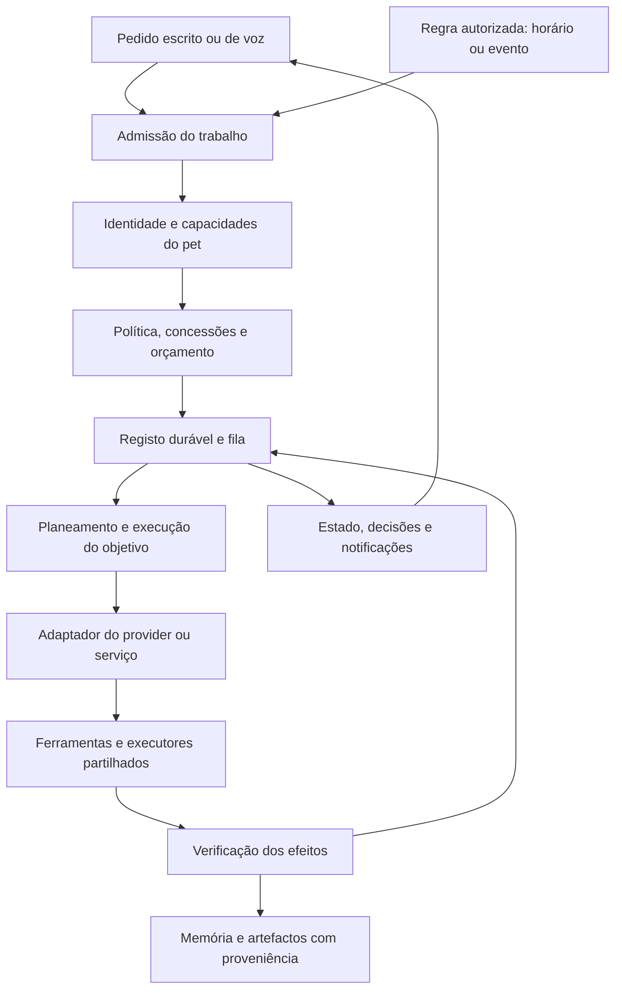
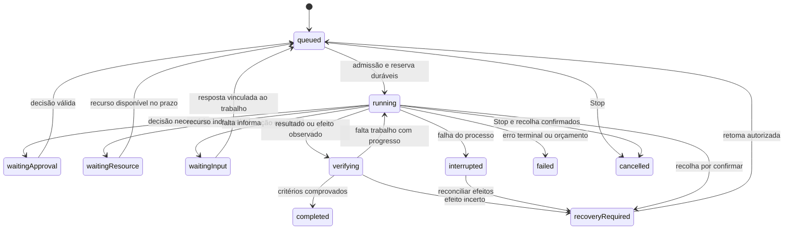

# Arquitetura dos pets autónomos de AI

## 01/11 — Fala nativa e candidata mochi.32 (C6C3)

A fala nativa recebe apenas o ID da resposta; conteúdo, idioma, superfície GTK/WebKit, geração do documento e validade são conservados no backend. A execução reutiliza o supervisor de helpers e conserva o recurso até recolher a família própria. A origem capturada reutiliza as revisões e testemunhos de IO existentes, sem confundir leitores concorrentes com uma gravação nem conceder autoridade nova.

[Composição, provas, entrega e limites](releases/0.5.1-mochi.32.md).

A versão.32 está agora instalada e ativa: nome D-Bus, executável empacotado e admissão nativa verificados; três originais de preferências/conversas e cópias nativas byte-exatas. A.30 foi preservada. O ensaio284 do próprio RPM passou com helper sintético; isto não fecha áudio real nem os49 requisitos.

## 31/10 — Seleção TTS e cancelamento por resposta (C6C2, fontes1000)

Fontes1000 integradas: seleção TTS capturada na ocorrência de Voz e no preview, validade após esperas e cancelamento do renderer por resposta exata. Falha do motor escolhido conserva o texto; só a seleção explícita system pode usar síntese do sistema. [Provas e limites C6C2](../.build/pet-goal-execution-next-r1/VOICE-PLAYBACK-CHECKPOINT-C6C2A3.json).

Reutiliza Plan/Input, Settings/Flow, epoch e processos TTS existentes. Edge/local conservam runtime/diretórios; ElevenLabs conserva serviço/modelo e limita descoberta, bytes/tempo/targets, sem redirects/retry e com verificação antes do POST. voice_say_native ainda precisa de associação exata à resposta/superfície/worker antes de concluir a ativação governada. Revogar não retira dados já entregues.

## 31/10 — Entradas imutáveis da Voz (C6C1, fontes999)

Fontes999 integradas: entradas de captura/ASR e seleção de inferência imutáveis por ocorrência de Voz, usando os runners e a fábrica existentes. Alterar pet, perfil, endpoint ou preferências durante a espera não redireciona o pedido; o contexto inválido é recusado. O snapshot não renova grants. [Provas e limites C6C1](../.build/pet-goal-execution-next-r1/VOICE-TURN-CHECKPOINT-C6C1A4.json).

Manual/hotword conservam o provider inicial; a sessão contínua pode selecionar explicitamente um pet no enunciado, com os perfis dessa ocorrência. CLI conserva modelo/esforço/modo/pasta; Ollama conserva configuração/identidade/endpoint. A validade é reavaliada nos caminhos de efeitos existentes. TTS, alvo físico, anexos/conversa antes da captura e ativação após restauro continuam abertos.

## 31/10 — Fontes997: seleção de áudio exata e posse dos workers de captura (C6A/B2)

Integrado na árvore principal, sobre os executores de Voz, ditado e gravação existentes. Um microfone nomeado ausente/ambíguo não abre outro por omissão; monitors/aliases não substituem a seleção explícita. A captura do sistema procura o alvo de loopback por host/ID exatos. O inventário tem limite256. Preferências guardadas, modelos, endpoints e wire schema mantêm-se.

Capture conserva Stop, JoinHandle e holds do Coordinator comum até recolher o worker. Timeout impede play tardio e não liberta um pedido ainda vivo. Os caminhos hotword/manual/sessão recebem o Stop externo; fechar a captura normalmente não cancela o turno de inferência que se segue. Donos tipados de Voz, Ditado, microfone da Gravação e áudio do sistema da Gravação impedem que trocar de alvo fabrique outro dono. As leases de leitura são independentes: Voz e gravação podem partilhar o mesmo endpoint quando o backend permite, sem uma revogar a outra. Não são grants de pet nem exclusividade sobre outras aplicações.

A primeira versão B1 tinha exclusão global demasiado ampla; a auditoria dos callers identificou a quebra que causaria no ditado/gravação enquanto hotword conserva o stream. B2 corrige-a e acrescenta provas de leituras partilhadas e de recusa de retarget do mesmo dono. B1 e os respetivos resultados ficam conservados; não chegou à instalação.

Provas B2:19 dirigidos passaram/2 ignorados;3153 gerais passaram/38 ignorados; build595 inputs/100 avisos existentes. Inventários e streams são sintéticos, exercitando os mesmos seletores/donos de produção. Não foram abertos dispositivos ou modelos reais. Os421 inputs não-Rust e71 outputs web da raiz continuam exatos;1329 testes web/TSC/Vite anteriores são reutilizados por identidade, sem nova execução.

[Checkpoint C6A/B2](../.build/pet-goal-execution-next-r1/VOICE-AUDIO-PARTIAL-CHECKPOINT-R43F10B2C3D2C6B2.json) · [Integração997 B2](../.build/pet-goal-execution-next-r1/integration997-r43f10b2c3d2c6b2/CHECKPOINT.json) · [Contrato de ativação e dependências](../.build/pet-goal-execution-next-r1/VOICE-ACTIVATION-CONTRACT-R43F10B2C3D2C.md). Instalação, HEAD/índice Git e10 ficheiros externos gravity_managed preservados; sem commits/publicação.

Pendente: Revisão de ativação Voz utilizável, com alvo nativo capturado e validado antes de esperar, estado/recibo de captura reais, autoridade distinta para captura/ASR/inferência/TTS/operação e bindings da fábrica; sem alterar modelos escolhidos. Defaults/aliases CPAL não são pinning físico. Depois Móvel/Hooks/Credenciais e restantes critérios integrais. Esta correção não demonstra pinning físico, áudio real/humano ou ativação governada completa. Todos os49 critérios integrais permanecem abertos.

## 31/10 — Fontes995 integradas na árvore principal, instalação preservada

A árvore `/home/pmglo/Projects/coucou-codex`, branch `feat/mochi-cli-accounts`, passa de834 para995 fontes comprovadas. Adoção ficheiro a ficheiro:291 alterações, incluindo161 ficheiros novos; checkpoint recuperável com originais anteriores. As10 fontes externas gravity_managed ficaram intactas, tal como HEAD/índice Git. Nenhum commit, push, merge ou substituição da instalação.

Os593 inputs Rust coincidem byte a byte com a build e os testes privados C4. TypeScript e Vite foram executados na árvore principal; os42 outputs comuns coincidem com o SDK. O bundle principal conserva mais29 WAV existentes de NotchBuddy/Resources/sounds, iguais às fontes e ao bundle anterior. A primeira comparação estrita de bundles falhou por essa diferença real e foi reconciliada por inspeção, sem remover sons nem repetir a build. Isto não prova reprodução de áudio real. Não houve nova execução da suite Rust nem build nativa na árvore principal: a reutilização tem como prova os inputs exatos, não uma alegação de teste adicional.

[Checkpoint de integração](../.build/pet-goal-execution-next-r1/integration995-r43f10b2c3d2b3c4a1/CHECKPOINT.json) · [Verificação reconciliada](../.build/pet-goal-execution-next-r1/ROOT995-CURRENT-SCOPE-VERIFICATION-RECONCILED-R43F10B2C3D2B3C4A1.json). Os checkpoints anteriores que dizem root834 descrevem o estado antes desta adoção; não executar os seus verificadores de root834 sobre a árvore995.

C5 verificado em nativo privado: fechar a janela exata de Settings durante Bind pendente invalida o Frame, fecha a sessão própria e conserva Unconfirmed sem publicação. Uma preparação concorrente é recusada enquanto o worker detém o recurso; reabrir não renova a decisão antiga. Nativo277 passou com as mesmas fontes995/binário;276 não chegou ao fecho por navegação redundante da fixture, corrigida sem mudar produção ou remover asserções. Não se concedeu core:window:allow-close ao renderer: WM_DELETE_WINDOW foi dirigido ao PID/título/geometria observados no Xvfb privado, e hub-visible=false/diário/limpeza foram observados. [Prova e limites C5](../.build/pet-goal-execution-next-r1/SETTINGS-CLOSE-PARTIAL-CHECKPOINT-R43F10B2C3D2B3C5.json).

Próxima unidade: controlo próprio de ativação da Voz, seguido de Móvel/Hooks/Credenciais. Preservar os ASR/TTS/modelos selecionados e usar fixtures, sem abrir áudio real na QA genérica. Objetivos autónomos e fecho de chat têm lifecycle próprio e não ficam validados por C5. Os49 critérios integrais continuam abertos, incluindo autonomia/TEAM/Sistema/Guardian e aceitação/entrega.

## 31/10 — Novo pedido de atalhos no contexto atual, com histórico preservado (C3D2B3C4A1)

A composição privada SDK995/593 inputs permite um novo pedido humano de atalhos no contexto atual quando o original não pode ser observado. A revisão3 retém a cadeia e as identidades originais, mostra o destino atual e exige quatro confirmações, versão exata e uso único. Reutiliza Controller, Frame, gates, executores e diário; não concede permissões a pets. Sucesso atual conserva recibos e incerteza de scope anteriores. O portal pode partilhar configurações por aplicação: não se afirma independência por novo token, cliente, PID ou nome.

Formato8 impede leitores7 de ignorarem a incerteza histórica de Slots Verified/Reconciled. Controlos cumulativos, migração monotónica, reinício sem registo automático, backup e restauro nativo8 foram verificados.

Provas: 68 dirigidos passaram/2 ignorados; 3138 gerais passaram/38 ignorados; 1329 web/0 omitidos, TypeScript, Vite e build. Nativos274/275 atravessam Tauri/WebKit, quatro confirmações, registo/callback, segunda revisão, leitor7, reinício e restauro8. Portal sintético e X11 virtual; não aceitação humana/hardware/instalação.270/271 e272/273 conservam falhas de fixture (bindings deliberadamente desligados no restauro; profundidade2 indicada por Admission3), corrigidas sem alterar fontes/binário nem remover asserções.

[Checkpoint privado C4](../.build/pet-goal-execution-next-r1/SHORTCUTS-CURRENT-SCOPE-PARTIAL-CHECKPOINT-R43F10B2C3D2B3C4A1.json)

Decisão C4: nova autoridade para o registrar/cliente atual, sem usar endereços históricos para limpeza. Histórico é uma dependência validada antes e durante IO. Não existe segundo runtime, ledger ou scheduler. A recuperação não altera os49 critérios integrais nem substitui a entrega.

## R43F10B2C3D2B3C3A2 — comparação nativa original e atual

30/10/2026: a revisão2 mostra projeções tipadas da identidade nativa original, obtida da intenção retida por hash, e da captura nativa atual. A mesma decisão/fingerprint/artefacto conserva ambas. O lado atual inclui apenas sessões Bound conhecidas, nunca tokens de sessões ainda não criadas. Listas vazias e comparação visual não provam libertação.

A decisão exige a versão2 e as três confirmações; controlos antigos, alterações de origem/instância/transporte, argumentos desconhecidos e replay continuam recusados. Validadores de processo/ambiente são partilhados entre revisão e reconciliação. Não se cria nova autoridade, formato persistente ou infraestrutura.

Privado: 992 fontes/591 entradas nativas. Passaram 55 testes dirigidos, 3134 gerais (38 ignorados), 1326 web/0 ignorados, TypeScript, Vite, build e nativos266/268/269. [Fontes, provas e limites](../.build/pet-goal-execution-next-r1/SHORTCUTS-ORIGINAL-OWNER-PARTIAL-CHECKPOINT-R43F10B2C3D2B3C3A2.json).

## R43F10B2C3D2B3C2A1 — restauro 7 e suspensão de todas as componentes

O ensaio de restauro264 encontrou uma omissão real: o diário copiado suspendia apenas componentes com recibos. `restored_record` passa a suspender as seis operações existentes nos formatos com diário por componente, mantendo versão/slots/fases/referências. Formatos 1/2 conservam o formato e exigem a revisão global existente; uma publicação global incerta continua byte-exata. Não há nova infraestrutura ou autoridade.

Composição privada: 992 fontes/591 entradas nativas. Passaram 43 testes do módulo no A1. A execução geral C2 passou 3130 testes e teve duas expectativas antigas corrigidas no reteste dirigido; 38 ignorados. A1 altera apenas cfg(test), sem nova execução geral/build/nativa. Build e ensaio nativo 265 de C2, web1324/TSC/Vite B3 são reutilizados por identidade explícita dos respetivos inputs. [Fontes, provas e limites](../.build/pet-goal-execution-next-r1/SHORTCUTS-RESTORE-PARTIAL-CHECKPOINT-R43F10B2C3D2B3C2A1.json).

## R43F10B2C3D2B3B8 — recuperação dos atalhos e leitores antigos

27/10/2026: reconciliação humana própria reutiliza Controller/gates/Frame/TTL/cancel, Slot e arquivo; observa encarnação do processo, ambiente/transporte e bus/sessões originais. Portal aceita apenas ACKs exatos ou ausência autenticada do cliente no mesmo bus; plugin exige limpeza completa das teclas potencialmente afetadas ou processo original ausente em X11 local. Não usar Registry vazio/PID/lease como prova de libertação.

A observação mantém intenção/outcome/hash anteriores, sem novo registo nem sucesso passado. Outra tentativa exige novo consentimento; restart e outro ecrã/transporte não herdam continuidade. Protocolo 7 antecede a nova intenção porque o leitor 6 reconhece a fase reconciliada, mas desconhece estas condições; o leitor antigo recusa sem modificar. Não há outro runtime/ledger/grant.

Composição privada: 992 ficheiros de fonte e 591 entradas nativas; backend e binário B7, uma correção de fixture cfg(test) B8. 52 testes dirigidos B8 passaram; a execução geral B7 teve 3129 testes aprovados, uma falha de fixture e 38 testes ignorados; a falha foi conservada e corrigida com reteste dirigido.Os 1324 testes web, TypeScript e Vite de B3 e os 18 testes D-Bus de B5 reutilizados por identidade explícita; build B7 e ensaios nativos 261 (X11) e 262 (portal) passaram. Não houve nova execução dessas suites no B8. [Fontes, provas e limites](../.build/pet-goal-execution-next-r1/SHORTCUTS-RECONCILIATION-PARTIAL-CHECKPOINT-R43F10B2C3D2B3B8.json).

## R43F10B2C3D2B3A1 — resultado pendente e publicação

27/10/2026: o facto nativo verificado fica primeiro retido como Unconfirmed/publication=pending. O input só é publicado com esse witness; Verified final exige publicação observada, autoridade ainda válida e a referência exata ao pendente. Um handle local limpa os seus alvos se a finalização falhar; crash conserva a barreira sem depender de Drop. Mesmos diário6/Registry/atores. Falta observação/reconciliação independente B3B. [Provas e limites](../.build/pet-goal-execution-next-r1/SHORTCUTS-PUBLICATION-PARTIAL-CHECKPOINT-R43F10B2C3D2B3A1.json).

## R43F10B2C3D2B2B3 — aprovação dos atalhos e suspensão X11

27/10/2026: revisão2 inclui o estado nativo anterior, destino e impacto; três confirmações autorizam uma tentativa nativeUser. Reutiliza Settings6, Registry e o mesmo portal/plugin, com intenção antes do efeito, guards durante IO e publicação após observação durável. Nenhuma permissão de pet/modelo é criada. B3 permanece aberto para publicação/limpeza incerta e crash/reinício antes de nova admissão. [Checkpoint e limites](../.build/pet-goal-execution-next-r1/SHORTCUTS-APPROVAL-PARTIAL-CHECKPOINT-R43F10B2C3D2B2B3.json).

## R43F10B2C3D2B2A2 — dados dos atalhos e barreira de novo registo

27/10/2026: privado980/582inputs. O editor usa patch nativeUser por ação com valor anterior/CAS e ACK; snapshots gerais antigos deixam de sobrescrever shortcuts. O mesmo diário Settings6 pausa novos registos antes de publicar dados, preservando IDs desconhecidos, campos alheios e slots incertos. Uma publicação falhada conserva a barreira. Verified de shortcuts continua a ser facto de uma sessão, sem remover a barreira persistida. Recusa de admissão mantém teclas existentes e o callback de navegação; suspensão explícita deixa de mostrar Active obsoleto.

Passaram37dirigidos,3104Rust/29ignorados/build582 e1312web/0skip/TSC/Vite A1 (A2 só converte o erro Rust; web reutilizado por identidade). Build101avisos, menos o novo aviso deprecação B1. Caso nativo247 passou: UI real, CAS/ACK, snapshot geral antigo, callback genuíno, suspensão e leitor976/reinício980 sem novos registos. O wrapper original terminou1 na auditoria posterior de uma fixture derivada; verificador de leitura reconstituiu a derivação exata e concluiu as verificações sem repetir efeitos. O retorno separado do contentor não ficou guardado. [Fontes, comandos e limites](../.build/pet-goal-execution-next-r1/SHORTCUTS-DATA-PARTIAL-CHECKPOINT-R43F10B2C3D2B2A2.json).

A aprovação e o despacho duráveis continuam por implementar sobre a mesma captura B1; este incremento é de dados/revogação, não reativação ou paridade instalada. Seguem consumo da reserva, guards durante IO e resultado antes de Active, depois reconciliação/lifecycle/composição. Root834/.30 e os49critérios integrais permanecem abertos/intactos.

## R43F10B2C3D2B1A2 — revisão do plano nativo dos atalhos

27/10/2026: privado976/580inputs. A revisão reutiliza planner, Registry/worker, Context/Revision/Frame e Bridge/definições existentes. Captura preferências completas, ações/conflitos, perfil/revisões e instância nativa; o portal reserva peer/client/session/requests sem criar, registar ou fechar atalhos. Preparar/inspecionar/cancelar não concede ativação. Mudanças de janela, dados ou estado nativo invalidam a captura. O recurso identifica o registrar; mudar teclas ou caminhos reservados não cria independência. Geração u64 mantém decimal exato no TS; dados hostis e IDs legados são dados.

Passaram29dirigidos,9D-Bus privados,3098Rust/29ignorados/build580,1308web/0skip/TSC/Vite A1 e nativos245/246. A2 só corrige duas fixtures Rust: web A1 reutilizado por identidade, sem nova execução.245 usa portal sintético;246 usa plugin X11 real em Xvfb.243/244 conservam falhas da instrumentação do teste, corrigida sem alterar produto/binário. Há um novo aviso de depreciação atómica, registado para B2. [Fontes, comandos e limites](../.build/pet-goal-execution-next-r1/SHORTCUTS-REVIEW-PARTIAL-CHECKPOINT-R43F10B2C3D2B1A2.json).

Segue B2: consumir esta mesma captura na aprovação exata, intenção/despacho/resultado Settings6 e gravação só do campo de atalhos; depois reconciliação/lifecycle/composição. B1 não é reativação nem entrega. Root834/.30 intactos;49critérios integrais abertos.

## R43F10B2C3D2A3A1 — perda do dono nativo dos atalhos

27/10/2026: privado970/577inputs. A subscrição do peer único antecede a consulta de vida; só a transição exata emitida pelo daemon retira disponibilidade. Troca do nome do serviço com o peer antigo vivo conserva a sessão; morte do peer termina o worker e cancela Flow sem novo comando, sem seguir substituto ou afirmar rollback remoto. Passaram12portal/8ignorados,8D-Bus privados/0ignorados,3093Rust/28ignorados/build e nativo242. Este último usa Tauri/WebKit reais e broker sintético/Xvfb: não é compositor/áudio/humano/instalado. Web/TSC/Vite reutilizados por identidade exata, sem nova execução. [Fontes, comandos e limites](../.build/pet-goal-execution-next-r1/SHORTCUTS-OWNER-LOSS-PARTIAL-CHECKPOINT-R43F10B2C3D2A3A1.json).

Segue revisão/controlo durável próprio de Atalhos pelo mesmo diário Settings6, depois Voz/Móvel/Hooks/Credenciais e composição/adoção. Root834/.30 intactos;49critérios integrais permanecem abertos.

## R43F10B2C3D2A2C3 — origem dos atalhos e conflito CAS

27/10/2026: privado970/577inputs. O portal autentica o peer único real, prende chamadas/sessão/geração e aceita apenas ações pedidas/aceites; release/rebind excluem callbacks antigos e Flow conserva release/cancel. A composição revelou um conflito real na leitura da memória: `load_for_update` partilhado distingue conflito anterior à publicação, recusa do guard, dados inválidos e commit incerto, sem retry/default ou renovação de autoridade. Passaram3092Rust/25ignorados com1024disputas,4provas CAS,11memória/build e nativo241 privado. Cinco testes D-Bus B1 são reutilizados por identidade dos três ficheiros; web/TSC/Vite E4 reutilizados por identidade não-Rust/bundle, sem nova execução. [Fontes, provas, falhas retidas e limites](../.build/pet-goal-execution-next-r1/SHORTCUTS-CALLBACK-PARTIAL-CHECKPOINT-R43F10B2C3D2A2C3.json).

Falta detetar desaparecimento do dono nativo; depois revisão/controlo durável próprios de Atalhos, Voz/Móvel/Hooks/Credenciais e composição/adoção/entrega. O nativo241 usa broker sintético em Xvfb, não compositor/áudio/aceitação humana ou instalada. Root834/.30 intactos;49critérios integrais abertos.

## R43F10B2C3D1B2E4 — identidade física, origem legada e protocolo6

27/10/2026:970fontes privadas/577inputs. `Target` identifica o slot pelos dev/inode/birth-time da base retida e nomes relativos, com domínio2, sem fallback por caminho. Substituição da base muda a identidade; rename/alterações normais mantêm-na. O plano vivo continua a prender alvo/launcher/revisões. Origem legada1 é desconhecida: revisão específica/4ACK observa só o presente, conserva raw Unknown e não afirma equivalência física/sucesso passado nem reativa. Elegibilidade requer recurso físico, perfil e revisão de dados exatos. A intenção/diário e o controlo funcional reutilizam o percurso existente. Settings6 protege a nova semântica e é conservado em migração/backup/restauro.

45dirigidos/3082Rust21ignorados/build577 passaram. E4 executou24web/TSC/Vite;1302testes web E3 são reutilizados (o TSC E3 falhou; não houve nova execução completa E4). Nativo239 passou140.45s: arquivo5 real sintético readonly, D5 anterior abre5 e recusa6 sem alterar roots, decisão legada própria, freshSet/reinício, troca física conservando caminho/perfil, nova revisão e efeito só na base nova, backup6 byte-exato e restauro/custody/config/admissão depth4 com6componentes suspensas e observações antigas inelegíveis. E1 confirmou a falha real; E2/E3 conservam falhas intermédias de guardas/fixture/tipagem corrigidas. [Prova, fontes e limites](../.build/pet-goal-execution-next-r1/SETTINGS-AUTOSTART-PHYSICAL-PARTIAL-CHECKPOINT-R43F10B2C3D1B2E4.json).

Segue revisão própria dos atalhos sobre `plan/apply`/portal/registry e o mesmo diário; Voz/Móvel/Hooks/Credenciais continuam suspensos. Root834/instalação .30 intactos. Sem aceitação humana/login/hardware/powerloss, publicação ou fecho dos49requisitos.

## R43F10B2C3D1B2D5 — observação histórica e arquivo só de leitura

27/10/2026:970fontes privadas/577inputs. O novo controlo seleciona um EffectId incerto na cadeia local validada, apresenta o plano nativo e exige decisão própria; reutiliza diário, artefactos imutáveis, gate, Frame/TTL, cancelamento e cerca física. A observação mantém o Unknown antigo, preferência, registo e suspensão; não prova o resultado passado. Revisão de dados ou perfil diferentes retiram elegibilidade, conservando a evidência. A operação atual incerta no mesmo recurso é reconciliada primeiro. Outra alteração exige novo plano/decisão.

3074Rust/21ignorados/build577 passaram;1299web/TSC/Vite D3 reutilizados por identidade exata (sem nova execução web D5). Nativos236/238 privados passaram: revisão histórica/3ACK, cancelamento/replay/seletores recusados, leitor5 anterior conservador antes/depois de freshSet, revisão de dados, reinício/backup5 e restauro real do arquivo montado read-only para novo perfil, onde observações anteriores ficam inelegíveis.237 recusou corretamente origem/destino no mesmo dispositivo através de mounts distintos;238 usa a mesma origem sintética byte-exata num tmpfs distinto e readonly, sem relaxar essa proteção.235 revelou uma falha real: lock_shared abria o ficheiro com O_RDWR; a correção usa O_RDONLY só na leitura, preservando exclusão e O_RDWR dos escritores. Fixtures dirigidas provam consulta0400, Busy com escritor e recusa de concessão.233 foi preparação incompleta dos pais legados sintéticos;234/236 preservam-nos offline, sem limpar dados. [Fontes, comandos, provas e limites](../.build/pet-goal-execution-next-r1/SETTINGS-AUTOSTART-HISTORICAL-PARTIAL-CHECKPOINT-R43F10B2C3D1B2D5.json).

Limite por resolver antes da integração: o plano prende o destino físico durante IO, mas o identificador persistido D5 ainda deriva do caminho; falta distinguir a substituição da pasta-base pelo mesmo nome e definir tratamento dos registos legados. Segue esse caso concreto, depois composição/outras5componentes. Root834/instalação .30 intactos; sem modelos/quota, aceitação humana/login/hardware ou fecho dos49requisitos.

## R43F10B2C3D1B2C3 — backup5 restaurado e admitido numa terceira geração

27/10/2026: mesmas969fontes B2, novo nativo232 privado/0modelos. O backup5 real foi restaurado, revisto e admitido pelo percurso de época/custody existente; o caminho operacional é o payloadDepth=2 selado nesta cadeia. Novo scope suspende o recibo atual e conserva o ancestral incerto. Outra aprovação nativa altera só o novo recurso, mantém5 e só revalida autostart; reinício conserva ficheiro/inode/diário/autoridade/orçamentos. Root1/Root2 permanecem byte-exatos e o terceiro backup5 inclui os roots completos, controlos, originais e histórico.230/231 conservam erros de expectativa do harness (ordem custody→configuração e prefixo operacional);232 corrige essas expectativas, sem modificar produção.3066Rust/21ignorados,1294web/TSC/Vite/build B2 são reutilizados por identidade exata; não foram repetidos. [Prova e limites](../.build/pet-goal-execution-next-r1/SETTINGS-AUTOSTART-PORTABLE5-PARTIAL-CHECKPOINT-R43F10B2C3D1B2C3.json).

Segue controlo explícito para observar o recurso de um efeito incerto arquivado quando voltar a ser o alvo nativo atual; permanece recusado até essa revisão. Depois composição/outras5componentes. Sem instalação/aceitação humana/login/hardware;49critérios integrais continuam abertos.

## R43F10B2C3D1B2B2 — novo destino com incerteza antiga preservada

27/10/2026, privado969/B2/Linux: setIndependentRegistration exige perfil **e** recurso nativos diferentes e quarto ACK próprio da incerteza externa, ligado ao mesmo plano/hash/Owner-epoch. Reutiliza Controller/gate, diário/Revision, preferência guardada e cerca física. O slot/artefactos anteriores conservam a fase incerta; nenhum caminho arquivado é seguido e não há falsa reconciliação. Status/UI mantêm visíveis os ancestrais incertos após novas operações; leitura local limitada/hash-bound recusa corrupção/ciclos e novo trabalho no recurso antigo até reconciliação própria. Primeira operação independente usa marker/Record5: o leitor4 anterior recusa; gravações comuns, revisão e backup preservam5, sem downgrade.

13testes do controlador/22diário-protocolo,3066Rust/21ignorados,build576 e nativo229 passaram.1294web/0skip/TSC/Vite foram executados B1 e reutilizados B2 por inputs/bundle idênticos.229 prova backup4→restauro/admissão→UI4acks→novo efeito5 com incerteza antiga conservada/visível, cancel/wrongwindow/args/replay,reinício/revisão5,recusa do leitor4 e backup5,0modelos/quota. Unknown é fixture após registo privado real; não powerloss físico. [Fontes, provas e limites](../.build/pet-goal-execution-next-r1/SETTINGS-AUTOSTART-INDEPENDENT-PARTIAL-CHECKPOINT-R43F10B2C3D1B2B2.json).

Seguem restauro do backup5 numa nova Root3 e controlo explícito de reconciliação histórica do recurso antigo, depois composição/outras5componentes. Sem instalação, aceitação humana/login/hardware;49critérios integrais continuam abertos.

## R43F10B2C3D1B2A4 — restauro nativo e nova revisão de autostart

27/10/2026: mesmas969fontes A6, novo ensaio nativo228 privado,38.56s/0modelos. Backup4→restauro→configuração/autoridade independente/admissão→nova revisão nativa no destino Root2 passou. O restauro mantém o recibo anterior como dado suspenso e desativa a preferência; nova aprovação afeta apenas o recurso atual e revalida só autostart, sem modificar pendingFeatures imutável. Reinício não repete efeitos. Nova revisão de dados conserva formato4 e recibos, mas volta a suspender as6componentes; exige outra aprovação. Leitores958/protocolo3 recusam e o segundo backup conserva os roots completos, controlos e originais. Rust/web/build A6 reutilizados por identidade exata, sem nova execução. [Prova e limites](../.build/pet-goal-execution-next-r1/SETTINGS-AUTOSTART-RESTORED-PARTIAL-CHECKPOINT-R43F10B2C3D1B2A4.json).

Continua aberto o efeito antigo incerto num recurso diferente; não alegar reconciliação desse caso. Seguem esse percurso explícito, composição exata e outras5componentes. Sem aceitação humana/instalada/login/host;49critérios integrais continuam abertos.

## R43F10B2C3D1B1A6 — controlo nativo de autostart e reconciliação

27/10/2026, privado969/A6/Linux: percurso funcional de preview/3acks/decisão nativa de uso único e5min, ligada ao Owner/epoch da janela C3B. Reutiliza Controller/gate, diário/artefactos/WriterLock/Target/Witness existentes. Intenção precede preferência guardada com guard; Dispatched precede registo. IO ocorre fora de Shared, a validade usa Witness/Observation e epoch fraco da Revision real, cancelamento atómico não espera esse mutex e o gate dura até retorno do worker. Cerca física com flock prende o recurso entre instâncias. Scope/configuração/plano/recibo e referência da revisão dos dados são revalidados; observação recuperada mantém suspensão e exige outra aprovação para alterar. Não há novo grant/scheduler/ledger de objetivos.

Linux recusa a API antiga de mutação e startup só observa drift. UI/Bridge tipados mostram efeito distinto de preferência e login, sem retry implícito; evento Settings atualiza disponibilidade após revisão de dados.3061Rust/21ignorados A6,1288web/0skip/TSC/Vite A3 reutilizados por bytes iguais e buildA6 passaram. Nativo224 prova UI Root1,6suspensões→sóautostart,wrongwindow/args/replay/close recusados,registo/remover/restart/drift,reconciliação sem repetição e novo consentimento,recusa958 e protocolo3 anterior, recibo3 sódados e backup4completo,0modelos/quota.219 encontrou estado visual desatualizado; corrigidoA3.220/221 identificaram settingsBusy por leitor passivo; A5corrigiu com guard da revisão real,10+2testes e nativo222. A6 cria barreira4 contra escritores legados3 e valida em224. Toda evidência anterior conservada. [Fontes, comandos e limites](../.build/pet-goal-execution-next-r1/SETTINGS-AUTOSTART-REVIEW-PARTIAL-CHECKPOINT-R43F10B2C3D1B1A6.json).

Falta Root2/restauro/overlay/scope e composição conjunta antes de avançar às outras5componentes. Unknown em224 é fixture controlada, não powerloss físico; ficheiro verificado não prova login. Sem aceitação humana/instalada ou host real. Raiz834/.30 preservadas;49critérios integrais continuam abertos. Segue C3D1B2.

## R43F10B2C3D1A4 — diário de efeitos e plano exato de autostart

27/10/2026, privado963/A3/Linux: primeiro incremento de C3D, ainda sem percurso nativo de reativação. O plano congela launcher, alvo, bytes anteriores, diff e pós-condição; reutiliza Directory/Witness e o gerador existente. Record3 estende o mesmo diário com intenção, despacho e outcome por componente, artefactos imutáveis limitados e binding de perfil/configuração/recurso/plano. Preferências normais e revisão de dados preservam estados; restauro não reativa recibos. Observação recuperada não é autorização para replay. Marker3 exige1/2; compatibilidade e promoção de upgrade interrompido são verificadas por fixtures.

3046Rust/21ignorados em A3, 21dirigidos/0ignorados e1ACKperdido/0ignorados em A4 e build573customprotocol A4 passaram. A4 altera apenas3fontes do plano/Target/testes; a regressão A3 é reutilizada com essa diferença explícita, sem alegar suite completa A4. Inclui9testes de plano e16do diário/perfil: efeito real apenas em ficheiros privados, ACK perdido após rename, recusa de replay/configuração trocada, revogação antes de despacho e persistência de suspensões. A1 passou7testes mas revelou hash semântico incorreto; SHA256 e known-answer test corrigidos antes destas provas. A4 conserva o Witness devolvido pelo escritor e recusa substituição do ficheiro/pai/raiz mesmo com bytes iguais antes da confirmação. [Fontes, comandos e limites](../.build/pet-goal-execution-next-r1/SETTINGS-AUTOSTART-JOURNAL-PARTIAL-CHECKPOINT-R43F10B2C3D1A4.json).

Faltam ligar os handlers/UI nativos à aprovação exata/cancelamento/reconciliação e provar o percurso conjunto, backup/leitor antigo e restante reativação. Registo de ficheiro não prova login; fixtures não são aceitação nativa/humana/instalada. Sem novos grants/ledger/scheduler, efeitos reais de host/cofre/quota ou instalação. Raiz834/.30 e49critérios integrais abertos. Segue C3D1B; as outras5componentes continuam pendentes.

## R43F10B2C3B1B4 — revisão exata dos dados, sem reativar componentes

27/10/2026, privado958/B4/Linux: revisão nativa de uma janela,5min e uso único captura valores efetivos/propostos/defaults, origem/revisões, configuração/pets/modelos/destinos e referências de credenciais sem consultar o cofre. Recusa janela errada, argumentos adicionais, replay, alterações e revogação antes da publicação. Epoch nativo invalida após fechar/recriar a janela; os guards não fazem query GTK sob mutex Settings. O original e o outcome anterior ficam retidos antes da intenção nova; aprovar dados conserva6componentes suspensas e não aprova objetivos ou efeitos antigos. [Contrato e limites](../.build/pet-goal-execution-next-r1/SETTINGS-HUMAN-REVIEW-NEXT-CONTRACT-R43F10B2C3B.md).

Marker2 precede Record2 e recusa leitores950/anteriores; gravações normais de v1 mantêm compatibilidade. Registo/backup/restauro conservam suspensões e history. Preferências incompletas persistem os valores revistos; Root1 conserva campos opacos, o restaurado retém originais e publica o formato canónico. Um perfil já admitido com preferências danificadas abre apenas dados protegidos para revisão; root/chave/manifesto/custódia desconhecidos continuam recusados antes do carregamento.

3022Rust/21ignorados,build568 e nativos217/218 passaram.217 prova UI nos3percursos Root1/Root2/Root2danificado,stale recusado,7operações bloqueadas após aprovação,reinícios/runtime/backup e old950Root1+Root2 recusados;2HTTP2CLI sintéticos0quota.218 prova fecho normal do único hub/PID próprio em Xvfb e token recusado após reabrir,0modelos; ACL de fecho JS não foi alargada.1278web/TSC/Vite B2 reutilizados por bytes exatos da web/bundle. [Fontes, provas e diagnósticos](../.build/pet-goal-execution-next-r1/SETTINGS-HUMAN-REVIEW-PARTIAL-CHECKPOINT-R43F10B2C3B1B4.json).

Seguem reativação por componente e intenções/recibos/reconciliação de listeners/chaves/hooks/registo (C3D), antes de integrar/adotar. Sem host/cofre/instalação/áudio reais, aceitação humana, sandbox sameUID ou powerloss físico. Raiz834/.30 preservadas;49critérios integrais abertos.

## R43F10B2C3B0 — origem confirmada antes de componentes opcionais

27/10/2026, privado950/B0A1: Voice/Mobile/Autostart/Shortcuts/Hooks/Credentials reutilizam a origem de IO do Shared atual antes de novos efeitos. Mantêm as barreiras de restauro e repetem a verificação após consulta ao perfil; microfone/listener repetem depois da espera pelo recurso/cofre. Stop e histórico conservam os seus caminhos. As preferências desejadas não são desligadas para contornar a revisão. O relatório de atalhos identifica suspensão por preferências não confirmadas; erro ao eliminar uma credencial vazia deixa de ser sucesso falso. [Contrato e limites](../.build/pet-goal-execution-next-r1/SETTINGS-OPTIONAL-EFFECTS-ADR-R43F10B2C3B0.md).

7dirigidos/3000Rust21ignorados/1272web/TSC/Vite/build563/nativo215 passaram. Tauri real recusa7comandos antes do efeito em Changed e ReviewRequired; flags autostart/phoneLink true conservadas, listener bloqueado após dois reinícios/nova gravação, estado de atalhos visível. Providers/helpers sintéticos,0quota; áudio real, cofre real, aceitação humana e instalação não exercidos. [Fontes, comandos e provas](../.build/pet-goal-execution-next-r1/SETTINGS-OPTIONAL-PARTIAL-CHECKPOINT-R43F10B2C3B0A1.json).

É uma pré-condição de C3B, não revisão humana nem revalidação operacional. Seguem captura/decisão humana exatas, suspensão persistente separada da aprovação de dados e intenções/recibos de listeners/chaves/hooks. Sem integração/instalação antes da prova conjunta. Raiz834/.30 preservadas;49critérios integrais abertos.

## R43F10B2C3A4 — intenção de gravação e revisão duráveis

27/10/2026, composição privada 948/C3A4/Linux: o writer comum persiste Prepared antes de publicar preferências e Committed depois de fsync/readback; uma falha anterior distingue NotPublished. A revisão de valores recuperados sobrevive a load/save/restart. O registo usa Document/Snapshot/WriterLock existentes e contém hashes/estado, sem conceder permissões. O marcador imutável na raiz impede leitores anteriores de carregar o novo perfil; o registo mutável acompanha o payload no backup e na inicialização revista de restauro. Prepared e revisão pendente não são convertidos em sucesso. A consulta de IO usa um descritor de formato capturado, sem tomar o mutex geral do perfil. [Contrato e limites](../.build/pet-goal-execution-next-r1/SETTINGS-DURABLE-IO-ADR-R43F10B2C3A.md).

Passaram 13 casos dirigidos, 2 993 testes Rust (21 ignorados), build de 561 inputs e nativo212. O Tauri conserva o bloqueio após dados diferentes e reinício; num perfil sintético separado, mantém ReviewRequired por dois reinícios e outra gravação, com o estado visível na UI. Leitores945/915 recusam no arranque, antes de Settings/Chat; esta execução não chega ao RPC Spec13 antigo. Mantém a regressão de runtime/Stop/reinício/backup e pipe parcial de 4 096 bytes; 2HTTP/2CLI sintéticos, quota real zero. Web1272/TSC/Vite reutilizados por igualdade exata de fontes/bundle. [Fontes, comandos, falhas conservadas e alcance](../.build/pet-goal-execution-next-r1/SETTINGS-DURABLE-PARTIAL-CHECKPOINT-R43F10B2C3A4.json).

C3 permanece aberto: seguem a revisão/reconciliação humana exata e as intenções/recibos de listeners e chaves. Não revalidar funcionalidades restauradas nem adotar/instalar antes da prova conjunta. Metadados/hashes não são sandbox, CAS contra sameUID ou prova de powerloss. Raiz834 e instalação.30 preservadas; os 43+6 critérios integrais continuam abertos.

## R43F10A4 — recusa antes de guardar e preferências privadas

26/10/2026,privado925/A4: nativo200 demonstrou autostart guardado como ativo e sucesso devolvido apesar da barreira de restauro, além de settings.json0644 incompatível com o leitor privado. O mesmo escritor comum passa a validar sob mutex antes de guardar/publicar; a verificação antes do efeito mantém-se. Erro de registo posterior indica preferência guardada/efeito não confirmado. Temporário exclusivo0600 conserva ficheiros alheios e a compatibilidade legacy. O controlo funcional consulta o valor nativo após erro, sem repetir a ação. [Decisão e limites](../.build/pet-goal-execution-next-r1/RESTORED-FEATURE-PRECOMMIT-ADR-R43F10A.md).

81dirigidos/2892Rust21ignorados/1266web/TSC/Vite/build542/native201 passaram. Este prova recusa na UI/IPC sem mudar memória/bytes/eventos,erro real de registo num caminho sintético bloqueado,gravação normal0600/reinício/backup e regressão do runtime13/consentimento/decisões/Stop.2HTTP1CLI sintéticos/DBus privado; HOME vazio privado ligado só no container,nenhuma entrada/serviço de arranque criado,nem HOME autenticado copiado. [Fontes,prova negativa e checkpoint](../.build/pet-goal-execution-next-r1/RESTORED-FEATURE-PARTIAL-CHECKPOINT-R43F10A4.json).

Voz,móvel e arranque continuam pendentes; não foi criada uma concessão de revalidação. Antes dela,fechar intenção por campo/concorrência e confirmação após publicação/fsync do diretório no escritor comum. Aceitação humana/instalada/áudio/hardware e49critérios integrais abertos. Raiz834/.30 preservadas,sem commits/publicação; seguir migrações/revalidações/adoção e dependências restantes.

## R43F9B4A1 — limites conjuntos da retenção comprovados

26/10/2026: três casos no RetentionReview/fixture existentes aceitam4096 entradas (diretórios incluídos) e64MiB repartidos por um original retido e a preparação atual; recusam4097,64MiB+1 e um ficheiro8MiB+1. As recusas preservam bytes/inodes e não publicam nova autoridade. A contagem não reinicia por pasta. [Fontes, comando e prova](../.build/pet-goal-execution-next-r1/RETENTION-BOUNDARY-CHECKPOINT-R43F9B4A1.json).

Só mudou o ficheiro de testes; produção/web são byte idênticos à composição923/B3F2A7 comprovada. B4 tem3dirigidos/0ignorados; a suite2886Rust/21ignorados,web1262/build542/native199 pertencem exatamente aA7 e não foram repetidos como se fossem novos ensaios. Sem quota/host/instalação/commits. Seguem migrações/revalidações/adoção das fontes exatas e restantes dependências;49critérios integrais continuam abertos.

## R43F9B3F2 — trabalho futuro com origem restaurada, validado em privado

26/10/2026, composição923/A7: revisão nativa da origem/revisão e intenção/critérios futuros, destino capturado e aceitação explícita da incerteza cria outro GoalId do mesmo pet. Spec.restoredFrom13 sela apenas a criação de dados pelo HMAC/Authority/Store existentes; não concede execução, saldo, memória ou autoridade anterior. Contexto, consentimento, modelo, limites e decisões seguintes passam pelo runtime comum. Idempotência reconhece o original sem renovar escolhas; validade/origem são verificadas nas fronteiras da publicação. [Contrato e decisão](../.build/pet-goal-execution-next-r1/RESTORED-FUTURE-DRAFT-ADR-R43F9B3F2.md).

Objetivos antigos concluídos são consultáveis como estado declarado no snapshot, sem exigir a Authority original para leitura. read_control/mutate/context/admissão recusam controlo antigo; UI identifica o histórico e só oferece consulta e revisão de trabalho futuro. Não se infere consumo zero, morte do dono ou desfazer de efeitos.

32dirigidos,2886Rust/21ignorados,1262web/TSC/Vite e build542 passaram. Nativo199 atravessa cartão/revisão/checkbox/criação, contexto e consentimento próprios, driver/decisão/verificação/conclusão, Stop, reinício/ACK com arquivo offline e backup portátil. Leitor915 real recusa13 preservando os ficheiros. Época seguinte13 e cortes/tamper/expiração são fixtures. [Checkpoint com fontes, comandos, falhas retidas e limites](../.build/pet-goal-execution-next-r1/RESTORED-FUTURE-PARTIAL-CHECKPOINT-R43F9B3F2A7.json).

Aplicação privada com HTTP2/CLI1 sintéticos e DBus privado,0quota/modelos reais; sem aceitação humana/instalada/áudio/hardware. Raiz834 e instalação.30 preservadas,sem publicação. A prova fecha este percurso privado, não os49 requisitos integrais. Seguem fronteiras conjuntas4096/64MiB, migrações/revalidações e adoção das fontes exatas; restantes dependências e entrega continuam abertas. Secções anteriores conservam as fotografias históricas datadas.

## R43F9B3A — histórico restaurado com origem e consumo desconhecido

Privado915/A2 fecha um falso zero demonstrado por prova negativa: o histórico comum ignorava corretamente grants históricos para execução, mas apresentava total zero a um objetivo sem admissões ligadas. A consulta nativa existente agora verifica GoalRef/hash/dono da boundary HMAC e os mesmos bytes/assinaturas/fences do leitor histórico. Resposta2/restoredSnapshotOnly liga a origem exata, mantém cumulativeCharge desconhecido e recusa autoridade, continuação ou retirada de grants históricos. Trabalho novo conserva resposta1; sem migração/escrita passiva, provider ou ledger novo.

O controlo funcional de histórico mostra proveniência e incerteza, sem subtotal zero enganador. Passaram os dirigidos,2870Rust/21ignorados,1256web/TSC/Vite,build536 e nativo196. Este prova IPC real/todas as origens antigas/revisões/bytes só leitura antes de IO e resposta1 para trabalho novo, compondo retenção/admissão/consentimento/Stop/reinício/backup já comprovados. HTTP2/CLI1 sintéticos e DBus privado;0quota/modelos reais. [Fontes, comandos, prova negativa e limites](../.build/pet-goal-execution-next-r1/RESTORED-HISTORY-PARTIAL-CHECKPOINT-R43F9B3A.json).

B3F2/continuação histórica ainda não está implementada: exige revisão própria da origem/dados/efeitos incertos e novo consentimento/contexto/destino/limites/causalidade no mesmo runtime. Três épocas/tamper são fixtures; UI testada em JS e IPC nativo,sem aceitação visual humana/áudio/hardware/instalação. Raiz834/.30 intactas,sem publicação;revalidações/adoção/restantes dependências e49critérios integrais abertos.

## R43F9B2D4D2B — autoridade futura distinta após retenção

Privado914/B1 compõe a retenção opaca913 com preparação nativa separada. Binding1 liga head/fingerprint semântico/count; Intent2/generation2 declaram propósito de nova chave futura, com intenção durável antes de RNG e outra aprovação exata. O hash da retenção não autoriza a chave. Dados retidos continuam não fiáveis, sem grants/saldo novos. Custody2 explicita a ligação; formatos1/receipt3 sem retenção conservam serialização.

Configuração4 apenas inspeciona, num recibo por head; preserva recibos1/3/4 anteriores. Activation usa esse caminho exato e a mesma chave preparada em Admission4/Bound/runtime. Opened/reinício/ACK conservam trabalho novo sem recapturá-lo como histórico e dispensam o arquivo externo. Backup2 conserva a raiz e custódia completas; fixture de época seguinte mantém Custody2 e negações de IDs anteriores.

7dirigidos novos,2864Rust/21ignorados/build535 e nativo195 passaram. Este ensaio usa CLI/Tauri reais: duas retenções, chaves distintas sob aprovações próprias, mesmos inodes/bytes originais, recibos preservados, recusa de leitor913, admissão4, sessão CLI sintética nova, objetivo com consentimento próprio, decisão/2efeitos no DBus privado, Stop, reinício/ACK offline e backup/inspeção portátil. São2pedidos HTTP e1turno CLI sintéticos,0quota/modelos reais. [Fontes, comandos, provas e limites](../.build/pet-goal-execution-next-r1/RETAINED-ADMISSION-PARTIAL-CHECKPOINT-R43F9B2D4D2B.json).

Composição privada, não entregue nem instalada; raiz834/.30 intactas,sem commits/publicação. Época seguinte é fixture neste incremento; áudio/hardware/móvel/autostart/aceitação humana e fronteiras conjuntas4096/64MiB não foram fechados por este ensaio. Seguem migrações/revalidações/B3/adoção a partir de fontes exatas; restantes dependências e49critérios integrais mantêm-se abertos.

## R43F9B2D4D2A — retenção nativa de preparação incompleta

Privado913/A2 acrescenta o comando CLI de retenção, reutilizando Claim/Review/Dir/inventário. Exige Header2/archive1 não admitido, ausência original/operacional e payload exato. Cadeia privada versionada conserva JOB opaco e o seu inode após intenção durável; transferência entre pais fixados sem substituição, fsync e verificação precedem ready. Dados retidos nunca são políticas/grants; não há geração de chave. Leitores normais recusam todas as pendências. Nova preparação permanece bloqueada até a composição separada D4D2B.

11dirigidos,2855Rust/21ignorados/build534 e nativo193 passaram. CLI real prova revisão sem escrita, recusa de hash/leitor antigo, retenção de chave perdida e pre-manifest hostil com bytes/inodes exatos, cadeia2, retoma só do recibo após falha sintética e bloqueio de preparação nova.0modelos/quota/CLIagents/efeitos físicos. A1 passou9/full2853 mas a revisão encontrou contentor apenas com protocolo aceite por leitor normal; A2 fecha essa fase e acrescenta regressões de pendência válida e conteúdo portátil versus identidade física. [Fontes, comandos, provas e limites](../.build/pet-goal-execution-next-r1/INDEPENDENT-RETENTION-PARTIAL-CHECKPOINT-R43F9B2D4D2A.json).

Conteúdo portátil foi verificado em fixture, não backup/admissão operacional. D4D2B ainda deve ligar manifesto2/Custody2/configuração/Activation/Bound/backup/época sob outra revisão, sem renovar autoridade. Limites conjuntos4096entradas/64MiB implementados, fronteiras exatas ainda sem ensaio próprio. Migrações/revalidações/B3/adoção/TEAM/Guardian/entrega e49critérios integrais abertos; raiz834/instalação.30 intactas,sem publicação.

## R43F9B2D4D1 — revisão correta de chave inválida

Privado910/D4D1a reutiliza KeyFile::parse no runtime e na preparação, acrescentando inspeção só de leitura. Chave truncada/inválida é keyInvalid/manualReconciliationRequired, com geração indisponível; geração incerta mantém essa barreira. apply recusa ambos antes de qualquer escrita, mesmo com hash atual aprovado. Preparação válida retoma a mesma chave; ready com custódia alterada continua recusado. Sem formatos/grants/ledger novos, reparação ou regeneração.

Passaram11dirigidos,2844Rust/21ignorados,build531 e nativo192. O CLI real compara o leitor anterior (keyPresent/manualfalse para chave truncada), prova8variantes inválidas com recusa aprovada sem escrita, retoma válida, chave ausente incerta e ready adulterado recusado. Source/payload conservados;0modelos/quota/CLI de agentes/efeitos físicos; web1255/TSC/Vite reutilizada por bytes iguais. [Fontes, comandos, provas e limites](../.build/pet-goal-execution-next-r1/INDEPENDENT-RECOVERY-REVIEW-PARTIAL-CHECKPOINT-R43F9B2D4D1.json).

É pré-condição da recuperação explícita, que continua por implementar para jobs incertos/pre-manifest/staging anónimo: retenção durável e atos separados de abandono/futura autoridade, sem renovar saldo nem confiar em dados retidos. Migrações/revalidações/B3/adoção/TEAM/Guardian/entrega e49critérios integrais continuam abertos. Raiz834/instalação.30 intactas,sem publicação.

## R43F9B2D4C — verificar destino dos resultados antes do modelo

Privado910/C2 acrescenta preflight só de leitura no writer comum, antes de metadata/inferência e novamente antes de criar/reservar a tentativa com o corpo real. Reutiliza Authority/results/protocol_directory: recusa raiz/decisão incompatível sem reparar ou criar namespaces, conserva bytes/orçamento, admite ausência e rondas anteriores válidas. Não prevê falhas futuras; falha depois de dispatch mantém consumo/reconciliação e proíbe replay automático.

18 testes dirigidos (1ignorado),2841Rust (21ignorados),build531 e nativo191 passaram. O nativo conserva o percurso operacional/Stop, introduz depois um catálogo inválido privado e prova recusa funcional sem novo envio/tentativa/alteração de ledger, reinício sem replay e backup portátil. Providers sintéticos,0quota/modelos reais; web1255/TSC/Vite reutilizada por bytes iguais. C1 reteve2erros de preparação dos novos testes LMStudio; C2 só corrige esses helpers/configuração.189 falhou antes de boot por omissão da opção de build custom-protocol;190 usa a composição correta com fontesC2 idênticas, perfil fresco e espera passiva pela página incorporada.190 provou a recusa mas falhou ao esperar validação de conclusão com recibos globais corrompidos;191 exige a recusa dessa conclusão e preservação exata dos bytes, sem alterar produção. [Fontes, comandos, provas e limites](../.build/pet-goal-execution-next-r1/MODEL-RESULT-SINK-PREFLIGHT-PARTIAL-CHECKPOINT-R43F9B2D4C.json).

Próximo: recuperação explícita de geração incerta/seed inválido/pre-manifest/staging; depois migrações/revalidações/B3/adoção antes TEAM/Guardian. Raiz834/instalação.30 intactas;49critérios integrais abertos.

## R43F9B2D4B — admissão independente com proveniência, 26/10/2026

SDK909/B5 admite a MESMA chave preparada pela variante NoOriginalAuthority. Manifest/admission4 explícitos sob Header2 ligam custódia/HMAC/referências/proveniência; recibo3 inspectionOnly separado conserva o recibo1 anterior. Activation/Approved/Bound/Storage e o mesmo ledger permanecem. A adição da Authority é um pacote tipado não serializável: só prefixos exatos em staging e bytes completos no nome final, com originais preservados antes da cópia e publicação de diretório sem substituição. Sem RNG/ensure, novos grants, saldo renovado ou morte de dono inferida na admissão.

Antes de opened valida originais sem Authority, referências/objetivos antigos e pacote/custódia exatos; depois usa metadados/Blobs locais sem recapturar novos objetivos/grants como históricos ou depender do arquivo externo. IDs antigos são negados antes de Chat/IO; objetivos novos têm consentimento e orçamento próprios. Backup2 reconhece4 e conserva trabalho novo, preparação e originais; fixture de nova época C3/D1/D2 mantém chave/proveniência e nega todas as gerações.

Passaram2837Rust/21ignorados/7novos,focused7,build530 e nativo188: configuração3, mesma chave/admission4, leitor907/wronghash recusados sem escrita, novo SID sintético, objetivo/decisão próprios com2efeitos no leitor privado, Stop na segunda HTTP sintética, reinício/ACK com arquivo ausente sem replay e backup4 portátil com fonte offline. Providers sintéticos,0modelos/quota reais; web1255/TSC/Vite reutilizada por bytes iguais. B2 reteve erros de acesso a wrappers privados nos testes; B3 reteve ContextRequired num helper novo sem contexto; B4 corrige a preparação real do contexto no helper;186/187 conservaram recusa de um catálogo de resultados criado sem protocolo pela fixture. B5 move o dado opaco para inbox, produção B2/B3/B4/B5 idêntica. Falta antecipar a deteção de catálogo inválido antes do IO de modelo. [Checkpoint/fontes/provas/ignorados/limites](../.build/pet-goal-execution-next-r1/INDEPENDENT-ADMISSION-PARTIAL-CHECKPOINT-R43F9B2D4B.json).

Continuam por resolver explicitamente geração incerta/seed inválido/pre-manifest/staging anónimo, migrações/revalidações voz/mobile/autostart/B3/adoção e aceitação integral. Nova época Admission4 tem prova de fixtures, não nativa. Raiz834/instalação.30 intactas,sem publicação;49critérios integrais abertos.

## R43F9B2D4A — preparação sem autoridade original, 26/10/2026

SDK907/A5 liga o comando nativo existente a uma variante só para ausência real da Authority na origem e no destino Header2. O job tipado .restore-authority persiste manifest, referências e intenção de geração antes do RNG; o mesmo índice/HMAC nega objetivos/decisões antigos, sem grants nem alteração do payload. Modelos/configuração e revisões exatas fazem parte da revisão. A chave preparada permanece fora do caminho operacional.

A3 reproduziu uma falha da primeira implementação: remover a chave única fazia o seed vazio parecer não iniciado. A4/A5 consome a oportunidade de geração na chamada que persiste generation.json; chave ausente depois disso significa keyGenerationUncertain/manualReconciliationRequired, sem regeneração. Cortes duráveis com chave válida retomam o mesmo manifest/chave/índice; seed parcial ilegível ou desconhecido é conservado/recusado. A4 reteve uma falha de observação imediata da morte de um descendente num teste existente de helper; A5 usa a mesma espera limitada1s do teste vizinho, mantendo timeout400ms e produção idênticos. Passaram2830Rust/21ignorados/8novos,build528 e nativo185 sem inferência/quota: app cria perfil privado, catálogo sintético é inserido offline sem Authority, CLI prepara e reconhece o mesmo recibo/chave sem escrever no payload; leitor904 recusa sem escrita. Web1255/TSC/Vite reutilizada por bytes iguais. [Checkpoint, prova negativa, fontes e limites](../.build/pet-goal-execution-next-r1/INDEPENDENT-AUTHORITY-PREPARATION-PARTIAL-CHECKPOINT-R43F9B2D4A.json).

**NoAuthority ainda não tem admissão operacional.** D4B tem de publicar/admitir a mesma chave sob revisão, preservar proveniência na admissão/backup e resolver a recuperação explícita de geração incerta. Não é autoridade recuperada da origem ou consentimento autónomo. Restantes migrações/revalidações/B3/adoção e49critérios integrais abertos; raiz834/instalação.30 intactas,sem publicação.

## R43F9B2D3 — backup e continuidade Header3, 26/10/2026

SDK904/D3A5 conserva o contentor2 para os roots completos de um admitido Header3, incluindo trabalho atual/desconhecido, originais, history2 e custody C3. A verificação portátil permanece pura. O novo destino usa o mesmo Header3; paths literais derivam da admissão verificada, limitados a9 e coerentes com HMAC e lineage. Em9 preserva backup/inspeção mas recusa outro restauro antes dos efeitos. C3/D1/D2/Storage e a mesma Authority executam a nova revisão, sem renovar permissões ou consumo históricos.

A cópia de originais C3 valida as revisões imutáveis por descritores/Stamp, bindings, controlos e Claim em cada entrada, conservando hashes integrais antes de ready e efeitos. Não usa TTL ou ausência de eventos como integridade; se o orçamento de FDs não permitir retenção, percorre as mesmas revisões. Native183 reteve timeout120s provocado por validação integral repetida por entrada;184 passa o mesmo cenário/limite com seed sintético182 fresco. A3 reteve dois erros de chamada nos testes; A4 corrige o acesso à variante Next. A4 full reteve uma expectativa errada de hash após interrupção; A5 exige nova revisão da fase e recusa o hash antigo, conservando o mesmo manifest/custody.

Passaram2822Rust/21ignorados/11novos desdeD2,build525 e nativo184: backup3 atual completo, origem offline, leitor902 recusa sem escrita, restauro Header3/depth3, nova autoridade/configuração/admissão, quarto SID distinto e objetivo com consentimento próprio, efeitos verificados no leitor privado, reinício/ACK com arquivo ausente sem replay e grants anteriores intactos. Providers sintéticos; web1255/TSC/Vite reutilizada por bytes iguais. [Checkpoint, fontes, ignorados, falhas e limites](../.build/pet-goal-execution-next-r1/RECURSIVE-BACKUP-PARTIAL-CHECKPOINT-R43F9B2D3.json).

Seguem NoAuthority/revalidações voz/mobile/autostart/B3/adoção, migrações e aceitação integral. A unidade privada não está integrada na raiz834 nem entregue na instalação.30. Todos os49critérios integrais continuam abertos; sem commits/publicação/modelos ou quota reais.

## R43F9B2D2 — admissão operacional Header3, 26/10/2026

SDK902/D2A4 reutiliza Activation/Projection/Approved/Bound/Storage/Chat para manifest/admission3 com extensão tipada (payloadDepth2 e Scope D1 exato). O job .restore-admission não substitui a custody .restore-activation nem duplica os originais. O mesmo inicializador admite só os deltas canónicos/staging previstos, sob escolhas/revisão nativa nova. Índice2 entra antes de Chat; IDs anteriores e atuais ficam históricos. HMAC/chave/protocolo/antepassados/custody são ligados por Blobs e dados operacionais usam os caminhos aninhados corretos. Arranque e ACK após admissão dependem dos dados locais, não da localização do arquivo externo. Manifest1/admission2 mantêm bytes; leitores antigos recusam3.

Passaram2 811Rust/21ignorados/7novos,build523 e nativo182 com Tauri/CLI reais e providers sintéticos. O percurso cria terceira sessão CLI distinta e objetivo/decisão novos, executa duas operações no leitor privado, interrompe inferência por Stop, reinicia e reconhece ACK sem repetir efeitos ou reescrever trabalho posterior; arquivo externo ausente não impede reabertura/ACK. Grants/consumo anteriores e custody/originais ficam intactos. A2 reteve falhas da preparação create_new; A3 reteve Busy de duas posses na mesma fixture; A4 corrige só esses testes, produção idêntica.181 parou no peer de teste com path antigo;182/A5 declara depth2 e verifica Admission3, sem alterar produção ou repetir suites sem necessidade. [Checkpoint, fontes, ignorados e limites](../.build/pet-goal-execution-next-r1/EPOCH-ADMISSION-PARTIAL-CHECKPOINT-R43F9B2D2.json). Web1255/TSC/Vite reutilizada por igualdade exata.

**Backup do admitido3 ainda recusa sem escrita** e é a próxima dependência antes de adoção/entrega. NoAuthority/revalidações voz/mobile/autostart/B3/adoção e aceitação integral permanecem abertos.902 privados não foram integrados na raiz834 nem substituíram a instalação.30;49critérios integrais abertos,sem commits/publicação ou modelos/quota reais.

## Contexto anterior a D3 — planeamento conservado (superado pelo checkpoint acima)

O backup do perfil admitido3 recusa por agora. A próxima unidade tem de preservar os roots completos, metadados, trabalho novo e autoridade histórica, com leitura portátil e percurso de restauro coerente. Avaliar a extensão explícita do contentor2/Headerv3 com profundidade validada, sem criar uma versão de header por cada cópia nem flexibilizar leitores antigos. [Contrato, limites e provas necessárias](../.build/pet-goal-execution-next-r1/HEADER3-BACKUP-CONTINUITY-CONTRACT-R43F9B2D3.md). Não é suporte já disponível ou entrega.

## R43F9B2D1 — revisão da configuração e referências Header3, 26/10/2026

SDK901/D1A1 liga o comando nativo existente à configuração do payload operacional de Header3, após C3 inteiramente publicado e originais verificados. Recibo2 continua configurationInspectionOnly: liga manifest/ready/histórico C3, modelo/endpoint e índice2 de referências. Esse índice une CID/SID/tarefa atuais aos anteriores selados, conserva proveniência limitada e não copia mensagens nem concede controlo. Índice1/recibo1 conservam bytes; Admission2 continua a exigir índice1.

Passaram2 804Rust/21ignorados/9novos,build522 e nativo180 com CLI/Tauri reais e providers sintéticos. O ensaio compõe independentemente o índice a partir dos bytes anteriores/atuais e confirma o mesmo hash e os dois conjuntos de CID/SID; verifica revisão sem escrita, só recibo2 acrescentado, hash errado/replay/ACK, modelos/destinos e recusa pelo binário901 anterior. Web1255/TSC/Vite reutilizada com fontes não Rust idênticas. [Checkpoint, fontes exatas, ignorados e limites](../.build/pet-goal-execution-next-r1/EPOCH-CONFIGURATION-PARTIAL-CHECKPOINT-R43F9B2D1.json).

**Header3 continua inativo.** Segue D2: seleção/inicialização/admissão operacional com os mesmos originais e referências, sem substituir o manifest C3 nem reativar sessões/aprovações antigas. NoAuthority/revalidações/B3/adoção/entrega permanecem abertos;49critérios integrais abertos,raiz834/instalação.30 preservadas,sem commits/publicação ou quota/modelos reais.

## R43F9B2C3 — histórico de autoridade de várias épocas, 26/10/2026

SDK901/C3A6 conserva, na mesma Authority/chave/locks/ledger, a cadeia limitada de índices HMAC anteriores e a união de decisões/objetivos históricos negados. Corpo1/protocolo2 mantém os bytes compatíveis; corpo2/domínio2/protocolo3 liga o antepassado exato e recusa leitores antigos/downgrade/cadeias adulteradas. Grants, consumo e incerteza mantêm os seus bytes; não se renova saldo ou prova de morte do dono. O comando nativo Header3 retém os dois roots originais completos antes de alterar os três metadados previstos, sob o mesmo Claim.

Passaram 2 795 Rust/21 ignorados,19 casos novos desdeC2, build/522 inputs e nativo179 com CLI/Tauri reais e providers sintéticos. Provas de duas/três épocas, recusa de IDs antigos/atuais, consentimento novo independente, consumo incerto com dono original ainda vivo, cortes de publicação, instância em cache, originais, ACK/replay e adulteração. A4/178 também passou e fica conservado. A5/A6 acrescentam recuperação revista de temporários: só prefixos exatos do antepassado autenticado são removidos por Stamp depois de guardar o antepassado inteiro; identidade da transação mantém-se e consentimento inclui a fase. Em179 o resíduo de prefixo é sintético, não uma morte nativa a meio dessa escrita. Web1255/TSC/Vite reutilizada por fontes não Rust idênticas. [Contrato](../.build/pet-goal-execution-next-r1/MULTI-EPOCH-AUTHORITY-CONTRACT-R43F9B2C3.md) e [checkpoint/provas/limites](../.build/pet-goal-execution-next-r1/MULTI-EPOCH-AUTHORITY-PARTIAL-CHECKPOINT-R43F9B2C3.json).

**Header3 continua inativo:** falta inicialização/configuração e admissão CID/SID/tarefa sob revisão nova. Temporários desconhecidos/fora do prefixo ou staging anterior ao manifest não são reparados automaticamente. Seguem NoAuthority/revalidações voz/mobile/autostart/B3/adoção e aceitação integral. Raiz834/instalação.30 intactas;49critérios integrais abertos,0quota/modelos reais, sem commits/publicação.

## R43F9B2D — admissão por fases

D1/revisão nativa e união de referências estão comprovadas acima. D2/seleção, inicialização e admissão operacional3 continuam pendentes: conservar o job/originais C3 e o índice anterior selado, reaproveitando Projection/History/Activation/Storage/Chat. Active3 permanece bloqueado. [Contrato e aceitação](../.build/pet-goal-execution-next-r1/HEADER3-ADMISSION-CONTRACT-R43F9B2D.md).

## R43F9B2C2 — restauro dos dados da época seguinte, 26/10/2026

SDK898/C2A4 restaura arquivos2 completos por revisão/cópia/retoma comuns num Header3 inativo. Preserva ambos os roots antigos integrais sob payload, incluindo trabalho posterior, consumo/efeitos incertos, chaves/índices/originais e a admissão anterior como dados. Arquivos1 mantêm Header2; open()1 continua separado do leitor explícito de restauro1/2. Active/bootstrap e autoridade/configuração/ativação2 recusam3. O backend distingue dataRestorationAvailable de runtimeActivationAvailable e exige revisão; o campo antigo restorationAvailable continua false por compatibilidade de ativação executável.

Passaram 2 776 Rust/21 ignorados, seis casos novos e build/519 inputs. Nativo177 usa CLI/Tauri reais e providers sintéticos: recibo1 criado pelo binário898 anterior é reconhecido com bytes/hash/par inalterados; uma cópia2 própria foi interrompida/recolhida e retomada sob nova revisão no mesmo par; todos os bytes ficaram preservados, ACK não repete cópia e os leitores/ativadores anteriores recusam3. Zero inferência/efeitos adicionais para restaurar; não é aceitação humana/instalada ou de providers reais. Web1255/TSC/Vite reutilizada por igualdade das fontes não Rust. [Checkpoint, falhas e âmbito](../.build/pet-goal-execution-next-r1/NEXT-EPOCH-DATA-RESTORE-PARTIAL-CHECKPOINT-R43F9B2C2.json).

Na retoma, ficheiros já completos e diretórios também são sincronizados antes de completion: digest igual não demonstra que o writer interrompido terminou o fsync. A3 expôs quatro recusas SourceChanged por usar confirmação de ficheiro num diretório; A4 corrige com binding de Node/Dir e passa. O ensaio de kill/recolha não testa alimentação/disco físicos. **Header3 permanece inativo:** seguem reconciliação de autoridade/consumo de todas as épocas e inicialização/admissão próprias, depois NoAuthority/revalidações/B3/adoção. Raiz834/instalação.30 preservadas,49critérios integrais abertos, sem commits/publicação.

## R43F9B2C1 — backup portátil do perfil restaurado, 26/10/2026

SDK898/C1A1 permite rever/criar/inspecionar backup nativo Root2: formato2 conserva ambos os roots completos, incluindo trabalho posterior ao restauro, admissão/planos/índices/selos e originais retidos. Root1 mantém o formato1 de payloads. Reutiliza Claim/Active, inventário/cópia e limites existentes; os metadados não entram na configuração operacional. A inspeção verifica vínculos e HMAC históricos e não concede execução. Os limites de ficheiros/nós/caminhos/profundidade/bytes contam payload e recuperação em conjunto; excesso recusa, sem omissões silenciosas.

Passaram 2 770 Rust/21 ignorados, seis casos novos, build/519 inputs e nativo174: perfil restaurado com novo objetivo/CLI/Stop/reinício, aprovação exata de backup, todos os bytes dos roots conservados, inspeção com origem indisponível, adulteração recusada sem reparação e leitor897/restauro1 recusam2 sem publicar payload. IPC/CLI são reais; HTTP/CLI de inferência são sintéticos e MPRIS privado, sem quota/modelos reais. Web1255/TSC/Vite reutilizada com fontes não Rust idênticas. [Checkpoint e provas](../.build/pet-goal-execution-next-r1/PORTABLE-RESTORED-BACKUP-PARTIAL-CHECKPOINT-R43F9B2C.json).

A unidade fecha a recusa de backup Root2 da revisão897 para os dados dentro dos limites. **Restauro/ativação da época seguinte continuam pendentes:** o restauro1 recusa2 antes de escrever payloads. Não se transfere autorização pela admissão arquivada. NoAuthority, revalidações voz/mobile/autostart, B3/adoção e aceitação integral continuam abertos; raiz834/instalação.30 preservadas,49critérios integrais abertos, sem commits/publicação.

## R43F9B2B2 — primeira ativação operacional privada, 26/10/2026

SDK897/B2B2C1 acrescenta plano nativo tipado ligado ao recibo B2A e configuração efetiva, cópia integral dos originais antes de transformar Settings/pets/fontes/Flow e Admission2 selada. Reutiliza Claim/Active/Storage/Authority e os escritores existentes. O índice CID/SID/tarefa é agora capturado dos dados reais e carregado antes de Chat; o índice HMAC B1 continua a negar objetivos/decisões antigos. Modelo/endpoint permanecem os revistos e a rota lógica vem da fábrica. Autorização de trabalho novo continua própria; a admissão não renova grants históricos.

Passaram 2 764 Rust/21ignorados,10casos novos,build/518inputs e nativo173 com IPC Tauri real em perfil isolado. HTTP/CLI são sintéticos e MPRIS privado: novo SID, objetivo com decisão exata, Stop durante inferência, reinício e ACK sem repetir inicialização; IDs antigos recusados e fonte/arquivo/grant preservados. Não é aceitação de providers reais/humana/instalada. Web1255/TSC/Vite reutilizada por igualdade das fontes não Rust. [Checkpoint e provas exatas](../.build/pet-goal-execution-next-r1/RESTORED-ACTIVATION-PARTIAL-CHECKPOINT-R43F9B2B2.json). A prova anterior893 limitava-se às guardas/fixtures e regressão Root1.

**Limites abertos:** primeira via exige Authority original genuíno já quarentenado. Backup Root2 recusa até incluir metadados/originais; épocas seguintes, NoAuthority operacional, staging anterior ao manifest, migrações e B3/adoção permanecem por concluir. Voz/mobile/autostart ficam suspensos e bloqueados até revalidação própria. Raiz834 e instalação.30 intactas; todos os 49 critérios integrais abertos, sem commits/publicação. Segue backup/restauro completo e restantes dependências R43 antes de TEAM/Guardian.

## R43F9B2A — revisão tipada da configuração, 26/10/2026

SDK890/F9B2A5 acrescenta `--pets-profile-restore-configuration WORKSPACE ID [--approve FINGERPRINT]` sob o mesmo Claim offline. Settings/pets são lidos de forma limitada/privada/nofollow, sem salvage, criação ou reparação de preferências. Campos desconhecidos e tipos inválidos são recusados. A resolução pura de pets é a mesma do leitor normal; diferenças/defaults/upgrades são apresentados, com modelos/destinos, execução CLI, voz, telefone, integrações e permissões por pet separados na revisão.

A revisão liga arquivo, destino/par/estado, hash histórico, bytes e proposta. O recibo imutável `.configuration-review.json` significa **`configurationInspectionOnly`**: não aprova ativação, não renova grants e não admite o perfil. Perfis sem Authority podem rever estes dados sem criar chave/autoridade. Revalidação antes/depois da publicação recusa alterações e perda do dono; ACK perdido reconhece o mesmo recibo sem mudar payloads. Header2 continua bloqueado.

Passaram12testes novos incluídos nos2737Rust/21ignorados/build511 e nativo168 real/CLI/IPC/HMAC,0inferência/quota. O ensaio prova grupos/modelo/endpoint exatos, revisão sem escrita, hash errado, recibo único/ACK, payloads intactos e recusa pelo leitor anterior. Web1255/TSC/Vite reutilizada com bytes não Rust idênticos. B2B (seleção de ativações, concessões/sessões e Admission2), B3 (continuação histórica), épocas/semAuthority operacional e adoção/entrega permanecem abertos. [Checkpoint e limites](../.build/pet-goal-execution-next-r1/RESTORED-CONFIGURATION-PARTIAL-CHECKPOINT-R43F9B2A.json). Sem alterações à raiz834/instalação.30, commits, anfitrião ou aceitação humana;49critérios integrais abertos.

## R43F9B1C — autoridade histórica em quarentena, 26/10/2026

SDK888/F9B1C acrescenta revisão nativa offline `--pets-profile-restore-authority WORKSPACE ID [--approve FINGERPRINT]` sobre o restauro inativo. Reutiliza Authority/HMAC/lock/grants: índice autenticado de origem/negação e protocolo2 preservam os bytes antigos e bloqueiam decisões **e objetivos** históricos em load/publish. Leitura histórica verifica assinaturas sem criar permit, saldo, recuperação ou prova de morte do dono. Objetivo novo independente usa consentimento, lease e orçamento próprios no mesmo Authority. O índice é metadado autenticado, não outro grant ou ledger.

Passaram12testes novos dirigidos,2725Rust/21ignorados e build509inputs. Web1255/TSC/Vite reutilizada com fontes não Rust byte idênticas. Nativo165 usa consentimento/claim HMAC reais, CLI/IPC e perfis privados: revisão/hash errado, apenas protocolo+índice alterados, assinatura histórica válida, originais intactos, ACK idempotente, tamper recusado e leitores operacionais anterior/atual recusam o perfil. Zero inferência/quota. O consumo incerto e a admissão/claim de trabalho novo têm prova Rust; não foram executados num runtime restaurado ativo.

**Header2 continua inativo**, sem `.admitted.json` ou configuração sensível ativada. F9B2 (admissão/configuração) e F9B3 (continuação histórica com consentimento/saldo próprios) permanecem abertos. Arquivos sem Authority, múltiplas épocas e staging interrompido antes da publicação do índice precisam de percurso próprio; não há reparação automática. Não se prova ausência de dono nem estado posterior ao snapshot. [Checkpoint, falhas retidas e limites](../.build/pet-goal-execution-next-r1/RESTORED-AUTHORITY-PARTIAL-CHECKPOINT-R43F9B1.json). Raiz834/instalação.30 intactas;49critérios integrais abertos, sem commits/publicação.

## R43F9A — publicação revista dos dados de restauro, 26/10/2026

SDK885/F9A implementa `--pets-profile-restore WORKSPACE ID` e `--pets-profile-restore-resume WORKSPACE ID`, com revisão antes da escrita e `--approve FINGERPRINT`. O arquivo atual tem protocolo/manifesto/ready/origem/inventário verificados e descritores físicos retidos. A revisão liga arquivo, origem/conteúdo, paths/layout, inodes dos pais, estado parcial e modo. Destinos fresh têm de ser roots privados vazios; dados/perfis operacionais ou desconhecidos são recusados. Os mesmos Claim nativo, locks, Dir/NoFollow, inventário e staging são reutilizados.

Cada root recebe atomicamente cabeçalho2, intenção vinculada à origem e proveniência portátil completa antes dos payloads. A cópia preserva os dois payloads byte a byte. Retoma exige revisão explícita do mesmo arquivo e valida todo o subset/prefixo antes de acrescentar bytes; não trunca/substitui. Se existir alguma completion, dados desaparecidos ou alterados não são reconstruídos. Recibo perdido regressa ao mesmo par/recibo sem repetir a cópia. Originais e trabalho parcial são conservados.

O resultado é **`dataRestoredInactive`**: não se cria `.admitted.json`, não se ativa configuração/serviços/hooks/modelos e não se recupera autoridade executável. O bootstrap atual e os leitores operacionais anteriores recusam estes roots. Esta é a primeira parte da transação de restauro; F9B tem de implementar admissão revista e reconciliação/quarentena histórica antes de permitir arranque e novos trabalhos. Não equivale a uma aplicação restaurada operacionalmente. [Checkpoint e limites](../.build/pet-goal-execution-next-r1/CURRENT-PROFILE-RESTORE-PARTIAL-CHECKPOINT-R43F9.json).

Passaram2713Rust/21ignorados/check/build506inputs. As fontes não Rust são byte idênticas às1255JS/TSC/Vite já validadas, cuja prova foi reutilizada. Nativo163 usa CLI/IPC reais em perfil privado: origem normalv1, rascunho/arquivo original, backup, revisão antes dos roots, hash errado recusado, par/origem preservados, recusa por leitores novo/anterior, recibo idempotente, interrupção/recolha do processo próprio e retoma do mesmo par; subset divergente recusado antes de mais cópia. Removeu-se apenas o ficheiro de corrupção que o próprio teste tinha inserido. Fonte/arquivo/instalação/anfitrião intactos; zero modelos/quota.

Ainda faltam a validação semântica de assinaturas/história/contabilidade/efeitos incertos e a admissão executável F9B. Os testes de dados conservam esses ficheiros como bytes opacos, sem provar autoridade. Seguem adoção das fontes exatas e restantes dependências. Raiz834 e instalação .30 preservadas;43+6 critérios integrais abertos. Sem novos commits/publicação.

## R43F8B2 — reconciliação de origens divergentes, 26/10/2026

SDK882/F8B2 acrescenta revisão humana de ambas as origens, política explícita, sourceId/fingerprint, revisão nativa e prazo5min ligados ao hash. `retainOnly` conserva o original; `mergeCompatible` junta apenas tuplos ausentes. Mantém os valores nativos atuais e os registos IndexedDB. Original completo privado/imutável sob o payload precede o catálogo3/CAS/recibo, com até8 artefactos incluindo pendentes e64MiB cada. Arquivos pendentes são visíveis e recuperáveis. O ACK normal continua estrito; substituir recibo após reconciliação relê transacionalmente todos os registos/counters/sourceId. ACK perdido não reimporta sobre edições posteriores. Nenhum envio, modelo ou grant é concedido.

Controlos comuns inline/flutuante permitem rever origens, escolher política e recuperar texto conservado para conversa existente do mesmo dono. Fonte/bytes/revisões/destino/prazo são revalidados. Catálogo3 lê1/2 sem mutação passiva; reconciliação válida migra e escritas posteriores conservam3. Leitor2 congelado e backend anterior real recusam3 sem destruir. Os mesmos private_registry, dono dos dados, retenção, fábrica e backup são reutilizados.

Passaram2700Rust/21ignorados e compilação503inputs. JS/TSC/Vite passaram1255 emB1;B2 só atualiza uma fixture Rust de versão futura3 para4. Produção Rust/JS/testesJS e binários B1/B2 são idênticos. Nativo162 correu nessa produção com IndexedDB e IPC reais, escolhas scriptadas: ambas as origens, fusão conservadora, RAM em conflito conservada, original arquivado, mesma origem alterada, ACK deliberadamente omitido/reinício sem replay, reconhecimento posterior sem nova fusão, cópia do arquivo pela UI, alteração após revisão recusada, leitor anterior e backup byte a byte das três origens. Zero modelos/quota/anfitrião. [Checkpoint e limites](../.build/pet-goal-execution-next-r1/DIVERGENT-DRAFT-RECONCILIATION-PARTIAL-CHECKPOINT-R43F8B.json).

Falhas iniciais preservadas: a fixture Rust antiga tratava3 como desconhecido; agora4 continua a ser recusado. Nativo161 procurava PetId numa mensagem que é substituída pelo erro de migração;162 observa o provider no aria-label real. Não se alterou navegação/IPC para contornar guardas. Mutação da origem durante IO nativo não tem prova temporal nativa; alteração após revisão e releitura transacional têm provas próprias. A ilha compacta usa scroll existente; não houve aceitação humana de legibilidade.

O backup inclui o payload e origens aceites/pendentes conservadas; não copia perfis WebKit nem mutações posteriores ainda não revistas. Restauro/admissão/autoridade histórica sem renovação, adoção e aceitação humana/instalada continuam abertos. Raiz834 e instalação .30 preservadas; os43+6 critérios integrais continuam abertos. Sem novos commits/publicação.

## R43F8A — recuperação explícita de rascunhos nativos, 26/10/2026

SDK874/F8A implementa listagem nativa limitada por dono/provider e revisão, classificação observada de destinos e revisão/cópia explícita para conversa existente do mesmo pet/provider. O backend liga fonte/revisões/bytes UTF16/destino/prazo de5min ao hash, recompõe a revisão e aplica CAS; recusa replay, seleção alterada, falta de confirmação e destino não vazio diferente. Conserva o registo original, usa os mesmos controlos inline/flutuante e publica apenas hints de identidade. Não envia mensagens, invoca motores, concede dados/permissões ou assume controlo de CLI. Reutiliza catálogo2, private_registry, dono, retenção e backup existentes.

Passaram2684Rust/21ignorados,check499inputs,1240JS/TSC/Vite/build. Nativo160 usa a entrada pet-cards e IPC reais num perfil privado: consulta passiva, original órfão, confirmação pelos controlos, ação antiga após trocar de pet recusada, texto hostil como texto, original conservado, sincronização inline/flutuante, replay/conflito recusados, reinício, leitor anterior869 do mesmo formato e backup byte a byte. Escolhas automatizadas, zero modelos/quota/anfitrião; não é aceitação humana/instalada. [Checkpoint, fontes e limites](../.build/pet-goal-execution-next-r1/ORPHAN-DRAFT-RECOVERY-PARTIAL-CHECKPOINT-R43F8.json).

A reconciliação entre IndexedDB e nativo divergentes continua por implementar: a migração normal recusa-a e conserva os dados. Próxima unidade F8B deve preservar a origem perdedora em artefacto imutável incluído no backup e rever as fontes exatas antes do ACK. Depois restauro/adoção e restantes dependências. Raiz834 e instalação .30 preservadas; todos os43+6 critérios integrais continuam abertos. Sem novos commits/publicação.

## R43F7A — rascunhos inline e sem conversa, 26/10/2026

SDK869/F7A: 2674 testes Rust passaram, 21 ignorados, check/compilação nativa e 1230 JS/TSC/Vite. O inline usa agora o mesmo repositório nativo/CAS e controlos de estado/conflito/retry da janela flutuante. A fábrica resolve o dono pelo canal de chat completo. O texto anterior à identificação do CID fica num slot `unbound` por pet/provider, separado de `SessionTarget`, memória, envio e autoridade. Cópia/abertura da conversa exige escolha explícita e conserva a origem. Trocas de pet/CID/modelo e decisões antigas não redirecionam texto; sucesso de envio limpa apenas a captura original ainda inalterada, enquanto falha ou nova edição conservam o rascunho. [Checkpoint e limites](../.build/pet-goal-execution-next-r1/INLINE-DRAFTS-PARTIAL-CHECKPOINT-R43F7.json).

O catálogo nativo2 lê1 sem o alterar; uma mutação válida migra atomicamente. O parser antigo congelado e o backend privado anterior recusam2 sem sobrescrever. Importações concorrentes do mesmo original esperam até1s apenas por contenção anterior à publicação, com dono revalidado e recibo idempotente; incerteza/revogação não se repetem. Os limites UTF16/u64 mantêm-se.

Nativo158, nos cartões autorizados `pet-cards`, prova migração, dados separados Ollama/Codex/Gravity, revisão/edição/cópia explícita de origem sem conversa, ação antiga recusada após mudar de pet, registo comum inline/flutuante, reinício, leitor anterior e backup byte a byte. Zero modelos/quota. A origem `unbound` foi criada antes da primeira consulta Gravity; não se provou digitação nativa inicial antes da resposta de CID, nem se alterou o `invoke` protegido. As corridas de digitação/hidratação foram testadas separadamente em Node.155 respeitou a recusa de navegação legacy;156/157 eram pressupostos do harness sobre roster/invoke e foram conservados.

Compatibilidade não nativa: os rascunhos associados mantêm IndexedDB v1; texto sem CID é explicitamente indisponível/RAM até cópia deliberada para conversa suportada, sem escrita de origem nova no formato antigo. Faltam recuperação funcional de órfãos/importação divergente, restauro/adoção e aceitação humana/instalada. A raiz834, instalação .30 e os43 IDs originais+6 Guardian continuam preservados e abertos integralmente. Sem novos commits/publicação.

## R43F7A em implementação — produtor inline (26/10/2026)

O produtor inline passa a partilhar o repositório nativo/CAS e a identidade completa da conversa. Texto anterior à resolução de CID fica num slot de rascunho `unbound`, separado de sessões/autorização, e só uma escolha explícita o copia para a conversa identificada; a origem conserva-se. Formato nativo2 lê1, migra em mutação válida e deve ser recusado pelo leitor anterior. Controlos funcionais de estado/retry/conflito são comuns às duas superfícies. [Contrato da unidade](../.build/pet-goal-execution-next-r1/INLINE-DRAFTS-CONTRACT-R43F7A.md). Provas em execução futura; inline/reconciliação/restauro continuam abertos até validação própria.

## R43F6D — rascunhos nativos privados, 26/10/2026

SDK865/F6D: 2669 testes Rust passaram, 21 ignorados, compilação nativa e1219 JS/TSC/Vite (fontes web idênticas aA). A janela de conversa usa agora `SessionDrafts` com armazenamento nativo, dono/CAS existentes, revisões u64 e UTF16 exatos. A migração lê todos os registos conhecidos pela API IndexedDB, cerca v1 com versão2, conserva a origem após ACK e não repete importação sobre edições posteriores. Novo rascunho Mochi retém o CID existente antes de publicar, sem mensagem/modelo/consentimento; o arquivo conserva referências após reinício. O teste de capacidade máxima mantém os limites lógicos anteriores. [Checkpoint e limites](../.build/pet-goal-execution-next-r1/NATIVE-DRAFTS-PARTIAL-CHECKPOINT-R43F6.json).

Nativo154 usa IPC e janela reais em perfil privado: origem858/F5D com três rascunhos sintéticos (incluindo Gravity/Copilot inativos e tombstone), importação/edição/conflito/ação explícita/reinício e uma nova conversa vazia retida só pelo rascunho; o catálogo nativo entra byte a byte no backup dos payloads. Zero chamadas de modelo/quota.154 foi executado na produçãoC;D altera só uma fixture de teste e o binário foi comparado byte a byte, preservando o alcance exato da prova.152 é falha do setup de origem;153 revelou CID vazio perdido, corrigido porC; ambos preservados. Não se provou callback de escritor v1 vivo: o backend de origem foi recolhido antes da atualização, e a nova abertura v1 é recusada.

Ainda faltam o produtor inline, resolução funcional de importação divergente e recuperação dos destinos legados órfãos; estes dados não são apagados nem redirecionados. Faltam restauro/adoção e aceitação humana/instalada. A raiz834 e instalação .30 continuam preservadas;43 IDs originais+6 Guardian permanecem abertos integralmente. O objetivo completo continua ativo, sem novos commits ou publicação.

## Em desenvolvimento — R43F6A, rascunhos nativos (26/10/2026)

A dependência de preservação registada em F5 passa pelo repositório nativo de rascunhos, sob o mesmo dono dos dados e `private_registry`, e pelo adaptador partilhado de `SessionDrafts`. A migração lê apenas os registos conhecidos de `coucou.sessionDrafts.v1` pela API IndexedDB, cerca escritores v1 através de versão2 e retém os registos antigos após ACK nativo. Tuplo exato de destino, revisões u64 decimais, texto UTF16 e tombstones são dados; não são pedidos de envio nem autoridade. Importação atómica, fingerprint e replay idempotente impedem substituir edições nativas após ACK perdido. Divergência conserva ambas as origens e recusa a importação. Sem fallback por erro, sem cópia de perfis WebKit. [Contrato privado da unidade](../.build/pet-goal-execution-next-r1/NATIVE-DRAFTS-CONTRACT-R43F6A.md).

A primeira integração funcional é a janela de conversa existente, com recuperação/conflito/retry já presentes. A integração inline e a reconciliação humana de origens divergentes ficam explicitamente pendentes até terem implementação/prova própria. F6A em desenvolvimento não fecha R43, DATA-01 ou REL-01, nem altera a instalação.

**R43F5D validado em privado — 26/10:** SDK858 acrescenta revisão/confirmação/inspeção de backup dos dois payloads nativos admitidos e corrige a conclusão sob locks transitórios, conservando prova/aprovação e prioridade de Stop. Passaram2655 Rust/21 ignorados,23 dirigidos/1 ignorado,check-tests/build e composição nativa151;149 cobre as recusas e integridade do arquivo. São perfis, motores e escolhas sintéticos. **Rascunhos IndexedDB/inline ainda ficam fora desta cobertura**: segue persistência nativa/migração dos rascunhos, depois restauro/adoção. Raiz834 e instalação .30 preservadas; os49 critérios integrais continuam abertos. [Provas e limites](PETS-VALIDATION.md#backup-payload-conclusao-r43f5) · [Uso e cobertura](PETS-DATA-BACKUP.md).

**R43F3/F4 validado em privado — 25/10:** a composição854/F4 conserva a memória selecionada ao continuar objetivos com novo consentimento e orçamento adicional explícitos. Tauri146/147 provam duas rondas, aprovações separadas, revogação durante IO e preservação por reinício/leitor antigo, com motores sintéticos. A importação legada passa a recusar proveniência nova escondida em formato antigo e catálogos de runtime que seriam omitidos. Passaram2641 Rust/21 ignorados,check/build e a composição nativa147. O timeout145 permanece sem causa exata confirmada; não é uma regressão dada como corrigida. [Provas e limites](PETS-VALIDATION.md#retoma-memoria-importacao-r43f4). Seguem backup/restauro coerente do perfil atual e adoção; raiz834 e instalação .30 preservadas. Sem novos commits ou aceitação integral dos49 requisitos.

**R43F2E2 validado em privado — 25/10:** SDK854 liga a seleção/revisão de memória aos chats manuais, vincula anexos/contexto ao token e apresenta destinos API conhecidos sem prometer contenção do fornecedor. Passaram2638 Rust/21 ignorados,1212 JS/TSC/Vite/check/build e Tauri143/144. A janela de conversa passou nos dois motores locais, três CLI e Notion/Codex; o inline tem provas de controller/unidade, com aceitação nativa pendente após falha de ativação em Xvfb. São escolhas automatizadas e providers sintéticos. [Alcance e limites](PETS-VALIDATION.md#memoria-chat-contexto-r43f2e2). Raiz834/instalação .30 preservadas; seguem retoma com memória e migração/adoção.

**Histórico R43F2E1 — 25/10:** SDK850 acrescenta catálogo/seleção por revisão e revisão completa com consentimento próprio nos controlos reais de objetivos Ollama/LMStudio, além da projeção de memória por caller. Reutiliza CRUD/CAS, admissão, concessão e writer existentes. Passaram2634 Rust/21 ignorados (487 inputs nativos iguais entre E1a/E1b),1200 JS/TSC/Vite/check/build e Tauri139. Os cliques/consentimentos foram automatizados e os motores sintéticos: não é aceitação humana ou instalada. Seguem revisão manual de chat, retoma com memória e adoção/migração/entrega; os49 requisitos continuam abertos nos critérios integrais. [Provas e limites](PETS-VALIDATION.md#memoria-controlos-objetivos-r43f2e1). Raiz834 e instalação .30 preservadas.

Revisão normativa: **25 de outubro de 2026**. Projeto: `coucou-codex`, branch
`feat/mochi-cli-accounts`. Este documento define o sistema a construir e os
contratos que orientam o desenvolvimento. Um contrato definido aqui pode ainda
não estar implementado; a prova de implementação tem localização própria.

**Revisão posterior de 25/10 — Guardian e execução integral:** os 43 requisitos originais conservam os seus critérios; acrescentam-se GUA-01..06 no [contrato System Guardian](SYSTEM-GUARDIAN-ARCHITECTURE.md) e na [auditoria rastreável](PETS-REQUIREMENTS-AUDIT-2026-10-25.md). Pet, runtime comum, motor de inferência e papel funcional são entidades distintas. `ai_ollama` continua coordenador preferencial configurável, sem ser router obrigatório ou concedente de permissões. Guardian é especialista da mesma fábrica, sem autoridade própria adicional. Não há um pet Guardian operacional por esta atualização documental.

**Estado verificado nesta continuação:** raiz integrada834 e instalação .30 preservadas. SDK843/R43F2A passou 21 testes dirigidos de contexto, 2617 Rust/21 ignorados e cargo check em 483 inputs nativos imutáveis. O novo contrato de revisão mostra dados completos e destino nativo, separa consentimento de objetivo e verifica âmbito/credencial/revogação. É fundação privada: ainda falta a ligação à admissão, concessão assinada e corpo real anterior ao hash/reserva. Não foi acrescentada prova Tauri ou build instalada por este incremento. A barreira F1 permanece fechada; não declarar R43 concluído.

**Restrições vigentes:** um único agente, sem novos commits/pushes/merges de qualquer pasta; a publicação anterior do dossier foi uma exceção histórica já executada. Sem alteração da instalação/autostart/serviços, Wi-Fi/VPN/firewall/dispositivos ou dados pessoais. Sem quota real Copilot/GitHub, segredos em modelos/logs/Git ou bases de outros projetos. Alterações persistentes do anfitrião seguem sysworkspace e autorização específica; o desenvolvimento atual fica no projeto. Estados/estimativas antigos são históricos e não medem conclusão.

Correção em curso R43F6C: os rascunhos Mochi novos retêm o CID existente pelo mecanismo de `Chat`, depois de validar fábrica/destino/CAS e antes de publicar. O arquivo posterior consulta referências de rascunhos sem obter locks de escrita; desconhecido conserva. Não cria conversa, mensagem ou consentimento. Rascunhos legados órfãos permanecem dados e exigem recuperação explícita ainda pendente. O limite físico é64MiB para representar os limites lógicos anteriores, sem aumentar estes últimos. Provas finais em execução.

## 1. Prioridade, objetivo e documentos de referência

A ordem expressa pelo utilizador é:

1. **Arquitetura:** manter requisitos, contratos, dependências e critérios de
   aceitação completos e coerentes com o código e com as decisões do utilizador.
2. **Pets:** desenvolver os assistentes, a sua continuidade, execução, memória,
   contexto pessoal, autonomia e cooperação, abrangendo os vários providers.
3. **Sistema e integrações:** desenvolver as capacidades necessárias aos pets
   segundo os contratos comuns. A matriz de Sistema fica definida desde já;
   construir widgets ou completar todas as componentes físicas não precede o
   motor dos pets.
4. Frontend/UX: apenas controlos necessários a uma capacidade, aprovação,
   preservação de dados ou entrega. Melhorias visuais continuam adiadas.

O objetivo é ter **assistentes digitais disponíveis no dia a dia, capazes de
compreender objetivos, trabalhar com continuidade, usar ferramentas autorizadas,
verificar resultados, recordar contexto permitido e antecipar necessidades
através de regras escolhidas pelo utilizador**.

A disponibilidade inclui executar sem a conversa aberta, recuperar após falhas,
explicar limites e parar quando solicitado. Autonomia inclui planeamento e
execução dentro de uma autorização durável e limitada; não exige uma chamada
humana para cada leitura já autorizada. O âmbito das ações continua explícito.

| Documento | Responsabilidade |
| --- | --- |
| Este ficheiro | Arquitetura e requisitos normativos do produto |
| [PETS-GOAL.md](PETS-GOAL.md) | Texto integral revisto para o objetivo persistente da sessão |
| [PET-CAPABILITIES-CONTRACT.md](PET-CAPABILITIES-CONTRACT.md) | Contrato v1 do registo de identidade/capacidades, próximo incremento |
| [PETS-ROADMAP.md](PETS-ROADMAP.md) | Unidades de desenvolvimento, dependências, IDs e aceitação |
| [PETS-IMPLEMENTATION-STATUS.md](PETS-IMPLEMENTATION-STATUS.md) | Código existente, lacunas, versões, provas e próxima execução |
| [AI-LOCAL-REUSE.md](AI-LOCAL-REUSE.md) | Avaliação do projeto AI Local descontinuado e peças aproveitáveis |
| [Arquivo anterior](PETS-ARCHITECTURE-HISTORY-2026-10-23.md) | Requisitos detalhados e evidência histórica preservados |
| [COMPANIONS.md](COMPANIONS.md) | Contexto funcional e evolução da integração desktop |

A prioridade deste documento prevalece sobre prioridades antigas. Requisitos
históricos ainda sem substituição explícita permanecem no âmbito do produto e
estão agrupados no roadmap. Métricas de testes e números de builds não definem
sozinhos a conclusão de uma unidade ou do objetivo completo.

### 1.1 Regras de trabalho e preferências preservadas

- Um responsável de desenvolvimento, sem novos agentes. As unidades organizam
  o trabalho e a integração; a cooperação entre pets pertence ao produto.
- Por nova instrução de 24/10, commits, pushes e merges ficam suspensos até
  nova ordem. Continuar o desenvolvimento e a integração local sem publicar.
  Quando forem novamente autorizados, preservar hooks e assinatura YubiKey.
- Não consumir quota real de GitHub CLI/Copilot em ensaios. Usar fixtures e
  simulação nesses percursos; a aceitação real fica identificada como pendente.
  Ensaios necessários com modelos usam primeiro uma opção gratuita, depois a
  mais barata que satisfaça a capacidade a verificar.
- Só `integration_github` está temporariamente descontinuado. Preservar ID,
  preferências, perfis e dados. Gravity e Copilot CLI permanecem no âmbito.
- Manter Wi-Fi disponível e os sete widgets existentes. Um controlo de desligar
  Wi-Fi é uma operação explícita; não representa uma configuração pretendida
  para a estação. Ensaios não autorizam alterações de rádio/dispositivos.
- Código, dados e dependências do projeto ficam no seu âmbito. Alterações
  persistentes do anfitrião seguem as instruções da estação e sysworkspace.
- PostgreSQL é opcional; a disponibilidade local não autoriza ler bases de
  outros projetos, migrar dados ou ativar serviços.

## 2. Resultado funcional e critérios de sistema completo

O sistema tem de permitir, com autorizações e recursos disponíveis:

| Situação do dia a dia | Resultado esperado |
| --- | --- |
| Preparar o dia | Consultar calendários/fontes escolhidas, distinguir dados atuais de incompletos, apresentar compromissos e prioridades com proveniência |
| Trabalhar num objetivo | Criar trabalho persistente, planear passos verificáveis, executar ferramentas permitidas e continuar enquanto houver progresso e orçamento |
| Receber vários documentos | Conservar a coleção, associar os itens aos turnos, pesquisar o conteúdo autorizado e gerir retenção sem apagar referências ou reautorizar leitura silenciosamente |
| Fechar a conversa | O trabalho mantém o mesmo dono, tarefa e sessão; pode continuar em background, com decisões pendentes acessíveis |
| Reiniciar ou perder um provider | Recuperar estado durável, reconciliar efeitos e sessões e apresentar a retoma apropriada; operações incertas não são repetidas automaticamente |
| Usar voz | Reconhecer o pet e a intenção, partilhar a conversa/tarefa correta, respeitar idioma e capacidades e permitir parar ou responder a decisões |
| Criar uma rotina | Definir regra, fontes, horário/evento, ações, limites, notificações e política para ocorrências perdidas; executar sem manter uma janela aberta |
| Controlar o computador | Usar CLI, API, acessibilidade ou observação visual suportada; confirmar os efeitos no alvo exato |
| Usar mais de um pet | Escolher o pet adequado ou delegar trabalho autorizado, mantendo permissões, proveniência e um único responsável por cada efeito |
| Consultar o estado | Saber o que está a correr, espera, falhou, consumiu recursos e produziu resultado verificado; distinguir incógnitas |

O objetivo só está concluído quando estas situações têm percurso implementado,
integrado e aceite nas capacidades declaradas, com recuperação, cancelamento,
revogação e preservação de dados demonstrados. Uma capacidade indisponível num
provider aparece como indisponível e não é simulada por outro pet. A aceitação
por provider e por componente fica discriminada no roadmap.

## 3. Estrutura e fluxo comum

O alvo é um backend modular no processo desktop existente, com workers próprios
para IO e processos. Introduzir serviços independentes exige benefício concreto;
não é necessário reconstruir o antigo sistema multirepo para ter autonomia.

| Componente | Responsabilidade e fronteira |
| --- | --- |
| Registo de pets e capacidades | Identidade estável, papel, configuração, modelos e capacidades realmente observadas |
| Admissão e política | Validar dono, recursos, concessões, limites e intenção antes de criar ou executar trabalho |
| Motor de objetivos | Manter plano, tarefas, dependências, progresso, condições de paragem e conclusão verificável |
| Fila e agendador | Reservas, prioridades, concorrência, prazos, regras e recuperação durável |
| Adaptadores | Traduzir os contratos comuns para cada provider, conta e protocolo nativo |
| Broker de ferramentas | Validar operações tipadas, aprovações e alvos e encaminhar para executores |
| Executores partilhados | Serializar operações conflituantes em ficheiros, aplicações e componentes de Sistema |
| Verificação | Guardar observações e recibos e decidir se a pós-condição foi satisfeita |
| Contexto e memória | Selecionar fontes, anexos e recordações autorizadas com proveniência |
| Observabilidade e comunicação | Estado, consumo, decisões, falhas, notificações e controlos de pausa/Stop |

As janelas, widgets e voz são clientes destes contratos. O trabalho é propriedade
do backend; mudar de vista não altera o destinatário de uma resposta ou ação.

### 3.1 Pets de primeira classe, runtime e motores de IA

O objetivo revisto pelo utilizador em 24/10, conservado integralmente em
[PETS-GOAL.md](PETS-GOAL.md), mantém os 43 requisitos e distingue quatro elementos:

| Camada | Identidade e disponibilidade |
| --- | --- |
| Pet e superfícies | Identidade persistente, nome, contexto, sessões, memória e objetivos próprios; acesso direto por chat, voz ou outra superfície autorizada |
| Runtime persistente | Receção de eventos/mensagens, filas, tarefas, regras, decisões e operações determinísticas; pertence ao pet e ao backend, com continuidade enquanto a infraestrutura permitir |
| Motor/adaptador de IA | Ollama, Codex, Copilot, Gravity ou outro motor configurado, invocado apenas quando necessário e suportado; a respetiva indisponibilidade afeta as capacidades que dele dependem |
| Papel funcional | Coordenador, especialista, serviço ou observador; configuração independente do provider e dos privilégios, sem criar outro runtime |

Todos os pets existentes e futuros são entidades de primeira classe no produto.
Um serviço pode oferecer operações determinísticas sem modelo; assistência por
IA é uma capacidade adicional. Um modelo local descarregado ou provider offline
não apaga o pet nem impede receber trabalho, observar estado, tratar decisões ou
executar operações independentes desse motor. A admissão de inferência continua
a exigir prontidão, permissões e orçamento frescos. Disponibilidade do runtime,
do motor e de cada operação deve ser observada separadamente.

Ollama pode ser o coordenador global preferencial, por configuração e concessão
próprias. Coordenação é uma capacidade do pet, separada do processo de inferência
e da infraestrutura de controlo. Chamadas diretas entre utilizador/pets e entre
pets não passam obrigatoriamente por esse coordenador. Perder o coordenador ou
um fornecedor preserva os trabalhos independentes; não escolhe outro motor,
transfere autoridade ou repete efeitos implicitamente.

Reutilizar a fábrica, registo de capacidades, runtime, broker de decisões e
executores existentes. A necessidade de uma mudança estrutural deve ser
demonstrada por incompatibilidade concreta e manter migração/continuidade. Estas
garantias são requisitos: o executor autónomo aceite continua limitado às rotas
efetivamente implementadas, não a uma ativação automática de todos os providers.

## 4. Identidades, capacidades e paridade entre pets

### 4.1 Entidades distintas

| Entidade | Contrato |
| --- | --- |
| `PetId` | Identidade persistente do assistente; nome/alias/modelo não a substituem |
| `ConversationId` | Conversa local do pet, independente da sessão nativa |
| `NativeSessionId` | Identidade canónica no provider, com origem e ligação verificadas |
| `GoalId` | Objetivo durável pedido pelo utilizador, com critérios de conclusão |
| `TaskId` / `StepId` | Execução concreta e passo com autoridade, orçamento e recibos próprios |
| `AttemptId` | Tentativa de inferência, com modelo, consumo e resultado observado |
| `RuleId` / `OccurrenceId` | Regra autorizada e ocorrência deduplicável |
| `GrantId` / `ApprovalId` | Concessão limitada ou decisão vinculada a uma proposta exata |
| `ArtifactId` / `SourceId` / `MemoryId` | Cópia, fonte inscrita e recordação; cada uma com revisão e proveniência |

Um pedido guarda pet, conversa, tarefa, turno, modelo, origem, revisões e prazo
antes das esperas. A autoridade efetiva é construída no backend autenticado.
Nomes, títulos de janela, diretórios ou IDs enviados por um modelo não conferem
controlo sobre uma sessão, pet, ficheiro ou dispositivo.

### 4.2 Descritor de capacidade

O contrato a implementar é um `PetDescriptor` versionado: ID, tipo
(`llm`, `service`, `observer`), adaptador, estado, configuração e revisão. Cada
capacidade publica suporte, disponibilidade, motivo, origem da observação e
frescura. Suporte desconhecido não equivale a suportado.
Os campos, estados, motivos, origens e critérios exatos estão no
[contrato v1 de capacidades](PET-CAPABILITIES-CONTRACT.md). O núcleo de leitura e as observações de histórico nativo por alvo estão
integrados nas fontes, com adoção inicial no chat comum, preparação da voz e
observabilidade da gestão. A entrega da composição atual continua pendente. A preparação separa presença do adaptador, configuração e identidade
de autenticação/modelo pronto; voz conserva o perfil e dono próprios do pet.
Cobertura e adoção completas e
aceitação nativa continuam pendentes. O contrato integral não está fechado.

O contrato abrange conversa, streaming, cancelamento, ferramentas, decisões,
imagens/documentos, voz, continuidade, execução, memória, fontes, Sistema,
consumo e cooperação. Uma capacidade só fica utilizável quando coincidirem:

`implementação ∩ suporte observado ∩ configuração ∩ permissões ∩ política do trabalho ∩ orçamento`.

Capacidades dependentes do modelo pertencem ao modelo exato selecionado. A
existência de um adaptador HTTP, perfil ou ID num JSON não prova um pet completo.
Não trocar conta, provider ou modelo silenciosamente para satisfazer um pedido.

Na configuração atual, o campo `provider` faz parte da identidade validada do
pet. O novo descritor deve resolver adaptador/endpoint/capacidades sem alterar
essa identidade por conveniência. Perfis com `provider` vazio e adaptadores de
API existentes exigem integração e migração explícitas antes de anunciar execução.

### 4.3 Evolução da fábrica e do framework comum

A fábrica atual resolve os moldes `llm`/`application`, extensões e preferências
bundled. `pet_config` e os consumidores usam esse catálogo; a fábrica não é um
executor nem um mecanismo de autorização. Melhorias no núcleo comum propagam-se
pelos pets que usam esse núcleo, sem copiar implementações por pet.

**Pedido revisto do utilizador:** tornar a promoção de pets e a propagação de
melhorias mais prática. Centralizar num manifesto tipado os metadados de papel,
provider lógico e encaminhamento para adaptadores. As tabelas hoje repetidas
entre configuração, descritor e voz devem consumir essa origem comum. O manifesto
declara a rota implementada; suporte de modelo, disponibilidade e autoridade
continuam observados/revalidados pelos mecanismos próprios.

Os contratos de adaptador devem separar comportamento comum e diferenças nativas,
com testes gerados a partir do catálogo: cada entrada possui identidade/limitações
coerentes e cada rota implementada passa a matriz aplicável. Uma nova entrada não
herda execução só por escolher um molde. Proibir herança de credenciais, grants,
política de execução e decisões nativas mantém-se requisito da fábrica.

Alterações aos defaults não sobrescrevem preferências pessoais gravadas. Uma
migração de configuração precisa de versão, distinção de defaults/overrides e
prova de preservação dos IDs, modelos/perfis e permissões. Este desenvolvimento
segue a validação em curso de contexto/reservas e correção do censo CLI; integra
PET-01/04/05 e ARC-02, sem retirar âmbito aos restantes requisitos.

**Primeiro incremento nativo validado em privado:** o catálogo bundled passa
a schema2 com `runtime.kind` e um adaptador tipado explícito por entrada. A
configuração pessoal continua em versão1, com os mesmos 25 defaults resolvidos.
IDs de providers/tarefas, lista de serviços, classificação e binding do descritor
e escolha de adaptador na preparação da voz passam a consumir essa origem.
Rotas de canais distintos não podem identificar donos diferentes com a mesma
chave; partilhar uma conta Codex conserva o provider lógico de cada serviço.
Metadados de runtime/rotas/retirada não podem ser herdados dos moldes/extensões.

O catálogo só pode escolher entre adaptadores realmente implementados. APIs e
LM Studio mantêm a sua classificação de LLM e histórico, sem receber execução
pela declaração. Observadores conservam referências históricas. Spotify mantém
a rota determinística, com provider vazio por omissão; um backend de assistência
explicitamente configurado é preservado e admitido pelo contrato opcional da
fábrica (16.8). Só a entidade GitHub
continua retirada. Um teste derivado do catálogo exige controlador nativo para
cada rota de voz declarada; acrescentar metadados não implementa esse controlador.
Promover um pet para conversa/execução exige completar o adaptador, provar o
contrato de dono/contexto/modelo, cancelamento/decisões/recuperação aplicável e
anunciar as limitações efetivas. O manifesto nunca substitui esses controlos.

A unidade654 passou 1818 testes Rust/12 ignorados, 1082 JS e check/TSC/Vite,
preservando os defaults e as fontes653. A primeira suite Rust teve uma falha
num helper de recuperação de rede anterior; esse caso passou isoladamente e
a suite completa passou com quatro testes em paralelo, sem alterar fontes.
Esta prova não é aceitação nativa nem instalação. Ver
[estado e limites](PETS-IMPLEMENTATION-STATUS.md) e
[checkpoint](PETS-VALIDATION.md#evidencia-local).

A validação dos donos de objetivos deve consumir as rotas e adaptadores da mesma
fábrica, incluindo o assistente opcional de um serviço. O provider lógico do
Spotify mantém-se `integration_spotify` quando o seu assistente é Codex; não se
transforma no pet Codex. Esta compatibilidade estática permite ler um registo e
não concede execução. Conservar os identificadores de registos antigos de APIs e
observadores; criar trabalho novo exige descritor nativo ativo, configurado e com
adaptador realmente declarado. Retirada e falta de executor impedem criação/
admissão, sem apagar histórico. Troca de adaptador/modelo/configuração exige nova
revisão e não converte um objetivo ou consentimento antigo.

**Incremento718 integrado:** este contrato passa pela fábrica e pela construção
nativa do dono a partir do descritor. Sete regressões novas, 2141 Rust/17 ignorados,
1109 JS, check/TSC/Vite e 181 ensaios privados do runtime no host, sem novos avisos.
Os schemas e os 25 defaults permanecem iguais. Não implementa executores de APIs
ou suporte autónomo adicional: compatibilidade estática não é autorização.
[Prova e limites](PETS-VALIDATION.md#evidencia-local).

### 4.4 Cobertura a desenvolver

| Grupo | Contrato e lacuna principal |
| --- | --- |
| Codex | Sessão/turno nativos inequívocos, ferramentas/aprovações, continuidade e consumo com cobertura real; alvo externo ambíguo mantém apenas leitura |
| Gravity | Conversa própria e sessões externas distintas; resolver controlo/continuidade e aprovações interativas sem ampliar permissões para contornar limitações |
| Copilot CLI | Preservar ACP/ponte e decisões nativas; fixtures para capacidades, continuidade e falhas; ensaios reais que consumam quota permanecem suspensos |
| Ollama | Conversa e execução local quando o modelo anuncia ferramentas; motor supervisionado existente como base; memória, tarefas duráveis e regras usam o mesmo dono |
| LM Studio e APIs | Verificar configuração e ligação do pet, formatos e ferramentas realmente suportados; completar os percursos declarados antes de os oferecer como equivalentes aos restantes |
| Observadores/integrações CLI | Um agente detetado ou hook não implica conversa controlável; anunciar apenas as operações efetivas |
| Spotify/serviços | Operações determinísticas e autoridade própria; a especialização de áudio não exige um LLM. Qualquer executor LLM associado tem dono e contexto explícitos |
| GitHub entidade | Identidade e dados preservados; novos pedidos continuam desativados |

Os contratos comuns são exercitados em todos os adaptadores aplicáveis. Trabalho
no Codex não fecha automaticamente lacunas do Gravity, Ollama ou outros pets.

## 5. Autonomia, autorização e controlo pelo utilizador

### 5.1 Modos por pet e por regra

| Modo | Comportamento |
| --- | --- |
| A pedido | Responder a uma intenção explícita; não inicia objetivos próprios |
| Assistida | Planear, consultar recursos já autorizados e propor ações; ações que exigem decisão aguardam aprovação |
| Delegada | Concluir um objetivo dentro de concessões explícitas de ferramentas, recursos, limites e validade |
| Programada | Iniciar ocorrências de regras autorizadas por horário ou evento, sob os mesmos limites da autonomia delegada |

A autonomia efetiva é a interseção das permissões do pet, da concessão do
objetivo/regra e da política da operação. Ativar um modo não concede documentos,
Sistema, contas, memória partilhada ou comunicação externa. A configuração
inicial mantém os comportamentos atuais; novas rotinas exigem configuração.

### 5.2 Concessões e decisões

Uma concessão define dono, capacidades/operações, recursos e alvos permitidos,
restrições de argumentos, prazo, limites e revisão de política. Pode autorizar
leituras repetidas ou uma receita tipada durante um objetivo, evitando pedidos
redundantes. A aprovação de um comando livre continua vinculada ao comando exato,
pasta, executável, tarefa e prazo; o modo Ask existente conserva essa regra.

Receitas automáticas futuras têm ID/versão, argumentos tipados e limitados,
recursos explícitos e verificação definida. Uma receita não pode transformar-se
numa aprovação genérica de shell. As aprovações e autenticação nativas do provider
ou do sistema operativo mantêm-se necessárias onde aplicáveis.

Revogar uma concessão impede novos passos e descarta resultados tardios como
autoridade para novas ações. Operações já iniciadas conservam recibo e reconciliam
o efeito real. Stop não significa que efeitos anteriores foram desfeitos.

Conteúdo de páginas, anexos, calendários, email, memória recuperada e saídas de
ferramentas é dado não fiável. Não cria permissões, não altera a política e não
pode induzir inscrição de fontes, instalação de plugins ou delegação de autoridade.

### 5.3 Comunicação e ações sensíveis

Preparar uma mensagem, abrir um rascunho e enviá-la são capacidades distintas.
O comportamento instalado de email prepara rascunhos, com acesso ativo apenas no
Ollama por defeito. Não há autorização atual de envio autónomo. Um envio futuro
exige capacidade própria e concessão explícita de destinatários, canal e limites.

Credenciais e prompts de autenticação pertencem ao mecanismo nativo e ao pedido
exato. Permanecem fora dos prompts, conversas, argumentos de processo, logs e Git.

## 6. Motor de objetivos e tarefas duráveis

Este motor comum é **desenho a implementar**. As tarefas e os loops existentes
são a base de integração; ainda não provam este contrato integral.

Um objetivo guarda intenção original, critérios de conclusão, pet responsável,
contexto autorizado, orçamento, política de autonomia e estado. O plano é
revisionado; passos independentes podem executar em concorrência, com limites.
Uma alteração que alargue recursos, custo ou efeitos exige nova autorização.

O objetivo/regra tem uma conversa própria ou uma associação explicitamente
escolhida. Executar em background não troca a conversa selecionada na UI,
arquiva o rascunho do utilizador ou publica numa conversa que entretanto passou
a estar visível. A estrutura atual de conversa corrente por provider exige uma
admissão/associação própria para estes trabalhos; não basta criar uma fila.

### 6.1 Ciclo do trabalho

`paused` é uma decisão explícita de suspensão; não substitui erro, espera por
recurso ou falta de progresso. Os estados atuais `thinking`, `working`,
`searching` e `message` continuam úteis como atividade. A migração deve separar
atividade transitória de estado durável, sem reinterpretar cegamente os journals.
O código atual reduz `SavedConversation.tasks` a dez entradas e limita
`Task.query` a 4000 caracteres. Esse histórico não é o repositório do motor de
objetivos: a migração conserva referências e recibos antigos, assinala a possível
incompletude da intenção e exige critérios/política próprios para nova admissão.
`Task::terminal()` também inclui `interrupted` e `resumed`; isso não demonstra
conclusão de um objetivo. Abrir ou migrar o novo repositório nunca lança trabalho.
Stop também cancela admissões e decisões nos estados de espera; uma recolha
incerta conserva esse motivo e não é apresentada como paragem física confirmada.

### 6.2 Progresso e conclusão

Um passo define entrada, recursos, pós-condição, prazo, possibilidade de repetição
e forma de verificação. O motor mede progresso por evidência nova ou mudança
verificada de estado, não pelo volume de texto nem pela confiança do modelo.

Repetição do mesmo plano/erro sem evidência nova faz o trabalho esperar por
informação, reduzir o plano dentro do âmbito autorizado ou terminar com motivo.
Há limites de ciclos e tentativas. A conclusão exige os critérios do objetivo,
recibos das ações e pendências explícitas; uma resposta final do modelo não basta.

Guardar a admissão e o passo precede iniciar efeitos. O checkpoint inclui plano,
origem, tentativas, consumo, decisões, artefactos e efeitos conhecidos/incertos.
Uma falha de persistência impede iniciar um novo efeito e conserva qualquer
resultado já produzido, com indicação da incerteza de gravação.

### 6.3 Reinício e repetição

No arranque, um trabalho antigo em execução passa a interrompido ou a reconciliação.
Não reproduzir comandos, envios ou decisões antigas automaticamente. A retoma
verifica sessão, processo, recursos, permissões e efeitos já observados.

Uma ferramenta idempotente pode repetir dentro da política. Para efeitos externos
sem idempotência garantida, um ACK perdido exige consulta do estado ou decisão
humana. O sistema não promete execução exatamente uma vez num serviço externo.

**Identificação do dono nativo — integrada local787:** novos claims
registam uma identidade autenticada do processo do backend: PID/incarnação,
arranque do sistema, namespace, UID, perfil/chave e bloqueio nativo por lease.
O handle do bloqueio acompanha o dono e todos os workers até desaparecer a última
referência. A observação distingue processo original vivo, ausência verificada,
identidade divergente, fonte indisponível e registo antigo sem proveniência.
Uma consulta de estado não escreve nem concede execução ou recuperação.

O PID do backend não substitui a identidade da sessão CLI do provider. Mudança
de PID/incarnação, boot, namespace, perfil, chave ou inode não prova continuidade.
Os registos antigos conservam leitura sem ganhar retroativamente uma identidade
nativa nova. Captura/classificação e apresentação funcional passaram dois
crashes/reinícios na app privada real; a consulta preservou os ficheiros e recusou
a aprovação e o controlador antigos. É observação, sem autorizar retoma;
reconciliação de efeitos e revisão/admissão após perda do dono continuam exigidas.
Esse percurso deve validar a posse atual do perfil, conservar o histórico e não
recriar o controlador, a aprovação ou o `Ready` a partir de JSON.

**Lacuna observada e corrigida local790:** a confirmação retirava o token antes
de certificar/publicar, e um `Busy` podia consumir a revisão sem enfileirar.
A confirmação retém agora o mesmo objeto nativo e a mesma aprovação, com limites
originais e revalidação fresca, sem novo consentimento perante publicação incerta.
A prova inclui locks reais e a app Tauri privada; a recuperação do dono continua.

**Confirmação de admissão — integrada local790:** cada
token mantém um objeto nativo por janela/pet/objetivo/revisão, protegido por um
mutex próprio. A cache global serve apenas a descoberta e nunca acompanha IO.
A primeira aprovação fixa spec, instante, evidência, prazo e a autoridade nativa
aberta; `Busy`/indisponibilidade/incerteza conservam esse mesmo objeto, sem
reconstrução a partir da proposta nem abertura de uma chave substituta. Novas
publicações revalidam política/capacidades/contexto; ACK de uma admissão já
gravada apenas estabiliza o grant e o objetivo originais, mesmo após expirar a
revisão, sem conceder nova execução. Recusar antes da publicação revoga apenas
o grant original ainda sem lease; se a admissão já foi publicada, devolver o
recibo real e exigir o controlo Stop/Cancelar existente para a interromper.
O frontend conserva o mesmo token quando o backend indica repetição disponível
ou quando se perdeu a resposta; não repete automaticamente a escrita.
O objeto aprovado respeita o limite mais restrito da revisão e da observação
nativa que o criou; a revalidação não o prolonga. Recibos duravelmente confirmados
permitem uma revisão independente após Pausar/ResumeDraft; o token antigo só
confirma o seu próprio evento. A cache por janela é efémera, limitada a 64 entradas
e à validade original da revisão, preservando transações em curso. Depois de um
reinício, consultar o estado durável; dados guardados não recriam estes objetos.

**Falha observada R29B e corrigida no percurso privado local793:** durante Stop
com HTTP sintético,
o driver terminou em `recoveryRequired/StorageUnavailable`, com objetivo
`stopping`, grant `draining` e tentativa do modelo ainda `started`. O worker
terminado não transforma esse resultado em sucesso. O fecho anterior tentava uma
vez e perdia a prova opaca de drain se a publicação falhasse. O driver793
conserva a mesma prova/transação e repete apenas fecho/ACK perante
contenção ou armazenamento indisponível, sem repetir modelo/ferramenta, renovar
limites ou libertar a reserva antes do ACK durável. Essa aceitação de Stop, antes
reprovada, passou sob bloqueios e projeção atrasada na app privada793; os restantes
limites de controlo precedem a recuperação após perder o processo original.

O ensaio concorrente R29C recusara com `Conflict` o claim de outro objetivo já
admitido. A verificação da fila793 usa lock partilhado, conserva Busy perante
escritor exclusivo e mantém revogação como conflito real. Três testes com locks
reais e o mesmo ciclo Tauri com segundo claim passaram; não se repetem conflitos
genericamente. A falha anterior continua documentada para rastreabilidade.

**Fecho nativo retido — integrado local793:** depois de provar zero
workers no dono original, guardar uma única prova opaca de drain e o resultado
terminal pretendido. O estado `closing` repete só gravação/ACK, libertação do
handle original e retirada do serviço, com backoff e janela automática de cinco
segundos; não renova o prazo de execução. Se continuar indisponível, conservar a
prova no mesmo driver para repetição explícita de fecho, sem inferência ou ações.
Resultados iniciados/incertos permanecem desconhecidos e cobrados. Uma mudança
de dono/perfil/chave/lease/origem é recusada; a prova guardada não é serializável.
A verificação só de leitura da fila coexiste com leitores, e contenção
conserva `Busy`, sem ser convertida num conflito semântico.

**Controlo antes da ativação — integrado local796:** uma preparação
nativa pode reservar o provider e falhar antes de publicar a lease no objetivo,
incluindo quando o grant já recebeu o claim. Pausar/Cancelar deve revogar essa
tentativa e permitir que o objeto original prove zero workers e publique apenas
auditoria terminal. A revisão de controlo posterior não invalida essa limpeza;
continuam obrigatórias a mesma admissão, intenção, contexto, perfil e prova opaca.
Nunca publicar uma ativação artificial para concluir a limpeza. O prazo original
também deve retirar preparações abandonadas sem exigir outra ação do utilizador.

A manutenção determinística limita-se a preparações sem dono ativado conservadas
no processo original. Roda por um máximo de oito das 64 entradas, sem inferência,
novas aprovações ou criação de diretórios/chaves. Só retira a entrada e a reserva
depois do ACK durável; contenção/incerteza conservam os objetos originais. A
consulta de estado permanece só de leitura. ResumeDraft pode confirmar primeiro
a limpeza dessa preparação; só pode avançar a revisão da própria limpeza
realizada a partir da revisão exata recebida, mantendo CAS perante concorrência.
Repetir um pedido histórico de Pause/Cancel continua limitado ao seu recibo.

Cancel durante o fecho parcial deve prevalecer de forma terminal, conservando a
data de fecho, identidade nativa, uso/efeitos desconhecidos e o orçamento original.
Se a revogação assinada chegou antes da projeção correspondente no objetivo,
esperar por essa projeção; não repetir conflitos genéricos nem inventar sucesso.
Fechar um dono que cedeu o recurso não o pode readquirir, cancelar ou libertar a
reserva de outro dono, mesmo quando ambos usam o mesmo provider.

O incremento796 confirmou estas transações em testes nativos, incluindo outro
dono nativo ativo durante o fecho cedido. Na app isolada, Pausar/Cancelar e a
expiração automática retiraram a preparação sem ativar workers ou inferência;
um claim independente seguinte passou. Cancel durante fecho parcial tem prova
unitária com falhas de publicação, sem aceitação específica desse intervalo na
app gráfica. A sequência seguinte é recuperar o dono perdido, conservando uso
desconhecido e a impossibilidade de criar objetos nativos a partir de metadados.

A recuperação deve conservar revisão/hash do objetivo e do grant, orçamento
já usado, referências/recibos e a classificação de efeitos desconhecidos. Uma
prova opaca de ausência mantém o bloqueio nativo e revalida perfil/incarnação na
transação; a observação JSON não a substitui. Fecho do grant antigo e nova
admissão são passos explícitos, sem renovar permissões/orçamento ou repetir IO.
O limite de 4096 entradas do diretório de bloqueios exige um ciclo de retenção
revisto antes da prontidão de produção; não remover bloqueios de processos vivos.

**Reconciliação de leitura e prova de ausência — integrado local801:** a consulta
explícita vincula pet, objetivo e revisão, conserva o lock de leitura do objetivo
e o lock partilhado da autoridade durante a leitura dos recibos existentes.
Reutiliza respostas assinadas, saídas de planeamento, passos/observações,
receitas, verificações e conclusão. Regista hashes, ausência/corrupção/
indisponibilidade e consumo reservado/desconhecido sem reparar, confirmar
durabilidade, consultar alvos físicos ou criar outro journal. Consumo settled
sem recibo não prova sucesso; a observação assinada de uma ferramenta continua
distinta de critérios do objetivo verificados e da conclusão publicada.

A consulta distingue identidade da lease e atualização da projeção de controlo,
para representar claim ou Stop parcialmente publicados. O saldo apresentado
tem âmbito explícito `latestAdmission`; a revisão de continuação terá de vincular
e conservar também uso/história anteriores, sem repor limites implicitamente.
Os DTOs de consulta não são objetos de aprovação nem dão execução/recuperação.
O contador de tentativas desconhecidas refere-se ao resultado/efeito: uma
observação nativa válida pode confirmá-lo antes do recibo final, mantendo a fase
e a reserva integral de consumo enquanto o ledger não for confirmado.

Uma origem nativa de ausência só pode ser construída após autenticar o grant.
Conserva a sua revisão/hash e mantém aberto o flock exato da lease antiga,
revalidando processo, UID, boot, namespace, perfil, diretório e inode. Processo
original ainda vivo, PID reutilizado, ficheiro substituído ou perfil divergente
recusam a prova. Na consulta, esse handle dura apenas durante a leitura; uma
aprovação de recuperação futura deverá conservar o seu próprio objeto nativo
e revalidar a origem antes de cada publicação. Metadados serializados nunca o
substituem. Fecho aprovado, ACK incerto e continuação com nova admissão mantêm
aceitação própria ainda pendente.

O incremento801 passou oito testes novos, o runtime completo e dois crashes/
reinícios da app privada: resposta com recibo reconhecida, streaming interrompido
mantido desconhecido e consumo original conservado, sem escritas ou efeitos.
A consulta também reconheceu uma conclusão nativa e um Stop com efeito incerto.
Seguem a revisão nativa explícita, fecho aprovado/ACK e continuação com nova
admissão. A consulta e a prova de ausência, por si, não concluem RUN-04.

**Revisão e fecho após falha — integrado local808:** a revisão pertence ao
backend e conserva autoridade, origem, prova nativa de ausência, hashes do
objetivo/grant/recibos e prazo. A escolha explícita só fecha a execução antiga;
não executa planos, renova orçamento ou liberta reservas de outro dono. Entradas
do cliente limitam-se a referências e escolha; propostas ou indicações de ausência
enviadas pelo cliente não criam aprovação.

O recibo do fecho fica no grant assinado, com origem, imagem terminal, consumo e
hash do objetivo projetado. O schema7 do grant conserva dono/lease, ledgers e
data anterior de fecho; o schema9 do objetivo acrescenta o evento de fecho perdido
ou de preparação sem claim publicado. A imagem terminal usada para o hash exclui
o próprio recibo, evitando referência circular. Os schemas anteriores continuam
legíveis e não recebem novos campos enquanto não houver este fecho.

A transação bloqueia primeiro o objetivo e depois a autoridade. Antes da primeira
publicação, confirma origem e bytes dos recibos que sustentaram a revisão.
Alterações recusam a escolha; contenção e ACK incerto conservam a operação
aprovada. Depois de gravado o fecho assinado, a repetição confirma apenas esse
recibo e a projeção exata. Após reinício, essa escolha autenticada permite o ACK
pendente sem reconstruir uma prova de execução ou pedir nova aprovação. Perfil,
chave e origem assinada continuam obrigatórios.

Enquanto a projeção aprovada estiver pendente, outras mutações do objetivo
recebem Busy. Tokens históricos só confirmam o seu recibo e não substituem
controlos/admissões posteriores. O estado preserva cancelamento/conclusão
genuínos ou fica RecoveryRequired. A continuação por nova admissão, preservando
uso anterior e efeitos desconhecidos, mantém uma unidade e aceitação próprias.

A aceitação local808 passou 2496 Rust/21 ignorados,486 ensaios privados no
anfitrião,1164 JS/check/TSC/Vite e quatro crashes/reinícios de processos da app
privada. Um fecho assinado com a projeção impedida foi confirmado após reinício;
uma conclusão anterior manteve objetivo/certificado exatos. Nenhuma destas
confirmações repetiu inferência/ações. A app instalada .30 permanece intacta;
retoma com nova admissão, paridade/voz/migração e entrega continuam abertas.
[Provas e limites](PETS-VALIDATION.md#fecho-recuperacao-local808).

**Continuação após fecho — critérios concretizados no incremento815 abaixo:** a continuação
pertence ao mesmo objetivo e conserva identidade, intenção, critérios, contexto,
eventos e todas as admissões anteriores. Exige fecho anterior confirmado e uma
nova revisão nativa, com política/capacidades/contexto atuais. Nem o fecho, nem
um ResumeDraft genérico, nem referências JSON autorizam execução nova.

A revisão apresenta separadamente o consumo acumulado autenticado, incluindo
reservas e resultados desconhecidos, os limites anteriores e o que a nova escolha
autoriza. Uma nova admissão não apaga nem reembolsa os ledgers antigos. Qualquer
aumento de limite ou extensão de prazo exige escolha explícita; não nasce da
mudança de processo/modelo, da criação de outro grant ou do saldo da última
admissão. Evidência ausente/corrompida ou contagem não verificável impede concluir
que existe saldo disponível. A contagem acumulada tem limites e overflow
verificados, sem converter medição indisponível em zero.

**Leitura cumulativa — integrada local811:** a leitura percorre as admissões
originais e o inventário de grants assinados, sem fabricar versões truncadas do
objetivo. Um grant sem referência no objetivo pode ser uma preparação não
publicada ou histórico omitido; nenhuma das hipóteses autoriza ignorá-lo no
saldo. Publicações temporárias permanecem pendentes. Ledger legado ausente é
consumo não verificável, distinto de uma admissão autenticada nunca reclamada.
Tokens/custos sem medição continuam indisponíveis, mesmo quando chamadas e bytes
estão contabilizados.

As assinaturas dos formatos anteriores autenticam cada admissão, mas não um
head que vincule todas as anteriores. A leitura declara esse âmbito e não
certifica continuidade integral quando uma linha antiga e o respetivo ficheiro
podem ter sido removidos. Um hash calculado agora sobre JSON não corrige essa
ausência. A futura admissão de continuação deve vincular nativamente o histórico
revisto e o consumo anterior, conservando limitações de cobertura e exigindo
aprovação explícita de qualquer verba adicional; dados não verificáveis não
podem ser apresentados como saldo livre. Esta leitura não concede retoma.

A leitura inicial trata conservadoramente também o claim moderno sem ledger
antes da primeira reserva como consumo não verificável. A distinção dessa
proveniência nativa sem IO face ao legado não medido fica como pré-requisito da
continuação; não escrever um ledger vazio para simular essa prova.

A aceitação local811 passou2511 Rust/21 ignorados,501 ensaios privados/check e
o percurso Tauri com duas admissões/consumo anterior conservado. Os quatro pets,
32 admissões, omissões, origem incompleta, overflow e leitores concorrentes têm testes nativos. O ciclo
anterior e quatro crashes/reinícios passaram; web exato à prova1164 JS/TSC/Vite.
A nova revisão/admissão de continuação mantém implementação e aceitação próprias.
[Provas e limites](PETS-VALIDATION.md#historico-cumulativo-local811).

Planos, receitas e aprovações antigos permanecem históricos. A continuação não
os reproduz nem lhes atribui um controlador novo. Efeitos desconhecidos exigem
reconciliação adequada antes de qualquer repetição; uma resposta de modelo
interrompida também conserva o consumo reservado. A nova revisão/decisão deve
reter a mesma operação perante contenção/ACK incerto, e uma repetição histórica
não pode modificar uma admissão posterior. Estes critérios terão prova própria
por adaptador; o suporte de um pet não anuncia suporte dos restantes.

**Admissão de continuação — incremento815 integrado localmente:** reutilizar a revisão/cache,
assinatura de consentimento e transação de admissão existentes. Acrescentar uma
referência opcional de continuação, com schema próprio, à admissão; quando ausente,
os bytes anteriores mantêm-se. A operação continua resposta ou planeamento,
conforme o suporte nativo. O objetivo que contém esta referência usa schema10,
para impedir que leitores antigos ignorem a nova proveniência. Todas as transições
posteriores, incluindo publicar planos e concluir trabalho, calculam a versão
necessária a partir do registo completo; não podem repor uma versão fixa antiga.

A referência vincula a imagem exata após o fecho confirmado, a revisão/sequência,
o recibo antigo e o histórico revisto. Conserva hashes das admissões e grants
anteriores, os respetivos limites/modelos e o consumo conhecido/incerto. O novo
orçamento é adicional e só nasce de escolha explícita; não é saldo recuperado.
As leituras posteriores validam a cadeia nativa, incluindo os registos anteriores,
sem reconstruir um objetivo truncado. A cobertura histórica não comprovada dos
formatos anteriores continua declarada, mesmo depois de assinar a continuação.

O objeto nativo retém a autoridade capturada na revisão. A confirmação revalida
fonte, política, capacidades e contexto; publicar ou confirmar o recibo conserva
a mesma escolha perante Busy/indisponibilidade/ACK incerto. A contenção de leitura
na publicação de dados deve conservar a classificação Busy, o dono, o pedido e o
resultado assinado originais; uma espera limitada por esse bloqueio não repete a
inferência nem converte um ACK incerto numa publicação nova. Só os temporários
assinados da própria admissão, comprovadamente sem lease/IO, podem ser tratados
como parte dessa transação e retirados após confirmação durável. Outros pendentes
continuam a bloquear a revisão. Uma preparação revogada sem claim tem zero IO
comprovado e permanece auditável; não deve ser confundida com uma execução cujo
ledger foi perdido. O claim moderno assinado, anterior à primeira reserva,
também exige classificação própria, sem escrever um ledger artificial.

Resultados incertos de modelo conservam o consumo anterior e podem coexistir com
uma nova tentativa explicitamente autorizada. Efeitos de ferramenta desconhecidos
exigem reconciliação nativa antes de permitir a continuação correspondente. Não
reutilizar leases, controladores, receitas ou aprovações antigos. A aceitação de
RUN-04 continua a incluir esses casos e os restantes adaptadores, mesmo quando o
percurso de retoma após modelo interrompido passar primeiro.

**Fronteiras de recuperação ainda obrigatórias:** uma queda entre a publicação
assinada de uma nova autorização e a gravação da admissão pode deixar um grant
emitido sem linha no objetivo. Depois de reiniciar, a perda da cache de revisão
não autoriza reconstruir consentimento a partir do JSON nem apagar esse grant.
É necessário um percurso nativo de inspeção/revisão que distinga publicação
pendente de omissão de histórico e prove a ausência de claim/IO antes de retirar
uma preparação. O registo revogado permanece na auditoria; não nasce orçamento.
O tratamento da transação enquanto o objeto original está vivo não fecha esta
pendência de RUN-04.

Para ferramentas cujo resultado ficou desconhecido, recuperar um recibo nativo
já gravado é diferente de voltar a observar o recurso. Uma observação atual não
prova, por si, que uma ação antiga não aconteceu. A reconciliação deve conservar
o alvo, a identidade, o efeito e a incerteza originais, e distinguir operações
repetíveis de efeitos que exigem resolução explícita. Não desbloquear a repetição
por descartar o estado desconhecido. A execução dos restantes adaptadores, a
migração/rollback e a entrega mantêm critérios próprios de aceitação.

O primeiro percurso de continuação após modelo interrompido passou em Tauri
privado, até conclusão nativa do mesmo objetivo, conservando consumo e histórico.
A revisão de proveniência é comum aos quatro adaptadores; execução limitada
verificada em Ollama local/Spotify, com receitas aprovadas individualmente.
[Provas, falhas originais e pendências](PETS-VALIDATION.md#continuacao-local815).
Não está instalado. A inspeção/retirada nativa após perda do processo entre
publicações está concretizada no incremento822 abaixo.

**Retirada de autorização sem admissão — incremento822 integrado localmente:** a operação
reduz autoridade e conserva o objetivo. Reutiliza o catálogo, chave, locks e
recibos nativos, com revisão explícita por pet/objetivo/decisão. O grant recebe
uma referência opcional de retirada, schema próprio1; o novo grant revogado sem
lease usa schema8. A ausência desta referência conserva os formatos anteriores.
Não se reconstrói a revisão perdida, orçamento ou controlador a partir do hash.

A revisão captura o perfil atual da operação e a imagem assinada presente; um
grant antigo nunca reclamado não contém um processo original que se possa
inventar. A cobertura histórica anterior mantém-se não verificada. Exigir
canónico assinado sem lease, reservas ou rondas e sem admissão associada, e
recusar provas contraditórias de resultados/planeamento/ferramentas. Um temporário
isolado não prova ausência de IO. Só imagens assinadas compatíveis com o canónico
podem pertencer à mesma retirada; retirar temporários próprios exige primeiro
revogação canónica durável e confirmação do inode exato.

A assinatura de retirada conserva identidade/hash/instante do consentimento
antigo e fixa fonte, perfil e decisão de retirada. Depois de reiniciar, o recibo
autêntico permite só confirmar a operação já registada. Não reautoriza, não cria
admissão nem altera Cancel ou trabalho posterior. Limites adicionais continuam
a exigir outra revisão. A consulta explícita e os controlos funcionais enviam
referências/decisão, conservam a escolha perante bloqueios e não anunciam ACK
incerto como confirmado. A certificação de evidência imutável de conclusão usa
lock partilhado para coexistir com leitores; a publicação conserva exclusividade.
A aquisição exclusiva usa um orçamento de espera de 100 ms no mesmo descritor, com
fences de perfil/chave/inode após aquisição; não repete publicação nem efeitos.
No registo de receita só Busy admite espera limitada de um segundo, com a mesma
aprovação/Ready e política/Stop/prazo revalidados. A consulta de claim usa leitura
autenticada de controlo, mantendo a validade nativa e executionAvailable:false.

A aceitação local822 passou 2546 Rust/21 ignorados, 536 ensaios privados/check,
1177 JS/TSC/Vite e o percurso Tauri privado com cinco crashes/reinícios,
retirada/ACK e continuação separadamente autorizada até conclusão. O consumo
anterior desconhecido e os bytes assinados mantiveram-se. [Provas, falhas preservadas e limites](PETS-VALIDATION.md#retirada-local822).
A app instalada .30 está intacta. Segue a reconciliação de ferramentas sem recibo
recuperável: estado atual não prova autoria passada, nem autoriza repetição.
RUN-04, paridade por provider, migração/entrega e o objetivo completo continuam
abertos.

**Recuperação de recibos e prefixos já assinados — incremento823 integrado localmente:** o mecanismo
existente já recupera evidência nativa depois de pausa/reinício sem repetir a
ferramenta. A auditoria privada confirmou uma lacuna: uma observação assinada pode
ser conhecida enquanto o ledger continua Started; uma continuação sela o hash do
grant antigo, e a reconciliação posterior altera esse grant, invalidando a leitura
do objetivo. Não é um resultado presumido a partir do estado atual do leitor.

A recuperação deve ser serializada com as admissões, na ordem objetivo→autoridade.
Depois de um prefixo ficar vinculado a outra admissão, conservar os seus grants e
encargos exatos. Evidência autêntica pode acrescentar conhecimento, mas não pode
ser usada para reescrever um prefixo selado ou apresentar contabilização congelada
como liquidada. A decisão é projetar a informação
posterior em leitura quando a contabilização estiver congelada, conservando fase
canónica, reserva histórica e hashes anteriores. Expor accountingFrozen e a
observação autenticada; não inventar Finished nem liquidar silenciosamente o ledger.
Antes de existir prefixo selado, manter a normalização nativa já implementada. A
recuperação de produção mantém o lock partilhado do objetivo até terminar a
transação exclusiva da autoridade; novas admissões exigem exclusividade no objetivo.
Leituras de passo/receita usam a mesma classificação. Não é necessário outro
journal ou schema persistente. A consulta expõe `accountingFrozen:true`,
`reconciliationAvailable:false` e `recordedResult` apenas quando o resultado
autêntico ainda não consta do registo canónico. A classificação autentica a
admissão posterior e os hashes exatos sob o lock da autoridade, sem confiar num
booleano enviado pelo cliente. Fase Finished/Settled genuína permanece como tal.
Recibos ausentes continuam desconhecidos e não autorizam repetição/reembolso;
tarefas independentes conservam os seus próprios controlos. Não recriar donos ou
permissões antigos. A normalização de um prefixo já corrompido exige recuperação
ou migração própria; esta correção não reconstrói bytes de JSON.

A aceitação823 conserva o grant antigo e o objetivo legível no erro original,
mantém Cancel posterior, recusa evidência adulterada e mantém desconhecida a
evidência ausente. A consulta de Finished/Settled sobrevive à ausência do sidecar
opcional porque o recibo canónico já está autenticado. Uma continuação com novo
dono/decisão concluiu depois da consulta; não atribuiu essa conclusão à receita
histórica. Passaram os ciclos nativos anteriores e 2549 Rust/21 ignorados,
539 ensaios privados/check e 1180 JS/TSC/Vite. [Provas e falhas preservadas](PETS-VALIDATION.md#recuperacao-local823).
RUN-04, restantes adaptadores, migração/entrega e o objetivo completo permanecem
abertos; a instalação .30 mantém-se intacta.

**Resolução explícita de operações de estado desconhecidas — incremento825 integrado localmente:**
a continuação normal mantém a recusa quando existe um efeito sem resultado
autêntico. Um pedido separado pode preparar uma revisão nativa que conserve
essa incerteza e autorize trabalho novo, limitado às operações de estado já
implementadas: pausar, reproduzir e definir volume absoluto do leitor. Estas
operações convergem para um estado sob uma nova aprovação; não se promete que
o efeito histórico não ocorreu ou que o recurso permaneceu igual entretanto.

O backend associa cada tentativa desconhecida ao passo/âmbito assinado e aos
argumentos originais. Operações sem essa classificação, origem ausente ou
ambígua, corrupção ou passos estrangeiros continuam bloqueados. A referência
de continuação schema2 conserva o manifesto exato revisto; schema1 sem o campo
opcional mantém os bytes antigos. Os grants, passos, consumo reservado e
resultado desconhecido anteriores não são reescritos ou reembolsados.

A revisão apresenta as ações/alvos antigos, a incerteza, o consumo e os limites
adicionais. A sua aprovação apenas admite planeamento Ollama local com o
catálogo SpotifyTransportV1: cada nova receita exige ainda a aprovação exata
do alvo/ações atuais e outra lease. Não reutiliza a tentativa, controlador ou
aprovação antigos. Novas ferramentas/providers não herdam esta exceção. Sem
essa revisão explícita, mantém-se `unreconciledEffects`.

Reutilizar a transação/consentimento nativos e a ordem objetivo→autoridade.
Conservar a mesma escolha perante Busy/publicação parcial/ACK incerto; o ACK
posterior confirma apenas o que já foi assinado. Recusa, Cancel, revisão stale,
mudança de política ou evidência invalidam a nova escolha antes dos efeitos.
Uma observação atual e uma decisão de assumir incerteza são factos diferentes
de uma confirmação histórica. A recuperação posterior do recibo antigo continua
em leitura quando o prefixo está selado. O manifesto também chega ao planeador
como contexto histórico autenticado, com a incerteza e consumo originais; esse
contexto não é uma concessão para agir. O pedido normal não opta pela exceção.
Uma proposta sem o catálogo de planeamento limitado é recusada mesmo com a opção.

A app privada passou a nova revisão, recusa sem escrita, Busy, publicação parcial
com a mesma aprovação, ACK, lease nova e receita separadamente aprovada até
conclusão. Outro reinício conservou o objetivo legível, a ferramenta antiga
desconhecida e a mesma contabilização; Cancel antes da escolha recusou a admissão.
Os cinco percursos nativos anteriores passaram. [Provas e limites](PETS-VALIDATION.md#incerteza-local825).
Schema1 sem o campo opcional mantém os bytes antigos; schema2 exige um leitor
compatível, e migração/rollback/entrega conservam aceitação própria. Esta decisão
não torna envios, lançamentos, comandos relativos ou operações sem proveniência
repetíveis; nem concede execução equivalente aos outros providers. RUN-04,
paridade dos pets e o objetivo completo permanecem abertos.

**Paridade dos adaptadores — auditoria que orientou R40:** na composição825, o
transporte HTTP local reconhecia LM Studio, mas a fábrica conservava esse pet sem
adaptador/provider resolvidos. Um URL/modelo global não constitui ligação nativa
do pet. Preservar configurações antigas com provider vazio e a classificação
NotConfigured até existir associação explícita; não alterar preferências ou
permissões por acrescentar uma variante ao enum da fábrica.

O próximo desenvolvimento deve reutilizar o emissor limitado, contexto,
cancelamento, contabilização e recibos comuns. Decidir primeiro a identidade
estável do pet, endpoint/modelo/instância, autenticação, prontidão e política de
carregamento/recursos. A [listagem nativa de modelos LM Studio](https://lmstudio.ai/docs/developer/rest/list)
distingue tipo, chave e instâncias carregadas; a [inferência compatível](https://lmstudio.ai/docs/developer/openai-compat/chat-completions)
permite avaliar reutilização do transporte atual. Estas fontes foram revistas
em25/10/2026; não comprovam uma integração Coucou já implementada. Não consultar
metadados em listagens passivas, iniciar inferência/carregamento para descobrir
capacidades ou contornar autenticação. Uma falha não muda silenciosamente o modelo.

Codex, Gravity e Copilot conservam os respetivos transportes/identidades e
requisitos de decisões/limites nativos. O writer autónomo continua limitado ao
adaptador atual até provar outro; streaming de conversa não prova controlo das
chamadas/ferramentas internas das CLI. A próxima unidade não retira estes pets,
os motores API ou os restantes requisitos do âmbito. Usar fixtures privadas e
gratuitas, sem quota real Copilot/GitHub ou alterações ao anfitrião/instalação.

**Integração nativa LM Studio — decisão R40 adotada localmente em828:** acrescentar
adaptador tipado sem promover o provider vazio antigo. A associação explícita
no perfil escolhe `lmstudio`; desassociar conserva identidade/histórico e retira
prontidão. O chat manual antigo sem associação mantém o comportamento atual.
Reutilizar perfis, transporte HTTP, contexto, orçamento, aprovações, Stop,
recibos e recuperação comuns. Não inferir voz, shell ou ferramentas internas.

A descoberta nativa usa GET/api/v1/models, com limites e seleção inequívoca de
LLM/chave/instância carregada. Não faz inferência nem gestão de modelos ou
fallback por lista de nomes. Uma chave de modelo pode usar o carregamento JIT
do servidor apenas na inferência explicitamente autorizada; uma instância
escolhida tem de corresponder à mesma chave. A ligação opcional `engineBinding`
autenticada na admissão vincula endpoint, chave, instância e impressão nativa
do modelo/âmbito de credenciais. Ausente, conserva os bytes antigos. Validar
na revisão/confirmação/claim e antes do HTTP; mudar alias não muda o modelo
autorizado. A cache de revisão compara também a ligação nativa exata e conserva
a escolha original; uma época de descritor igual não permite apresentar uma
ligação diferente sob o mesmo token. A expiração dos metadados não revoga uma
receita independente.

Uma credencial opcional tem entrada própria no cofre existente, vinculada ao
URL, sem token em preferências, descritores ou logs. Mudá-la/desligá-la invalida
a autoridade em memória; o próximo pedido preparado também deteta alteração
externa de credenciais. Nunca usar chave de outro servidor nem contornar 401/403.
Só loopback é elegível para o runtime local limitado; os metadados são uma
afirmação do fornecedor configurado, não atestação criptográfica dos pesos ou
do comportamento interno do motor. Stop confirma o fim do IO do cliente, não
o fim de trabalho interno que o servidor não permite observar; conservar consumo
incerto. A compatibilidade de leitores/entrega e os demais43 requisitos continuam
com aceitação própria. A composição828 integra este âmbito limitado, com dez
percursos nativos privados e regressões comuns. Motor/cofre reais, voz, restantes
providers e entrega não são comprovados por estes ensaios.
[Âmbito e evidência](PETS-VALIDATION.md#paridade-local828).

### 6.4 Primeiro repositório do runtime — decisão de implementação

RUN-01 começa com um registo privado por objetivo, independente do journal das
conversas. O envelope versionado reúne intenção original, critérios, dono e
associação de contexto, planos, tarefas, passos e eventos. Recusar entradas acima
dos limites; não truncar a intenção ou eliminar tarefas ativas. A primeira versão
admite rascunhos e planos propostos; não concede execução a partir dos dados gravados.

O primeiro kernel expõe os estados de preparação `draft`, `paused`, `cancelled`
e `recoveryRequired`. Tarefas/passos guardados são propostas; `resumeDraft`
retoma a preparação. A importação conservadora de tarefas antigas conserva
referências/recibos e exige reconciliação mesmo quando a fase antiga era `done`.
Cancelar essa referência não afirma que o processo antigo parou. A fila, leases,
orçamentos, autorização e execução do ciclo completo continuam em RUN-02/03/04.
O caminho local é `config_dir()/pet-runtime-v1/<goalId>.json`; abrir/listar este
caminho não cria conversas, altera seleção da UI ou inicia providers.

Os IDs de pedido são estáveis para repetir uma criação incerta com o mesmo
conteúdo; reutilizá-los com conteúdo/dono diferentes dá conflito. Cada mutação
exige a revisão original, publica uma revisão nova e um evento. O backend define
pet/provider/adaptador a partir da configuração; o frontend não escolhe executor,
origem de autoridade ou concessões. Uma conversa existente pode ser associada
explicitamente sem alterar a seleção/rascunho da UI. Contexto ainda por resolver
permanece por resolver até à admissão RUN-02.

Limites iniciais: 256 objetivos, 128 tarefas e 512 passos por objetivo, 32 planos,
32 critérios, intenção até 64 KiB e envelope até 4 MiB. Não fazer GC implícito.
Reservar capacidade de controlo para cancelar quando o histórico de eventos
atinge o limite; uma nova atividade não pode impedir a paragem posterior.
Estes limites são do repositório, separados do orçamento de inferência/execução.

O backend local Linux usa diretório privado identificado por protocolo, exclusão
de escritores, acessos relativos ao descritor do diretório, substituição atómica
e sincronização do ficheiro, diretório do objetivo e diretório pai. Recusar links
e ficheiros/locks de identidade ou permissões
inesperadas. Uma falha anterior à publicação conserva a revisão original;
depois da publicação pode exigir reconciliação e devolve recibo incerto, sem
incentivar repetir efeitos. Artefactos incompletos ficam identificados para
recuperação, sem execução ou limpeza automática de dados desconhecidos.

Abrir/listar não cria o repositório nem executa trabalho. Uma recuperação explícita
marca execução/decisões antigas para reconciliação, sem replay. A migração de
`assistant_tasks` importa referências/recibos com indicação de intenção incompleta;
não inventa critérios, autorização ou conclusão a partir de `phase`/`terminal()`.
PostgreSQL permanece opcional atrás do contrato do repositório; esta unidade não
requer novos serviços, credenciais ou dependências globais. A aceitação de RUN-01
ainda exige a integração/migração; RUN-02/03/04 completam admissão, fila, execução,
verificação e recuperação no percurso real dos pets.

Este primeiro kernel está implementado e verificado em 650 fontes privadas:
1792 Rust/12 ignorados, 1074 JS, cargo check, TypeScript e Vite. O contrato
`Repository`, os comandos nativos e a bridge tipada já existem; as provas atuais
são sintéticas/offline, com diretórios de teste. O módulo não foi ativado na
aplicação instalada. `goals.draft`/`goals.inspect` são operações de preparação
para `nativeUser`; `goals.run` continua por implementar. Este estado não fecha
RUN-01 nem demonstra o motor autónomo completo.

### 6.5 Propostas de operações e vinculação exata da revisão

Um passo pode propor uma operação por ID/versão do catálogo comum e argumentos
tipados, além da descrição e pós-condição humana. Validar o schema e os limites
na proposta; a proposta é dados e não um permit de execução. IDs desconhecidos,
versões não suportadas e argumentos inválidos são recusados antes de persistir.
O journal de objetivos usa versão6 quando contém propostas tipadas ou a nova
vinculação de revisão; este schema é distinto do histórico de conversas.

A revisão nativa apresenta intenção, critérios, tarefas e planos exatos e sela
o seu conteúdo estático na admissão. IDs, ligações, descrições, pós-condições e
argumentos ficam vinculados; estados transitórios de progresso não mudam essa
identidade. Revalidar o selo ao confirmar, certificar, admitir e usar uma
admissão ativa, mesmo que um ficheiro alterado conserve a revisão aparente.
Admissões antigas fechadas conservam o seu selo histórico quando o utilizador
retoma um draft e propõe trabalho novo.

O writer textual recebe a intenção e os critérios integrais e as propostas
revistas como dados, com limite agregado explícito e recusa sem truncagem. A
pergunta legível apresentada na atividade e no histórico visível conserva a
intenção original; o envelope de contexto fica no pedido privado ao modelo. Uma
admissão legada sem selo não adota propostas como contexto revisto. A leitura de
recibos antigos mantém-se independente e não revive workers.

A admissão atual continua a autorizar só `conversationRespond`: os campos de
revisão devem dizer que a execução de ferramentas está indisponível. Um limite
`maxToolCalls` não é concessão. Executar os passos exigirá autoridade própria,
alvos/recursos vinculados, ledger/recibos e verificação independente; não inferir
essa autoridade a partir das propostas ou da aprovação de uma resposta textual.

O incremento710 integra esta vinculação: 2106 Rust/16 ignorados, 1107 JS,
check/TSC/Vite sem novos avisos e 155 casos privados do runtime no anfitrião.
O input revisto do modelo tem limite agregado de 256 KiB, com recusa antes da
inferência se não couber. As fixtures não executaram modelos ou dispositivos
reais. A app instalada continua na .30; o dispatcher de planos/ferramentas e a
verificação dos critérios permanecem pendentes.
[Prova e limites](PETS-VALIDATION.md#evidencia-local).

### 6.6 Entrada operacional e supervisão dos objetivos

A área de Tarefas usa os mesmos IDs e APIs nativos dos objetivos. Criar guarda o
intento/critérios, tarefa/plano propostos e um contexto dedicado; cada publicação
precisa de ACK durável ou idempotente antes da seguinte. Uma confirmação incerta
interrompe o encadeamento e exige leitura/reconciliação. Abrir, atualizar ou fechar
a vista não aprova, repete efeitos ou inicia modelos. Os rascunhos e revisões
permanecem estáveis durante leituras periódicas; uma fonte indisponível conserva
o último estado como tal, sem o confundir com uma observação atual.

A disponibilidade passiva não inicia IO de modelo. A inspeção explícita antes de
rever/confirmar admissão e claim consulta apenas metadados do modelo Ollama
configurado em loopback, com alvo lógico original, prazo, reserva e cancelamento.
Uma alteração de pet/provider/adaptador é recusada. Um `modelHint` que se resolve
após criar o rascunho conserva a identidade do dono; o modelo concreto, política
e limites são selados na admissão e revalidados antes de uso. A observação de
metadados não concede execução nem renova orçamento.

A revisão de trabalho e a revisão de receita são decisões distintas. A primeira
sela o trabalho/limites; a segunda autoriza os efeitos exatos apresentados. A
execução continua numa chamada nativa própria com o controlador retido. Uma
reserva lida do disco não o recria. Texto produzido pelo modelo conserva critérios
não verificados; conclusão exige a cadeia de prova nativa. A gestão tem APIs de
consulta/resposta apenas de objetivos, reutilizando o broker sem ganhar a
faculdade de responder às permissões originais de sessões CLI.

**Incremento759 integrado — entrada funcional de objetivos RUN-01/02/EXE-02:**
a área existente de Tarefas passa a chamar criação/contexto/admissão/claim/resposta/
receita/consulta/Stop nativos. O formulário usa identidades da fábrica, prepara
contexto dedicado e conserva a revisão e os limites originais. A gravação incerta
interrompe a sequência de chamadas; abrir/atualizar a vista não inicia inferência,
ações ou aprovação. Os controlos permitem propor uma sequência de música e os
critérios finais explícitos, sem converter a proposta em permissão. A gestão tem
transporte de decisões apenas de objetivos; não ganha acesso às respostas de
permissões nativas de terminais. A inspeção explícita de metadados Ollama resolve
a preparação sem inferência, com alvo/configuração locais e cancelamento; o
modelo resolvido é selado na admissão, sem trocar a identidade do dono. Uma
reserva guardada sem controlador vivo não dá origem a outra execução.

Foram aplicados 20 ficheiros com 15 pré-imagens e cinco fontes novas. Passaram
2370 Rust/20 ignorados, 1153 JS, check/TSC/Vite e 274 ensaios privados no anfitrião;
cinco helpers do runtime são invocados pelos pais, sem novos avisos/modelos/quota.
O controlador e os controlos funcionais têm fixtures; os metadados e o broker
exercitam IO nativo privado. Não se comprovou o ciclo gráfico completo da app,
microfone/TTS, inferência real ou entrega. A app instalada continua na .30.
[Aceitação e limites](PETS-VALIDATION.md#evidencia-local).
[Checkpoint](PETS-VALIDATION.md#evidencia-local).

A mesma unidade continua: planeamento/replaneamento limitado, despacho nativo,
restantes operações/verificadores/adaptadores e aceitação operacional/entrega.
As revisões v2 selam os planos originais; replanear exige uma transação nativa
explícita que preserve o orçamento comum, e não remover a guarda dos planos ou
das chamadas internas das CLI. Os 43 requisitos permanecem no âmbito.
[Contrato seguinte](PETS-VALIDATION.md#evidencia-local).

### 6.7 Planeamento limitado com publicação autenticada — desenho escolhido

A evolução do planeador usa uma concessão própria, com o mesmo orçamento e prazo
do objetivo, catálogo nativo permitido e limites de rondas, passos, saída e falta
de progresso. A proposta do modelo é dado tipado e limitado; não aprova nem
concede efeitos. As aprovações de receita e as permissões originais das CLI
mantêm a sua autoridade. A guarda de adaptadores sem limites internos comprovados
permanece. Este desenho está escolhido e ainda não corresponde a implementação
completa do ciclo autónomo.

A revisão atual v2 continua a selar o plano imutável. A evolução v3 deve selar a
semente e a política de planeamento, mantendo um journal nativo autenticado de
rondas junto ao ledger de tentativas. Reservar ronda e orçamento é uma transação
única anterior ao IO. O resultado e a proposta têm provas imutáveis com hashes
da origem, modelo/tentativa, política e conteúdo. Um ACK incerto não renova a
chamada nem inicia execução.

Adicionar um plano durante uma reserva exige CAS do registo de origem e uma
confirmação nativa da publicação, sob o controlador original e sem workers em
curso. Leitores e executores verificam assinatura, conteúdo e pertença ao journal;
JSON não pode acrescentar/remover uma ronda ou recriar o controlador. Novos
âmbitos de passo/receita referenciam o plano confirmado e a proposta exata. Os
formatos anteriores conservam o seu comportamento; alterações de schema seguem
a aceitação de migração, preservação e rollback antes de instalar.

O dispatcher nativo continua independentemente da vista, limita os ciclos,
executa apenas receitas autorizadas, verifica resultados e replaneia com provas
nativas e saldo restante. Efeitos desconhecidos param para reconciliação. Uma
medida posterior não substitui a observação final original; texto do modelo não
conclui critérios. O mesmo contrato da fábrica deve propagar estes comportamentos
aos adaptadores, respeitando o suporte efetivamente implementado.

**Incremento769 integrado em desenvolvimento — ciclo autónomo ainda pendente:**
a política nativa e o consentimento próprio de planeamento reservam ronda e
orçamento na mesma transação. O writer local Ollama mantém modelo/contexto e
limites originais, sem ferramentas do modelo; a proposta tipada inclui todos os
critérios originais. Saídas inválidas/bloqueadas consomem os limites aprovados.
Recibos e propostas imutáveis autenticam origem, tentativa e conteúdo; repetir
um pedido recupera a mesma prova sem inferência adicional.

O plano canónico já segue preparação autenticada, CAS da origem completa,
readback durável e ACK no journal. A preparação e o ACK exigem um objeto nativo
que mantém o gate do controlador original, sem workers em curso. JSON ou uma
concessão guardada não criam esse objeto. Leitores nativos comparam conteúdo e
pertença ao journal e ao catálogo de concessões, mesmo se o JSON remover todas
as referências ou tentar parecer um draft antigo.

Stop/drain continuam disponíveis durante uma publicação pendente. Com o
controlador original, recuperar um plano já guardado pode estabilizar o mesmo
ACK após Stop, mantendo a concessão fechada. Abandonar uma preparação sem plano
canónico exige prova nativa de ausência e encerramento/drain já registado; não
elimina uma publicação confirmada nem renova orçamento. Os formatos anteriores
conservam os campos omitidos e os seus domínios de assinatura.

**Incremento local770 — âmbitos gerados e execução nativa, sem commit:** os
âmbitos Step2/Recipe3 referenciam o plano confirmado e o snapshot canónico exato,
com domínios de assinatura próprios. A revisão conserva o mapeamento de critérios
da proposta assinada. A aprovação humana ainda exige publicação e ACK do
manifesto antes de ativar a receita; uma proposta ou um JSON de âmbito não bastam.

Ferramentas reservam o saldo original apenas através de um passo aprovado,
assinado e reservado, associado ao plano confirmado. Os ensaios com bus/leitor
privados cobrem a sequência completa até à prova final e conclusão nativa, bem
como Stop, perda de evidência, versões antigas de âmbito e repetição sem novos
comandos ou medições. Os formatos anteriores mantêm os campos omitidos e os seus
domínios de assinatura.

No checkpoint770, isto ainda não ativava o planeador na app. O dispatcher com o controlador original,
feedback autenticado para replaneamento, equidade durante espera de aprovação e
ativação por uma única projeção nativa continuavam pendentes. Era também necessário
validar o tamanho/clareza da revisão com intenções grandes, incluindo o contexto
de consentimento de planeamento já existente. A aplicação .30 permanece intacta;
[a validação e os limites](PETS-VALIDATION.md#execucao-gerada-local770) não concluem
RUN/EXE, a entrega ou os 43 requisitos. Commits e pushes estão suspensos por
instrução do utilizador; o último remoto continua em `bbe12e2`.

**Incremento local778 — ciclo nativo e ativação funcional, sem commit:** o
executor conserva o `Owned` original numa thread independente da vista e admite
um único dispatcher por lease. O percurso usa proposta limitada, publicação
canónica confirmada, decisão humana do broker comum, ACK do manifesto, execução
nativa e observação final. O planeamento tem admissão própria, com configuração,
modelo, política e catálogo capturados na mesma projeção nativa. Os controlos
mínimos na área de objetivos permitem rever essa autorização, iniciar e consultar
o executor; não assumem o ciclo nem recriam autoridade a partir do estado.

O feedback de cada ronda referencia a verificação original assinada. A próxima
proposta recebe o saldo original e as observações históricas identificadas; elas
não são apresentadas como uma nova medição. Só o aumento do número de critérios
originais comprovados reinicia o contador de falta de progresso. Rondas, chamadas,
saída, ferramentas e prazo permanecem limitados pelo mesmo consentimento. Um
resultado desconhecido exige recuperação, e uma recusa não é renovada
automaticamente. Falhas no ACK conservam a aprovação nativa e o `Ready` originais.

A revisão apresenta intenção/critérios completos uma vez, com o âmbito e os
argumentos de cada passo. O limite próprio de receitas não amplia o domínio de
permissões dos terminais. A decisão opaca consumida pertence à revisão exata e
explica o consentimento de planeamento já existente, sem conceder planeamento
adicional. Após encerramento confirmado e zero workers, a prova nativa retira só
a reserva física original; referências de auditoria não bloqueiam o trabalho
seguinte e provas antigas não libertam a reserva de outro dono.

Uma decisão pendente distingue **válida, alterada e temporariamente
indeterminada**. Disputar um bloqueio do registo de provas não equivale a
revogação nem a registo corrompido. No estado indeterminado conserva-se o mesmo
pedido, dono, revisão, receita, prazo e orçamento; a leitura da lista não o
encerra. Aceitar uma resposta e produzir a decisão opaca continuam a exigir
validação atual. Se a prova ficar indisponível depois de receber a resposta,
revalidar essa mesma resposta dentro do prazo original, sem emitir novo pedido
ou executar. Stop, revogação, mudança do objetivo/política e expiração continuam
a invalidar o pedido; nenhum resultado incerto autoriza efeitos. A verificação
deve incluir consultas concorrentes, disputa real do bloqueio e recarga da vista.
As observações de provas podem partilhar o bloqueio de leitura; alterações ao
consentimento, orçamento e recibos continuam exclusivas. Os dois modos verificam
a mesma chave, diretório e inode do bloqueio. A concorrência não dispensa a
verificação autenticada nem transforma uma leitura num direito de escrita.

A fábrica declara separadamente planeamento limitado, execução de receita e
verificação de critérios. O suporte atual restringe-se ao Ollama local e a
reproduzir/pausar/definir volume absoluto no leitor Spotify capturado, mediante
permissão de música e aprovação exata. Os restantes pets não herdam suporte de
execução ainda inexistente nem ganham acesso geral ao Sistema.

Passaram 2426 Rust/20 ignorados, 1155 JS, check/TypeScript/Vite e 336 ensaios
privados no anfitrião. Isto é integração local do código; ainda faltam aceitação
real de app/Tauri/eventos/voz/providers, cedência e retoma durante aprovação,
recuperação após perder o dono e expansão dos adaptadores/operadores. Migração,
backup, rollback, entrega e todos os restantes requisitos continuam exigidos.
[A prova e os limites](PETS-VALIDATION.md#ciclo-nativo-local778) não concluem
RUN/EXE nem o sistema completo. A instalação .30 continua intacta; não houve
modelos/quota reais, novos agentes, commits ou pushes.

**Prova posterior local779 — correção e percurso Tauri aceites no âmbito
privado:** a consulta concorrente de aprovações passou a respeitar a distinção
entre indisponibilidade e alteração real descrita acima. O percurso da aplicação
custom-protocol com Tauri real, leitor/modelo privados completou duas receitas,
feedback/replaneamento, conclusão assinada, recarga da vista e Stop durante HTTP,
com eventos nativos. Passaram 2434 Rust/20 ignorados, check e 424 ensaios no
anfitrião; web sem alterações. Isto não comprova providers/leitores reais,
botões/formulários completos, janela fechada, voz ou entrega. Segue a cedência e
retoma autenticada enquanto espera decisão; o objetivo e os 43 requisitos
permanecem abertos. [Aceitação e limites atuais](PETS-VALIDATION.md#aprovacoes-concorrentes-local779).

## 7. Fila, regras, limites e recursos

### 7.1 Preparação de contexto e reserva física — núcleo privado verificado

A fila só pode despachar depois de resolver a independência do contexto e do
controlo. Na aplicação instalada, a reserva de `Chat` fixa a conversa corrente
de uma instância. A unidade privada653 introduz um coordenador de recursos
partilhado pelas conversas manuais e pelos contextos privados dos objetivos.
O âmbito inicial é o provider lógico do pet; serviços com executor Codex mantêm
o seu dono próprio. Não transformar o coordenador num bloqueio de todos os pets.

O handle do worker/reserva conserva a posse física até terminar. Cancelamento ou
expiração invalida novas operações mas não liberta um slot ainda detido pelo
worker. Metadados de turno e revisão não constituem prova de posse. A validação
de admissão conserva o prazo original, incluindo preparação/espera; o dispatcher
terá de cancelar e recolher workers no prazo, sem roubar a sua reserva.

O encerramento normal distingue a vida das referências de auditoria da posse
física. Depois de todos os workers terminarem, a prova opaca de drain do dono
original e o ACK durável de encerramento permitem retirar só o seu slot do
coordenador. Cancelamento, JSON e um contador apresentado pela UI não constituem
essa prova. Handles históricos podem continuar a existir; uma prova antiga
nunca pode libertar a reserva de um dono posterior. Uma recusa, limite ou Stop
não se transforma em conclusão do objetivo nem renova o consentimento.

Durante uma aprovação pendente, ceder e retomar o recurso exige uma transição
autenticada do mesmo dono/saldo; remover o hold sem esse protocolo continua
proibido.

O protocolo mantém o `Owned`, controlador, lease, consentimento,
contexto e prazo originais. Antes de ceder, o dono prova zero workers e nenhuma
IO por recolher, confirma a transição autenticada de espera e só depois liberta
a reserva física exata. Uma publicação incerta conserva a reserva e reconcilia
a mesma transição. A admissão deve reconhecer a espera autenticada para permitir
trabalho manual ou de outro objetivo nesse provider; não basta retirar a entrada
do coordenador em memória.

Retomar exige adquirir uma nova reserva física para o mesmo dono, com geração
própria e confirmação durável antes de armar efeitos. Aprovação e saldo não são
renovados. A validade do pedido pendente durante a cedência é distinta da guarda
de IO; um dono cedido não pode criar workers de modelo ou ferramenta. Stop tem
sinal próprio e não cancela a reserva entretanto detida por outro dono. JSON de
uma espera não permite reconstruir o controlador após reinício. Este protocolo
foi implementado e verificado no incremento local783 para espera de receitas do
executor limitado. Prioridades gerais da fila, perda do dono e recuperação após
reinício continuam requisitos separados.

**Implementação local783:** as transições de espera ficam no registo
autenticado do consentimento, com a revisão/hash do objetivo, receita, prazo,
geração física e instantes de cedência/retoma. Confirmar a publicação e ler a
mesma transição desse registo constitui o ACK; a revisão canónica do objetivo
fica estável, para conservar o pedido exato de aprovação. A fase de espera não
conta como uma sessão fisicamente ativa na admissão de outro objetivo.

O handle nativo de gestão do recurso pertence ao dono original; cada reaquisição
cria uma geração física nova. Uma prova antiga não pode libertar essa geração
nem a reserva de outro dono. O controlador conserva a revisão e, quando já
recebida, a decisão opaca durante uma falha de ACK; retomar esse mesmo controlador
reconcilia a mesma transição. A validação de uma decisão pendente tem modo próprio
e nunca permite criar workers enquanto o recurso está cedido. Este desenho está
integrado localmente e tem aceitação Tauri privada com outro objetivo a reservar
o mesmo provider, espera com aprovação retida, retoma e conclusão verificada.
Passaram 2440 Rust/20 ignorados, 1155 JS, check/TypeScript/Vite e 430 ensaios no
anfitrião. O grant schema5 acrescenta o histórico assinado de recursos; os schemas
anteriores continuam legíveis. Migração/backup/rollback de entrega e providers
reais não foram aceites por este ensaio. A fábrica conserva o suporte limitado
existente; não há novas permissões de Sistema. A .30 continua instalada, sem
commits/pushes. [Provas e limites](PETS-VALIDATION.md#cedencia-e-retoma-local783).

Cada objetivo prepara uma biblioteca privada com CID próprio, identificada pelo
objetivo/pet/provider, sem modificar a conversa ou rascunho visível. Quando o
objetivo referencia uma conversa Mochi existente, uma cópia do histórico exige
modo explícito de snapshot e conserva a origem/hash do conjunto copiado. Não
copiar tarefas ativas, sessões nativas, aprovações, anexos ou concessões da
conversa original como autoridade do novo contexto. O contexto de execução e
a associação original são campos distintos. Preparar não inicia inferência.

A biblioteca e o seu marcador ficam privados e com exclusão de escritores. Uma
preparação interrompida ou uma divergência de dono/CID/origem exige recuperação,
sem adotar outra conversa. Callbacks, respostas e decisões usam o chat/alvo do
pedido original; não consultam a conversa visível no momento da callback.
O incremento prepara este percurso; a admissão autorizada, fila durável,
leases persistidas, orçamento e dispatch continuam requisitos RUN-02/03/04.

O agendador pertence ao backend e continua com as janelas fechadas enquanto a
aplicação permanece ativa. Uma janela não possui processos ou filas de trabalho.
A necessidade de um serviço separado será avaliada apenas se este ciclo de vida
não satisfizer os requisitos; não instalar um daemon por antecipação.

### 7.2 Admissão durável — contrato e núcleo privado

A admissão vincula a revisão original do objetivo/tarefa, pet/provider lógico,
contexto preparado, adaptador/modelo/endpoint efetivamente resolvidos, referências
às concessões e revisões de política/capacidades, prazo e orçamento. O backend
constrói este registo após verificar esses elementos; uma proposta do modelo,
um campo recebido da UI ou um envelope recuperado do disco não é um permit.
Não confundir `routing.execute` do catálogo com autorização do trabalho.

Antes de iniciar efeitos, persistir a admissão e a reserva de orçamento/lease
sob revisão e idempotência. A fila deve derivar de estado durável reconciliável;
um índice separado não pode iniciar trabalho que o registo do objetivo não
reconhece. A posse durável e o handle físico têm funções distintas: expirar a
primeira impede novos efeitos, mas só o fim do worker liberta a segunda.

No dispatch, revalidar dono/contexto, concessões, política, capacidades, modelo e
prazo originais. Mudança ou revogação devolve motivo tipado e pausa/recusa; não
trocar conta, modelo, conversa ou ampliar validade para conseguir executar.
Reabrir registos não repete efeitos. Trabalho com lease interrompido ou efeito
incerto exige reconciliação pelos recibos e controlador nativo original antes
de retoma. A perda do processo não prova cancelamento remoto ou custo zero.

**Primeiro núcleo RUN-02 verificado em privado, unidade657:** revisão exata
mantida no backend, tokens de uso único por janela/pet/objetivo/revisão,
revalidação de prontidão/modelo/política/contexto e histórico de admissões no
mesmo envelope do objetivo. O schema3 acrescenta o estado `queued`; pausa e
cancelamento encerram apenas entradas que ainda não possuem worker. Retomar
o draft exige nova revisão e preserva as decisões anteriores. Gravação incerta
e repetição devolvem recibos de dados, sem renovar prazo ou iniciar trabalho.

Os limites fixados incluem prazo, chamadas, ferramentas e bytes de saída; limites
finitos de tokens/custo são recusados quando não existe medição adequada. A
revisão usa observações frescas e pode devolver indisponibilidade: não inventa
prontidão a partir de um modelo/default ou de uma conta presumida. Os comandos
nativos e a bridge existem; controlos de revisão, produtores efetivos de
prontidão e aceitação dos providers ainda requerem integração. Passou 1833 Rust/
12 ignorados, 1084 JS e check/TSC/Vite, com fontes654 preservadas.

A unidade não faz dispatch, não reserva consumo no writer e não produz um permit
de execução recuperável. Leases, autorização verificável após reinício, execução,
orçamento aplicado, verificação e recuperação continuam RUN-02/03/04. `goals.run`
permanece indisponível. Os schemas3 e anteriores precisam de backup/migração e
rollback aceites antes de ativação.

### 7.3 Proveniência de consentimento — núcleo privado verificado

Para admitir execução após reabertura, não basta validar a forma de uma entrada
`queued`. Acrescentar prova autenticada do consentimento nativo, vinculada ao
objetivo/revisão de origem, contexto, operação/modelo, política e limites exatos.
A chave pertence ao estado privado da aplicação, com protocolo/versão e leitura
segura; nunca ao catálogo, à UI, ao modelo ou ao próprio ficheiro do objetivo.
Verificar proveniência e condições atuais precede construir um permit efémero
tipado. Ausência, alteração ou chave indisponível exige nova revisão/reconciliação,
preservando dados; não adotar silenciosamente decisões antigas sem prova.

O claim durável fixa controlador/lease e revisão antes de iniciar efeitos; um
recibo incerto impede esse início até reconciliação. O handle físico conserva o
recurso até terminar o worker real. Stop/expiração revoga novas operações, mantém
o lease em reconciliação e não declara cancelamento remoto ou libertação física.
Uma instância nova nunca toma posse de uma sessão nativa ambígua ou mata terminais
externos para recuperar um objetivo. A posse/execução permanece requisito da
integração seguinte, separado da prova de consentimento.

**Unidade660 validada em privado:** schema4 acrescenta uma prova HMAC-SHA256 por
admissão, com versão e operação explícitas, usando `ring` já existente. A chave
aleatória de 32 bytes e o ledger de concessões têm namespace privado
`pet-runtime-consent-v1`, distinto dos objetivos. A criação publica a diretoria
completa; protocolos, dono/modo, symlinks/hardlinks, limites, identidade da chave/
diretoria/lock e sincronização são verificados. Chave perdida/corrompida ou
namespace estrangeiro não são regenerados/adotados automaticamente.

A certificação só segue a confirmação da revisão original no backend. O ledger
autentica estados `issued`/`revoked` com domínio separado da prova de consentimento;
pausa/cancelamento revoga primeiro, antes da publicação do estado do objetivo.
Uma cópia antiga do JSON do objetivo não repõe uma concessão revogada. Repetir
um recibo de pausa antigo não revoga uma admissão posterior. Publicação incerta
conserva artefactos e exige reconciliação; capacidade esgotada recusa novas
entradas sem apagar metadados desconhecidos.

O endpoint de proveniência é só leitura, sem criar chave, e devolve sempre
`executionAvailable: false`. Autenticidade não prova política/prontidão atuais.
Os registos unsigned do schema3 conservam leitura e exigem nova revisão explícita;
não há upgrade automático para autoridade. Passou 1854 Rust/12 ignorados,
1085 JS e check/TSC/Vite, incluindo os cinco donos nativos/serviço exercitados
pelas fixtures. Não houve chamadas a modelos ou instalação.

O âmbito de proteção pressupõe acesso reservado do backend à chave e ao ledger.
A exclusão deste estado de fontes/contexto/ferramentas dos pets e o isolamento de
processos com acesso irrestrito à mesma conta exigem aceitação própria. Rollback
de todo o perfil, backup/recuperação/rotação da chave, órfãos e falhas durante a
criação da chave continuam na aceitação de dados/release. HMAC autentica estes
registos; as conversas mantêm o seu formato de persistência documentado.

### 7.4 Posse durável dos workers — núcleo privado verificado

O claim deve verificar a proveniência, revisão atual e condições frescas do
contexto/pet/modelo/política/recursos/prazo. Conservar a ordem de locks
objetivo → autoridade nos passos que precisem de ambos; revogação não mantém
o lock da autoridade enquanto escreve no objetivo. Persistir controlador,
identidade do lease e orçamento reservado antes de entregar um permit efémero
ao writer. A mesma decisão não admite dois controladores, mesmo com outra
instância ou uma cópia antiga do JSON.

Falhas entre publicar o claim no ledger e no objetivo exigem reconciliação antes
de efeitos. Expiração/Stop não libertam a posse física de um worker vivo. Uma
instância nova exige prova do estado/controlo nativo original para reconciliar
um lease interrompido; não o toma como livre por decurso do prazo. O dispatcher,
o orçamento aplicado em cada chamada e a aceitação dos adaptadores continuam
pendentes. `goals.run` permanece indisponível.

**Unidade664 verificada em privado:** schema5 fixa lease/controlador/contexto/
modelo/política/prazo no objetivo e schema2 autentica o claim no ledger privado.
Uma admissão tem um controlador durável por provider lógico, mesmo entre
instâncias e após expiração. Publicação incerta não devolve owner de worker;
o pending original conserva contexto/reserva e reconcilia com o mesmo lease,
sem renovar prazo ou criar outro owner. Uma instância nova não fabrica essa
posse a partir dos dados guardados.

Pausa/cancelamento com lease passam por `stopping`; o recurso físico mantém-se
até os guards de IO registados terminarem e a drenagem ser reconciliada.
`leaseDrained` conserva estado de recuperação quando falta confirmação do efeito;
não conclui critérios do objetivo. O controlador original pode abandonar uma
preparação interrompida antes de produzir owner, preservando intenção e trilho.
Contenção transitória do ledger ou observação desconhecida bloqueiam nova
operação sem cancelar permanentemente outro trabalho válido. Alteração/revogação
confirmada, contexto inválido ou prazo expirado continuam a invalidar o lease.

Os endpoints nativos preparam/consultam/libertam metadados de posse e devolvem
`executionAvailable:false`. Reserva local, claim confirmado, número conhecido
de guards e lease só guardado em disco têm campos/origens distintos; este último
conserva workers desconhecidos. O holder físico pode omitir apenas o seu próprio
busy numa projeção reconstruída; prontidão desconhecida nunca é elevada a Ready.
As APIs internas de registo de workers ainda aguardam produtores reais e writer.

Passou 1872 Rust/12 ignorados, 1087 JS e check/TSC/Vite, com fontes660 preservadas.
Os 17 casos de lease são sintéticos; um caso adicional confirma recusa de exec
de um helper cujo ficheiro ainda está aberto para escrita. Um fixture de rede
preexistente falhou numa ronda anterior e ganhou diagnóstico limitado de spawn/
exit; o resultado final verde não prova resolvida a causa intermitente anterior.
Não houve execução de modelos ou instalação. Startup/reconciliação nativa,
limpeza periódica de deadlines/pending, Stop sob contenção global, justiça e
recursos de modelo/dispositivo/conta permanecem na integração/aceitação.

### 7.5 Writer, orçamento e handoff do chat — primeira passagem nativa

O owner de lease e um guard de IO não concedem por si acesso a um modelo ou
ferramenta. Antes de cada efeito, reservar e persistir a tentativa e limites no
ledger, construir um permit efémero de uso único, confirmar a posse/política/
contexto/modelo/prazo atuais e conservar o recibo de consumo/resultado. Consumo
incerto mantém reserva; um retry não renova orçamento nem repete efeitos.

Integrar o hold já possuído na reserva real do chat privado, sem o tratar como
busy de outro controlador nem criar uma segunda reserva física. Os adaptadores
conservam origem/decisões nativas e a vida do worker até terminar stream/processo
próprio. Validar com fixtures e depois no percurso nativo aplicável antes de
anunciar `goals.run`. A unidade664, anterior ao writer, não fazia esse dispatch.

A primeira integração do writer é uma resposta textual ao intento original do
objetivo, no Ollama local configurado e aprovado. Confirmar metadados nativos
recentes de modelo instalado, rejeitando aliases remotos/desconhecidos. Tanto
a consulta de metadados como a inferência usam cliente local sem proxy nem
seguimento de redirects. A consulta conserva o seu guard de IO; não é uma
inferência. O prompt usa a identidade do pet resolvida pela fábrica comum. A
passagem não executa ferramentas, planos ou novos comandos gerados pelo modelo,
nem declara critérios cumpridos. CLI com chamadas/ferramentas internas ainda
não observáveis requer controlo nativo antes de expor execução autónoma.

O ledger autenticado de concessão evolui para schema3 apenas quando contém
`budgetUsage`; schemas1/2 sem esse campo mantêm a assinatura anterior. Cada
pedido tem ID lógico, ID aleatório da tentativa, hash do corpo/modelo/lease,
tipo, reserva de bytes e transições `reserved/started/settled/uncertain`. Guardar
estes dados não cria um permit. O writer que possui o guard e o contexto só
arma uma vez, depois da publicação durável; confirmação perdida após `started`
não permite repetir o efeito. Um novo objeto não adota o mesmo pedido lógico.

Contar tentativas de pedidos de modelo controlados pela aplicação, ferramentas
separadamente e bytes UTF-8 de conteúdo aceite antes de filtrar blocos de
raciocínio. Isto não limita geração remota, tokens ou custo desconhecidos;
limites finitos sem metering continuam recusados. Reservas incertas conservam
o teto completo. Um recibo completo liberta apenas bytes não usados, nunca a
contagem da chamada. O stream precisa de terminação explícita do protocolo;
texto parcial/erro/cancelamento não produz um recibo completo nem um retry cego.

O chat usa o mesmo hold físico do owner, com sinal de cancelamento próprio de
cada chamada: terminar/abandonar uma chamada não cancela o objetivo, enquanto
revogar o objetivo invalida todas as chamadas. Conservar o worker até o futuro
de IO local estar drenado; não afirmar que o modelo remoto terminou só porque
a ligação local fechou. Expor o resultado da resposta separado de verificação
de critérios e conclusão do objetivo. Migração/backup/rollback do schema3,
aceitação nativa e bloqueadores de retenção continuam antes de instalação.

**Unidade671 verificada em privado:** ledger de tentativas autenticado, handoff
do mesmo recurso físico e primeira resposta textual Ollama ligada ao writer
HTTP real com fixtures. Passaram 1916 Rust/12 ignorados, 1101 JS e check/TSC/Vite,
sem novos avisos e sem chamadas reais de modelos. O teste de Stop durante um
stream HTTP já recebido conservou o slot até à drenagem do guard; recibo ficou
incerto e não houve reenvio. [Checkpoint](PETS-VALIDATION.md#evidencia-local).

A aceitação seguinte deve separar prontidão fresca antes de cada efeito da
validade da operação já em curso: envelhecer uma observação de prontidão após
15 segundos não prova perda de autorização nem deve interromper uma resposta
longa por si só. Posse, consentimento/revogação, política/configuração/modelo,
contexto, prazo e Stop continuam verificados durante o IO. Nova chamada exige
novamente prontidão fresca. A unidade671 usava o fence de prontidão em ambos os momentos; essa lacuna foi
corrigida na unidade673, conservando a exigência de nova prontidão antes de
outro pedido e sem promover «desconhecido» a «pronto».

A separação usa modos internos tipados: `FreshEffect` antes de novos pedidos e
`InFlightPolicy` para IO já autorizado, mantendo a mesma posse/prova/prazo/
contexto. O segundo modo não pode ser pedido por JSON nem arma um modelo ou
ferramenta. A leitura nativa da política usa a mesma captura de configuração e
settings que produziu o descritor; não combinar duas revisões diferentes.
Uma leitura de prontidão pode usar um worker próprio sob o grant já possuído,
mas só o resultado genuíno capturado para o endpoint/modelo exatos renova a
cache. Falha ou metadados remotos/desconhecidos não publicam prontidão positiva.
O writer volta a verificar `FreshEffect` antes da reserva/armamento do próximo
pedido, incluindo depois da consulta de metadados. Esta integração passou a validação
privada da unidade673; não prova a paridade integral de sandbox/perfil/
aprovações com os terminais definida em §9.1.

**Unidade673 verificada em privado:** 1928 Rust/12 ignorados, 1101 JS e
check/TSC/Vite, sem novos avisos. Inclui 12 novas regressões e HTTP real simulado
que expira a prontidão depois de receber o pedido, preserva a resposta autorizada
e continua a bloquear a próxima chamada; revogar a política invalida a resposta.
A captura interna usa as mesmas configurações para descritor e revisão de
política. [Checkpoint](PETS-VALIDATION.md#evidencia-local).
A continuação de integração é CTX-01. A evidência terminal durável/descoberta
e remoção de metadados foi verificada na unidade675; restam aceitação de
restauro parcial/limpeza interrompida e migração/rollback. As fontes continuam
privadas e sem instalação.

- Uma reserva de tarefa conserva dono, prazo e orçamento originais, incluindo a
  espera na fila. Reservas expiradas não iniciam inferência nem ferramentas.
- Começar com uma execução de controlo por sessão e limites globais de workers,
  modelos locais e recursos. Slots físicos só são libertados quando o worker
  terminou, mesmo que o cliente tenha desistido ou expirado.
- Priorizar decisões interativas e Stop; evitar que uma rotina bloqueie pedidos
  manuais ou que um pet monopolize modelos/recursos.
- Partilhar um dispositivo exige coordenação pelo recurso, não um bloqueio global
  de todos os pets. Operações independentes conservam concorrência.
- Limitar tempo total, ciclos de raciocínio, tentativas, ferramentas, tokens,
  custo permitido, bytes de contexto/saída, processos e notificações.
- Reservar orçamento antes de despachar. Manter reservado consumo ainda incerto;
  cancelar não equivale a custo zero. Desconhecido conserva motivo e cobertura.
- Se tokens/custo não forem mensuráveis, aplicar limites de chamadas, tempo e
  ferramentas e a política específica para uso pago. Não inferir custo zero.
- Não usar fallback cloud, outro provider ou um modelo mais caro sem política
  explícita. Falta de quota não autoriza procurar outra conta.

Uma regra guarda ID/revisão, pet, gatilho, fuso, fontes e concessões, objetivo,
limites, validade, política de notificação e estado ativo. Cada ocorrência tem
chave determinística: regra/revisão mais ocorrência lógica ou evento de origem.
A entrega de eventos pode repetir; a admissão deduplica antes de criar trabalho.

Horários usam fuso IANA e política explícita para mudança da hora. Ocorrências
perdidas durante suspensão/offline têm política `skip`, `coalesce` ou decisão;
não lançar uma rajada de tarefas ao regressar. Atualizar ou desativar uma regra
invalida ocorrências antigas ainda não admitidas e revoga passos pendentes.

### 7.6 Resultados duráveis e recuperação sem repetir inferência

Cada resposta do executor tem recibo nativo ligado ao objetivo, dono lógico,
decisão, lease, modelo, pedido e tentativa originais. O texto entregue e os
bytes aceites são observações do modelo; não verificam critérios, ferramentas
ou efeitos externos. Os recibos não concedem autoridade nem reconstroem workers.

O writer confirma primeiro a contabilidade autenticada da tentativa e depois
publica um recibo privado imutável, limitado e autenticado com domínio próprio.
Só devolve sucesso ao chamador depois da publicação durável. Uma interrupção
entre a contabilidade e o recibo conserva a chamada consumida e exige
recuperação; não repetir inferência para preencher a lacuna. Texto parcial,
stream sem conclusão, revogação ou efeito incerto não obtêm recibo de sucesso.

Repetir o mesmo pedido recupera o recibo existente antes de qualquer nova
consulta ao modelo e sincroniza o ficheiro e diretório canónicos antes de
confirmar novamente sucesso. A consulta explícita por objetivo/decisão/pedido é só de
leitura, funciona sem controlador vivo e após pausa/reinício, revalida a
proveniência e nunca ativa sessões. Distingue ausência de tentativa, tentativa
incompleta/incerta, contabilidade concluída sem recibo e resultado disponível.
Pedidos de outro pet/objetivo/decisão, ficheiros adulterados ou inseguros são
recusados. Ler resultados antigos não renova o prazo nem o orçamento.

Este contrato aplica-se aos adaptadores através do motor comum; a primeira
ligação continua a execução textual Ollama com limites nativos. Não anunciar
execução autónoma CLI onde os limites internos ainda não são controláveis.

Os recibos pertencem ao histórico do objetivo; apagar uma conversa não elimina
automaticamente a sua prova de recuperação. O ciclo explícito de retenção,
exportação/eliminação por objetivo e backup do perfil protegido deve abranger
este repositório. Estes percursos completos continuam pendentes.

O incremento702 implementa o percurso textual e a consulta, está integrado no
checkout e passou 2077 Rust/16 ignorados, 1105 JS, check/TSC/Vite e 14 ensaios nativos
privados no host, incluindo outro processo após pausa. Não executou providers
reais nem fecha planos/ferramentas/critérios ou entrega da aplicação.
[Prova e limites](PETS-VALIDATION.md#evidencia-local).

## 8. Ferramentas, execução e verificação

Uma ferramenta anuncia nome/versão, schema, efeitos, recursos, permissões,
cancelamento, idempotência, verificação e limites. O backend congela a proposta
antes de pedir aprovação. Uma resposta do modelo nunca é um `RunPermit`.

Conservar os executores atuais e as suas decisões: CLI nativa, ferramentas
locais Ask, calendário, aplicação/desktop e futuros executores de Sistema.
MCP e helpers externos seguem os mesmos contratos de autoridade, revisão,
origem, prazos e resultados. Descobrir uma ferramenta não a autoriza.

O resultado separa proposta, decisão, início, ACK, saída, observação e efeito
verificado. `exit 0`, launcher iniciado e mensagem do modelo não provam uma janela
aberta, um volume alterado ou um documento guardado. Ações sem observação
independente ficam com verificação incompleta ou efeito incerto.

No desktop: preferir CLI/API local e acessibilidade. Para controlo visual, obter
estado/janelas, escolher o alvo exato, observar antes de atuar e voltar a observar.
Capturas são privadas. Ausência de observação ou sessão bloqueada tem erro de
capacidade; não adivinhar coordenadas. `pet-desktop` é uma capacidade existente a
integrar pelos adaptadores, com alvos de janela/nó revistos.

O executor local atual corre como utilizador do desktop e **não é uma sandbox de
filesystem**. Uma sandbox futura tem de demonstrar os seus limites; o desenho
não deve atribuir essa proteção ao executor instalado. AGENTS.md e as regras de
âmbito projeto/anfitrião mantêm-se aplicáveis às alterações solicitadas.

### 8.1 Broker comum das operações interativas existentes

Centralizar primeiro os cinco percursos já oferecidos pelos modelos: lista/
alteração de pets, leitura do snapshot dos serviços, controlo Spotify, abertura
de aplicações e preparação de email. Um catálogo comum define nome/versão,
schema, efeitos possíveis, recurso, concessão existente, limites e alcance de
cancelamento. A oferta do catálogo não autoriza uma operação nem concede acesso
autónomo ou ao plugin Sistema. Calendário e comandos locais aprovados mantêm os
seus executores e têm de aderir ao contrato nas unidades seguintes.

Todos os providers validam os mesmos argumentos antes do despacho: rejeitar
campos desconhecidos, valores ausentes/fora de limites e alvos inválidos. Nunca
fornecer um valor por omissão que altere o efeito, como volume 50 quando faltou
o volume. Conservar o dono lógico da fábrica, as permissões já configuradas e
as decisões/cancelamentos do chamador. A proposta tipada fica congelada;
revalidar o mesmo dono/configuração e o chamador imediatamente antes do efeito.
Mudança de outro pet não deve emprestar concessões ou substituir esse dono.

O resultado tipado separa resposta observada, pedido aceite, despacho sem ACK,
recusa, efeito parcial e incerteza. A falta de resposta depois de despachar não
é recusa comprovada nem autorização para repetir. Abertura por launcher/mailto
é pedido enviado; só observação independente pode comprovar a pós-condição.
Conservar os dados devolvidos quando o âmbito muda durante a ação e indicar
essa mudança, sem declarar conclusão. Limitar a saída mantendo truncagem e
cobertura explícitas. Os adaptadores legados podem continuar a receber texto e
um indicador de ação, mas não devem confundir esse indicador com verificação.

Este primeiro broker interativo não substitui concessões por objetivo/regra,
ledger durável de ferramentas, pinning de alvos, observação de efeitos ou a
matriz granular de Sistema. Estes requisitos permanecem obrigatórios antes de
anunciar o executor autónomo completo.

O incremento707 integra este primeiro percurso no checkout: 2092 Rust/16 ignorados,
1105 JS, check/TSC/Vite, sem novos avisos e 25 ensaios privados no host. São callbacks
simulados, sem ações reais de dispositivos/CLI ou inferência. O resultado JSON
completo tem limite de 16000 bytes partilhado com a voz local; não cortar o JSON
silenciosamente a meio no consumidor. As permissões/configuração mantêm o schema
existente; a matriz de Sistema e o âmbito das fontes não são substituídos por
estes metadados. [Evidência e limites](PETS-VALIDATION.md#evidencia-local).

### 8.2 Primeiro percurso de execução com efeitos: Spotify capturado

Ligar reprodução, pausa e volume a uma instância nativa capturada do leitor.
Não usar o nome de serviço mutável como destino do comando: conservar o bus,
owner único e identidade do peer apresentados na revisão. Recusar troca de
owner, perda da ligação ou alvo indisponível; não relançar Spotify, reconectar
noutro bus ou seguir automaticamente uma instância nova com a autorização velha.
Esta concessão usa a permissão Spotify do pet e não concede Som global/Sistema.

O alvo nativo retido não é deserializável de JSON. A revisão/concessão do passo
é distinta de `conversationRespond` e vincula objetivo, contexto, lease, plano,
passo, operação/versão, argumentos, recurso e prazo. Antes do efeito, reservar e
persistir a tentativa/orçamento; conservar a reserva quando o efeito for incerto.
O slot físico permanece ocupado até terminar o worker, mesmo após Stop.

Ler o estado diretamente do alvo antes e depois do comando; não usar a projeção
otimista da UI para verificar o resultado. ACK, erro de transporte e pós-condição
são factos distintos. Um ACK perdido pode ser reconciliado pela observação,
sem repetir o comando. Uma leitura que não confirme o efeito deixa a verificação
incompleta; nem a confiança do modelo nem `exit 0` a substituem.

Começar com ações de estado explícito (`play`, `pause`, `set_volume`). Toggle,
próxima/anterior, iniciar outro item, abrir aplicações, mailto e restantes
adaptadores mantêm-se no objetivo e exigem as suas próprias condições de alvo,
repetição e verificação. Os testes com efeitos usam leitores e bus privados,
sem alterar o Spotify, som ou aplicações reais. A unidade só fecha este percurso
depois de ligar alvo, concessão, ledger, dispatch e recuperação ao runtime;
um adaptador isolado não comprova o executor de objetivos.

O percurso do passo usa um token nativo, de uso único, vinculado à janela e à
revisão exata. A concessão assinada liga também a admissão original, configuração,
hash dos argumentos e instância capturada. Os quatro comandos IPC/bridge recebem
referências; não aceitam alvo, autorização, argumentos alternativos ou resultado
fornecidos pelo chamador. Ler um registo não reconstrói um controlador vivo.

Persistir os estados `approved/reserved/started/finished` no repositório privado
`pet-runtime-step-consent-v1`, separado dos resultados textuais e com domínio de
autenticação próprio. Consumir a concessão do passo e reservar/iniciar a chamada
de ferramenta no orçamento comum antes de enviar o comando. Falhas entre essas
transações preservam a fase alcançada e recusam repetição automática. Publicar,
sincronizar e reler o resultado antes de o confirmar. Se faltar um recibo após
início, conservar a incerteza; uma futura reconciliação explícita não pode inferir
que o efeito não aconteceu. A retenção/exportação/eliminação e backup destes
registos acompanham DATA/REL e continuam pendentes.

A recuperação compara o registo assinado do passo e a tentativa do orçamento
comum sob a mesma fronteira de leitura. Distinguir concessão preparada, reserva
sem confirmação de envio, início sem recibo e resultado durável; estes estados
não provam que existe um worker vivo. Um orçamento liquidado comprova contagem,
não a pós-condição do efeito. Falta de recibo mantém a verificação desconhecida,
incluindo após pausa/reinício. Dados ausentes, alterados ou contraditórios não
produzem uma classificação favorável nem desbloqueiam nova execução.

A consulta de recuperação não executa ferramentas, reconstrói `Ready`/alvo ou
concede autoridade. A reconciliação posterior exige um percurso nativo próprio,
ligado ao objetivo/admissão/passo/tentativa/recurso originais e à revisão atual.
Uma observação nova pode comprovar o estado presente de um alvo confirmado; não
prova, por si só, que o comando anterior o causou. Não inferir que o efeito não
ocorreu nem repor orçamento para repetir a tentativa. Recibos antigos conservam
a sua evidência; a recuperação não conclui critérios/objetivo automaticamente.

Antes de liquidar o orçamento e publicar o recibo final de um passo, conservar
uma prova imutável da observação nativa no repositório privado do passo, com
domínio de autenticação próprio e ligação exata à concessão/tentativa originais.
Uma recuperação explícita pode estabilizar essa prova, liquidar a mesma tentativa
e completar a publicação do recibo, incluindo após pausa/reinício. Não envia outro
comando nem altera o resultado já observado. A prova não vem do IPC/modelo; uma
resposta ambígua continua ambígua. Se nem a prova ficou publicada, conservar a
incerteza e a reserva: contabilização liquidada sem recibo não inventa evidência.
[Contrato da recuperação](PETS-VALIDATION.md#evidencia-local).

**Incremento744 integrado:** consulta coerente de passo/orçamento/prova e comando
explícito de recuperação por referências, revisão atual e concessão original.
A prova nativa tem domínio de autenticação próprio e publicação imutável antes
da liquidação/recibo final. Recuperação interrompida é idempotente; testes cobrem
pausa e outro processo sem alvo vivo, dados adulterados/estrangeiros, ausência de
prova, Stop e reservas incertas. Não há novo efeito, reconstituição de executor,
retoma automática de objetivo ou conclusão de critérios. 12 ficheiros aplicados
com pré-imagens, 2330 Rust/18 ignorados, 1131 JS, check/TSC/Vite e 234 ensaios
privados de runtime/leitor/operações no anfitrião. Os três helpers são executados
pelos pais; sem avisos novos, chamadas a modelos ou mudanças na app .30.
A reconciliação sem prova canónica, planeamento/iterações, critérios, restantes
executores e entrega permanecem RUN/EXE/REL.
[Checkpoint](PETS-VALIDATION.md#evidencia-local).
[Matriz e limites](PETS-VALIDATION.md#evidencia-local).

O bloqueio do recurso físico usa bus e owner único, sem depender do nome legível
mutável do leitor. O alvo conserva a identidade completa revista. Stop, revogação
ou prazo durante IO não apagam observações, mas impedem declarar verificação atual.
O efeito observado do passo não conclui critérios ou objetivo. Revisões concorrentes
não substituem a instância retida da primeira concessão.

**Incremento717 integrado no código:** 2134 Rust/17 ignorados, 1109 JS,
check/TSC/Vite e 174 ensaios privados do runtime no host. Os helpers de outro
processo são executados pelos pais; verificam consulta após pausa sem retomar
execução. Sem novos avisos Rust, chamadas de modelos, quota Copilot ou alterações
a dispositivos/perfis reais. O percurso inicial exige objetivo Ollama já possuído,
admissão schema2 e leitor MPRIS Linux existente. A aprovação utilizável na app,
os restantes providers/operações, ciclo autónomo, critérios e entrega permanecem
abertos. [Checkpoint](PETS-VALIDATION.md#evidencia-local).

### 8.3 Planos revistos e execução limitada de receitas

A revisão de uma receita apresenta a sequência completa e imutável de passos,
argumentos, alvo nativo, orçamento e prazo. A autorização é distinta da conversa
e de uma proposta do modelo: concede uma utilização de cada passo apresentado,
na ordem revista, sem autorizar novos passos ou alterações de argumentos. A
receita tem identidade/domínio de autenticação próprios e referencia concessões
individuais, contexto, admissão, lease, política e hash do plano. A publicação
da autorização precede qualquer efeito; publicação incerta não provoca despacho.

O executor conserva o controlador e o alvo nativos em RAM; um manifesto assinado
serve para observação, nunca reconstrói esses objetos após reinício. Uma execução
ativa por receita, com guard do worker e reserva física durante a sequência,
impede sobreposição com outros passos do runtime nesse recurso. A sequência
continua em background sem depender da janela que a iniciou. Cada passo conserva
o orçamento comum, a prova nativa/recibo e o controlo de Stop/política/prazo já
existentes. Dividir o limite de saída entre os passos antes da aprovação e
revalidar a capacidade restante antes de cada novo efeito; não renovar limites.

Saltar apenas passos cuja concessão e recibo exatos confirmem execução verificada.
Uma fase iniciada/reservada sem recibo ou um efeito não verificado interrompe a
sequência para reconciliação. Uma repetição do pedido não repete efeitos; resolver
a incerteza não significa executar os passos restantes sem controlador válido.
O progresso distingue sequência revista, execução parcial, sequência verificada
e recuperação necessária. Verificar as operações da sequência não comprova os
critérios livres do objetivo nem autoriza declarar o objetivo concluído.

O primeiro executor de receitas reutiliza os passos Spotify de estado explícito;
os restantes executores/verificadores, iteração/replaneamento e adoção das
aprovações em chat/voz continuam na mesma unidade de desenvolvimento e em RUN/EXE.
O contrato comum não promove automaticamente outras operações ou pets a suporte
de execução. Auditar os adaptadores separadamente; CLI com pedidos/ferramentas
internos sem limites verificáveis mantém a recusa atual para execução autónoma.
[Contrato da unidade](PETS-VALIDATION.md#evidencia-local).

**Incremento749 integrado:** kernel de receita revista com manifesto imutável,
ativação após ACK durável, concessões individuais, limite de saída dividido,
reserva física durante a sequência e uma execução ativa. Reutiliza os passos e
recibos nativos; revogação, Stop, incerteza e repetição têm regressões próprias.
16 ficheiros aplicados com pré-imagens; 2342 Rust/19 ignorados, 1133 JS,
check/TSC/Vite e 246 ensaios privados de runtime/leitor/operações no anfitrião,
sem novos avisos ou chamadas a modelos. Os quatro helpers são invocados pelos
pais. A app continua na .30. O progresso da sequência não conclui critérios ou
objetivo. A unidade inteira continua aberta para os contratos seguintes.
[Checkpoint parcial](PETS-VALIDATION.md#evidencia-local).
[Aceitação e limites](PETS-VALIDATION.md#evidencia-local).

Os critérios textuais originais precisam de associações explícitas a verificadores
tipados. Cada associação conserva o índice/hash do critério original, operação,
recurso, predicado e momento da observação apresentados na revisão. O modelo pode
propor essa associação como dados; a sua mensagem não a aprova nem verifica.
Critérios ausentes, não suportados ou parcialmente cobertos mantêm a conclusão
incompleta. Não interpretar texto livre como shell, SQL ou código de verificação.

Um critério sobre o estado final exige observação nativa ao terminar a sequência,
sob a mesma reserva de recurso e validação de Stop/política/prazo. O sucesso de
um passo anterior não comprova um estado que um passo posterior possa ter
desfeito. Conservar momento, origem, cobertura e limites da observação: comprova
o estado observado, não uma garantia de que nunca mudará no futuro. Verificadores
que executem efeitos ou usem outra fonte precisam de autoridade própria.

A conclusão de um objetivo exige prova nativa durável dos critérios e uma
transição autenticada/idempotente da revisão e admissão originais; uma flag de
IPC ou resposta do modelo não a substitui. Publicação incerta é reconciliada pela
mesma prova, sem repetir a receita. Mudanças de schema preservam os registos
antigos e têm aceitação de migração/rollback antes de entrega. O worker e a
reserva só são libertados quando a execução realmente terminou, incluindo a
fronteira entre publicar a conclusão e fechar o lease.

O primeiro verificador tipado observa reprodução/volume do alvo Spotify capturado,
com uma observação final autorizada por revisão. A receita v2 conserva o hash de
cada critério original e os predicados escolhidos; a v1 mantém o seu formato e
não ganha conclusão implícita. Cobertura parcial, estado diferente ou origem
inválida produz `unknown`/`unmet`, sem concluir o objetivo. Repetir a publicação
usa a observação nativa retida, sem medir outro estado como se fosse a primeira
observação. Uma nova avaliação/replaneamento exige contrato próprio.

A prova assinada vincula também o hash do registo original completo, a sua
sequência/revisão e uma revisão de destino, antes da publicação do objetivo.
O estado `completed` usa schema7 e referência à prova; os schemas1–6 sem conclusão
mantêm a forma anterior. A leitura pública valida a cadeia nativa, não apenas
uma flag guardada em JSON. A confirmação depois de publicação incerta estabiliza
a mesma referência/revisão; não reconstitui um controlador. Sem publicação do
objetivo, uma prova guardada não substitui a validade do controlador para criar
a primeira transição. Um lease guardado também não comprova que o worker antigo
terminou: a recuperação de recursos após falha conserva essa distinção.

Durante a transação, a validação de política recebe o registo que já está sob
lock, evitando voltar a adquirir o mesmo lock. O guard do controlador impede
admissão de outro worker durante a conclusão e exige que o IO anterior tenha
terminado. A política real, Stop, prazo e autoridade continuam a ser verificados.
Migração/backup/rollback do novo estado permanecem aceitação obrigatória antes
de instalar uma composição que o produza.

**Incremento752 integrado:** critérios tipados e observação final, prova nativa
imutável e conclusão schema7 autenticada/idempotente, com recuperação da mesma
publicação. A política recebe o registo sob lock sem reentrada; o guard exige
IO terminado e impede novos workers durante a conclusão. As leituras nativas
vinculam a autoridade configurada e rejeitam prova/ref inválida. 27 ficheiros
com pré-imagens, 2359 Rust/20 ignorados, 1135 JS, check/TSC/Vite e 263 ensaios
privados no anfitrião; cinco helpers executados pelos pais, sem avisos novos ou
modelos. O primeiro verificador cobre reprodução/volume Spotify; não comprova
os restantes critérios/adaptadores, GUI/áudio ou entrega. A app continua na .30.
Segue a adoção utilizável das revisões de objetivo na mesma unidade.
[Checkpoint parcial](PETS-VALIDATION.md#evidencia-local).
[Aceitação e limites](PETS-VALIDATION.md#evidencia-local).

A adoção das revisões em chat/voz tem origem própria de objetivo/receita e mantém
o dono/contexto exatos. Não apresentar uma revisão de background como pedido
original de uma CLI, nem reutilizar uma aprovação local de comando único para
autorizar a sequência. As várias vistas partilham uma só decisão; uma recusa
não depende de abrir um provider nem concede passos. Tokens e objetos nativos
continuam retidos no backend e não são reconstruídos a partir da resposta.

A origem `goal` usa um `goalTarget` próprio, sem `SessionTarget` de uma conversa
ou terminal emprestados: pet/provider lógicos da fábrica, objetivo, contexto
privado, lease/controlador, receita/plano e revisão. O pedido conserva a revisão
nativa completa e a fonte original; JSON e códigos apresentados são referências,
sem autoridade. Validar a mesma fonte ao apresentar, responder e converter a
decisão em concessão. Uma mudança de revisão/política, Stop, expiração ou perda
da fonte impede essa conversão. Confirmar autorização e iniciar execução são
operações distintas, com estados observáveis.

A voz usa comandos explícitos de rever/autorizar/recusar receita e um código
numérico único por pedido pendente, limitado ao pet selecionado. Nunca inferir
consentimento de um sim genérico, de texto de modelo ou da mudança de seleção.
A leitura por voz identifica o âmbito e conserva a revisão completa no cartão;
se exceder o limite de leitura, informa que não leu tudo. Sem correspondência
única e fonte atual, não envia decisão. Resolver numa vista retira o mesmo pedido
nas restantes; um pedido de background não muda a conversa ou o rascunho abertos.

**Incremento754 integrado — primeira adoção desta origem:** origem
própria `goal` com alvo separado das sessões, fonte nativa retida e revalidação de
contexto/controlador/revisão/Stop/configuração/prazo. Um pedido partilhado entre
vistas e voz é consumido uma vez; a voz exige código explícito e o pet correto.
A revisão completa não altera conversa/rascunho, não concede planeamento e não
inicia a execução. A composição passou 2365 Rust/20 ignorados, 1138 JS, check/TSC/
Vite e 269 ensaios privados no anfitrião; 19 ficheiros aplicados e 17 pré-imagens,
sem novos avisos/modelos/quota. API compilada e percursos privados de broker,
controlos e execução posterior; ciclo gráfico, microfone/TTS e aceitação real
continuam pendentes. A mesma unidade prossegue com adoção real, operações/
verificadores/adaptadores e planeamento/replaneamento; os 43 requisitos continuam
abertos à aceitação aplicável. A app instalada permanece .30.
[Aceitação e limites](PETS-VALIDATION.md#evidencia-local).
[Checkpoint](PETS-VALIDATION.md#evidencia-local).

**Correção da confirmação após atualizar metadados — 24/10:** a revisão pública
das capacidades inclui os instantes de observação. Atualizar o Ollama antes de
confirmar mudava essa revisão e fazia recusar o mesmo trabalho. A evidência nativa
passa a distinguir a observação renovável do âmbito semântico: ignora apenas a
revisão pública e os instantes/expiração, preservando identidade, modelo/perfil,
suporte, disponibilidade, decisões, callers, limites, restrições e proveniência.
Continuam obrigatórias disponibilidade fresca, política, contexto, plano, prazo
e orçamento originais. Uma capacidade ou política efetivamente diferente exige
nova revisão. Três regressões incluem o produtor real de revisões e confirmação
após expirar a observação inicial. A composição passou 2373 Rust/20 ignorados,
1153 JS, check/TSC/Vite e 277 ensaios privados; sem inferência/quota real.
[Validação versionada](PETS-VALIDATION.md).

## 9. Sessões nativas, background e interação humana

Cada sessão publica origem, identidade, propriedade, estado de ligação e
operações disponíveis. Ler histórico, enviar, interromper, aprovar e transferir
para background são capacidades independentes.

A observação de controlo pertence ao alvo exato, com prazo e invalidação;
não pertence globalmente ao provider. A leitura passiva usa cache limitada,
alimentada apenas pelos pedidos nativos explícitos já existentes. Respostas
antigas não revalidam uma sessão após eventos, mutações ou desconexão. O
consumidor comum cruza a projeção com o histórico, turno e identidade originais
e volta a confirmar a frescura ao atuar. O contrato detalhado e os limites do
primeiro incremento estão na secção 3.2 do
[contrato de capacidades](PET-CAPABILITIES-CONTRACT.md).

Reutilizar código de transporte e validação entre adaptadores preserva a
independência dos pets. Por exemplo, a bridge local de Copilot e Gravity tem
endpoints e identidade separados; cada pet conserva provider, credenciais,
modelos, sessões, decisões, concessões e memória próprios. Um pet não é executor
intermédio do outro. Cooperação futura exige o contrato explícito de TEAM-01/02.

Uma associação externa exige identidade canónica e ligação confirmadas no
provider. PID, pasta, título, variável herdada e ficheiro de rollout são sinais
de descoberta, não autorização de controlo. Ambiguidade mantém leitura com
limitação explícita e recusa mutações. Não substituir uma sessão externa por
uma nova e apresentar isso como continuidade da execução original.

Fechar a conversa não termina o trabalho. Continuar ou reencontrar uma sessão
após fechar o terminal exige prova do processo/sessão que efetivamente permanece.
Na ausência dessa capacidade, marcar interrupção ou limitação de retoma.

Decisões conservam pet, sessão, turno, proposta e validade originais, mesmo ao
mudar de vista. Stop e respostas tardias têm um único resultado vencedor.
A limpeza termina apenas processos/grupos próprios; não mata terminais ou
trabalhos de outro dono. Uma ação física que ainda não confirmou paragem fica
identificada como pendente/incerta.

### 9.1 Paridade de permissões com os agentes originais

**Esclarecimento do utilizador — 24/10:** os pets Codex e Copilot devem poder
usar as capacidades do respetivo agente original, incluindo trabalhar em
projetos, editar ficheiros, executar comandos e usar ferramentas/MCP, quando
essas capacidades estiverem disponíveis e autorizadas na sessão nativa. O pet
é uma superfície de interação e continuidade do agente; o primeiro catálogo
limitado Ollama/Spotify não define o teto funcional dos agentes CLI.

Distinguir dois percursos. A interação/continuação de uma sessão nativa mantém
a capacidade e política do agente original. Já o dispatcher autónomo de
objetivos exige também limites efetivamente controláveis, recibos e verificação.
Se o adaptador ainda não consegue impor um limite interno de chamadas/custo,
esse modo autónomo fica indisponível com motivo explícito; não se retira por
isso uma capacidade já suportada da sessão nativa nem se anuncia suporte falso.
Um provider apenas de API de modelo não é equivalente a um agente CLI com as
suas ferramentas instaladas.

A matriz do plugin Sistema controla as operações expostas pela aplicação.
Ela não constitui, por si só, uma sandbox do processo CLI. Comandos e ferramentas
nativas continuam sujeitos à política efetiva do agente/ambiente; uma garantia
de restrição global exige imposição e verificação nesse nível. Não apresentar
uma recusa do plugin como prova de que todas as outras vias nativas foram
bloqueadas, nem aumentar a política do agente para contornar a matriz.

O chat do pet e o canal de voz conservam a política efetiva do agente nativo
configurado: conta/perfil, sessão, sandbox, política de aprovação e concessões
nativas aplicáveis. Ao abrir uma sessão própria, usar o perfil/política nativos
selecionados; ao ligar uma sessão existente, conservar a sua política real.
Uma opção explícita de acesso total da aplicação aplica-se à criação autorizada
de uma sessão própria. Retomar uma sessão existente não volta a enviar flags de
sandbox/aprovação mais permissivas: uma alteração feita entretanto no agente
original tem de continuar efetiva. Conservar também o nome/identidade nativos e
as ferramentas/MCP originais; aprovar uma ferramenta local da aplicação não
altera o perfil da sessão.
Não substituir essa política por flags mais permissivas, uma sandbox fictícia
ou uma aprovação local que o agente não recebeu. Permissões desconhecidas ou
não observáveis ficam identificadas como tal. Limites adicionais explícitos por
pet/objetivo/subplugin de Sistema continuam aplicáveis; não alargam a política
nativa nem transportam concessões entre pets ou sessões distintas.

**Correção integrada de retoma Codex:** o RPC comum aplica a opção de acesso
total apenas em `thread/start`. Em `thread/resume`, a política atual é herdada,
sem reenviar sandbox/aprovação mais amplas, e o nome original é preservado.
Quatro cenários de protocolo sintético verificam criação/retoma com a opção
ligada/desligada, aprovação e stream; 80 testes RPC, biblioteca completa e
416 ensaios privados no anfitrião passaram. Esta prova local não fecha PET-03,
a paridade real com os terminais ou a entrega.
[Validação e limites](PETS-VALIDATION.md#retoma-nativa-codex-local778).

**Decisão R41 integrada localmente em 830 fontes — continuidade exata dos três agentes CLI:** o
resolvedor comum não transforma uma sessão guardada incompatível em ausência de
sessão. Se mudou a pasta, conservar a associação/histórico e recusar antes de
criar outra conversa nativa ou enviar o prompt. A ação existente Nova conversa
é a escolha explícita para criar outra associação. Uma alteração da preferência
de acesso total em Codex/Gravity também não altera a política da sessão nem
autoriza uma substituição silenciosa: recusar essa continuação até o utilizador
escolher uma conversa nova ou repor a preferência de criação. Copilot conserva
a política ACP e não passa a interpretar essa opção global.

O campo histórico `full_access` apenas permite detetar essa mudança de intenção;
não prova permissões nativas atuais. Retoma Codex/Gravity não volta a enviar
flags de bypass. Criação realmente nova conserva a opção explícita existente.
Não mudar schemas, preferências guardadas ou o broker de decisões. Chat, voz e
serviços com assistência opcional usam o mesmo resolvedor. O protótipo
`gravity_managed` ainda não registado conserva o seu âmbito separado, sem ser
promovido a prova de aprovações prontas. Esta decisão precede a alteração do
código e mantém abertos PET-02/03, EXE-02 e os restantes43 requisitos.

A comparação na app Tauri privada confirmou o comportamento anterior e a
correção para Codex, Gravity, Copilot e uma integração assistida por Codex.
Retoma exata, recusa sem enviar prompt e Nova conversa com arquivo preservado
passaram com processos de protocolo sintéticos. Não comprova adoção de um
terminal externo, política operacional real ou execução autónoma limitada de
ferramentas internas das CLI. [Provas](PETS-VALIDATION.md#continuidade-local830).

Um pedido de aprovação tem uma identidade canónica: adaptador/endpoint, perfil,
sessão, turno e ID nativo do pedido, mais operação/argumentos/alvo e validade.
As representações no terminal, chat e voz referem a mesma decisão pendente.
Aprovar/rejeitar num canal deve consumir uma única vez o pedido nativo e
atualizar/inutilizar as restantes representações. Resposta tardia, Stop,
mudança de sessão, revogação e aprovação concorrente não criam uma segunda
decisão. Preservar os modos nativos de permitir uma vez, por sessão ou
persistente apenas nos âmbitos efetivamente suportados; não inventar uma opção
mais ampla nem voltar a pedir uma aprovação já satisfeita e ainda válida.

O consumo no broker deve exigir o alvo exato e a validade do pedido, para decisões
nativas e locais. Conservar o sinal de cancelamento da origem, incluindo mudança
de turno na mesma conversa; verificar a conversa Mochi ativa sob o mesmo gate de
Stop antes de consumir. Duas superfícies competem pelo mesmo registo de uso único.
Os IDs de apresentação devem ser únicos por arranque e recusar overflow; um ID
antigo não pode passar a designar outro pedido após reiniciar. Estas guardas não
substituem a identidade nativa canónica nem a política observada de cada adaptador.

A identidade e o ticket efémero de origem pertencem ao núcleo comum dos pets.
Cada transporte nativo captura o seu adaptador declarado na fábrica, ligação,
sessão, pedido e correlação de turno/prompt efetivamente disponíveis. O ticket
acompanha cancelamento, fecho e invalidação sem reter o processo ou reconstruir
uma sessão a partir de JSON. Campos indisponíveis ficam ausentes e a cobertura
é explícita: um hook com ligação verificada não inventa um ID de pedido nativo.
Adaptadores partilham estas guardas, conservando os seus leitores, protocolos,
políticas e decisões originais.

No gate de comandos do Gravity, o contrato documentado de `PreToolUse` fornece
conversa, chamada/argumentos e `stepIdx`, sem anunciar ID de pedido/turno ou
política efetiva. A correlação é `connectionOnly`; o índice do passo não é um
turno nem uma autorização. Vincular a ligação e o hash da chamada à posse exata
do turno local, incluindo época e sinal de Stop, sem conservar o processo.
Aprovação de uma época anterior não passa para outra que retome a mesma sessão.
Revalidar na receção/apresentação/consumo e antes da resposta; EOF, Stop ou perda
de posse retiram a revisão e preservam o pedido nativo de decisão. A conclusão
normal da revisão fecha só a origem do hook, sem cancelar o turno inteiro.
[Contrato oficial dos hooks](https://antigravity.google/docs/hooks#pretooluse).

Capturar a política confirmada nas respostas nativas de criação/retoma e nas
notificações posteriores, em ordem de receção na mesma ligação. Registar o ID do
RPC de criação/retoma antes do envio; uma resposta atrasada não substitui uma
notificação mais recente. A retoma deve confirmar a sessão pedida antes de iniciar
outro turno. A revisão pendente liga a projeção observada; mudança de sandbox,
perfil, reviewer, política ou diretório, observação inválida e fecho da sessão
invalidam a apresentação antiga. Repetir a mesma política ou atualizar outro
thread não revoga o pedido. Falta de campos observáveis mantém cobertura parcial
ou desconhecida e não é promovida a acesso total. Instruções, modelos e tokens
nativos não entram nesta projeção nem no seu hash. O hash de política é uma
referência à observação, sem conceder autorização ou comprovar ligação a terminal.

**Composição742 integrada e verificada:** origem/escolhas/IO comuns em Codex
gerido/externo, Copilot ACP gerido e gate Gravity; correlação moderna/legada/MCP,
decisões exatas e formulários tipados com controlos comuns nas duas vistas.
A origem dos pedidos `item/tool/call` chega ao broker comum de efeitos e à resposta
nativa com prazo, Stop original e vida do callback. Calendário usa cancelamento
local. Função/namespace têm de corresponder a um membro anunciado inequívoco;
o mesmo `callId` não executa de novo nesse turno. Depois de possível efeito,
entrega/âmbito/verificação permanecem distintos e uma resposta tardia/parcial
não repete a operação. O resultado tem limite de bytes/escape e conserva a
origem até ao IO; as permissões continuam no broker e no agente original.
A aceitação corrigiu ainda preservação da política/configuração e cancelamento
ACP, ordem de notificações e identidade/contexto da retoma Gravity.
Passaram 2314 Rust/17 ignorados, 1129 JS, check/TSC/Vite e 367 ensaios privados
no anfitrião; 48 avisos no check, sem novos. A unidade inteira foi aplicada sobre
a raiz718, com 51 ficheiros e pré-imagens conservadas. A app continua na .30.
A cobertura de política parcial/desconhecida não é convertida em permissão.
Fixtures não comprovam providers reais, terminal/GUI/áudio ou entrega; PET-02/03
e EXE-02 continuam abertos. A recusa por turno não é reconciliação durável de
efeitos após reinício; segue esse desenvolvimento RUN/EXE.
[Checkpoint](PETS-VALIDATION.md#evidencia-local).
[Matriz de aceitação](PETS-VALIDATION.md#evidencia-local).

A revisão deve distinguir as escolhas nativas: uma operação, turno, cache de
sessão, alteração recordada de política, recusa e cancelamento do turno. O Rust
guarda o valor/opção original de resposta; a proposta pode aparecer como texto de
revisão, que não é aceite como autoridade. A UI seleciona apenas um ID local do conjunto
revisto daquele pedido. `availableDecisions` é autoritativo quando presente;
um conjunto de compatibilidade do protocolo deve ser identificado como tal,
sem alegar que foi anunciado pelo servidor. Alterações de política usam a
proposta/objeto nativo exato, sem construir regras a partir do texto do chat.
No ACP, devolver o `optionId` original; o âmbito recordado pertence ao agente e
não se presume global ou limitado à sessão pelo rótulo da opção. Uma resposta
booleana comum continua uma decisão de uma operação/turno segundo o método e não
se transforma em concessão de sessão/política. IDs ou valores de outro pedido,
âmbitos acrescentados pela UI e origem inválida são recusados sem consumir a
revisão atual. Concessões locais, por pet e por objetivo continuam independentes.
[Contrato de decisões nativas](PETS-VALIDATION.md#evidencia-local).

Uma resposta positiva deve manter a origem até à fila e a cada tentativa de
escrita não bloqueante. Pedido resolvido antes do primeiro byte retira a resposta;
perda de validade durante uma frame parcial impede completá-la e exige retirar
o transporte próprio, sem repetir o efeito. Mensagens de retirada de política
conservam a correlação e deixam de ser enviadas se o pedido já foi resolvido.
Diálogos legados e MCP que continuam expostos à revisão humana devem transportar
a mesma origem exata, usando os campos nativos reais de conversa/turno quando
existem; campos opcionais não são inventados. `grantRoot` também conserva o âmbito
pedido nesses percursos. As guardas de IO e a correlação legada/MCP estão verificadas nos percursos
capturados; a conversão tipada e a vida dos callbacks geridos estão verificadas nos
percursos suportados. As fontes estão integradas; a aceitação com providers reais e a entrega
continuam pendentes. Recusas legadas seguem a estrutura real
do protocolo, e o turno MCP opcional não é inventado. Rótulos de opções de formulário
não substituem os valores/constantes; autenticação URL/dispositivo exige o fluxo
nativo real, sem fabricar uma prova ou aceitar conteúdo vazio.

A correlação é específica do schema e partilhada pelos dois transportes Codex:
`threadId`/`turnId` são obrigatórios nos quatro diálogos modernos; os pedidos
legados usam `conversationId` e conservam `callId` como referência à chamada,
sem o transformar em turno ou ID de decisão. MCP exige `threadId`, admitindo
`turnId` ausente ou nulo; um turno explícito diferente é recusado. O ID externo
do JSON-RPC continua a identificar a decisão nativa em todos os casos. Pedidos
legados/MCP recebidos antes do ACK de outro RPC aguardam o seu tratamento normal,
conservando a origem e a ordem de receção. Recusa legada usa o objeto
`denied.rejection` do protocolo; `approved_for_session` e `abort` são escolhas
explícitas. Uma concessão `grantRoot` nunca decorre apenas de `allow: true`.
A disponibilidade de um formulário na UI não comprova validação dos seus tipos
nem suporte aos modos de autenticação. A conversão deve validar conteúdo,
constantes e limites antes de devolver `accept` ao agente.
[Continuação corrente](PETS-VALIDATION.md#evidencia-local).
[Auditoria legada/MCP](PETS-VALIDATION.md#evidencia-local).

O formulário MCP conserva em Rust o pedido/origem e o mapa de campos/opções.
A apresentação recebe IDs próprios e rótulos; o valor/constante original e o tipo
não são reconstruídos a partir do texto visível. Validar a resposta antes de
consumir a revisão, permitindo corrigir erros de tipo, obrigatoriedade, limites
ou escolhas. Campo opcional omitido, texto vazio e seleção múltipla vazia são
valores distintos. As duas vistas partilham estes controlos funcionais; valores
por defeito não são preenchidos, enviados nem mostrados automaticamente, e campos
protegidos não aparecem em texto simples. A aprovação por formulário não é
prova de autenticação por URL/dispositivo nem autorização de ferramenta.

Aceitar apenas o subconjunto validado dos modos `form`, `openai/form` e
`openaiForm`; palavras-chave/formas não suportadas ficam no cliente nativo.
Limitar campos, opções, bytes e tamanhos das respostas antes de materializar
conteúdo. A validação local de `email` e `uri` verifica sintaxe, sem DNS,
verificação de entrega ou acesso à rede: referências primárias
[RFC 5321](https://datatracker.ietf.org/doc/html/rfc5321#section-4.1.2) e
[RFC 3986](https://datatracker.ietf.org/doc/html/rfc3986#section-3).
Os callbacks de operações nativas devem conservar a mesma origem até ao broker
de efeitos e à resposta; as concessões e o controlo do turno não substituem a
vida do pedido individual. Retirar uma resposta depois de um possível efeito
mantém a incerteza e não repete a operação para reparar o ACK.
A origem das operações é capturada pelo leitor antes de o callback bloquear,
com ID RPC, sessão, turno, método e hash dos argumentos originais. `callId`
identifica a chamada de ferramenta; não substitui o ID RPC ou o turno. Guardar
as chamadas já tentadas durante esse turno e recusar uma repetição do mesmo
`callId`, mesmo que o agente reutilize ou troque o ID RPC. Este conjunto em memória
não substitui o ledger durável de efeitos/reconciliação após reinício de RUN/EXE. O nome/namespace devem
corresponder à ferramenta efetivamente anunciada, sem resolver pelo nome isolado.

Uma guarda Rust combina esta origem com o prazo e Stop originais e a duração do
callback. Cópias retidas deixam de ser válidas ao sair o chamador. Esta guarda
não concede ferramentas: o mesmo broker comum continua a validar dono, argumentos,
configuração e permissões antes do efeito. O cancelamento de um worker de
calendário por fim do pedido usa um sinal local; não torna Stop o turno inteiro
nem inutiliza a nota de calendário ainda válida. Uma escrita de resposta parcial
ou incerta retira o canal próprio, sem executar outra vez para reparar o resultado.
A resposta nativa tem limites próprios de bytes/escape; truncar ou recusar a saída
não demonstra que o efeito físico falhou.
[Auditoria de operações](PETS-VALIDATION.md#evidencia-local).

O cliente ACP não escolhe silenciosamente `agent`/`interactive`, não força
`allow_all` para on/off e não elimina as opções nativas de aprovação herdadas.
O modo/permissões da sessão pertencem ao agente original. A consulta de modelos
não modifica essa política; a aplicação envia apenas as seleções de modelo/esforço
explicitamente pedidas. A identidade de conta/provider continua a seguir a fábrica.
A ausência de uma projeção completa de permissões mantém cobertura desconhecida,
sem inferir allow-all ou criar concessões locais. Mudanças nativas de configuração
retiram revisões pendentes e não são desfeitas pela aplicação.

Confirmações e notificações de configuração são observadas pelo leitor em ordem
de receção, mesmo quando outro RPC ou revisão está bloqueado. Uma resposta antiga
não substitui uma notificação posterior. A retoma ACP aceita a ausência de eco de
sessão permitida pelo protocolo, mas recusa um eco contraditório e não cria uma
sessão de substituição. Verificar modelo/esforço explícitos antes do prompt e da
publicação; opções nativas de política não selecionadas pela aplicação não são
tratadas como fallback de modelo nem motivo para as reconfigurar.
[Desvios encontrados na aceitação](PETS-VALIDATION.md#evidencia-local).

A notificação ACP `$/cancel_request` retira apenas o pedido identificado nesse
endpoint, preservando a distinção entre IDs numéricos e textuais. Uma revisão
retirada não aceita resposta positiva. Enquanto a origem ainda permitir a
resposta, o cliente devolve no máximo um resultado nativo cancelado; não cancela
o prompt inteiro por esta notificação nem responde novamente a um pedido já
resolvido. O fim nativo do prompt invalida as revisões e dispensa um cancelamento
redundante desse prompt.

O Gravity confirma a identidade do `init` antes de associar a sessão ao chat ou
publicar os seus eventos. Na retoma, o ID confirmado tem de coincidir com o
pedido; uma pasta nativa observável tem de corresponder ao contexto original.
Inicialização repetida ou contraditória e IDs estrangeiros nos envelopes de
progresso/resultado são recusados, sem substituir a associação guardada. Um erro
nativo anterior à inicialização pode ser comunicado sem inventar uma sessão.
O driver atual envia o prompt antes de observar o primeiro `init`: esta proteção
de associação/publicação não prova ausência de efeitos nativos anteriores à
confirmação, nem demonstra a política nativa completa do Gravity. Não inventar
um canal de controlo ou uma ordem de entrada que o protocolo não garanta.

Aprovação automática só existe quando a política nativa e as concessões locais
aplicáveis já autorizam a operação concreta. Uma aprovação de terminal não se
torna concessão genérica para outro comando/conta/pet. O adaptador publica a
cobertura desta paridade e o motivo das limitações. Codex, Copilot CLI e Gravity
precisam de aceitação por adaptador; canal de aprovação indisponível não é
sucesso. A voz usa o mesmo broker de decisões, sem elevar permissões por ser
fala. Esta exigência integra PET-02/03, EXE-02 e VOICE-01 e ainda não está
integralmente demonstrada nos percursos nativos.

## 10. Contexto, documentos e memória

### 10.1 Contexto do pedido

Selecionar contexto mínimo para o pet/conversa/tarefa: mensagens relevantes,
objetivo, passos verificados, fontes e artefactos autorizados. Guardar o mesmo
contentor físico não concede acesso à história de outros pets.

A coleção de anexos tem IDs estáveis, ordenação, revisão e pertença por conversa;
cada turno captura um conjunto imutável antes de IO/modelo. Entregas posteriores
não alteram esse conjunto. Nomes iguais não fundem documentos. Limitar número,
bytes, extração, tokens, tempo e suporte por provider, declarando cobertura parcial.

O histórico de anexos prova o conjunto capturado, não a leitura de todos os bytes
pelo modelo. Manifestos e recuperação não concedem leitura automaticamente.
Retirar seleção, apagar conversa, revogar leitura e eliminar cópia são operações
separadas, com revisão adequada. Conservar cópias referenciadas, partilhadas,
antigas sem registo ou com recuperação pendente.

### 10.1.1 Conclusão durável e limpeza de recuperação de cópias

Uma operação de cópias já concluída conserva evidência terminal descobrível
antes de apagar o WAL final. O registo terminal fica fora da pasta a remover,
com dono/provider/CID/ID, fase final, bytes/hash do WAL original e identidades
do root/protocolo/catalog lock/transação/payload vazio/WAL/lock. Um checksum
vincula metadados; não é uma concessão de execução nem isolamento contra um
processo irrestrito do mesmo utilizador. A captura nativa continua privada,
sem conteúdo dos anexos e sem autoridade para restaurar/apagar cópias novamente.

Publicar o envelope com ficheiro sincronizado, rename sem sobrescrita e sync do
root antes de remover o WAL; sincronizar a remoção da pasta antes de apagar o
envelope. Estas são operações distintas: `fsync` do ficheiro não garante a
persistência da entrada do diretório, que requer sincronização própria, segundo
o [manual Linux fsync(2)](https://man7.org/linux/man-pages/man2/fsync.2.html).
A publicação usa a semântica de não sobrescrita de
[renameat2/RENAME_NOREPLACE](https://man7.org/linux/man-pages/man2/rename.2.html).

O inventário associa envelope e pasta ao mesmo ID/revisão original e continua
a descobrir a fase final se faltar o WAL ou a pasta. A revisão nativa terminal
só oferece limpeza de metadados, conservando janela/pet/CID/validade; não recria
payload/WAL/lock nem concede restauração/eliminação. Recusar artefactos
substituídos, links, conteúdo extra ou namespace alterado. Apenas staging
completo e idêntico ao envelope verificado pode ser reconciliado; staging
parcial/estranho permanece visível como indisponível. Repetir com o mesmo handle
nativo depois de confirmação perdida só reconcilia metadados.

Testar falha/retoma em cada fronteira de publicação, unlink, rmdir e sync,
incluindo pastas ou WAL ausentes e revisões tardias. Fault injection não equivale
a corte de energia real. Restauro parcial/nome reutilizado, limpeza recursiva,
motivos de recusa, aceitação nativa e compatibilidade/migração/rollback com
leitores antigos continuam necessários para fechar CTX-01 e ativar a composição.

**Unidade675 verificada em privado:** envelope terminal e descoberta/reap depois
de WAL/pasta ausentes; revisão nativa só de metadados com janela/pet/CID e ID/
revisão originais. Passaram 18 regressões novas, total 1946 Rust/12 ignorados,
1101 JS, check/TSC/Vite e nenhum aviso novo. A injeção de falha percorre todas
as fronteiras finais para cópias repostas/eliminadas, preserva dados estranhos
e recusa substituições de nós/protocolo/catalog lock. Staging parcial permanece
indisponível. [Checkpoint](PETS-VALIDATION.md#evidencia-local).
Isto resolve o desaparecimento da prova terminal, sem fechar CTX-01 ou a entrega.

### 10.1.2 Retoma nativa de restauro e limpeza parcial

O plano de restauro persiste os destinos de todos os itens antes do primeiro
movimento. Uma retoma distingue cópias ainda no payload de cópias já repostas;
volta a verificar o conjunto completo e as referências antes de mover mais.
Destinos reutilizados por ficheiros/pastas/symlinks ou reivindicados por outro
registo/conversa não são sobrescritos nem assumidos como próprios. Quando a
cópia continua no payload e o destino planeado ficou ocupado, escolher outro
nome privado, persistir o novo plano e conservar o destino estranho.

Validar o percurso nativo com vários itens e falha depois de publicar o plano,
depois de cada rename e depois de cada sync do movimento, bem como entre o
manifesto de restauro durável e o WAL final. Preservar IDs, dono/CID e nomes
reconciliados; os registos repostos ficam desselecionados e sem novas concessões.
O restauro já publicado é idempotente; uma confirmação perdida do WAL final
não concede um novo restauro e pode terminar só por limpeza de metadados.

Limpeza recursiva interrompida conserva a recuperação original. Dados já
incompletos/alterados não são apresentados como cópia integral recuperável;
novos nós da árvore são preservados, mesmo quando impedem continuar a limpeza.
Os motivos de recusa distinguem cópia não verificável, destino referenciado
por outro registo/conversa, preflight de árvore não verificável e interrupção
já na fase de limpeza. Só códigos nativos fechados são traduzidos em mensagens
específicas; erros internos desconhecidos não expõem caminhos/detalhes na resposta.
A aceitação destes percursos passou no incremento de recuperação nativa da
base675; migração/rollback e a entrega continuam separados.

**Base675 — recuperação nativa verificada:** deriva da base675 de conclusão
terminal, alterando apenas código/testes existentes. Passaram 8 regressões
novas, total 1954 Rust/12 ignorados, 1101 JS e check/TSC/Vite, sem novos avisos.
Inclui todos os oito donos de metadados, vários itens, nomes ocupados, árvore
não UTF-8, reivindicação por outro registo/CID e publicação incerta final;
mensagens específicas usam apenas motivos nativos fechados.
[Checkpoint](PETS-VALIDATION.md#evidencia-local).
Não é uma nova instalação nem conclusão de CTX-01: falta compatibilidade dos
leitores antigos, backup/migração/rollback e aceitação integrada.

### 10.2 Memória durável

A memória do assistente a implementar distingue:

| Tipo | Exemplos e regra |
| --- | --- |
| Preferências explícitas | Idioma, horários e forma de notificar; revisão pelo utilizador |
| Contexto do projeto | Objetivos, decisões e artefactos; âmbito de projeto e pet |
| Episódios de trabalho | Resultado verificado, tarefa e fontes; não substituir recibos |
| Factos derivados | Proveniência, data, cobertura, validade e eventual confirmação; não elevar inferência a instrução |
| Resumos | Referências às mensagens/fontes originais, revisão e limitações; não criar prova independente |

Cada item tem dono/âmbito, fontes, data de observação, validade, sensibilidade,
revisão e política de retenção. Memória partilhada requer concessão própria.
O utilizador consegue consultar, corrigir, excluir e revogar itens/âmbitos.

Começar por pesquisa estruturada/lexical com proveniência. Embeddings/RAG são
opcionais quando demonstrarem melhoria; a geração externa exige autorização de
saída de dados. Revogar/apagar uma fonte invalida os derivados e índices segundo
uma política explícita. Não conservar segredos através de resumos ou embeddings.

**Unidade R42 integrada localmente em 834 fontes — memória estruturada individual:**
o arquivo `assistant_memory` é histórico de diálogo e sessões; não é o catálogo
de recordações acima. Não reinterpretar mensagens antigas como preferências
confirmadas nem migrar silenciosamente o arquivo para outro schema. A primeira
composição de memória deve permitir criação explícita, consulta/pesquisa,
correção e exclusão por um controlador nativo revisto, com revisão otimista e
persistência limitada no perfil admitido. Identidade do pet vem da fábrica;
provider/modelo ou pasta observada não substituem esse dono.

Separar âmbito do pet, conversa e projeto. Só aceitar os âmbitos cujo vínculo
nativo já seja verificável; um caminho não cria automaticamente um projeto.
Partilha, extração/resumos automáticos e escrita por modelos exigem decisões
próprias. Um pedido sem memória explícita conserva o comportamento atual. Uma
recordação não autoriza ações, ferramentas, fontes ou outro pet; conteúdo
recuperado entra como dados com origem, revisão, validade e cobertura.

Reutilizar as garantias de armazenamento/posse/CAS existentes antes de introduzir
infraestrutura. PostgreSQL continua opcional e não é dependência desta unidade.
Leituras ausentes não criam ficheiros; corrupção, conflito e publicação incerta
preservam os dados anteriores. Expiração/exclusão invalidam seleções e derivados;
não conservar uma cópia oculta nos resumos ou no contexto de trabalho.

A auditoria identificou preparação de contexto distinta nos transportes CLI,
local, Claude e OpenAI compatível. Uma API de seleção/validação comum deve servir
os pets aplicáveis sem depender do Codex. A integração futura em objetivos exige
captura/revisão nativa vinculada à admissão: não acrescentar memória oculta a um
pedido já autorizado. Memória disponível em disco não prova inclusão no contexto
nem permissão de envio a um provider remoto. MEM-01/02 continuam abertos;
a composição 834 implementa a gestão explícita descrita abaixo; a adoção do
contexto dos modelos e a aceitação integral MEM-01/02 continuam pendentes.

**Decisão de armazenamento R42, antes da implementação:** extrair o mecanismo
privado de revisão/CAS/publicação das fontes para um componente comum tipado.
O adaptador de fontes conserva schema, erros, limites, nomes de lock/temporários
e testes. A memória usa esse mesmo componente com um documento próprio no
payload admitido, sem alterar a biblioteca de diálogo. A publicação admite uma
revalidação nativa final; o comportamento das fontes permanece equivalente.

O primeiro percurso de gestão trata preferências e notas fornecidas
explicitamente pelo utilizador, por pet ou conversa nativa existente, com
sensibilidade, validade e retenção até exclusão explícita. Expirar suprime a
disponibilidade, sem eliminar silenciosamente o registo. Pesquisa/edição/exclusão
não abrem fontes nem enviam conteúdo a modelos. Projetos, episódios verificados,
derivados/resumos, partilha e adoção do contexto conservam os contratos e a
implementação pendentes; este percurso inicial não fecha MEM-01/02.

**Decisão R42D — conversa vazia com memória:** o ensaio nativo reproduziu perda
de acesso a uma recordação porque o CID existia apenas em RAM. Criar memória
explicitamente deve conservar a identidade da conversa pelo escritor existente,
sem inventar mensagens. Nova conversa conserva no arquivo um CID vazio que
tenha recordações; catálogo ausente mantém o comportamento anterior e catálogo
inválido exige preservação conservadora. A leitura deste vínculo não toma o lock
de escrita da memória nem chama o chat, evitando inversão de locks.

Validar primeiro a mutação e a revisão esperada. Conservar o CID durante a revisão
nativa e revalidar o dono antes de publicar a recordação. Uma mudança concorrente
de conversa pode recusar a publicação; nunca associa a recordação a outro CID.
Uma identidade conservada antes de uma publicação recusada não concede execução
nem cria texto de histórico. Os formatos de diálogo existentes mantêm-se.

A composição passou 2582 Rust/21 ignorados, check/build, 751 ensaios privados no
anfitrião e 13 percursos Tauri privados. O novo percurso cobre os 24 pets não
retirados do catálogo, preservação da conversa vazia através de reinícios e
Nova conversa, CRUD/pesquisa/CAS e o adaptador existente de fontes. O pin de
retenção só existe em RAM; a persistência usa o escritor/arquivo anteriores e o
catálogo de memória restaura a referência após reinício. Não se serializa um
novo campo de conversa nem se inventa uma mensagem. Os12 percursos anteriores
passaram; três precisaram de corrigir apenas a ativação LM Studio nas fixtures.
[Provas e limites](PETS-VALIDATION.md#memoria-local834).

**Unidade seguinte R43 — seleção e contexto comuns:** definir captura explícita
das recordações, origem/revisão/validade e destino autorizado antes de acrescentar
conteúdo a um pedido. Usar o mesmo contrato nos transportes CLI, local, Claude e
OpenAI compatível; integrar a captura na revisão/admissão dos objetivos. Memória
guardada não significa memória incluída. Revogação/exclusão deve impedir nova
reutilização pela app; dados já entregues a uma sessão nativa/fornecedor exigem
tratamento explícito das limitações reais de contexto e retenção. Não prometer
apagar conhecimento remoto só por remover um registo local. As capacidades do
descritor devem distinguir gestão humana disponível e uso por modelos ainda
pendente, sem ampliar permissões.

**Decisão R43 antes do código — revisão comum e proveniência entregue:** a
seleção humana vincula revisões exatas, dono/CID, pergunta e destino efetivo,
incluindo o modelo escolhido. Credenciais ficam apenas no objeto nativo; a
revisão pública não as expõe nem deriva a sua identidade a partir delas. O token
de revisão é limitado à janela e não é uma permissão do agente original, uma
ferramenta de modelo ou uma admissão autónoma. Não fabricar um ticket CLI para
representar esta decisão de dados nem reutilizar uma concessão de objetivo.

Nos transportes sem sessão remota, as recordações entram numa mensagem de dados
temporária, separada da pergunta pública e do histórico gravado. Respostas já
entregues ao utilizador continuam dados da conversa; eliminar uma recordação
não apaga silenciosamente esse histórico. Nas CLI, conservar referências e
destino do contexto entregue, incluindo incerteza antes de IO. Revogação,
expiração ou alteração bloqueiam nova reutilização pela app na sessão afetada,
até uma transição explícita de contexto suportada. Não prometer apagar os logs
ou o conhecimento do fornecedor.

Metadados persistentes de contexto nativo exigem biblioteca versão7. Campos
ausentes conservam os bytes/versões4/5/6; leitores antigos têm de recusar versão7
antes de escrever, em vez de perder a proveniência. A captura comum limita
quantidade/bytes e verifica os itens escolhidos; uma edição de outro pet não
seleciona dados diferentes. Identidades de rotas genéricas ainda não associadas
não são substituídas por outro pet. Primeiro implementar e provar captura,
revisão e codec; depois ligar os transportes manuais, a admissão dos objetivos e
o descritor. R43 permanece aberto até esses percursos estarem integrados.

**Incremento R43C sem sessão remota:** a decisão humana de dados só pode iniciar
um turno, mesmo que o canal nativo seja clonado internamente. Cada transporte
confirma os seus parâmetros reais antes de acrescentar a mensagem temporária;
registos selecionados são revalidados durante IO cancelável e antes de publicar
uma conclusão. O destino OpenAI/Google identifica a base nativa da API: os
endpoints irmãos Chat/Responses já conhecidos não constituem uma mudança de
conta ou autorização para URLs arbitrários. Anthropic e servidores locais
conservam o endpoint efetivo. A credencial aprovada é comparada no consumo e no
transporte, sem sair do objeto nativo; o pedido em curso usa esse destino e
credencial exatos. O pedido seguinte exige nova revisão. Uma preparação/API sem
superfície humana funcional não fecha a aceitação do produto.

**Decisão R43D — revogação durante decisões e ferramentas:** verificar apenas o
IO do modelo não cobre o tempo de espera pela decisão humana ou a execução de
um comando. A mesma reserva de turno supervisiona a validade do contexto e
sinaliza o cancelamento original; o supervisor não possui outro recurso físico.
A admissão do passo e a classificação terminal verificam a fronteira diretamente.
Cancelar não liberta o recurso antes de terminar a limpeza/recolha do processo
próprio, nem apaga os recibos ou repete o efeito para tentar confirmar o estado.

**Auditoria para contexto CLI:** os três adaptadores têm tempos diferentes de
confirmação do ID nativo. A proveniência de possível entrega tem de ser durável
antes do prompt bruto. Um ID desconhecido após possível entrega não autoriza
criar outra sessão; a adoção posterior de um ID deve ser exata e persistida.
Conservar esse contexto mesmo sem mensagem pública inicial. Chat, voz e retoma
usam a mesma fronteira, mantendo as permissões e decisões do agente original.
A pergunta/histórico públicos não recebem o prefixo temporário de memória.

**Decisão R43E — contexto entregue às CLI:** todos os pontos de entrada passam
pela fronteira comum de execução nativa, incluindo voz e retoma. Contexto antigo
é validado por referências/destino, sem voltar a enviar registos brutos só porque
existem metadados. Novos dados exigem a revisão humana `NativeSessionContext`.
A união conserva todas as referências anteriores; conflito ou limite acumulado
exige transição explícita, sem truncar conhecimento já entregue. Gravar possível
entrega antes do prompt e adotar o ID nativo numa escrita verificada conjunta com
a sessão/tarefa. ID ainda desconhecido ou destino diferente não autoriza outra
sessão. A deteção de revogação marca o contexto como revogado; falha de gravação
mantém uma barreira visível. Estas decisões não alteram as permissões nativas.

**Unidade seguinte R43F — memória no objetivo antes da admissão:** reutilizar o
contexto isolado, a revisão de dados, o hash de admissão e a fronteira canónica
do writer. Referências selecionadas mantêm pet/CID de origem; o CID privado do
objetivo não concede acesso a notas de outra conversa. Contexto dedicado só pode
usar notas de âmbito autorizado sem inventar uma origem. O utilizador revê dados,
destino/modelo e o âmbito do objetivo antes da concessão; um ticket de mensagem
ou sessão manual não autoriza rondas autónomas. O corpo real com memória tem de
estar construído antes do hash/reserva da tentativa. O contexto comum deve também
invalidar efeitos e decisões, sem novo dono de recursos. A decisão de versão,
leitores antigos, recuperação/retoma e limites completos precede a implementação.

**Decisão R43F1 antes do código:** uma seleção de referências tipadas acrescenta
`ContextBinding` versão2 e registo de objetivo versão11, apenas quando existe
memória selecionada. Sem seleção, os formatos1..10 e os bytes ausentes mantêm-se.
O contexto dedicado só aceita notas do próprio pet; o snapshot pode aceitar notas
da conversa pública exata declarada. Repetir a preparação não troca nem esquece
a seleção. O `ContextFence` existente valida as referências e invalida IO,
decisões e efeitos, mantendo os recursos até à limpeza. As recordações brutas
não entram no diálogo inicial. Durante a implementação, a admissão com memória
fica recusada até ligar a revisão humana dos dados/destino e a mensagem anterior
ao hash/reserva canónicos; esta recusa é temporária e não fecha a unidade R43.

**Atualização de estado R43F1A — 25/10/2026:** no SDK privado841 passou a preparação durável de memória selecionada para objetivos: referências exatas por pet/conversa de origem, contexto versão2 e objetivo versão11 apenas quando há seleção, sem copiar os dados brutos para o diálogo inicial. Passaram 2612 testes Rust/21 ignorados, check/build e o percurso Tauri privado130, incluindo reinício, revogação e recusa do leitor840 sem alterar os ficheiros. Não houve chamadas a modelos ou quota. A admissão autónoma com memória permanece deliberadamente recusada até R43F2 ligar revisão humana dos dados/destino, consentimento próprio do objetivo e mensagem anterior ao hash/reserva canónicos. A raiz aceite permanece834; a app instalada permanece .30. R43 e os 43 requisitos continuam abertos.

**Histórico R43F2D — 25/10:** SDK846 prova os envios de memória de Anthropic/OpenAI/Google através da implementação nativa comum, com HTTP loopback sintético, dados separados da pergunta e recusa de destino/modelo/credencial/pergunta alterados. Foi retirado o opt-in de fallback automático Anthropic; APIs e percursos locais usam o destino exato sem seguir redirecionamentos. Passaram2632 Rust/21 ignorados, check/build e Tauri136:13 pedidos HTTP e17 prompts CLI sintéticos, incluindo memória/decisões/recolha/retoma dos três CLI e serviço separado, objetivos locais e dois redirecionamentos recusados sem pedidos ao destino alternativo. Não certifica contas reais, routing interno do fornecedor, UI humana ou instalação. Raiz834 e instalação .30 preservadas. Seguem interface humana/callers, retoma de objetivos com memória e adoção/migração/entrega; R43 e os49 requisitos continuam abertos.

## 11. Fontes pessoais, proatividade e voz

Entregar um anexo é diferente de inscrever uma fonte persistente. A inscrição
exige consentimento e define fonte/revisão, donos, operações, validade, frescura
e cobertura. Uma regra só usa fontes que ela e o pet tenham autorização para ler.

O catálogo existente vincula fontes a pet/CID. Para rotinas, acrescentar
principais de autorização de objetivo/regra e derivar uma captura por ocorrência,
sem alargar inscrições antigas a todo o pet. A inscrição por conversa continua
válida no seu âmbito. Vários calendários persistentes requerem seleção explícita
da coleção autorizada; o limite atual de uma fonte inscrita por owner não prova
essa capacidade. Esta evolução exige schema/migração e revogação por revisão.

- ICS é um ficheiro/export de calendário. Não prova sincronização com a conta,
  atualidade permanente ou capacidade de escrever eventos.
- Vários calendários conservam IDs, revisões e proveniência. Consultas usam a
  fonte selecionada de forma explícita, com limites partilhados e fuso validado.
- RSS e IMAP são adaptadores separados a desenvolver: TLS, destinos revistos,
  limites de bytes/tempo, redirecionamentos e leitura parcial explícita. IMAP
  começa por leitura e não concede envio, eliminação ou leitura de outras pastas.
- Falha de uma fonte não transforma um resumo parcial em ausência de eventos.
- Mudança/revogação da fonte invalida a captura original e os trabalhos dependentes.

A proatividade inicia tarefas apenas por regras autorizadas. Define horários de
silêncio, deduplicação, prioridade, validade e número máximo de notificações.
Observação de atividade, microfone ou janelas não fica ligada por ativar um pet.

Voz partilha identidade, conversa, tarefas, orçamento e permissões do chat.
Ditado, comando ao pet e confirmação são intenções distintas. STT por transcrição
escrita não prova microfone, Bluetooth ou TTS. Validar PT/EN/misto, idioma pedido,
pronúncia, latência, falhas e Stop no áudio real, sem alterar o modelo escolhido.

### 11.1 Controlo e interação de todo o sistema por voz

A voz é um canal completo para o backend de pets, além de ditado e resposta
falada. Todas as operações de utilizador disponibilizadas pelo backend devem
ter uma intenção de voz tipada e uma matriz de cobertura: listar/escolher pets,
conversas e sessões; conversar e anexar/selecionar contexto autorizado; criar,
consultar, acompanhar, pausar, retomar e cancelar objetivos/tarefas/regras;
receber e responder a pedidos de decisão; escolher modelo/perfil permitido;
gerir fontes/memória/configuração e os plugins/subplugins de Sistema
explicitamente concedidos. Controlar som ou rede por voz conserva a matriz por
pet/subplugin/operação e as permissões nativas da operação.

O roteamento fixa utilizador/canal, pet/dono, sessão/conversa, turno, objetivo e
operação; trocar o pet em vista não muda um comando já capturado. Reutilizar os
mesmos contratos, concessões, orçamento, auditoria, idempotência, cancelamento e
verificação do chat/terminal. Uma capacidade sem adaptador ou bloqueada por
permissões é comunicada por voz com o seu motivo; não se substitui por outro
pet/modelo/conta ou por uma ação mais ampla.

Separar ditado, intenção de comando e confirmação. Uma resposta falada a uma
aprovação identifica o pedido nativo exato e apresenta a operação/alvo relevantes;
ambiguidade pede esclarecimento por voz. Não escolher o pedido mais recente de
outro turno, aceitar um «sim» fora do contexto nem transformar TTS/conteúdo de
terceiros em comandos. Resposta no terminal, chat ou voz resolve a mesma decisão
uma vez, conforme §9.1. Autenticação e passos que o provider/SO não expõe pela
voz conservam o percurso nativo e uma limitação explícita, sem ler segredos.

Stop/interrupção têm prioridade sobre TTS e a fila normal; o âmbito é explícito
(pet/sessão/tarefa ou todos os trabalhos autorizados) e confirma a paragem real
ou o estado ainda pendente. Conversa contínua, interrupção da fala, timeout,
reconexão de áudio/Bluetooth e reinício não repetem ações nem mudam a origem.
Ativação de microfone/escuta contínua é uma preferência própria, sem ser
concedida pela simples ativação do pet. Verificar cobertura funcional por voz,
PT/EN/misto, microfone e TTS reais, sem confundir fixtures/transcrição escrita
com aceitação de áudio. Estes critérios ampliam VOICE-01/02; a implementação
existente é parcial e não fecha o controlo integral por voz.

## 12. Cooperação entre pets

### 12.1 Comunicação direta e protocolo comum

Cada pet pode ser chamado diretamente pelo utilizador e trocar mensagens com
outro pet dentro da política aplicável. Uma relação de coordenação não transforma
Ollama ou qualquer outro pet em passagem obrigatória. A infraestrutura de controlo
é partilhada, mas conserva os donos e não obriga a carregar um motor para entregar
um evento, consultar uma tarefa ou executar uma operação determinística.

O protocolo comum deve consolidar descoberta de capacidades, mensagens, pedidos,
respostas, delegação, eventos, resultados e acompanhamento. Uma entrega durável
regista versão, ID de mensagem, remetente/destinatário, origem autenticada,
correlação/causa, objetivo/tarefa, referências de artefactos autorizados, prazo,
chave de idempotência e orçamento/limites de encaminhamento. IDs ou referências
de concessões na mensagem são dados; o backend verifica a autoridade efetiva.

Reutilizar revisões/CAS, eventos e recibos do runtime, o registo de capacidades e
o broker existente. Antes de criar outra fila, mailbox ou serviço, demonstrar que
esses mecanismos não satisfazem o contrato. Uma tarefa direta e uma delegada
usam a mesma admissão, controlo, cancelamento, verificação e auditoria. Entrega,
aceitação, execução e conclusão são fases distintas; perder um ACK não repete o
efeito.

### 12.2 Delegação paralela, limites e coordenação resiliente

Um objetivo tem um pet responsável e pode ter trabalhos delegados quando a
política permitir. Uma delegação guarda origem, destino, subconjunto do objetivo,
artefactos autorizados, concessão, orçamento repartido, prazo e resultado esperado.

A delegação não alarga a autoridade do trabalho. O executor e o contexto delegado
têm de satisfazer as permissões da operação. Um pet sem acesso a uma componente
não o obtém pedindo a outro pet que a use. Partilha adicional exige concessão
explícita compatível com o objetivo.

Um único dono reserva cada efeito. Mensagens repetidas são deduplicadas; falhar
a entrega ou perder um ACK não repete a ação. Um resultado delegado só conclui o
passo depois de verificado. Falhas de um pet preservam trabalhos independentes.

Trocar um resumo/artefacto autorizado não copia toda a biblioteca de conversas.
Uma delegação não abre contas, ativa pets retirados ou escolhe um provider pago.
A cooperação vem depois de identidade, tarefas, política e recuperação individuais.

As entregas podem ser paralelas e assíncronas; dependências e recursos continuam
sob controlo nativo. Limitar profundidade, número de delegações, tentativas,
concorrência, prazo, custo e saída por cadeia. Guardar a cadeia causal para
recusar ciclos e duplicações; conflitos não geram dois donos do mesmo efeito.
Cancelar ou perder um ramo conserva o estado e os resultados dos outros ramos,
sem promover conteúdo recebido a instrução ou permissão do destinatário.

O coordenador configurado pode observar objetivos, prioridades, estados e
capacidades apenas no âmbito concedido, propor divisão de trabalho e acompanhar
resultados. Ollama é a preferência expressa pelo utilizador para esse papel;
outros pets permanecem utilizáveis sem ele, com delegação direta autorizada e
resultados consultáveis. Reeleição, substituição ou transferência de coordenação
exigem política explícita e não mudam conta/modelo/permissões silenciosamente.

**Estado inspecionado em 24/10:** `windows/src/mochi/delegation.ts` prepara pedidos
de texto editáveis e não inicia tarefas de IA/Sistema. Esse caminho, os moldes da
fábrica e os contextos separados não comprovam, por si só, o protocolo durável
entre pets ou a coordenação resiliente. A adoção dessas capacidades e os ensaios
de chamadas diretas, ramos concorrentes, ciclos, falhas do coordenador e ausência
de motores continuam pendentes em TEAM-01/02; não reconstruir os componentes
funcionais existentes para simular uma implementação dessas garantias.

## 13. Sistema como plugin e matriz de permissões

O objetivo dos widgets próprios inclui acesso programático pelos pets às mesmas
componentes. UI e pets têm autoridades diferentes e usam o mesmo executor por
componente; um pet não precisa de abrir um widget para cada operação autorizada.

A matriz é **pet × subplugin × operação × recurso/âmbito**. O plugin principal
Sistema habilita a configuração, sem conceder o sistema inteiro. Subplugins têm
ativação independente e operações distintas de leitura e controlo.

| Exemplo de configuração futura | Resultado autorizado |
| --- | --- |
| Spotify: Sistema + Som, ler/controlar | Música/áudio nos recursos concedidos; sem acesso implícito a Rede, Bluetooth ou Energia |
| Ollama: Sistema + Som, ler/controlar | Pode partilhar Som com Spotify; o executor coordena pedidos sobre o mesmo recurso |
| Ollama: Sistema + outras componentes selecionadas | Só as componentes/operações explicitamente concedidas |
| Retirar Som ao Spotify | Revoga os pedidos pendentes desse pet; a concessão de Som do Ollama mantém-se |

O `PetId` vem do contexto autenticado e não de argumentos do modelo. Revogar o
plugin/subplugin invalida pedidos e resultados tardios sem afetar outros pets.
Autenticação nativa, alvos opacos, revisões e confirmação do efeito mantêm-se.

| Unidade de Sistema | Âmbito a completar quando for retomada |
| --- | --- |
| Rede e Bluetooth | Um grupo de desenvolvimento: estado, scan, Wi-Fi, ligações/perfis/VPN/hotspot e dispositivos Bluetooth, prompts e revisões exatas |
| Som e multimédia | Aplicações/streams, volume, mute, dispositivos, perfis/portas, balanço e microfone; capacidades reais e efeitos confirmados |
| Ecrã e energia/sessão | Luminosidade, luz noturna, perfis, bateria/componentes e operações de sessão suportadas |
| Integração funcional | Matriz por pet, execução partilhada, revogação, concorrência e exposição coerente às ferramentas e aos controlos |

Preservar os sete widgets e indicadores atuais. A retirada do centro antigo
continua dependente de paridade funcional/visual e aceitação; não se torna uma
prioridade visual por causa deste contrato. Não usar testes para desligar Wi-Fi
ou alterar outros dispositivos sem autorização específica.

## 14. Persistência e integração PostgreSQL

A localização e o formato efetivos estão no documento de estado. Atualmente a
biblioteca Coucou usa `assistant/conversations.json`; anexos e história nativa
CLI têm armazenamento próprio. O armazenamento comum não é contexto global.

O motor de autonomia terá armazenamento separado e versionado para objetivos,
tarefas, regras, reservas, decisões e eventos. Um journal durável e snapshots
limitados são uma opção inicial para o único backend desktop. A transação lógica
admite trabalho, reserva orçamento e regista o evento de saída de forma coerente.
A projeção para o histórico de conversas usa IDs e aplicação idempotente;
ficheiros separados não são apresentados como uma única transação atómica.

O limite atual de dez trabalhos no journal público por pet não é o limite de
trabalhos duráveis do motor futuro. Rotação e resumos não podem apagar objetivos
ativos, aprovações pendentes, efeitos incertos ou referências necessárias.

| Área | Requisito de persistência |
| --- | --- |
| Estado de autonomia | Versão, migração, exclusão de escritores, limites, checkpoint e recuperação de publicação incerta |
| Anexos/fontes | Manifestos, revisões, referências e concessões separadas; não inferir ausência de uso em dados antigos |
| Efeitos externos | Intenção durável antes de executar, recibo e estado incerto após perda da confirmação |
| Memória/índices | Proveniência, retenção, correção, invalidação e remoção coerente dos derivados |
| Credenciais | Referências ao mecanismo local/nativo apropriado, fora do estado do modelo e de Git |

**PostgreSQL pode trazer valor** para pesquisa estruturada, memória e maior
concorrência, mas ainda não está integrado. Definir interfaces de repositório
que permitam backend local e PostgreSQL sem mudar os contratos de autoridade.
A decisão depende de uma necessidade medida, custo operacional e recuperação.

Uma integração usa base/schema/utilizador próprios, permissões mínimas,
migrações versionadas, configuração com referências de credenciais e ensaio de
backup/restauro. A migração preserva IDs, relações, contagens e revisões; deve
ter rollback verificável. PostgreSQL não acrescenta permissões dos pets nem
substitui a verificação de efeitos em aplicações ou serviços externos.

## 15. Observabilidade e utilização

Publicar por pet, objetivo e tarefa: estado durável, atividade, fase/passo,
espera e motivo, prazo, recursos, tentativas, decisões e resultado verificado.
O utilizador consegue pausar, parar, responder ou rever a origem do trabalho.

Separar tokens de tentativas observadas, consumo de thread, métricas de conta e
quota. Guardar origem, período, data, cobertura e lacunas. Não somar snapshots
cumulativos como deltas, nem tratar desconhecido como zero. Consultar conta ou
autenticar não acontece apenas por abrir um painel de estado.

Logs de operação não contêm documentos, prompts, tokens, credenciais, nomes de
redes ou conversas privadas. Recibos detalhados ficam no âmbito privado necessário,
com limites e retenção. Exportações de diagnóstico exigem conteúdo revisto.

### 15.1 Terminais, clientes e sessões — distinção funcional pedida

Contar separadamente terminais distintos (TTY quando conhecido), processos
clientes CLI e sessões de conversa/controladores dos pets. Vários clientes,
incluindo um suspenso, podem partilhar o mesmo terminal. Uma conversa do pet ou
um worker de background pode existir sem terminal. Preservar IDs/origem e a
cobertura de cada contagem; uma janela, um PID e um CID não são a mesma unidade.

Os estados têm fonte e significado explícitos: atividade de turno/execução só
com evidência nativa/worker válida; espera/idle sem turno em curso quando
confirmada; suspensão do processo ou pausa do trabalho com motivo próprio;
inatividade/terminação apenas quando confirmada; caso contrário, desconhecido
ou leitura anterior. Foreground, processo `S`/`R`, presença de terminal, lease
preparado ou histórico em disco não demonstram inferência ativa. Contar um
lease reservado sem worker como preparação, conservando o zero de workers
conhecidos; uma sessão externa sem prova não recebe zero nem estado inativo.

A projeção de processos separa `foreground`, `background`, `suspended` e
`headless`. Os terminais são agrupados pelo TTY: um terminal com um cliente
em foreground e outro suspenso continua a ser um terminal com foreground;
contar o cliente suspenso separadamente. Um TTY com apenas clientes suspensos
recebe `suspendedOnly`; se a identidade do TTY faltar, os estados agregados de
terminais ficam desconhecidos. Estes estados do SO nunca são estados de IA.

A projeção `loadedPetConversations` é independente, por dono lógico/pet e
conversa atualmente carregada: `idle` (sem turno da app), `reserved`, `busy`
(turno admitido na app), `waiting` (aprovação/pergunta do turno), `stopping`
(cancelamento pedido, guard ainda presente) ou `unknown` (contexto/recurso/
identidade do turno indisponível). `busy` não confirma um pedido de inferência
em curso. Só o fim do guard permite passar de `stopping` a `idle`. Não importar
IDs nativos guardados, arquivos ou objetivos privados para esta contagem;
nenhuma conversa carregada e fonte indisponível não significam zero sessões
externas. Uma atualização falhada conserva a data e indica leitura anterior.

Observação privada de 23/10: a .30 continua instalada, com três clientes Codex
em dois TTYs, dois em foreground e um suspenso no mesmo TTY de outro cliente.
A correção de contagem/legenda foi integrada nas fontes da composição742 e
ainda não foi aplicada à app instalada. Esta exigência funcional integra OBS-01 e PET-02/03; não
altera a prioridade visual definida pelo utilizador nem autoriza parar clientes.

**Unidade666 verificada em privado:** aplica estas projeções comuns a todos os
providers/pets declarados, com guardas de cancelamento/drenagem, projeção de
fontes desconhecidas e apresentação funcional separada. Passaram 1887 Rust/12
ignorados e 1101 JS, check/TSC/Vite. Continua sem instalação; o âmbito não inclui
reconciliação global de sessões externas nem execução de objetivos. Ver o
[checkpoint](PETS-VALIDATION.md#evidencia-local).

## 16. Aceitação, migração e entrega

Uma unidade distingue **desenhada**, **implementada**, **verificada com fixtures**,
**aceite no percurso nativo**, **integrada** e **entregue**. O estado de um provider
ou dispositivo não é herdado dos testes de outro. Uma exceção por falta de quota
ou autorização fica explícita; não é contada como aceitação realizada.

Critérios comuns de aceitação:

- Fluxo positivo, recusa, falta de capacidade, dados parciais e erro claro.
- Dono errado, revisão antiga, nome repetido, sessão ambígua e resultado tardio.
- Concorrência, expiração, revogação, Stop, falha de persistência e reinício.
- Perda de ACK e reconciliação sem repetir efeitos externos incertos.
- Limites de recursos/orçamento e falta de progresso; preservação de incógnitas.
- Identidade/conversação e memória corretas nos vários adaptadores aplicáveis.
- Percurso nativo real correspondente à capacidade declarada, com dados sintéticos
  sempre que possível e respeito pelas restrições de quota/dispositivos.

Antes de ativar uma composição: fonte congelada e hashes exatos, preservação de
preferências/histórico/rascunhos, backups frescos, migração e rollback revistos,
recursos de calendário/sons e helper verificados, artefacto identificado e
aceitação integrada. Builds antigas não podem ler um journal novo por suposição.
Resolver transações e marcadores temporários antes de regressar a leitores antigos.

A .30 instalada, a candidata .31 congelada e o protótipo privado de 633 fontes
são estados distintos. O documento de estado mantém as provas. Nenhuma nova
funcionalidade é considerada entregue apenas por estar desenhada aqui.

### 16.1 Compatibilidade de leitores antigos e rollback de dados

A fonte congelada da entrega .30 foi reverificada (597 hashes). O leitor de
memória aceita versões1–4; a composição nova pode gravar versão5 para anexos e6 para histórico inativo. A recusa de
um JSON desconhecido conserva o ficheiro, mas não prova a segurança de outros
subsistemas: a função de inbox antiga remove entradas com mais de sete dias,
incluindo pastas recursivamente, sem reconhecer namespaces de recuperação nem
referências. Não executar esse leitor/limpeza sobre o estado novo por assumir
que a recusa do JSON o protege. Os canários privados usam os trechos exatos da
fonte .30 e perfis sintéticos; a evidência de execução e os limites da prova
ficam na unidade de compatibilidade. Não equivalem à aceitação da app antiga
completa nem usam dados reais.

Antes de ativar, decidir e testar fronteira de dados/perfil/versão, retenção de
originais, backup limitado e privado, exclusão de segredos e suporte explícito
de rollback. O restauro não copia concessões como se fossem novas, não repete
workers/efeitos, não reativa decisões já consumidas e não religa provas ligadas
a inodes sem validação própria. Falha em qualquer etapa conserva os dados e a
versão de origem. Nunca usar perfis reais na prova destrutiva de compatibilidade.
Ver a [auditoria da fonte .30](PETS-VALIDATION.md#evidencia-local).

A fronteira escolhida para a primeira migração é
`<config-antiga>/pets-config-v1` e `<dados-antigos>/pets-data-v1`. São pastas
irmãs dos ficheiros de configuração e da inbox antigos; `Models`, `bin` e os
logs mantêm o caminho partilhado. A versão do layout é independente da build e
do JSON das conversas. A implementação começa por uma revisão nativa não
serializável, limitada aos dados conhecidos da app, com identidade e hash dos
ficheiros e nova verificação antes da cópia. Recusa versões5/6, manifests de
anexos, quarentena e estado de objetivos/contextos/concessões numa importação
legada. Entradas desconhecidas e assets partilhados ficam fora da cópia e são
contados; não se exportam árvores da conta.

Esta revisão ainda não muda caminhos de produção nem autoriza a migração.
A publicação exige exclusividade de arranque, staging privado, sincronização,
recusa de sobrescrita e uma barreira de conclusão para as duas pastas, inclusive
quando ficam em sistemas de ficheiros diferentes. O arranque atual lê Settings
antes de inicializar a instância única e constrói Chat antes de `setup`; integrar
a migração só em `setup` não basta. A cópia/restauro de perfis novos exige um
protocolo distinto para autoridade consumida e provas ligadas a inodes.
Ver a [decisão e os bloqueios de ativação](PETS-VALIDATION.md#evidencia-local).

A cópia é preparada primeiro num workspace privado explícito, fora das duas
origens. Contém apenas os dados admitidos, com nomes em bytes preservados,
ficheiros novos privados, manifesto e marcador de conclusão após verificação
dos conteúdos e nova validação da origem. Falhas conservam a cópia parcial e o
seu ID para inspeção; o ID não prova posse nem autoriza apagar ou adotar pastas.
Uma inspeção após reinício pode confirmar consistência dos dados, sem
reconstruir a revisão nativa, o objeto de preparação ou qualquer concessão.
Checksums de um manifesto regravado não se tornam autoridade. Validar o destino
por leitura antes do marcador de conclusão. A separação do workspace verifica
também a identidade de montagem do kernel: caminhos distintos no mesmo sistema
de ficheiros não bastam para excluir aliases de bind mount. Recusar montagens
intermédias e identidades que não permitem provar a separação; não criar nem
alterar montagens. A publicação nas duas pastas de destino e a barreira de
ativação continuam etapas distintas.
Ver o [contrato da cópia privada](PETS-VALIDATION.md#evidencia-local).

Antes da ativação, distinguir referências tipadas a pastas externas das que
apontam para cópias geridas na inbox antiga: sessões guardam `cwd` e a política
nativa, e tarefas também guardam `cwd`/ID de sessão. Preservar texto histórico;
não trocar o alvo de uma sessão nativa por mera substituição de caminhos.
Uma referência que não pode ser retomada precisa de estado explícito e revisão
da continuidade/permissões, conservando os dados e as cópias. As datas internas
de Flow/Notes são preservadas nos JSON; este incremento não promete preservar
timestamps do sistema de ficheiros. Os limites de cópia podem recusar gravações
longas de Notes, conservando a origem. Inventário real e política de limites
adequada são gates de ativação, sem omitir ficheiros maiores.
Ver a [auditoria das referências legadas](PETS-VALIDATION.md#evidencia-local).

### 16.2 Posse nativa e admissão do perfil

O plugin de instância única inicializa D-Bus no seu `setup` e pode continuar
após algumas falhas. Registar o plugin ou encontrar um marcador em disco não
prova posse. A migração exige uma reivindicação nativa não serializável: nome
original `.SingleInstance`, dono único estável e PID/utilizador confirmados
pelo bus, mais lock privado do perfil e identidade corrente da pasta/ficheiro.
Usar o endereço local explícito da sessão, sem autolaunch, fallback para outro
bus, pedido/substituição/libertação do nome pertencente ao plugin. Perder a
ligação/dono invalida a reivindicação; o mesmo PID com outro dono único não a
reativa. Esta posse não concede execução ou aprovações aos pets.

Obter a posse antes da revisão/cópia e conservá-la durante publicação e
admissão inicial. Revalidar nessas fronteiras. Após admissão, transferir para
um lease físico de dados, conservado durante o processo: lock e pastas/par
continuam validados, sem tornar a disponibilidade posterior de D-Bus uma
permissão para ler/gravar conversas. Criar o lock antes da revisão
para não confundir a sua criação com mudança da origem; conservar permissões
da pasta antiga e gerar apenas ficheiro privado regular, vazio e sem links.
Recusar substituições e conteúdo/objetos inesperados; não apagar/recriar um
lock desconhecido como mecanismo de recuperação.

A barreira das duas pastas e esta posse devem preceder construção de
Settings/Chat/Recap. A fonte privada liga esta barreira ao arranque como
descrito em16.4; os testes isolados do componente não provam essa composição
nem a entrega instalada. A aceitação usa buses privados,
incluindo outro processo real, sem contactar a sessão D-Bus do utilizador.
Ver o [contrato de posse nativa](PETS-VALIDATION.md#evidencia-local).

### 16.3 Publicação dos dois destinos e perfil mutável

Sob posse nativa, validar formato/limites da origem e criar destinos privados
ainda inativos antes do inventário definitivo. A exceção a destinos existentes
é um objeto nativo que conserva as pastas e cabeçalhos exatos; a inspeção
legada geral continua a recusar pastas arbitrárias. Separar `payload` dos
registos imutáveis de layout/conclusão/admissão. Copiar apenas o conteúdo
admitido, verificar identidade/hash por ficheiro e a origem completa em
fronteiras fixas, evitando rever todo o perfil por cada entrada.

Publicar registos completos por criação nova e rename sem substituição, com
sincronização dos ficheiros e diretórios. Só após verificar/sincronizar os dois
destinos publicar a admissão que referencia ambos. Um registo isolado ou a
existência de uma pasta não autoriza construir Settings/Chat/Recap. Caminhos
ativos exigem posse nativa corrente e concordância de layout, par e registos.
A perda de posse observada invalida definitivamente o objeto antigo, mesmo
que a mesma ligação volte a obter o nome.

O recibo de migração descreve o snapshot inicial. Após admissão, conversas e
outros dados do payload podem mudar legitimamente: reiniciar não reimporta a
origem antiga nem compara esses dados com o hash inicial. IDs de montagem são
provas correntes, sem os tornar identidade persistente que impeça reiniciar o
anfitrião. Conservar e validar schemas/autoridade específicos dos stores; a
admissão de dados não renova concessões ou workers.

A recuperação atual conclui pares já integralmente copiados, com nova posse
e revisão dos dados da origem. Conservar os recibos existentes; um novo log
excluído não redefine o snapshot. A retoma de cópias parciais, meias pastas e staging atómico segue16.5;
dados divergentes/desconhecidos permanecem conservados e recusados. A ligação
privada ao arranque segue16.4. Aceitação nativa, revisão dos escritores e
entrega continuam por concluir; estas provas não migram o perfil real.
Ver o [contrato da publicação](PETS-VALIDATION.md#evidencia-local).

### 16.4 Arranque e caminhos efetivamente ligados ao perfil

No código Linux, a instância única é o primeiro plugin. No `setup`, admitir o
perfil antes de ler Settings ou construir Shared/Chat/Recap. O bootstrap cria
apenas os componentes em falta dos diretórios da app, sob dono D-Bus genuíno
e com limite de profundidade, conservando permissões das pastas existentes.
Perfil incompleto/corrompido não permite carregar/gravar defaults noutro
caminho. Registar o lease admitido antes de o leitor tolerante de Settings
poder proteger/reparar um ficheiro; só então devolver definições ao arranque.

`config_dir` Linux aponta para o payload admitido; `data_dir` reúne biblioteca,
inbox, manifests, métricas, Flow, Notes e recap. `local_dir` mantém bin/hooks,
Models e log no caminho estável. Credenciais no keychain e perfis dos agentes
originais não são exportados/retargetados. Seletores de produção exigem o
perfil; a compatibilidade legada sem bootstrap existe apenas nos fixtures
unitários com caminhos explícitos. O lease físico é mantido até terminar o
processo e uma perda observada do lock/pastas/registos invalida-o. Perder o
nome de sessão depois da transferência não cria outro escritor nem apaga dados.

Pedidos de outra instância podem chegar durante a migração. Manter voz/preview
e apresentação numa fila efémera limitada, com validade; toggles de voz
primários/secundários partilham o mesmo estado e podem cancelar. Não adiar
atalhos sem alvo que depois poderiam atuar noutra sessão/decisão. Só declarar
as superfícies prontas após a criação dos estados/janelas. Os helpers de
calendário/relay usam a captura/socket próprios e continuam antes do bootstrap,
sem tentar obter um segundo lock de escrita do perfil.

Esta ligação existe na fonte privada; aceitação GUI/OS, recuperação parcial,
limites/perfil real, preservação em normalização e backup/rollback continuam
gates de instalação. Nenhum teste de sessão D-Bus privada prova o arranque
visual na sessão do utilizador.
Ver o [contrato de bootstrap](PETS-VALIDATION.md#evidencia-local).

### 16.5 Retoma de uma importação interrompida

Uma cópia incompleta continua inativa. A fonte privada implementa o contrato
seguinte, verificado na composição privada. A retoma exige um novo dono nativo e o lock físico do perfil;
um registo em disco nunca recupera consentimento nem trabalho de agentes.

Antes do primeiro byte de dados, guardar uma intenção privada que identifica
o par de destinos e o conteúdo completo revisto das fontes. Na retoma, comparar
uma revisão nova com essa intenção. Depois de registar a intenção, uma mudança
de ficheiros, anexos, caminhos ou conteúdo recusa a retoma e conserva ambas as
versões, sem sobrepor dados.

| Interrupção | Regra de recuperação |
|---|---|
| Uma das duas pastas ainda não foi publicada | Criar a contraparte apenas se a pasta presente tiver cabeçalho válido, payload vazio e nenhum recibo de conclusão/admissão |
| Ficheiro em falta no payload inativo | Copiar apenas após validar todo o conteúdo já existente e a intenção original |
| Ficheiro parcialmente copiado | Retomar apenas se todos os bytes existentes forem o prefixo exato da fonte revista; não truncar nem substituir |
| Ficheiro completo, pasta ou entrada inesperada divergente | Conservar e recusar; não tratar a divergência como ficheiro em falta |
| Recibo de conclusão já publicado | Exigir cópia integral equivalente; não preencher silenciosamente dados que desapareceram depois da conclusão |
| Perfil já admitido | Abrir o payload atual; nunca reimportar a origem legada |
| Metadados atómicos interrompidos | Conservar até16 ficheiros privados por raiz, de até4096 bytes, com nome exato de staging; nunca interpretar como intenção, conclusão ou admissão. Registos finais exigem toda a validação nativa e do conteúdo |
| Staging com permissões/tipo/nome inválidos ou acima dos limites | Conservar e recusar antes de copiar ou ativar dados |

Publicar novas pastas de controlo só após preparar cabeçalho e payload numa
pasta temporária privada, com rename sem substituição. Uma interrupção durante
essa preparação não deve deixar um destino final sem cabeçalho. Restos privados
não publicados permanecem para diagnóstico; não autorizam acesso ao perfil.
A recuperação de cópia não substitui backup/rollback nem a aceitação nativa.

### 16.6 Referências e aceitação antes da entrega

Copiar dados não autoriza substituir caminhos dentro de mensagens, transcrições
ou argumentos arbitrários. O histórico público conserva o texto original.
Rever referências tipadas por categoria: dados mutáveis copiados pela app,
assets estáveis, pastas externas do utilizador e cwd/identidades das sessões
nativas. Uma sessão original não muda de pasta, sandbox ou política só porque
a app mudou o seu diretório de dados. O campo histórico `full_access` não é uma
nova concessão de execução; a política corrente e as decisões nativas continuam
obrigatórias. Mapeamentos de anexos exigem a identidade da cópia verificada.

Antes de instalar, conferir schemas/overrides e referências de todos os pets,
limites do perfil real, escritores que conservam caminhos em memória e helpers.
Um inventário de metadados é diagnóstico: não é snapshot consistente nem prova
de compatibilidade do conteúdo. Preparar backup íntegro e restauro/rollback
verificados antes de parar/trocar a app, e conservar a origem legada enquanto
houver referências ou possibilidade de rollback. Validar arranque GUI, pedidos
precoces, anexos, vozes/sons e permissões na composição final. Nenhuma destas
etapas fica satisfeita apenas pela suite privada de migração.

**Decisão R41B integrada localmente em 830 fontes — diretórios vivos e snapshots:** a observação
de identidade de um diretório de destino não usa o seu carimbo de conteúdo como
prova de posse. Criar/remover entradas legítimas no payload altera tamanho,
datas e número de ligações; isso não constitui substituição do perfil. Validar
os descritores, nome/inode/dispositivo/mount, dono e modo, mantendo recusa de
substituição, links, permissões divergentes e perda real do lock/posse. Marcadores
e ficheiros continuam a exigir conteúdo/identidade exatos. A inspeção de fontes
legadas conserva os snapshots estritos e a deteção de alterações; a exceção de
binding pertence apenas aos diretórios de destino/vivos. Uma prova nativa
privada reproduziu a falsa perda de perfil com marcadores e identidades intactos,
antes da correção. A fixture de dono privado também deve publicar o sinal JSON
de pronto atomicamente, sem reduzir a validação ou aumentar o prazo.

Após a correção, a app privada manteve 200 consultas bem-sucedidas durante
583260 criações/remoções legítimas; marcadores e identidade do perfil ficaram
intactos. A suite de dados conservou a recusa de substituições, links, perda de
posse e mudanças de modo, bem como a inspeção estrita das fontes. Não repara
automaticamente perfis anteriormente inválidos nem fecha a migração/entrega.
[Provas e falhas conservadas](PETS-VALIDATION.md#continuidade-local830).

### 16.7 Histórico de donos indisponíveis

Um fornecedor fora do catálogo pode continuar a ter dados no perfil. O leitor
comum deve preservar esses registos e arquivos, incluindo formatos que não
compreende, num compartimento inativo. Campos desconhecidos da raiz também
permanecem como dados; não são permissões, sessões ativas ou instruções.
O runtime, contexto dos modelos e projeções públicas usam apenas os donos
interpretados. Uma futura entrada no catálogo não adota automaticamente o
compartimento inativo. Bibliotecas isoladas de objetivos recusam esse estado.

Gravar este compartimento exige versão6 da biblioteca; versões antigas devem
recusar o ficheiro. Não esconder o compartimento num JSON com versão anterior.
Gravações normais, reinício e eliminação de uma conversa conhecida conservam
os registos inativos. Enquanto existirem referências não interpretadas, não
se pode provar que uma cópia de anexo está sem referências: recusar a sua
purga, conservando o ficheiro. O compartimento não é enviado aos modelos nem
exposto como histórico público de outro pet.

A revisão dos campos internos/normalização das conversas conhecidas e das
preferências continua necessária; preservar donos desconhecidos não prova
por si a compatibilidade integral do perfil.

### 16.8 Serviços com controlo nativo e assistência de AI opcional

O leitor não pode apagar um backend já escolhido para converter um pet numa
interface apenas de controlo. A aceitação do perfil revelou esse problema no
Spotify. A fábrica deve declarar separadamente o adaptador nativo e um
adaptador de assistência opcional. A seleção existente de backend, modelos,
nomes, aliases e permissões mantém-se; um pet sem backend configurado continua
com os controlos nativos, sem ativar chamadas a modelos por omissão.

As capacidades de música/som pertencem ao dono lógico e continuam disponíveis
quando a assistência está configurada. Na voz, comandos determinísticos usam
o controlador nativo; pedidos restantes podem seguir para o backend escolhido,
com conversa/contexto próprios do pet. Disponibilidade ou falha do backend de
AI não concede nem retira permissões de Sistema. A declaração da fábrica não
é consentimento: ações mantêm a aprovação/política nativa e a matriz de Sistema
por pet/subplugin/operação continua um requisito separado.

Esta composição deve resultar dos metadados comuns da fábrica, com os mesmos
validadores no Rust e no frontend. Não criar uma exceção que volte a apagar a
preferência, nem partilhar o contexto do dono lógico com o pet do backend físico.

### 16.9 Backup de dados e rollback da aplicação

Antes da primeira troca do layout legado, capturar todos os dados mutáveis
conhecidos com a revisão/cópia nativa limitada e revalidação final das fontes.
Uma cópia de três JSON para testar codecs não substitui esse backup. Conservar
nomes/bytes/pastas vazias e verificar a cópia durável e um restauro independente.
Models, bin/hooks e log são assets estáveis fora da cópia de dados; a troca da
aplicação e dos seus assets exige procedimento/reversão próprios.

A revisão reconhece os backups históricos `assistant/pre-mochi<versão>-<data>-<hora>`
como arquivos opacos: copiar sem os adotar como conversas/estado corrente. O lock
estável `assistant/metrics/.capture-owner-lock` exige tipo/permissões privados e
conteúdo vazio; fica no sítio, sem aquisição, cópia ou substituição. O escritor
do destino obtém o seu próprio lease. Entradas não reconhecidas continuam a ser
recusadas; não alargar a cópia recursiva a outras fontes/contas.

Um candidato verificado depois de reiniciar é apenas dados: não recupera Claim,
Prepared, consentimento, workers nem autoridade de execução. Um restauro nunca
sobrepõe silenciosamente um destino existente ou um perfil ativo. Dados novos
do layout protegido permanecem conservados durante rollback; não converter ou
rebaixar schemas para os fazer passar num leitor antigo sem uma exportação
explícita e verificada. A versão anterior continua a usar a origem legada.
Preservar também drafts/estado de sessão antes de trocar processos. A prova de
backup/restauro de dados não prova sozinha a troca/reversão do serviço no host.

### 16.10 Integração de fontes e alcance da prova

A composição698 foi reconciliada e aplicada ao checkout em 24/10, sem commits:
180 atualizações com pré-imagens privadas conservadas. Os 22 ficheiros que
divergiam da base Git correspondiam à fonte .31 congelada, já sucedida pelos
incrementos verificados. A composição final coincide nas 698 fontes e nos
347 inputs nativos/713 inputs web com a última validação. Não houve alteração
de código que justificasse repetir os mesmos testes; a igualdade dos inputs
fica registada na [prova de integração](PETS-VALIDATION.md#evidencia-local).

Isto comprova adoção das fontes neste checkout, não instalação nem aceitação
da app em execução. A .30 continua instalada. O motor integral, permissões
nativas por adaptador, voz, dados e restantes critérios do roadmap permanecem
abertos no âmbito descrito no [estado corrente](PETS-IMPLEMENTATION-STATUS.md).

## 17. Execução do plano

A fila ativa, os critérios específicos e a rastreabilidade estão em
[PETS-ROADMAP.md](PETS-ROADMAP.md). A unidade inicial dos pets é o registo comum de
identidade/capacidades e a sua ligação às sessões e decisões. Depois seguem o
motor durável, ferramentas verificáveis, memória/fontes e rotinas autónomas.
As falhas de preservação já identificadas continuam como bloqueadores de
ativação da composição que as contenha.

A avaliação [AI-LOCAL-REUSE.md](AI-LOCAL-REUSE.md) fornece candidatos para estados
de execução, política, contexto e recursos. Reutilizar peças isoladas depois de
comparar contratos e limitações; o sistema antigo continua descontinuado.

Alterar esta arquitetura quando surgir um requisito, uma incompatibilidade ou
uma decisão concreta. Manter o histórico e a evidência nos documentos próprios,
com IDs estáveis do roadmap, evitando transformar a arquitetura num diário de builds.

## 18. System Guardian e clarificações de 25/10

O [contrato completo do Guardian](SYSTEM-GUARDIAN-ARCHITECTURE.md) acrescenta GUA-01..06 sem eliminar os 43 requisitos. Reserva `agent_system_guardian` como especialista da fábrica comum, com binding inicial de inferência Ollama explicitamente configurado para esse dono; nenhuma ativação, modelo, endpoint ou grant é herdado do coordenador. Inventário e verificações determinísticas não exigem modelo residente.

O runtime é infraestrutura determinística partilhada e mantém autoridade, dados, ferramentas, recursos, mensagens e recuperação. Papéis não concedem privilégios. A mesh permite comunicação direta pelo broker comum e não requer ligações all-to-all físicas, outro scheduler ou microserviços. A ausência do coordenador preserva trabalhos independentes; a ausência do backend comum tem limites de disponibilidade e recuperação explícitos.

O Guardian cobre inventário/evidência, vulnerabilidades, saúde/desempenho, integração com os gestores reais do sysworkspace, remediação governada e proatividade/cooperacão. Começa por observação/recomendação e inclui o percurso completo de remediação autorizada. Não há shell/root geral, autoaprovação ou alteração de política pelo modelo. Respeitar exclusões Coucou/Mochi e outras fronteiras de projetos. Fixtures de VPN/Tailscale/firewall, dock Thunderbolt e consumo de serviço não autorizam mutações na estação.

Isolamento lógico num processo partilhado não é sandbox para plugins/código não fiáveis. A contenção efetiva precede a sua execução; helpers privilegiados, se necessários, são mínimos/tipados e mantêm autorização nativa. Findings/conteúdo externo são dados não fiáveis, sem promover texto a autoridade. Os [49 requisitos auditados](PETS-REQUIREMENTS-AUDIT-2026-10-25.md) conservam prova, limites e próximo critério por ID.

Fechar R43 antes de deslocar o foco para mesh ou especializações. Depois seguem autonomia/preservação, cooperação, memória/fontes/rotinas, Sistema/voz e Guardian conforme as dependências reais. Não anunciar um catálogo, API privada ou testes como produto completo e entregue.

### Continuação selecionada e importação de dados — decisão R43F3/F4

Uma continuação conserva o GoalId, dono, intenção, critérios, contexto e revisões de memória originais. Exige encerramento autenticado do dono anterior e nova revisão/decisão do objetivo; o orçamento é adicional ao consumo histórico, sem o renovar. Os percursos146/147 verificam esta composição em privado, incluindo planeamento de duas rondas com aprovações próprias de receita. Não demonstram autonomia limitada dos CLI ou entrega instalada.

A importação de um perfil .30 é exclusivamente legada. Deve recusar `native_memory_context`/`nativeMemoryContext` em qualquer conversa ativa/arquivada sob um marcador antigo e qualquer catálogo de configuração `pet-runtime-*`, incluindo resultados, planeamento, decisões de passos e donos físicos. Uma cópia parcial desses dados não é migração/restauro do perfil atual. O restauro coerente é a próxima dependência: preserva dados, histórico de autoridade/consumo e efeitos incertos, mas não copia posse viva, locks ou provas de inode como autoridade nova. [Estado e provas](PETS-VALIDATION.md#retoma-memoria-importacao-r43f4).

### Backup do perfil atual e restauro — decisão R43F5

O backup do perfil atual reutiliza o inventário limitado e a cópia com verificação existentes, mas tem protocolo/namespace próprio, distinto da importação .30. Captura integralmente os dois payloads admitidos, incluindo memória, anexos, objetivos, concessões, contextos, resultados e recibos incertos. Executa em manutenção offline, antes de iniciar Chat/workers, sob o mesmo nome D-Bus e lock físico de startup; uma aplicação ativa causa recusa, sem tomada de posse. A revisão nativa mostra origem/destino/resumo e exige confirmação do fingerprint exato antes da cópia. Os ficheiros da aplicação podem conter informação e chaves privadas: o arquivo é local/privado e não se publica em Git ou em modelos.

Um arquivo verificado contém dados, não execução autorizada. Não transfere locks, identidade física do dono ou saldo renovado, nem é prova de autenticidade contra código do mesmo UID. O restauro completo continua obrigatório e exige transação própria pelo gate de publicação/admissão, com recuperação explícita da autoridade histórica e efeitos incertos; não fica concluído por este incremento de backup. Não alterar a instalação ou executar este modo sobre o perfil pessoal sem a autorização específica aplicável.

### Publicação de conclusão sob concorrência — decisão R43F5D

O ensaio nativo150 expôs `Busy` na conclusão após a prova final: leitores concorrentes podem ocupar o catálogo antes da transação de escrita. A correção conserva a mesma receita/aprovação e prova assinada; repete apenas autenticação/publicação de controlo anterior a qualquer escrita, com limite monotónico de1s e sem bloquear Stop entre tentativas. Atualidade desconhecida devolve Busy, alteração/revogação devolve recusa. Resultado incerto após publicação nunca é tratado como Busy nem repete inferência, observação física ou operações. Não altera schemas ou autoridade; os percursos manual/driver conservam a mesma transação nativa.

### Cobertura dos rascunhos antes do restauro — descoberta R43F6

A inspeção do produtor real confirmou `IndexedDraftStorage`/`coucou.sessionDrafts.v1` na janela e Map em memória no prompt inline. O IndexedDB observado no próprio QA143 fica em `data/fr.louisraille.coucou/databases/indexeddb`, fora do payload nativo. Portanto, backup F5 significa cópia íntegra dos dois payloads admitidos; não fecha a preservação integral de rascunhos. Antes de restauro/adoção, mover estes produtores para armazenamento nativo revisto, reutilizando dono/CAS e a API de drafts existente, com migração dos registos conhecidos, conflitos, revisões, reinício e ACK incerto. Preservar a base antiga até à confirmação; não copiar perfis WebKit/autenticados nem enviar o rascunho automaticamente. Esta dependência foi descoberta no código e não elimina DATA-01/REL-01 ou critérios originais.
